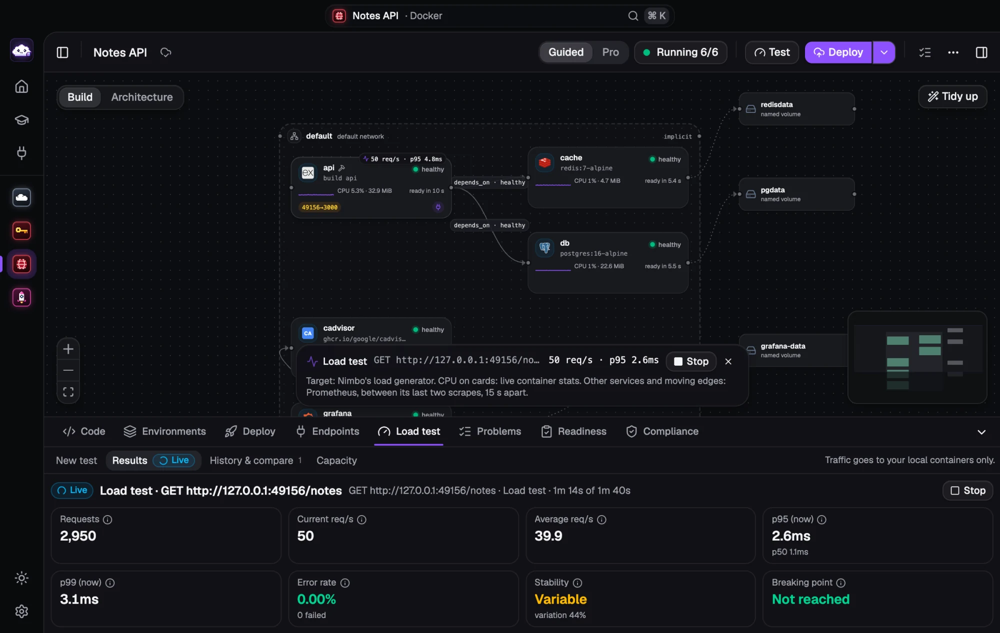
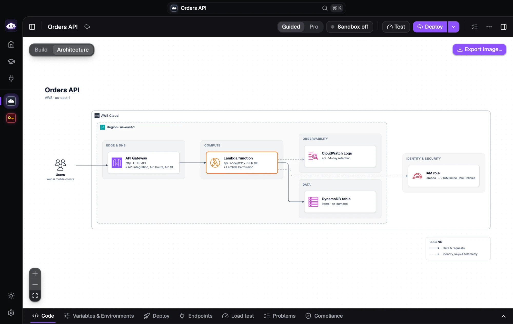
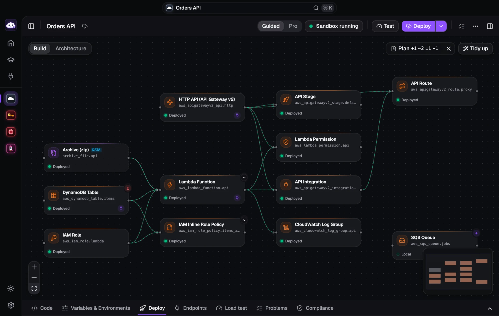
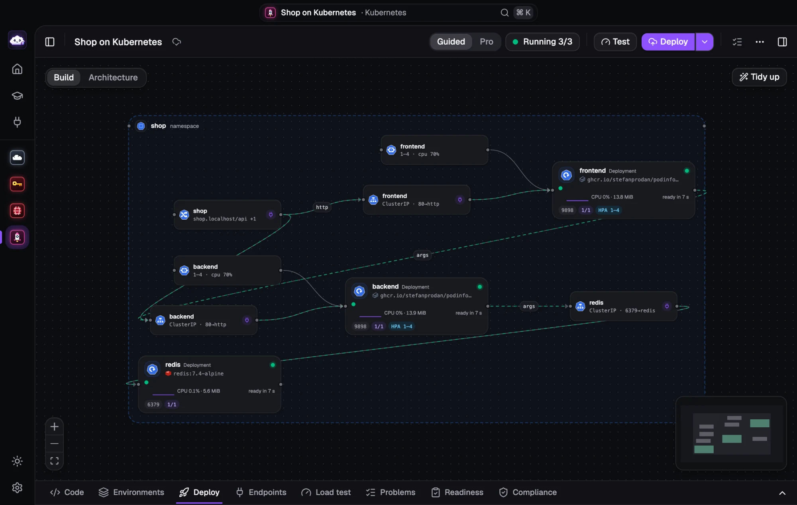
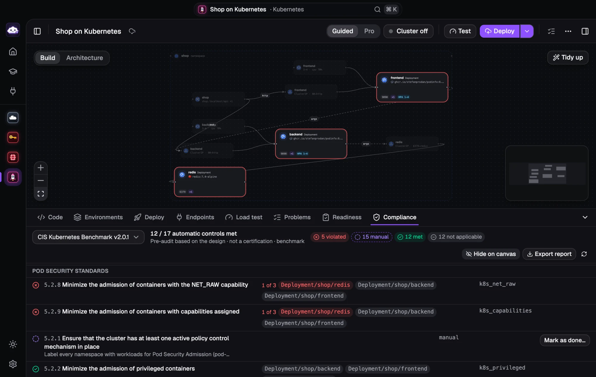

<div align="center">


# Nimbo

**Design, deploy and load-test cloud infrastructure, on your laptop.**

Draw it on a canvas (or let your AI agent build it), get real Terraform, docker-compose or Kubernetes out of it,<br/>
run it in a private local sandbox and see how it holds up under traffic. No real cloud account, no bill.

[](https://github.com/ismaelosuna7824/nimbo/releases/latest)
[](https://github.com/ismaelosuna7824/nimbo/actions/workflows/ci.yml)
[](LICENSE)


[**Download**](https://github.com/ismaelosuna7824/nimbo/releases/latest) ·
[Website](https://nimbo-hc.web.app) ·
[Install guide](docs/INSTALL.md) ·
[MCP for AI agents](docs/MCP.md) ·
[Architecture](docs/ARCHITECTURE.md)

<br/>



</div>

## ✨ What it does

|  |  |
|---|---|
| 🧩 **Design by connecting** | Every resource of the AWS, Azure, Google Cloud and OCI Terraform providers (≈5,200 types) is a card. Connect two cards and Nimbo does the wiring. *Guided* mode for beginners, *Pro* for every attribute, HCL and ⌘K. |
| 📦 **Docker & Kubernetes** | Open a docker-compose project, manifests, Kustomize or a Helm chart: the files stay the source of truth, edits are written back with comments kept. Kubernetes runs on a private k3s cluster per workflow. |
| 🏠 **Run it locally** | Each workflow gets its own Docker sandbox with the [Floci](https://floci.io) emulators it needs. Terraform runs inside it; cards show what is deployed. Your real account and `~/.kube/config` are never touched. |
| 📈 **Load test & break it** | Smoke, load, stress, spike and soak tests with live p95, errors and the breaking point, traffic flowing on the canvas, and failure tests (kill a replica, stop a dependency) with a verdict. |
| 🗺️ **See the plan** | `+ ~ ± −` on every card a Terraform plan changes, the attribute diff in the inspector, and a confirmation before a deploy destroys or replaces anything. |
| 🛡️ **Best practices built in** | Security, reliability, scaling, cost and operations checks, a CIS pre-audit for every cloud, Docker and Kubernetes, and a production-readiness score. |
| 🔁 **Terraform both ways** | Export clean, `terraform fmt`-ready files (modules, environments, a GitHub Actions or GitLab CI pipeline), or import a folder and get the diagram back. |
| 🖼️ **Architecture diagrams** | One click turns the design into a reference diagram with official icons. Export PNG, SVG, or an animated GIF/MP4 of requests flowing through it. |
| 🤖 **AI agents (MCP)** | 90+ tools let Claude, Cursor, Codex and friends design, deploy, test and review infra in Nimbo, guided by the Well-Architected frameworks. |
| 🎓 **Learn** | Roadmaps from beginner to expert and hands-on challenges for every cloud, Docker and Kubernetes, graded for real. |

<table>
  <tr>
    <td width="50%"></td>
    <td width="50%"></td>
  </tr>
  <tr>
    <td align="center"><sub>Architecture view</sub></td>
    <td align="center"><sub>The plan on the canvas</sub></td>
  </tr>
  <tr>
    <td width="50%"></td>
    <td width="50%"></td>
  </tr>
  <tr>
    <td align="center"><sub>Kubernetes on a local cluster</sub></td>
    <td align="center"><sub>CIS pre-audit</sub></td>
  </tr>
</table>

## 🚀 Get started

1. **Download** the app for your system from the [latest release](https://github.com/ismaelosuna7824/nimbo/releases/latest).
2. **Open it.** The first-run guide checks Docker and the sandbox images and fixes what it can with one click.
3. **Start from a template** (serverless API, queue worker, Node + Postgres + Redis, Kubernetes app…), press **Deploy** and try it.

| OS | File | First launch |
|---|---|---|
| macOS 12+ (Apple Silicon / Intel) | `Nimbo-macOS-universal.dmg` | Drag to Applications, then **System Settings → Privacy & Security → Open Anyway** |
| Windows 10/11 x64 | `Nimbo-Windows-x64-setup.exe` or `.msi` | SmartScreen: **More info → Run anyway** |
| Linux x86_64 / arm64 | `.AppImage`, `.deb`, `.rpm` | `chmod +x Nimbo-*.AppImage` (needs libfuse2), or install the package |

The builds aren't signed with a paid certificate, hence the one-time confirmation. Checksums and troubleshooting:
[docs/INSTALL.md](docs/INSTALL.md). Running sandboxes needs a Docker engine (Docker Desktop, OrbStack, Colima,
Rancher Desktop, Docker Engine or Podman); Terraform runs in a container, so you don't need it installed.
Installed apps update themselves.

## 🤖 Use it from your AI agent

In the app, open **Settings → AI agents (MCP)** and click **Install** next to Claude Code, Claude Desktop, Cursor,
Codex, VS Code, Windsurf or Gemini CLI. Or by hand:

```sh
claude mcp add --scope user nimbo -- /path/to/nimbo mcp
```

Then ask: *"Build this diagram in Nimbo, deploy it locally and load-test the API."* The agent sees the workflow you
have open, designs with secure and reliable defaults, reviews it against the Well-Architected pillars and deploys it
to your sandbox. Tools, prompts and examples: [docs/MCP.md](docs/MCP.md) ·
[docs/WELL_ARCHITECTED.md](docs/WELL_ARCHITECTED.md).

## 🧭 More features

<details>
<summary><b>Use what you deployed</b>: endpoints, snippets and <i>Try it</i></summary>

The Endpoints tab explains every deployed API, function, queue, topic, bucket and table in plain language, with
copyable URLs and identifiers, ready snippets (curl, AWS CLI, JavaScript, Python), a built-in *Try it* (send requests
and messages, read them back) and a one-click Postman collection. The sandbox address and test credentials stay the
same across restarts, so saved URLs keep working.
</details>

<details>
<summary><b>Load tests</b> in detail</summary>

Presets (smoke, load, stress, spike, soak, autoscale) or custom stages, open (req/s) or closed (virtual users)
model, against HTTP endpoints (API Gateway, Lambda URLs, any URL) or AWS operations (SQS, S3, DynamoDB, Lambda,
SNS, Kinesis, EventBridge, Step Functions). Live latency percentiles, error kinds, stability score, breaking point,
thresholds with pass/fail, history and run comparison. On Kubernetes, each autoscaled workload's replicas are charted
against p95 with a verdict on whether the HPA scaled in time.
</details>

<details>
<summary><b>Connections</b>: test services that already exist</summary>

A global library of services that live elsewhere: any HTTP/HTTPS API (headers, bearer, basic or API-key auth),
PostgreSQL, MySQL, Redis, MongoDB, or a real AWS account through a profile. Save once (secrets stay local), test the
connection and load-test it. Traffic that leaves the local sandbox always needs explicit confirmation.
</details>

<details>
<summary><b>Testing networks</b>: VPCs, subnets and security groups</summary>

Networks don't answer requests, so Nimbo tests them three ways:

1. **Configuration review.** Every save checks the design and lists issues under Problems → Network, with why and how
   to fix them: a subnet outside its VPC, overlapping CIDRs, a "public" subnet without a route to the internet
   gateway, a private subnet with no way out, a load balancer in a single availability zone, network ACLs that drop
   replies, and more. They never block a deploy.
2. **Reachability.** Pick *from* (the internet or a resource), *to*, protocol and port. Nimbo walks the path like AWS
   Reachability Analyzer (internet gateway, route table, network ACLs both ways, security groups, listeners and
   targets), shows each hop with ✓/✗ on the canvas and tells you what blocks the traffic.
3. **Live test.** **Add a test instance here** on a subnet adds a small EC2 web server. Deploy, then **Run live
   test**: Nimbo makes real connections and labels each hop *Verified live* or *Checked by analysis* (the emulator
   doesn't enforce every layer, so those stay analysis-only).
</details>

<details>
<summary><b>Environments, modules and CI/CD</b></summary>

Per-workflow variable values and process env vars (secrets masked), applied to runs and exported as tfvars, compose
overrides, Kustomize overlays or Helm values. Group resources into local modules with one click (`moved` blocks
included, so nothing is recreated). Export any workflow with a ready GitHub Actions or GitLab CI pipeline: checks on
every push, a plan per environment on pull requests, gated deploys with OIDC where the cloud supports it, and an
optional smoke check.
</details>

## 🛠️ Build from source

One command checks your computer, installs what's missing (asking first) and builds the app:

```sh
# macOS / Linux
git clone https://github.com/ismaelosuna7824/nimbo.git && cd nimbo && ./setup.sh
```

```powershell
# Windows (PowerShell)
git clone https://github.com/ismaelosuna7824/nimbo.git; cd nimbo
powershell -ExecutionPolicy Bypass -File .\setup.ps1
```

| Command | What it does |
|---|---|
| `./setup.sh` | Install prerequisites, build and install (default) |
| `./setup.sh dev` | Same checks, then start the app with hot reload |
| `./setup.sh build` | Rebuild everything |
| `./setup.sh doctor` | Check Docker, images, disk and network |

Options: `--yes` (no questions) and `--no-install` (only report). What it installs per OS and troubleshooting:
[docs/SETUP.md](docs/SETUP.md).

<details>
<summary><b>Develop</b>: tests, browser mode and repo layout</summary>

```sh
cd backend
go test ./...                                  # unit tests
go test -tags docker ./internal/sandbox/...    # real Floci integration tests
go run ./cmd/nimbo serve --addr 127.0.0.1:7788 # engine only

cd apps/desktop
bun run dev                                    # web UI in a browser (http://localhost:1420)
bun run test                                   # unit tests
bun run test:e2e                               # Playwright end-to-end tests
bun run tauri:build                            # desktop bundle
```

Data lives in `~/.nimbo` (override with `NIMBO_HOME` or `--home`); sandbox containers are named `nimbo-<workflow>-*`.

| Path | What |
|---|---|
| `backend/cmd/nimbo` | `nimbo serve` (HTTP + SSE engine), `nimbo mcp` (MCP over stdio) |
| `backend/internal/hclcodec` | Workflow ⇄ Terraform, edge derivation |
| `backend/internal/catalog` | Provider schemas, Floci support map, recipes, templates |
| `backend/internal/sandbox` | Per-workflow Docker sandbox and Terraform runs |
| `backend/internal/loadtest` | Load engine |
| `backend/internal/{api,store,events,mcp}` | REST API, persistence, SSE, MCP tools |
| `apps/desktop` | Tauri 2 + React + shadcn/ui + React Flow app |
| `apps/landing` | Website (Astro, Firebase Hosting): `cd apps/landing && bun run dev` |

CI runs on every push and pull request. Releases are automatic: every push to `main` with `feat`, `fix` or `perf`
commits ([Conventional Commits](https://www.conventionalcommits.org)) builds the installers, tags `vX.Y.Z` and
publishes the release. See [docs/RELEASING.md](docs/RELEASING.md).
</details>

## 📚 Docs

| | |
|---|---|
| [INSTALL](docs/INSTALL.md) · [SETUP](docs/SETUP.md) | Installing the app, building from source |
| [MCP](docs/MCP.md) · [WELL_ARCHITECTED](docs/WELL_ARCHITECTED.md) | AI agents: tools, prompts, best-practice guidance |
| [ARCHITECTURE](docs/ARCHITECTURE.md) · [TERRAFORM_FIDELITY](docs/TERRAFORM_FIDELITY.md) | How Nimbo works inside, contracts, verified Floci facts |
| [UX_GUIDELINES](docs/UX_GUIDELINES.md) | UI rules: what is visible when, status colors, destructive actions |
| [CONTRIBUTING-learn](docs/CONTRIBUTING-learn.md) | Adding Learn roadmaps and challenges |

## 📄 License

Nimbo is [MIT](LICENSE) licensed, made with 💜 by [Ismael Osuna](https://github.com/ismaelosuna7824).

<details>
<summary>Third-party icons</summary>

Cloud icons (AWS, Microsoft Azure, Google Cloud, Oracle Cloud Infrastructure) bundled for the Architecture view are not
covered by the MIT license; they stay under their owners' terms, see
[`icons/NOTICE.md`](apps/desktop/src/features/architecture/icons/NOTICE.md). Technology logos (Docker, Kubernetes,
nginx, Go, Node.js, PostgreSQL…) come from [Devicon](https://github.com/devicons/devicon) (MIT) and
[Simple Icons](https://github.com/simple-icons/simple-icons) (CC0); the marks remain their owners' trademarks, see
[`tech-icons/NOTICE.md`](apps/desktop/src/components/tech-icons/NOTICE.md). Kubernetes object icons are the
[Kubernetes community icon set](https://github.com/kubernetes/community/tree/master/icons) (Apache 2.0), see
[`k8s-icons/NOTICE.md`](apps/desktop/src/components/k8s-icons/NOTICE.md).
</details>
