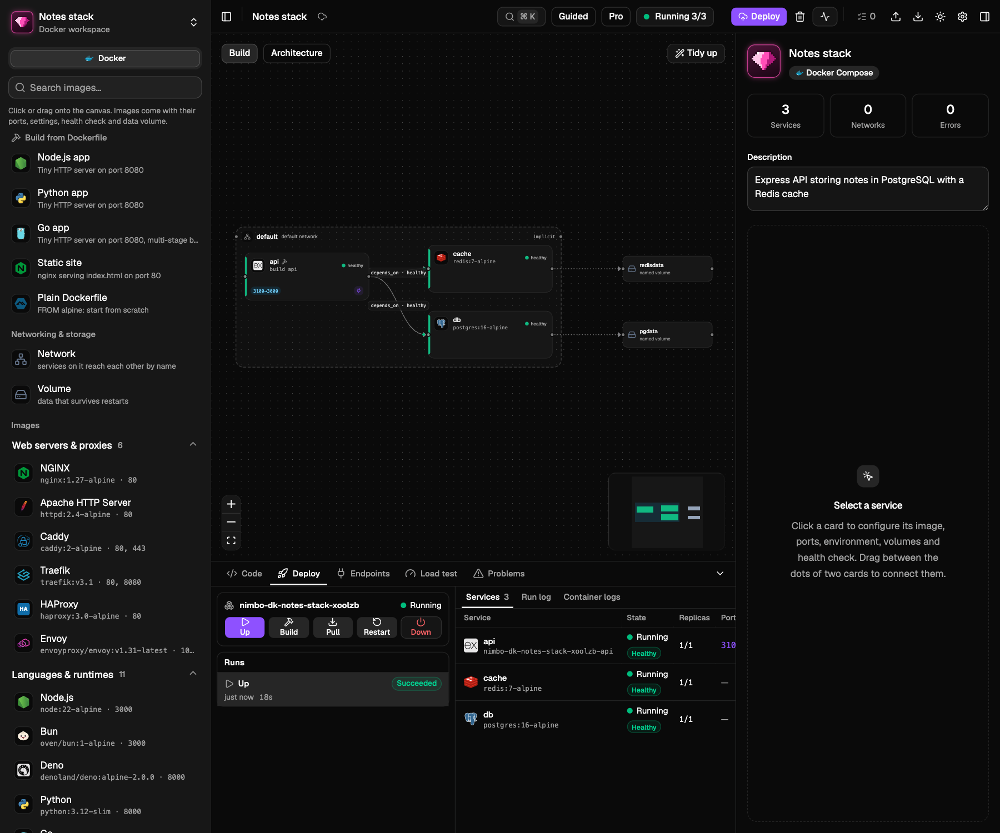

# Nimbo

A local ADE for infrastructure. Design cloud infrastructure by connecting
nodes on a canvas, get clean Terraform out of it (or import existing
Terraform into a diagram), deploy it into a private local
[Floci](https://floci.io) sandbox and load-test it — speed, stability and
capacity under different traffic volumes — without touching a real cloud
account. AI agents can do the same through the built-in MCP server.

- **Design**: React Flow canvas, every resource of the `aws`, `azurerm`,
  `google` and `oci` Terraform providers (≈5,200 resource types) with a
  schema-driven inspector. *Guided* mode for beginners (required fields,
  curated defaults, one-click connection recipes such as "SQS → Lambda
  trigger"); *Pro* mode for power users (every attribute, raw HCL
  expressions, meta-arguments, code editing, ⌘K command palette).
- **Terraform both ways**: export a workflow as idiomatic, `terraform fmt`
  clean files (plus per-environment `.tfvars`); import a Terraform folder and
  get the diagram back, edges derived from references.
- **Architecture diagram**: switch the canvas from *Build* to *Architecture*
  (⌘⇧A) for a read-only, shareable cloud diagram: official AWS/Azure/Google
  Cloud/OCI icons, nested cloud → region → VPC → AZ → subnet containers,
  logical service groups, users/internet actors, data-flow arrows, title and
  legend. Helpers stay out of the way: security groups, route tables, target
  groups and the like fold into the cards and subnets using them. Module
  calls are drawn as the services they create (one card per ECS service
  call, "ECS services (6)" groups), then export PNG (1–4×) or SVG.
- **Environments**: per-workflow variable values and process env vars
  (secrets masked), applied to runs and exported as tfvars.
- **Test locally**: each workflow gets its own Docker sandbox running the
  Floci emulators it needs (AWS `:4566`, Azure `:4577`, GCP `:4588`,
  OCI `:4599`); Terraform runs inside it. Nodes show what is deployed.
- **Use what you deployed**: the Endpoints tab explains every deployed
  API, function, queue, topic, bucket and table in plain language, with
  copyable URLs and identifiers, ready snippets (curl, AWS CLI, JavaScript,
  Python), a built-in *Try it* (send requests and messages, read them back)
  and a one-click Postman collection export. The sandbox address and test
  credentials stay the same across restarts, so saved URLs keep working.
- **Load test**: smoke / load / stress / spike / soak presets or custom
  stages, open (req/s) or closed (virtual users) model, against HTTP
  endpoints (API Gateway, Lambda URLs, any URL) or AWS operations (SQS,
  S3, DynamoDB, Lambda, SNS, Kinesis, EventBridge, Step Functions). Live
  latency percentiles, error kinds, stability score, breaking point,
  thresholds with pass/fail, history and run comparison.
- **Connections**: a global library of services that already exist
  elsewhere — any HTTP/HTTPS API (headers, bearer/basic/API-key auth),
  PostgreSQL, MySQL, Redis, MongoDB, or a real AWS account via an AWS
  profile. Save once (secrets stay local, never shown again), test the
  connection, and load-test it from the home screen or as a target in any
  workflow. Traffic that leaves the local sandbox always needs explicit
  confirmation.
- **Test networks**: a VPC on its own receives no traffic, so Nimbo checks
  it instead: a configuration review (Problems → Network) and a
  reachability analyzer ("can the internet reach my database on 5432?"),
  plus live tests against a one-click test instance. See
  [Testing networks](#testing-networks).
- **Docker workspaces**: open, import or create a docker-compose project
  (compose files with overrides, `include`, `extends`, profiles, plus
  Dockerfiles and `.env`, which stay the source of truth). Services show as
  cards with their technology's icon inside network frames, with
  `depends_on`, mount and inferred connection edges. You can add images from
  a curated palette or build from a starter Dockerfile, and drag between two
  cards to connect them ("Wait until healthy", connection settings, a
  network or a volume). Every edit is written back into the YAML with
  comments kept. The Code tab completes compose keys and Dockerfile
  instructions. *Deploy* runs `docker compose up` under a project name only
  Nimbo uses, with live state, logs, Endpoints *Try it* and load tests.

  
- **Kubernetes workspaces**: plain manifests, Kustomize (base + overlays per
  environment) and Helm charts (values per environment) as the source of
  truth. Objects show inside namespace frames with Kubernetes and
  technology icons, Service selector, Ingress and mount edges; a palette of
  starters, workloads from the image catalog and pinned Helm charts; edits
  written back with comments kept (Helm fields into the values file that
  drives them); schema-driven completion, `k8s_*` best-practice checks and
  quick fixes. *Deploy* runs on a local k3s cluster per workflow (a single
  Docker container; your `~/.kube/config` is never touched) with rollout
  state, logs, port-forwards, Ingress URLs and load tests with a resource
  verdict. *Convert to Kubernetes* turns a compose project into manifests,
  Kustomize or a Helm chart.
- **MCP**: 74 tools for agents (search → add → connect → validate → deploy →
  use what you deployed → check networks → load test → export, plus the
  Connections library, Docker and Kubernetes workspaces). See
  [docs/MCP.md](docs/MCP.md).

Architecture, contracts and verified Floci facts:
[docs/ARCHITECTURE.md](docs/ARCHITECTURE.md).

## Testing networks

Networks (VPCs, subnets, route tables, gateways, security groups) don't
answer requests, so there is nothing to load-test. Nimbo tests them in three
ways:

1. **Configuration review** — every save checks the design and lists issues
   in the Problems tab's **Network** group, each with why and how to fix it:
   a subnet outside its VPC, overlapping CIDRs, a "public" subnet without a
   route to the internet gateway, a private subnet whose Lambda/ECS/EKS has no
   way out (no NAT gateway or VPC endpoints), a NAT gateway in a private
   subnet, a load balancer in a single availability zone, network ACLs that
   drop replies, and more. They never block a deploy.
2. **Reachability** — select an instance, database, load balancer or subnet
   and click **Check reachability…**: pick *from* (the internet or a
   resource), *to*, protocol and port (presets for SSH, HTTP, HTTPS, MySQL,
   PostgreSQL, Redis). Nimbo walks the path like AWS Reachability Analyzer —
   internet gateway, route table, network ACL both ways, security groups,
   listeners and targets — and shows each hop with ✓/✗, highlights it on the
   canvas and tells you what blocks the traffic and how to fix it. The
   inspector's **Network** section explains each subnet (public, private or
   isolated, and why) and each security group. Once deployed, the analysis
   uses the sandbox's real addresses and IDs.
3. **Live test** — no instance to try? Use **Add a test instance here** on
   a subnet: it adds a small EC2 web server (port 80, a friendly page) and its
   security group. Deploy, open the Endpoints tab for its URL, then **Run
   live test** in the reachability dialog: Nimbo makes real connections
   (from your computer, between instances, or to the internet) and labels
   each hop *Verified live* or *Checked by analysis*. The local emulator only
   enforces some layers — it publishes a port only when a security group
   opens it, but it does not enforce security groups between instances,
   network ACLs or route tables — so those stay analysis-only, exactly as AWS
   would enforce them.

Public subnet = its route table sends internet traffic (0.0.0.0/0) to an
internet gateway; private = it goes out through a NAT gateway (outbound
only); isolated = no internet route at all. Security groups are stateful
(replies are allowed automatically); network ACLs are stateless (replies on
ports 1024-65535 need their own rule).

## Install

Download the app from the
[latest release](https://github.com/ismaelosuna7824/nimbo/releases/latest):

| OS | File | First launch |
|---|---|---|
| macOS 12+ (Apple Silicon/Intel) | `Nimbo-macOS-universal.dmg` | Drag to Applications, open it, then **System Settings → Privacy & Security → Open Anyway** (or `xattr -dr com.apple.quarantine /Applications/Nimbo.app`) |
| Windows 10/11 x64 | `Nimbo-Windows-x64-setup.exe` or `.msi` | SmartScreen: **More info → Run anyway** |
| Linux x86_64 / arm64 | `.AppImage`, `.deb`, `.rpm` | `chmod +x Nimbo-*.AppImage` (needs libfuse2), `sudo apt install ./Nimbo-*.deb` or `sudo dnf install ./Nimbo-*.rpm` |

The builds aren't signed with a paid certificate, hence the one-time
confirmation. Step-by-step instructions, checksums and troubleshooting:
[docs/INSTALL.md](docs/INSTALL.md). Running sandboxes needs Docker (see
below).

## Build from source

One command checks your computer, installs what's missing (asking first),
and builds the app:

```sh
# macOS / Linux
git clone https://github.com/ismaelosuna7824/nimbo.git && cd nimbo && ./setup.sh
```

```powershell
# Windows (PowerShell)
git clone https://github.com/ismaelosuna7824/nimbo.git; cd nimbo
powershell -ExecutionPolicy Bypass -File .\setup.ps1
```

It installs, only with your OK and from the official sources:

- **macOS**: Xcode Command Line Tools, Homebrew, Go 1.26+, Bun 1.4+, Rust.
- **Linux** (apt, dnf, pacman, zypper): the Tauri system libraries
  (WebKitGTK, …), Go 1.26+, Bun 1.4+, Rust.
- **Windows** (winget): Visual Studio C++ Build Tools, WebView2, Go 1.26+,
  Bun 1.4+, Rust.

Then it builds the backend (`backend/bin/nimbo`) and the desktop app
(`.app`/`.dmg`, `.deb`/`.rpm`/`.AppImage`, or `.msi`/`-setup.exe`), offers to
install the app and the `nimbo` CLI for AI agents, and runs `nimbo doctor`.

**Docker is not needed to build.** Open the app: its first-run guide checks
Docker and the sandbox images, explains anything missing in plain language and
fixes it with one click where it can.

| Command | What it does |
|---|---|
| `./setup.sh` | Install prerequisites, build and install (default) |
| `./setup.sh dev` | Same checks, then start the app in development mode (hot reload) |
| `./setup.sh build` | Rebuild everything (prerequisites already installed) |
| `./setup.sh doctor` | Check Docker, images, disk and network (`nimbo doctor`) |

Options: `--yes` (no questions) and `--no-install` (only report, change
nothing outside the repo). Windows: the same commands with `.\setup.ps1`,
`-Yes`, `-NoInstall`. Details and troubleshooting: [docs/SETUP.md](docs/SETUP.md).

### What Nimbo uses at runtime

- A Docker engine (Docker Desktop, OrbStack, Colima, Rancher Desktop, Docker
  Engine on Linux, or Podman with the `docker` CLI). Images pulled on first
  use: `floci/floci*`, `hashicorp/terraform`, `alpine:3`.
- No host Terraform needed; runs use the `hashicorp/terraform` image.

### Without the desktop shell

```sh
# backend + web UI in a browser
cd backend && go run ./cmd/nimbo serve --addr 127.0.0.1:7788
cd apps/desktop && bun run dev   # http://localhost:1420
```

Data lives in `~/.nimbo` (override with `NIMBO_HOME` or `--home`).
Sandbox containers and networks are named `nimbo-<workflow>-*`.

## Develop

```sh
cd backend
go test ./...                                  # unit tests
go test -tags docker ./internal/sandbox/...    # real Floci integration tests
go generate ./internal/catalog/...             # regenerate provider schemas

cd apps/desktop
bun run build                                  # tsc + vite
bun run test                                   # unit tests (bun test)
bun run test:e2e                               # Playwright end-to-end tests
bun run tauri:build                            # desktop bundle
```

CI (`.github/workflows/ci.yml`) runs these checks on every push and pull
request. Releases are automatic: every push to `main` with `feat`, `fix`,
`perf` or breaking-change commits (Conventional Commits) builds the macOS
universal, Windows x64 and Linux x86_64/arm64 installers, tags `vX.Y.Z` and
publishes the GitHub release; installed apps pick it up through the in-app
updater. See [docs/RELEASING.md](docs/RELEASING.md).

## Layout

| Path | What |
|---|---|
| `backend/cmd/nimbo` | `nimbo serve` (HTTP + SSE daemon), `nimbo mcp` (MCP stdio) |
| `backend/internal/hclcodec` | Workflow ⇄ Terraform, edge derivation |
| `backend/internal/catalog` | Embedded provider schemas, Floci support map, recipes, templates, validation |
| `backend/internal/sandbox` | Per-workflow Docker sandbox and Terraform runs |
| `backend/internal/loadtest` | Load engine |
| `backend/internal/{api,store,events,mcp}` | REST API, persistence, SSE, MCP tools |
| `apps/desktop` | Tauri 2 + React + shadcn/ui + React Flow app |
| `apps/landing` | Public website (Astro, Firebase Hosting) |

## Website

The landing page (English at `/`, Spanish at `/es/`) lives in
[`apps/landing`](apps/landing): Astro + Bun, static output for Firebase
Hosting, Google Analytics for Firebase only after cookie consent.

```sh
cd apps/landing && bun install && bun run dev   # http://localhost:4321
bun run deploy                                  # build + firebase deploy (see apps/landing/README.md)
```

## License

Nimbo is [MIT](LICENSE) licensed. Third-party cloud icons (AWS, Microsoft
Azure, Google Cloud, Oracle Cloud Infrastructure) bundled for the Architecture
diagram view are not covered by the MIT license; they stay under their owners'
terms — see
[`apps/desktop/src/features/architecture/icons/NOTICE.md`](apps/desktop/src/features/architecture/icons/NOTICE.md).
Technology logos (Docker, Kubernetes, nginx, Go, Node.js, PostgreSQL…) come from
[Devicon](https://github.com/devicons/devicon) (MIT) and
[Simple Icons](https://github.com/simple-icons/simple-icons) (CC0); the marks
remain their owners' trademarks — see
[`apps/desktop/src/components/tech-icons/NOTICE.md`](apps/desktop/src/components/tech-icons/NOTICE.md).
Kubernetes object icons (Deployment, Service, Ingress…) are the
[Kubernetes community icon set](https://github.com/kubernetes/community/tree/master/icons)
(Apache 2.0) — see
[`apps/desktop/src/components/k8s-icons/NOTICE.md`](apps/desktop/src/components/k8s-icons/NOTICE.md).
