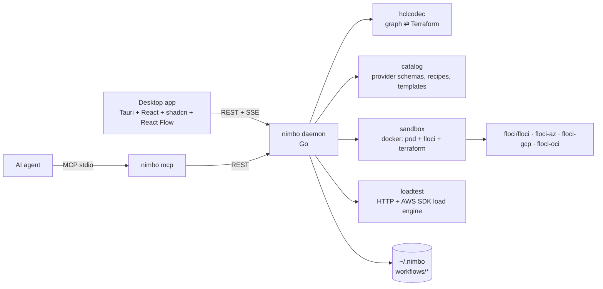

# Nimbo — Architecture

Nimbo is a local "ADE for infrastructure": design infrastructure as a node
graph, export/import it as Terraform, deploy it into a per-workflow Floci
sandbox and load-test it — all on the developer machine.



## Repository layout

| Path | Owner package | Purpose |
|---|---|---|
| `backend/cmd/nimbo` | main | `nimbo serve` (HTTP daemon), `nimbo mcp` (MCP stdio server), `nimbo doctor [--json]` (setup checks; exit 1 when not ready) |
| `backend/internal/model` | model | Shared domain types = wire contract |
| `backend/internal/hclcodec` | hclcodec | Workflow ⇄ HCL, value normalization, edge derivation |
| `backend/internal/cicd` | cicd | CI/CD pipeline an export can include (GitHub Actions / GitLab CI) for Terraform, Docker and Kubernetes workflows; see "CI/CD pipeline export" below |
| `backend/internal/catalog` | catalog | Embedded provider schemas, curated metadata, Floci support map, connection recipes, templates, schema validation |
| `backend/internal/lint` | lint | Best-practice checks (`bp_*` info/warning diagnostics with why + fix), run on every save after schema validation; see "Best-practice checks" below |
| `backend/internal/compliance` | compliance | Security benchmarks (CIS Foundations per cloud, CIS Docker, CIS Kubernetes) mapped onto the best-practice rules, grading of a design, attestations of manual controls, Markdown report; see "Compliance" below |
| `backend/internal/wellarch` | wellarch | Curated Well-Architected guidance per platform (AWS, Azure, GCP, OCI, Docker, Kubernetes) by pillar, cross-referenced to rule codes; see "Well-Architected" below |
| `backend/internal/codeguide` | codeguide | Application-code guidance per mode, language, style, platform and target (MCP `code_guidelines`): principles, `services/<svc>/` layout, buildable starter files (smoke handlers, hexagonal skeletons), packaging with Terraform snippets, compute options with local support, OpenSpec guide; see [CODE_GUIDELINES.md](CODE_GUIDELINES.md) |
| `backend/internal/netcheck` | netcheck | Network model of a workflow (deployed state or statically evaluated design), `net_*` configuration checks, reachability analyzer and live probes; see "netcheck" below |
| `backend/internal/sandbox` | sandbox | Per-workflow Docker sandbox, Terraform runs in containers, deployed state |
| `backend/internal/loadtest` | loadtest | Load engine, presets, target suggestions, results persistence |
| `backend/internal/endpoints` | endpoints | "How to use what you deployed": per-resource summaries, host URLs/identifiers, runnable snippets, "Try it" executor, Postman export |
| `backend/internal/compose` | compose | Docker workflows: compose/Dockerfile parsing (compose-go for the effective model, yaml node trees for locations), graph derivation, `dk_*` checks, comment-preserving write-back, image palette, docker templates |
| `backend/internal/store` | store | Workflow persistence on disk |
| `backend/internal/events` | events | SSE hub implementing `model.Publisher` |
| `backend/internal/api` | api | HTTP handlers, orchestration |
| `backend/internal/mcp` | mcp | MCP tools calling the daemon REST API |
| `backend/internal/learn` | learn | Learn content (roadmaps + challenges) and progress in `<home>/learn.db` (SQLite, pure-Go `modernc.org/sqlite`), fed by embedded content migrations; see "Learn" below |
| `backend/internal/settings` | settings | User preferences in `<home>/settings.json` (mode, docker, images, default AWS region) |
| `backend/internal/setup` | setup | Onboarding diagnostics (`GET /setup`, `nimbo doctor`), OS-tailored fixes, one-click actions (start Docker, pull images), PATH augmentation |
| `backend/internal/agents` | agents | Detects AI agent apps and installs/removes the `nimbo` MCP server in their configs |
| `apps/desktop` | — | Tauri 2 shell + React app; spawns `nimbo` as sidecar |

Go module: `github.com/ismaelosuna7824/nimbo/backend` (Go 1.26).

## Core decisions

1. **Single source of truth = Workflow JSON** (`model.Workflow`). Terraform is
   generated from it; imports produce it. Edges are *derived* from
   expressions (`aws_sqs_queue.q.arn` inside a node body ⇒ edge), never stored
   independently. Connecting two nodes in the UI = setting an attribute
   expression (or adding helper nodes through a curated recipe).
   `Workflow.Mode` is the build mode: `""`/`architecture` (infrastructure plus
   smoke handlers) or `full` (real application code); unlike `Kind` it may
   change. Application code and specs are workflow files (`services/<svc>/…`,
   `openspec/…`), never inline in Terraform.
2. **Values carry both forms**: `expr` (canonical HCL source) and `literal`
   (JSON when constant). Beginners edit literals through typed forms; power
   users edit raw expressions. The backend fills the missing side on save.
   **`expr` is authoritative when both are present**: a client that edits a
   literal MUST send `{literal}` without `expr`; a client that edits an
   expression sends `{expr}` without `literal`.
3. **Sandbox = pod pattern.** Per workflow: docker network `nimbo-<wf>`, a
   `alpine` "pod" container `nimbo-<wf>-pod` that owns the network namespace
   and publishes emulator ports on fixed `127.0.0.1:<hostPort>` ports (see
   "Stable host ports" below); every emulator
   (`nimbo-<wf>-aws`, …) and every Terraform run (`hashicorp/terraform`)
   joins with `--network container:nimbo-<wf>-pod`. Inside the pod every
   emulator is `localhost:<native port>`, which matches the URLs Floci
   returns (`FLOCI_BASE_URL` default). Floci-spawned containers (Lambda,
   RDS…) join `nimbo-<wf>` via `FLOCI_SERVICES_DOCKER_NETWORK`. Verified
   manually: Lambda + API Gateway v2 deploy and invoke from host through
   `http://127.0.0.1:<hostPort>/execute-api/<apiId>/$default/<path>`.
4. **Terraform runs in a container** (`hashicorp/terraform`) with a shared
   plugin cache volume `nimbo-tf-plugins`. No host Terraform needed; identical
   on every OS; Azure's self-signed TLS cert is trusted through
   `SSL_CERT_DIR` inside the Linux container.
5. **Floci provider wiring is injected only at run time** (override files in
   the run workdir). Exported Terraform stays clean and cloud-ready.
6. **Catalog is embedded and generated at build time** from
   `terraform providers schema -json` (aws, azurerm, google, oci), trimmed and
   gzipped. Curated metadata (labels, categories, icons, basic fields,
   defaults, recipes, templates) is layered on top. Every provider resource is
   available; Floci support is computed from a resource-prefix → Floci service
   map and refined with the live `/_floci/health` service list.

## Floci facts (verified 2026-10-17, floci 2.3.0)

| Cloud | Image | Port | Health | Reset | Terraform wiring |
|---|---|---|---|---|---|
| AWS | `floci/floci:latest` | 4566 | `GET /_floci/health` → `{services:{key:"running"}, version}`; readiness `GET /_floci/init` → `completed.ready` | `POST /_floci/state/reset` | env `AWS_ENDPOINT_URL=http://localhost:4566`, `AWS_ACCESS_KEY_ID=test`, `AWS_SECRET_ACCESS_KEY=test`; provider override `s3_use_path_style=true`, `skip_credentials_validation`, `skip_metadata_api_check`, `skip_requesting_account_id` |
| Azure | `floci/floci-az:latest` | 4577 | `GET /health` → `{status:"UP"}`; `GET /ready` | `POST /_admin/reset` | needs `FLOCI_AZ_TLS_ENABLED=true`; cert `GET /_floci/tls-cert`; provider `environment="stack"`, `metadata_host="localhost:4577"`, fake subscription/tenant/client ids, `skip_provider_registration=true` (v3) / `resource_provider_registrations="none"` (v4), `use_cli=false` |
| GCP | `floci/floci-gcp:latest` | 4588 | `GET /_floci-gcp/health` | `POST /_floci-gcp/state/reset` | `GOOGLE_OAUTH_ACCESS_TOKEN=fake`; `TF_VAR_gcp_emulator_host=nimbo-<wf>-pod:4588` (the emulator as Cloud Run containers reach it; they get only `PORT`/`K_*` and their localhost is themselves); `*_custom_endpoint` per service (storage `/storage/v1/`, pubsub/kms/secret_manager/iam_beta/service_usage/resource_manager/cloud_scheduler `/v1/`, cloud_run(_v2)/cloudfunctions2 `/v2/`, sql `/sql/v1beta4/`, big_query `/bigquery/v2/`, container `/container/v1/`, compute `/compute/v1/`). hashicorp/google(-beta) < 7.26 (lock file) strips versions only from `https://` endpoints, so client-library resources requested doubled paths (404): there sql/resource_manager/service_usage point at `/` and container at `/container/`; `google_sql_database` still fails on those versions (run warning). Cloud SQL runs a real `postgres`/`mysql` container per instance at `first_ip_address`. Not deployable: Cloud Tasks (gRPC only), Logging sinks/metrics and Monitoring alert policies/channels (no REST routes), KMS key/key-ring IAM (no `getIamPolicy`), Cloud Run env `value_source` (400), Cloud Functions v1 and Cloud Run v1 (`google_cloud_run_service`, knative API) return 404; Cloud Functions v2 has no update (re-applies with a diff fail). The catalog ignores floci-gcp's health service list (it names gRPC-only and unwired APIs) |
| OCI | `floci/floci-oci:latest` | 4599 | `GET /_floci-oci/health` | `POST /_floci-oci/state/reset` | env `TF_VAR_CLIENT_HOST_OVERRIDES="oci_identity.IdentityClient=http://localhost:4599;oci_object_storage.ObjectStorageClient=http://localhost:4599;…"` (floci-oci README; other clients follow the same pattern); fake tenancy/user/fingerprint + any generated RSA key (signatures not verified); `disable_auto_retries=true` |

Lambda Function URL path form: `/lambda-url/<urlId>/<path>`. API Gateway v1:
`/restapis/<id>/<stage>/_user_request_/<path>`; v2: `/execute-api/<id>/<stage>/<path>`
(or `Host: <id>.execute-api.localhost.floci.io:4566`).

Floci-spawned containers carry label `floci=true`; teardown removes every
container attached to `nimbo-<wf>`.

## Go package contracts

These signatures are the integration contract between packages. Types not
prefixed come from `internal/model`.

### hclcodec

```go
// Address returns "aws_s3_bucket.b", "data.aws_iam_policy_document.p" or "module.vpc".
func Address(n *model.Node) string

// Normalize fills Value.Expr/Literal pairs (also in Environments), assigns
// missing node IDs (from address), derives wf.Edges and wf.Clouds, and
// returns syntax/reference diagnostics (unknown reference, duplicate address,
// invalid expression, invalid recorded file name). It does not validate
// against provider schemas.
func Normalize(wf *model.Workflow) []model.Diagnostic

// Export renders wf as Terraform files. Every top-level block carries an
// optional file (Node.File, NamedBlock.File, Block.File for Other) and
// source position (…Order). Every source `locals`/`terraform` block is a
// model.BlockPart (Workflow.LocalsBlocks/TerraformBlocks) and each of their
// items (Workflow.Locals, Workflow.Terraform attrs/blocks) names its part
// with File/Order, so several such blocks stay separate:
//   - recorded (import, or moved by the user): the block is written to that
//     file; blocks with a position come first in source order, so an
//     imported project keeps its own file split and block order; blocks
//     without one (new, or moved into the file) follow, data sources/
//     resources/modules in dependency order, then address; new locals and
//     terraform items join the last part of the file holding most parts;
//   - empty: Nimbo's recommended layout, recomputed on every export —
//     versions.tf (terraform), providers.tf, variables.tf, locals.tf,
//     outputs.tf, data.tf (data sources), one file per catalog category for
//     resources (opts.ResourceFile: network.tf, compute.tf, containers.tf,
//     storage.tf, database.tf, messaging.tf, api.tf, iam.tf, security.tf,
//     monitoring.tf, analytics.tf, ai.tf, devtools.tf, cost.tf) and main.tf
//     (module calls, other blocks, uncategorized resources). With at most 5
//     resources, data sources and resources all go to main.tf. Next to
//     recorded files a new block joins the file holding most recorded
//     blocks of its class (same category, variables, …). Unrecorded data
//     sources/resources are ordered by dependency (wf.Edges), then address.
// Files with no content are omitted. Comments (model.Comments) are written
// back where Import found them. With opts.Environments, also writes each
// environment's values to its Environment.File (the root variable file it
// was imported from, e.g. "terraform.tfvars") or
// "environments/<name>.tfvars", and "environments/<name>.env.example"
// (keys; secret values blank). Deterministic: same workflow, same bytes.
func Export(wf *model.Workflow, opts ExportOptions) (map[string][]byte, error)
type ExportOptions struct {
	Environments bool
	ResourceFile func(resourceType string) string // catalog.ResourceFile; nil: resources in main.tf
}

// Layout / NodeFiles report where Export writes every block (api finalize
// stores NodeFiles in the derived wf.NodeFiles). PinFiles records the
// current placement (what re-importing the export gives); UnpinFiles clears
// it (templates start from the recommended layout). ValidFileName accepts
// root *.tf names Terraform loads (no folders, hidden or override files).
func Layout(wf *model.Workflow, resourceFile func(string) string) Placement
func NodeFiles(wf *model.Workflow, resourceFile func(string) string) map[string]string
func PinFiles(wf *model.Workflow, resourceFile func(string) string)
func UnpinFiles(wf *model.Workflow, resourceFile func(string) string)
func ValidFileName(name string) error

// Format formats HCL like `terraform fmt` (hclwrite.Format, LF endings) once
// it parses; CheckSyntax returns the syntax errors as "parse_error"
// diagnostics located in name; IsHCLFile: *.tf, *.tfvars, *.hcl. NewModule
// renders a new local module's files (versions.tf with the workflow's
// required_version and providers as >= minimums, providers adding the
// catalog entry of a cloud the root does not require; variables.tf,
// outputs.tf, main.tf, README.md) and the block calling it with source.
func Format(name string, src []byte) ([]byte, []model.Diagnostic)
func CheckSyntax(name string, src []byte) []model.Diagnostic
func IsHCLFile(name string) bool
func NewModule(wf *model.Workflow, name, source string, providers []model.ProviderInfo) (files map[string][]byte, call string)

// ExportLayout renders wf in its export layout (ResolveLayout): Export for
// "single", ExportEnvironments for "environments". ResolveLayout is
// wf.EffectiveLayout() (auto: "environments" with >= 2 environments), with an
// automatic "environments" falling back to "single" when
// CheckEnvironmentsLayout fails (environment name unusable as a directory,
// provider config reading a resource); an explicit one fails instead.
// ExportEnvironments writes modules/<ServiceName(wf)>/ (the workflow's
// blocks; no provider blocks; required_providers as >= minimums with
// configuration_aliases; environment-specific variables without default;
// local module sources "../<name>"; path.root -> path.module) and per
// environment (EnvironmentNames: sorted; "default" without any)
// environments/<env>/{backend.tf (workflow backend or the cloud default,
// partial, key/prefix per env), versions.tf (~> pins, required_version
// raised for use_lockfile/oci), providers.tf, variables.tf, locals.tf
// (what providers read), main.tf (module call, providers map when aliased,
// import/removed blocks prefixed module.<service>.), outputs.tf (re-export)}
// plus, with opts.Environments, terraform.tfvars (non-secret values) and
// .env.example (env vars + TF_VAR_<sensitive>=). AssetPlacement maps a
// workflow asset to its export paths (env layout: modules/** stay, the lock
// file goes to every root, the rest into the service module).
func ExportLayout(wf *model.Workflow, opts ExportOptions) (map[string][]byte, error)
func ResolveLayout(wf *model.Workflow) (string, error)
func ExportEnvironments(wf *model.Workflow, opts ExportOptions) (map[string][]byte, error)
func CheckEnvironmentsLayout(wf *model.Workflow) error
func ServiceName(wf *model.Workflow) string // wf.Service, else snake_case(wf.Name)
func EnvironmentNames(wf *model.Workflow) []string
func AssetPlacement(wf *model.Workflow) func(rel string) []string
func RequiredVersion(wf *model.Workflow) string // the Terraform constraint the export needs: the roots' required_version raised to what the backend (or backend.tf.example) needs
func HasBackend(wf *model.Workflow) bool         // a backend or cloud block

// ImportEnvironments parses an environments-layout tree (slash paths:
// modules/<svc>/*.tf, environments|envs/<env>/{*.tf, terraform.tfvars,
// *.auto.tfvars, .env.example}) into ONE workflow: Layout "environments",
// Service <svc>, the service module's blocks, the first root's providers
// and terraform settings (backend with the environment taken out of its key;
// dropped when it is the cloud default), root import/removed/moved blocks
// without the module prefix, one environment per root (tfvars + module
// call arguments + .env.example). IsEnvironmentsTree tells such a tree from
// root files. MergeEnvironmentsTree completes MergeImported for a code edit
// of that tree (environments stay the app's; removed defaults restored).
func ImportEnvironments(name string, files map[string][]byte) (*model.Workflow, []model.Diagnostic, error)
func IsEnvironmentsTree(files map[string][]byte) bool
func MergeEnvironmentsTree(prev, next *model.Workflow, fromTree []model.Environment)

// Scaffold renders the project files of wf's layout. Single: README.md
// (terraform-docs style: description, usage, "State & environments",
// requirements, providers, modules, resources with their file, inputs,
// outputs), .gitignore, terraform.tfvars.example (every variable; sensitive
// ones blank) and backend.tf.example (the cloud's partial remote backend;
// only without a backend). Environments: README.md (tree, usage, Make
// targets, state per environment), .gitignore (commits terraform.tfvars and
// the lock file), Makefile (init/plan/apply/validate ENV=, fmt),
// modules/<svc>/README.md and environments/<env>/backend.hcl.example. Each
// starts with a marker line: IsScaffold (by base name) recognizes them so a
// folder import of an export skips them. The API generates them only where
// the workflow has no file of that name (a README that came with an import
// wins). Readme also documents local modules (ReadmeOptions.ModuleSource).
// builds (DetectBuilds of the exported files, computed by api.exportBuilds)
// add a "Build the services" README section (ServiceBuildScript for dists;
// build, push and `export TF_VAR_<svc>_image=…` per image, flagging image
// variables the workflow doesn't declare), a `**/services/*/dist/`
// .gitignore entry for dists and, in the environments layout, a Makefile
// `build` target that `plan` and `apply` depend on.
func Scaffold(wf *model.Workflow, resourceFile func(string) string, builds Builds) map[string][]byte
func Readme(wf *model.Workflow, opts ReadmeOptions) []byte
func IsScaffold(name string, content []byte) bool

// ServiceBuilds returns the <...>/services/<svc> folders (sorted) whose
// Dockerfile has a `package` stage and whose dist any string of the .tf
// files refers to (archive_file source_dir for Lambda / Azure Functions /
// Cloud Functions / OCI zips, fileset uploads, paths inside dist): files
// maps slash paths relative to the root module to .tf files and service
// Dockerfiles. Used by the sandbox before each run and by the export.
func ServiceBuilds(files map[string][]byte) []string
func ServiceBuildCommand(dir string) string    // docker build --target package --output type=local,dest=<dir>/dist <dir>
func ServiceBuildScript(dirs []string) string  // rm -rf <dir>/dist + ServiceBuildCommand per folder
func HasPackageStage(dockerfile []byte) bool

// ServiceImages (C5): every `nimbo.local/<svc>` in a string of the .tf/.tfvars
// files is an image built from the shallowest services/<svc>/Dockerfile
// (the root's first), target `runtime` when that stage exists, else the
// last stage; problems: no such folder, or a last stage `package` without
// `runtime`. ImageVariable(svc) = svc with '-'/'.' as '_' + "_image".
func ServiceImages(files map[string][]byte) (images []ServiceImage, problems []string)
type ServiceImage struct{ Name, Dir, Target string } // Ref() = nimbo.local/<Name>:latest
func ImageVariable(name string) string
func ImageBuildCommand(s ServiceImage, ref string) string
type Builds struct{ Dists []string; Images []ServiceImage }
func DetectBuilds(files map[string][]byte) Builds // problems dropped

// Import parses Terraform files (path -> content; only root-level *.tf and
// *.tfvars plus environments/*.tfvars and environments/*.env.example are
// interpreted) into a new workflow. Every block records its file and
// position; each locals/terraform block becomes a BlockPart. Each
// *.tfvars file becomes an
// environment named after the file (terraform.tfvars -> "default",
// prod.auto.tfvars / environments/prod.tfvars -> "prod"; a taken name falls
// back to the file name); root files keep their name in Environment.File.
// environments/<name>.env.example fills that environment's EnvVars (created
// if needed; blank value => Secret). Override files and *.tf.json are not
// interpreted (warning "unsupported_file"; the folder import keeps them as
// assets). CRLF becomes LF. Comments are kept on the attribute/block they
// belong to (lead lines, same-line, block tail/end, end of file).
// Node positions are left with Positioned=false.
func Import(name string, files map[string][]byte) (*model.Workflow, []model.Diagnostic, error)

// ExprFromLiteral / LiteralFromExpr convert between value forms.
func ExprFromLiteral(lit json.RawMessage) (string, error)
func LiteralFromExpr(expr string) (json.RawMessage, bool)

// ValidateExpr reports a syntax error in a standalone expression.
func ValidateExpr(expr string) error

// MergeImported carries app-only data from prev into next (a fresh Import of
// edited code): node IDs, positions, labels, parents matched by address;
// environments, active environment, layout, service name, workflow
// ID/name/description/createdAt.
// Every block stays in the file it was written in. Blocks prev laid out
// automatically stay automatic while they remain in that file, and new
// blocks written where the layout would put them too, unless the layout
// of next would then move them or their file keeps recorded blocks.
func MergeImported(prev, next *model.Workflow, resourceFile func(string) string)

// RenameNode sets a node's name and rewrites every reference to its old
// address (bodies, depends_on, outputs, locals, providers, moved.to; not
// moved.from/removed.from); a moved block left moving an address to itself
// is dropped. Errors on unknown node, invalid name or taken address. Node
// IDs are unchanged; call Normalize afterwards. It adds no moved block for
// the rename: AddMoved does (the API, when the old address is deployed).
func RenameNode(wf *model.Workflow, nodeID, newName string) error

// AddMoved adds `moved { from = m.From  to = m.To }`; a block in the
// opposite direction is dropped instead, a duplicate kept once, and blocks
// already moving something to m.To are re-pointed to m.From (a chain).
//
// Renaming a deployed node: PATCH .../nodes/{id} with a new name reads the
// sandbox state (cached) first; when the old address of a resource or
// module call has instances there (aws_x.old, aws_x.old[0], aws_x.old["k"],
// module.old.*), it adds moved old -> new so the next plan moves it instead
// of destroying and recreating it (MCP update_node renames the same way).
// Undeployed nodes get none. Successive renames before a deploy collapse
// into one block from the deployed address (RenameNode rewrites moved.to);
// renaming back removes it; renaming again after a deploy chains (old ->
// mid, mid -> new). Data sources never get one. Resources inside local
// modules are edited as code, not renamed on the canvas, so their moved
// blocks are the user's.
func AddMoved(wf *model.Workflow, m model.MovedAddress)

// Summarize parses one directory's *.tf files (cheap; used by folder scans):
// resource/data counts, module calls (constant source/version), providers,
// clouds, backend presence and parse diagnostics.
func Summarize(files map[string][]byte) Summary

// IsLocalModuleSource / ResolveLocalSource classify and resolve "./x", "../x".
func IsLocalModuleSource(source string) bool
func ResolveLocalSource(dir, source string) string

// RewriteModuleSources rewrites constant module `source` values in one .tf
// file through hclwrite; every other byte is preserved.
func RewriteModuleSources(filename string, src []byte, newSource func(string) (string, bool)) ([]byte, bool, error)
```

Module refactoring (`extract.go`, `inline.go`):

```go
// ExtractModule moves nodes (IDs or addresses) into a new local module
// modules/<name> called from the root in their place. Inbound references
// (moved blocks -> other root nodes, var.*, local.*) become input
// variables passed by the call, typed from the referenced attribute's
// provider schema, else from the attribute they feed, else from the root
// variable, else "string"/"number"/"bool" for a root local whose value is a
// string template or literal (local.name_prefix -> string), else `any`, and
// described. Outbound references (root -> moved
// blocks) become described outputs read as module.<name>.<output> (whole
// objects for indexed/splat/for_each use; sensitive when the schema says
// so). depends_on on a moved block becomes depends_on = [module.<name>];
// depends_on from a moved block to the root moves to the call. Non-default
// provider aliases are passed with providers = {} (listing every
// configuration) and declared as configuration_aliases. One root `moved`
// block per moved resource/module call (the whole resource, so
// count/for_each instances move too); an existing moved block in the
// opposite direction is dropped. A file or folder moved blocks read through
// "${path.module}/<path>" (or path.root; the literal up to the last complete
// segment, a whole services/<svc> folder for anything under it) moves into
// modules/<name>/ with them (AssetMoves; the API moves what exists in the
// assets) and keeps ${path.module}, so the paths hold in both export
// layouts and in the sandbox; files the root still reads (or paths that
// can't be told) stay and are read through path.root. Import `to` addresses are prefixed. The module renders with
// Export (recommended layout, File unset) plus Readme. The call node sits
// at the centroid of the moved nodes. Errors (wf unchanged): invalid or
// taken name, unknown node, lifecycle.replace_triggered_by crossing the
// boundary, a provider configured from moved blocks that they use, and
// depends_on rewrites that would form a cycle.
func ExtractModule(wf *model.Workflow, refs []string, name string, opts ExtractOptions) (*Extraction, error)
type ExtractOptions struct {
    Schema       SchemaLookup               // Attribute(kind, type, attr) (AttrInfo, bool); HasSensitive(kind, type)
    ResourceFile func(resourceType string) string
}
type Extraction struct {
    model.ModuleExtraction           // preview: inputs, outputs, moved, providers, dependsOn, files
    Contents   map[string][]byte     // "modules/<name>/main.tf" -> bytes
    NodeID     string                // the module call node
    AssetMoves []AssetMove           // {From, To}: "services/worker" -> "modules/<name>/services/worker"
}
// InlineModule is the reverse for a local module called once without
// count/for_each: var.* become the call's arguments (or defaults;
// parenthesized when needed), module.<name>.<out> the output expressions,
// depends_on = [module.<name>] lists the inlined blocks, the call's
// depends_on goes to each inlined block, the providers map is applied,
// path.module templates whose file moves back become the root's
// ("${path.module}/services/worker/src" stays; AssetMoves
// modules/<name>/<path> -> <path>, unless rootHas reports the path taken or
// the root reads it: then "${path.module}/<dir>/<path>"), other path.module
// uses become "${path.module}/<dir>", nested local sources are
// re-rooted, module locals join the root's, missing required_providers are
// added, and moved blocks go module.<name>.<addr> -> <addr>. Rejects
// provider blocks or moved/import/removed blocks inside the module,
// optional() variable types, address/local clashes and whole-module
// references. files: the module directory's files.
func InlineModule(wf *model.Workflow, nodeRef string, files map[string][]byte, rootHas func(rel string) bool) (*Inlining, error)
func ValidModuleName(name string) error                 // snake_case
func LocalModuleDir(n *model.Node) (string, bool)       // "modules/x" for a constant local source inside the workflow
func TypeConstraint(raw json.RawMessage) string         // provider schema cty type JSON -> "list(string)"
```

### cicd (CI/CD pipeline export)

```go
func ParseProvider(s string) (string, error) // "" / "none" -> "", "github", "gitlab"; else an error (API: 400)
// Files renders the pipeline of wf for an export: generated are the files
// the export generates (a README.md there gets the section appended), own
// the workflow's files exported as they are. The result replaces files
// with the same path.
func Files(wf *model.Workflow, generated map[string][]byte, own map[string]bool, opts Options) (map[string][]byte, error)
type Options struct{ Provider string; Smoke bool; Builds hclcodec.Builds }
```

`api.exportPipeline` calls it after `exportFiles` for the folder export, the
zip and MCP `export_terraform` (`ci`, `smoke`). Output: the pipeline
(`.github/workflows/<workflow name slug>.yml` or `.gitlab-ci.yml`) and its
documentation: a "GitHub Actions pipeline" / "GitLab CI pipeline" section
appended to the generated README.md, a new README.md when the export has
none, or `CI.md` when the workflow has its own README. Jobs are described
once (provider-neutral `job`: stage, trigger, tools, settings, steps) and
rendered as yaml node trees per provider, so names and scripts cannot break
the document. The file's header comment and the README table list every
secret/variable the jobs read (required or optional).

- **Triggers.** Checks run on every push and pull/merge request; plans and
  renders on pull/merge requests; deploys on pushes to the default branch
  (GitHub also `workflow_dispatch`). GitLab runs merge request pipelines for
  merge requests and branch pipelines otherwise, never both.
- **Environments.** One plan/deploy job per environment (Terraform
  `EnvironmentNames` in the environments layout, the workflow's
  environments otherwise; docker: compose environments; Kubernetes:
  overlay/values environments; `default` without any). Deploys chain:
  others first, then staging-like (staging, stage, stg, uat, preprod), then
  production (`model.ProdLike`). GitHub deploy jobs run in a GitHub
  `environment:` of that name (protection rules, environment-scoped
  settings); pull request jobs read repository-level values. GitLab deploy
  jobs use `environment:` (plans `action: prepare`, smoke `action: verify`,
  for scoped variables), production-like ones are `when: manual` with
  `allow_failure: false`. Deploys are serialized per environment (GitHub
  `concurrency`, GitLab `resource_group`).
- **Terraform.** `terraform fmt -check -recursive` + validate of every root
  (`make validate ENV=<env>`; single layout: `init -backend=false`). The
  environments layout runs `make init|plan|apply ENV=<env>`; the single
  layout plain `terraform init/plan/apply` with a workspace per environment
  when it has two or more (`terraform workspace select -or-create`) and
  `-var-file=<env file>` when committed. `TF_BACKEND_CONFIG` (backend.hcl
  contents) is written to `backend.hcl`; the single layout copies
  `backend.tf.example` to `backend.tf` when none is committed. Without it a
  partial backend fails init with what to set, and a single-layout apply
  fails instead of applying into a throwaway local state. With
  `Options.Builds` (service folders from `api.exportBuilds`) every
  Terraform job builds them first: a "Build services" step with
  `hclcodec.ServiceBuildScript` (environments layout: `make build` in
  validate, `make plan`/`apply` build through the Makefile). GitHub uses the
  runner's Docker and Buildx; GitLab Terraform jobs get a `docker:29-dind`
  service (`DOCKER_HOST=tcp://docker:2376`, TLS certs) and `apk add
  docker-cli docker-cli-buildx` (privileged runners). With
  `Options.Builds.Images` an `images` job (pushes to the default branch,
  before every apply) builds each image and pushes
  `$IMAGE_REGISTRY/<svc>:<commit>` (`docker login` to the registry host
  when `REGISTRY_USERNAME`/`REGISTRY_PASSWORD` are set; a warning and no
  push while `IMAGE_REGISTRY` is unset), and every plan exports
  `TF_VAR_<svc>_image` with that reference when the registry is set. It is
  plain `docker build`/`docker push` on both providers, like the compose
  pipeline's image job. The plan text is
  an artifact (GitHub: also the run summary; GitLab: `expose_as` on the
  merge request). Terraform is pinned from `hclcodec.RequiredVersion`
  (raised to what the state backend needs): an exact pin, the newest patch
  of a minor (`~> 1.9.0`, `< 1.10`), else latest (setup-terraform version /
  `hashicorp/terraform:<tag>`). Credentials only for `wf.Clouds`: AWS role
  through OIDC (`aws-actions/configure-aws-credentials`; GitLab `id_tokens`
  + `AWS_WEB_IDENTITY_TOKEN_FILE`), Azure OIDC (`azure/login`,
  `ARM_USE_OIDC`; GitLab `ARM_OIDC_TOKEN`), Google workload identity
  federation (`google-github-actions/auth`; GitLab an `external_account`
  credentials file), OCI API key variables. Sensitive variables come from
  `TF_VAR_<name>` secrets.
- **Docker Compose.** `docker compose config --quiet` per environment (base
  files + override, `.env` then the environment's env file when present).
  Services with `build:` declared in the base files are built with
  `docker compose build` through `.ci-images.compose.yaml` (written by the
  job: `image: ${IMAGE_PREFIX}/<service>:${IMAGE_TAG}`) and pushed to GHCR /
  the GitLab registry from the default branch. Deploy over SSH
  (`DEPLOY_HOST`, `DEPLOY_SSH_KEY`, optional `DEPLOY_KNOWN_HOSTS`,
  `DEPLOY_PATH`; skipped with a warning while unset): `git archive HEAD` to
  the host, then `docker compose -f … -f compose.<env>.yaml pull` and
  `up -d --no-build` there (`up -d --build` when nothing builds).
- **Kubernetes.** Render every source per environment (`kubectl kustomize
  <overlay>`, `helm template` with the values files, manifests as they
  are) and check them with `kubeconform -ignore-missing-schemas`; deploy
  with `kubectl apply -k`, `helm upgrade --install --create-namespace
  --wait` and `kubectl apply -f` in source order, using the environment's
  `KUBECONFIG` (GitHub: secret contents; GitLab: File variable). Images
  Nimbo builds for its local cluster (`Builds`) are listed in the header:
  they must be pushed to a registry first.
- **Smoke check** (`smoke`): after each deploy, `curl --retry` every URL of
  the environment's `SMOKE_URL` (skipped with a warning while unset; on
  GitHub the deploy job passes its environment's value as a job output so
  the check needs no second approval). Load tests need the daemon, so they
  stay in the app.

Tests parse every generated file, run `actionlint` (with shellcheck when
installed) on the GitHub workflows and skip that with a log line when it is
missing.

### catalog

```go
func Load() (*Catalog, error) // embedded data only; fast (lazy per-provider decompression ok)
func (c *Catalog) Providers() []model.ProviderInfo
func (c *Catalog) Search(q Query) []model.ResourceSummary
type Query struct {
    Text string; Cloud model.Cloud; Kind model.NodeKind; Category string
    SupportedOnly bool; PopularOnly bool; Limit int
}
func (c *Catalog) Categories(cloud model.Cloud) []string
func (c *Catalog) Schema(kind model.NodeKind, typ string) (*model.ResourceSchema, bool)
func (c *Catalog) CloudOf(typ string) (model.Cloud, bool) // by provider prefix
// ResourceFile names the recommended file of a resource type from its
// category: "network.tf", "compute.tf", "containers.tf", "storage.tf",
// "database.tf", "messaging.tf", "iam.tf" (Identity), "security.tf",
// "monitoring.tf" (Observability), "analytics.tf", "ai.tf", "devtools.tf",
// "cost.tf"; API gateways/AppSync/API Management -> "api.tf"; "" (main.tf)
// for "Other" and non-cloud providers. Passed as hclcodec ExportOptions.ResourceFile.
func (c *Catalog) ResourceFile(typ string) string
// AddNode appends a node of typ to wf (unique name derived from typ when name
// is ""), prefilled with curated defaults for required attributes. For
// curated starters it may also append helper nodes (e.g. Lambda adds an
// archive_file data source and an IAM role) laid out near pos. It ensures wf
// has a required_providers entry and a provider block for the node's cloud.
// Returns the ID of the primary node.
func (c *Catalog) AddNode(wf *model.Workflow, kind model.NodeKind, typ, name string, pos model.Position) (string, error)
// StarterFiles returns the workflow files a node's curated starter reads
// (slash path -> content; nil when none): the Lambda starter's archive_file
// zips services/<name>/src (source_dir) and ships
// services/<name>/src/index.mjs. POST /workflows/{id}/nodes writes them into
// the workflow's assets for every node it added, keeping existing files.
func (c *Catalog) StarterFiles(n *model.Node) map[string][]byte
func (c *Catalog) Connections(wf *model.Workflow, sourceID, targetID string) []model.ConnectionRecipe
func (c *Catalog) Connect(wf *model.Workflow, sourceID, targetID, recipeID string) error
func (c *Catalog) Validate(wf *model.Workflow) []model.Diagnostic
func (c *Catalog) SetLiveServices(cloud model.Cloud, services map[string]string)
func (c *Catalog) Templates() []model.Template
func (c *Catalog) TemplateFiles(id string) (map[string][]byte, bool) // root *.tf files for hclcodec.Import (the API then UnpinFiles: templates get the recommended layout) plus asset files in subfolders (function sources), which template creation and challenge starters store as workflow assets
// Code editor data: every resource/data type (utility providers included,
// Local = live Floci support), Schema extended to provider configuration
// blocks (kind KindProvider = "provider", name "aws"), the built-in
// functions, a cheap type check and ValidateProvider (Validate's rules on a
// provider block; alias/version are meta-arguments).
func (c *Catalog) Types() []model.TypeInfo
func (c *Catalog) SchemaOf(kind model.NodeKind, name string) (*model.ResourceSchema, bool)
func (c *Catalog) Functions() ([]model.FunctionSignature, error)
func (c *Catalog) HasType(kind model.NodeKind, typ string) bool
func (c *Catalog) ValidateProvider(name string, b *model.Body) []model.Diagnostic
```

Catalog notes:

- Data: `backend/internal/catalog/data/<provider>.json.gz` (aws, azurerm,
  google, oci, plus utility providers archive and random; each with the
  schema of its `provider` block), `index.json.gz` and `functions.json.gz`
  (`terraform metadata functions -json`, `core::` aliases dropped) are
  regenerated with `go generate ./internal/catalog/...` (host terraform,
  docker `hashicorp/terraform` fallback); `go run ./internal/catalog/gen
  -out internal/catalog/data -pin` regenerates at the versions of the
  existing index. Curated labels, icons (lucide
  kebab-case), categories, Floci service map, starter bodies and needs live
  in `catalog/curated/*.json` (a starter's `files`: workflow files it
  reads, see StarterFiles); templates in `catalog/templates/<id>/`: root
  `*.tf` files plus asset files. Templates never inline application code:
  each Lambda's handler is `services/<svc>/src/index.mjs` zipped by a
  `data "archive_file"` with `source_dir = "${path.module}/services/<svc>/src"`
  (aws-serverless-api, aws-queue-worker, aws-scheduled-job,
  aws-step-functions; aws-api-gateway's service functions share
  `services/service/src` and get their name and records from
  `SERVICE_NAME`/`SERVICE_RECORDS`, its authorizer is
  `services/authorizer/src`). In the environments layout the assets move
  into the service module with the archive_file (hclcodec.AssetPlacement),
  so the `path.module` paths stay valid.
- `Query.Limit` 0 means 200. Utility providers are not listed by
  `Providers`/`Search` but have schemas and validate.
- AddNode starters never contain Floci endpoints. Provider blocks: aws
  `region`, azurerm `features {}`, google `project = var.gcp_project`
  (default `floci-local`), oci `region`; OCI resources use
  `var.compartment_ocid` (default: local Floci tenancy).
- Provider versions (`compat.go`, `curated/provider_compat.json`): one
  entry per embedded provider (`Load` fails when one is missing, unknown or
  listed twice) with `localMinimum` — the oldest release verified on the
  Floci emulators for the services Nimbo emulates — and `issues` — known
  broken ranges `{versions: constraint, services: resource types (trailing
  `*` = prefix; none = every resource), message, fix}`. `ProviderCompat` /
  `ProviderCompats` add `source` and `catalog` (the embedded schema's
  release) from the index and `recommended` = `~> <catalog major>.<catalog
  minor>`: the lower bound is the schema release, so every attribute and
  block Nimbo validates and offers exists in whatever init installs, and the
  upper bound stops before the next major (renames/removals, no embedded
  schema); it is derived, so regenerating the schemas moves it. AddNode
  writes it into `required_providers` and every template's `versions.tf`
  uses it (test: the catalog release satisfies each template constraint,
  which allows no release below `localMinimum` or inside any issue range).
  `CheckConstraint(constraint, types)` (`OtherMajor`, `BelowMinimum`,
  `Issues`, `Broken` = every allowed release is bad) decides with
  hashicorp/go-version over probe releases around every version the
  constraints mention; `CheckVersion` judges a locked release; `Status` →
  `ok`, `outdated` (misses the catalog's major, allows or locks releases
  below the minimum or in an affecting issue range) or `broken-locally`
  (the locked release, or every allowed one, is inside an affecting issue
  range). Issues whose range contains the catalog release (emulator gaps,
  `AffectsCatalog`) are skipped by the lint rule (`WithoutGaps`: no
  recommended constraint avoids them) but still set the status and the run
  warnings, whose fix is the issue's own; the types they break are not
  local (`ResourceSummary.flociSupported`, `TypeInfo.local` false, and
  Validate's `floci_unsupported` carries the issue's message and fix).
  Verified 2026-10-28 (floci 2.3.0,
  floci-az 0.15.0, floci-gcp 0.11.0, floci-oci 0.5.0; apply, empty re-plan,
  destroy through the sandbox): aws 5.100.0/6.0.0/6.69.1 ok → minimum
  5.100.0; azurerm 3.117.1 fails (storage account static website
  properties), 4.0.0 hangs creating a storage account, 4.9.0/4.81.0 ok →
  minimum 4.9.0 + issue `< 4.9.0` for `azurerm_storage_account`; google
  6.50.0/7.0.0/7.25.0 ok except `google_sql_database` (400 "uploadId is
  required"), 7.26.0/7.46.1 ok → minimum 7.26.0 + issue `< 7.26.0`; oci
  8.29.0 … 9.10.0 ok for buckets, queues, streams, KMS and vault, functions
  ok up to 9.2.0 and 404 from 9.3.0 (Functions API 20260325) → minimum
  8.29.0 + gap `>= 9.3.0` for `oci_functions_*`; archive 2.0.0/2.8.1 and
  random 3.0.0/3.9.1 ok. How the table is verified and kept current:
  PROVIDER_COMPAT.md.
- Recipe IDs: curated (`sqs-lambda`, `apigwv2-lambda`, `sns-sqs`,
  `lambda-uses-dynamodb_table`, `lambda-log-group`, `s3-require-tls`,
  `cloudfront-s3-oac`, `azure-resource-group`, …), grant recipes
  `access:read|write|manage` (group `access`, see [access](#access-permission-editors)),
  generic `ref:<target|source>:<attr>:<sourceAttr>` (the node holding the
  attribute), and `depends_on` (target depends on source). Curated and grant
  recipes are also offered when dragging in the reverse direction.
- Validate codes: `unknown_type`, `unknown_attribute`, `unknown_block`,
  `readonly_attribute`, `missing_attribute`, `missing_block`,
  `too_many_blocks` (errors); `deprecated_attribute`, `floci_unsupported`
  (warnings).

### access (permission editors)

Visual editors for every provider's permission model, plus one shared grant
interaction: drag an identity onto a resource (card onto card, or handle to
handle) and answer **What can it do? Read / Write / Manage**; Nimbo writes
least privilege in that provider's own model.

```go
// package access: structured views of a Terraform node's permissions.
func View(wf *model.Workflow, n *model.Node) (*model.AccessView, error)   // ErrUnsupported → 404
func Apply(wf *model.Workflow, n *model.Node, edit model.AccessEdit) error // EditError → 400
func Catalog(provider string, q CatalogQuery) (*model.AccessCatalog, error)
func Register(p Provider)                        // aws, azure, gcp, oci (one file each)
func RegisterCatalog(provider string, fn CatalogFunc)
// package catalog: grants as connect recipes "access:<level>".
type accessGranter interface {
    plans(c *Catalog, wf *model.Workflow, a, b *model.Node) []accessPlan // either orientation
    apply(x *conn, p accessPlan) error
}
// package kube: RBAC views/edits and grants as kube connect recipes.
func (p *Project) RBACView(o *Object) (*model.KubeAccessView, error)
func (e *Editor) ApplyRBAC(o *Object, edit model.KubeAccessEdit) error
```

| Provider | Editor (inspector "Access" section) | Grant (identity → resource) writes | Warnings |
|---|---|---|---|
| AWS | Policy documents of `aws_iam_role_policy`/`aws_iam_policy`/user/group policies, `aws_iam_role` (trust policy, inline policies, related attachments), `data.aws_iam_policy_document`, S3/SQS/SNS resource policies: statement cards (effect, actions with a picker per service, resources via Link to… + ARN suffix `/*` `:*`, principals; Condition/Not* read-only) | A statement with the curated least-privilege actions for the level, scoped to the resource ARN (log groups `"${arn}:*"`, S3 objects `"${arn}/*"` + `ListBucket` on the bucket), merged into the role's first editable inline policy or a new `aws_iam_role_policy`. Identities: role, Lambda function (its role), ECS task definition (task role), IAM user/group. Other types: actions from the Service Authorization Reference for that resource type (never `service:*`) | `aws_admin`, `aws_wildcard_action`, `aws_wildcard_resource`, `aws_public_principal` |
| Azure | `azurerm_role_assignment`: who (identities of the graph incl. `identity[0].principal_id`), role (built-in roles, suggested per scope type, privileged flagged), scope (Link to…) | A role assignment with the level's built-in role (e.g. Key Vault Secrets User / Officer / Administrator) at `scope = <resource>.id`; adds `identity { type = "SystemAssigned" }` when the workload has none | `azure_privileged_role`, `azure_broad_scope` |
| GCP | `google_*_iam_member` / `_binding`: members (type + value or Link to…, service agents of the project), predefined role picker, resource; condition read-only | `google_<resource>_iam_member` with the level's predefined role and `member = "serviceAccount:${<sa>.email}"` (Cloud Run/Functions/VMs/GKE resolve their service account) | `gcp_basic_role`, `gcp_public_member`, `gcp_project_scope`, `gcp_service_account_user`/`_admin` (info) |
| OCI | `oci_identity_policy` statements as sentences: Allow [subject] to [verb] [resource-type] in [tenancy \| compartment] [where …], with pickers and Link to… | A statement (read → read, write → use, manage → manage; buckets/objects, keys, vaults and secrets scoped with `where target.*.name/id = …`) appended to the compartment's editable policy, or a new `oci_identity_policy` | `oci_manage_all`, `oci_tenancy_scope`, `oci_any_user`, `oci_manage_verb` (info) |
| Kubernetes | Role/ClusterRole rules (API group + resource pickers, resourceNames, verb toggles), bindings (roleRef, subjects), ServiceAccount (token automount), workload "Identity" section | Kube recipes `access:read|write|manage` (workload or ServiceAccount → object): ServiceAccount (when on `default`) + Role `<identity>-<level>-<object>` with `resourceNames: [name]` (read get/list/watch, write + update/patch, manage + delete) + RoleBinding + `serviceAccountName`; later grants extend the same Role. `access:bind` (→ Role/ClusterRole), `access:role` (its own empty Role) | `k8s_cluster_admin`, `k8s_wildcard`, `k8s_cluster_scope`, `k8s_secrets_access`, `k8s_default_sa`, `k8s_token_automount` (info) |
| Docker | No IAM: the service form's **Hardening** section (non-root user, drop all capabilities, read-only filesystem + tmpfs, no-new-privileges, init, not privileged, secrets as files) through `PATCH …/compose/services/{name}` | — | the `dk_*` findings (`dk_root_user`, `dk_hardening`, `dk_privileged`, `dk_secret_env`) |

Rules every editor follows:

- **Round trip.** Editors parse what exists (`jsonencode({...})`, JSON
  strings and heredocs, policy-document blocks, statement lists, YAML) and
  write back only what changed: untouched statements, rules and attributes
  stay byte-identical (each carries its `source`).
- **Never destroy.** What an editor can't represent (for expressions,
  `local`/function values, Condition blocks, Endorse/Admit statements, Helm
  templates, Kustomize patches…) is shown read-only with **Edit in code** and
  kept verbatim; `Apply` refuses edits to it (400).
- **Least privilege by default.** Grants scope to the one resource;
  "Manage" is still that resource only. Warnings are part of the view, not
  lint rules, so challenge grading is unchanged.
- **Pinned official reference data** (`GET /access/catalog/{provider}`), each
  with source URL and retrieval date and a generator under
  `backend/internal/access/gen/<provider>`: AWS Service Authorization Reference
  (`servicereference.us-east-1.amazonaws.com`, all services and actions with
  access level and resource types), Azure built-in roles (Microsoft Learn),
  GCP predefined roles (Google Cloud IAM roles reference), OCI verbs and
  resource types (OCI Policy Reference), Kubernetes resources and verbs
  (Kubernetes API `swagger.json` and the RBAC docs).

### codeintel (code editor checks)

```go
// Check reports the problems of one file while it is edited. files: every
// .tf file of the workflow by workflow path, unsaved edits applied.
// Syntax errors (hclsyntax) are errors and end the check; otherwise
// warnings: catalog.Validate/ValidateProvider on the file's blocks located
// at the attribute name (missing ones at the block header), and references
// to undeclared var./local./module./data./resources of the file's
// directory, unknown outputs of local modules and unknown resource
// attributes. Reference checks are skipped while another file of the
// directory does not parse.
func Check(cat *catalog.Catalog, files map[string][]byte, file string) []model.CodeProblem
```

### lint (best-practice checks)

```go
func Rules() []model.BestPracticeRule // GET /best-practices/rules
func Check(wf *model.Workflow, cat *catalog.Catalog, cfg model.BestPracticeSettings, mods *model.ModuleTree) []model.Diagnostic // normalized wf; info/warning only
func LocalModules(wf *model.Workflow, dir string, read func(dir string) (map[string][]byte, error)) (*model.ModuleTree, error)
func Structure(wf *model.Workflow, mods *model.ModuleTree) model.StructureSummary // GET /workflows/{id}/structure
func Strip(diags []model.Diagnostic) []model.Diagnostic // without bp_* findings
func IsFinding(d model.Diagnostic) bool
```

The API's `save` runs `Check` after `Normalize` + `Validate` (and `GET
/workflows/{id}` re-runs it, so Settings toggles apply without an edit);
module views are not checked. `mods` are the local modules the workflow
calls, nested calls included, read from its files by `LocalModules` (each
directory parsed and normalized once; only when the workflow calls a local
module; registry/remote module code is never read). Findings carry `detail` (why) and `fix`, never
severity `error`, so plan/apply are never refused for them. Settings:
`bestPractices: {disabled, disabledRules, enabledRules}` (codes `bp_[a-z0-9_]+`, sorted,
deduplicated). Opt-in rules (`DefaultOff`) run only when listed in
`enabledRules`, so Problems stays quiet on designs that don't follow
benchmark-only practices; compliance grading runs them anyway (see
Compliance).
The desktop Problems tab groups Errors / Warnings / Best
practices / Network (`net_*`, see netcheck); node badges and tab counts
ignore `info`.

Rules (warnings: `bp_sensitive_not_marked`, `bp_provider_version` (its fix
names the recommended constraint for embedded providers),
`bp_provider_local_compat` — a `required_providers` constraint of an embedded
provider (matched by type and source) that can't select the catalog's major,
or allows releases below `LocalMinimum` or inside a known issue range that
breaks one of the workflow's resource types; the message says what breaks
(another major: the schema Nimbo validates against differs, here and on the
real cloud), the fix gives the exact recommended constraint plus
`terraform init -upgrade`; no constraint is left to `bp_provider_version`,
unparseable ones are ignored —,
`bp_open_ingress` — SSH, Telnet, RDP, SMB (445) and database ports; findings
carry `facet` = the exposed ports ("22,3389", or "all"), read by
`lint.ExposesPort` so compliance controls about one port count only theirs —,
`bp_public_bucket` — public intent = website configuration
or a `Public = "true"` tag/label —, `bp_unencrypted_storage` — S3/DynamoDB
findings are info —, `bp_iam_wildcard`; info: `bp_variable_type`,
`bp_variable_description`, `bp_output_description`, `bp_required_version`,
`bp_hardcoded_region`, `bp_hardcoded_az`, `bp_hardcoded_account_id`,
`bp_missing_tags` (AWS/GCP: one finding per provider configuration without
`default_tags`/`default_labels`; Azure: per resource), `bp_name_prefix`
(only when `local.name_prefix` exists, for types with a curated `naming`
attribute), `bp_log_retention`, `bp_large_file` (> 15 resources in one file),
`bp_module_candidate` (≥ 5 resources of one logical group — network
foundation, data tier, API, container service, Kubernetes cluster — in a
workflow of ≥ 12; fix suggests `extract_module`), `bp_duplicate_literal`
(same configuration-like literal in ≥ 3 resources).

Structure rules (docs/MCP.md "Structure" has the target layout and the
sources). Module rules report on the root module call the module is reached
through:

| Rule | Severity | Trigger |
|---|---|---|
| `bp_module_version_unpinned` | warning | Registry module without `version`; git source (`git::`, `github.com/`, `.git`) without `?ref=` or with a branch ref (`main`, `master`, `HEAD`, …); in the root and in local modules |
| `bp_provider_in_module` | warning | A `provider` block with settings in a local module (an empty or alias-only proxy block, or `configuration_aliases`, is fine) |
| `bp_module_thin_wrapper` | info | A local module called from the root with exactly one managed resource and no module calls (single-resource submodules a module composes internally are its design) |
| `bp_module_nesting_depth` | info | A local module call deeper than 2 levels below the root as exported (one level less in the environments layout, whose service module is the first level); one finding per root call |
| `bp_module_output_missing` | info | A local module resource that exports more than `id` (ARN, URL, name) and that no output reaches: neither referenced by an output (directly or through locals) nor connected by references to a resource that is (attachments, policies and associations count through their parent; data sources only connect when they read a managed resource) |
| `bp_inline_sg_rules` | info (warning when both styles target the same group) | `aws_security_group` with inline `ingress`/`egress` where the same root or local module also uses standalone rules (`aws_security_group_rule`, `aws_vpc_security_group_ingress_rule`/`_egress_rule`). Inline-only code is not flagged: it is consistent, used by the `aws-vpc-basics` template and `add_test_instance`, and the "always" variant only adds noise |
| `bp_inline_function_code` | info (pillars operations + reliability; on by default; not in the corpus noise counts below) | Function code embedded in Terraform, in the root or a local module (one finding per block): a static `source` block of `data "archive_file"` (the zip every cloud's functions deploy) or a `file` block of `azurerm_function_app_function` whose `content` is program code — two or more non-blank lines, one of them an import/export, a function/class/variable definition, `module.exports`, `using …;` or a shebang (a constant string, or the literal text of a template, `${…}` left out). Configuration content (a JSON line, YAML), `dynamic` blocks and content Nimbo can't read (`file()`, `templatefile()`, references) are not flagged. Fix: move the code to `services/<svc>/src/` workflow files and zip them with `source_dir = "${path.module}/services/<svc>/src"` (Azure: deploy that zip with `zip_deploy_file`); code that needs a build gets a `services/<svc>/Dockerfile` ending in a `FROM scratch AS package` stage and `source_dir` points at `services/<svc>/dist`. VM bootstrap scripts (`user_data`, `custom_data`, `startup-script`) are not function code and are not flagged |
| `bp_no_remote_backend` | info | ≥ 2 environments exported in the single layout (`hclcodec.ResolveLayout`: `layout: "single"`, or auto falling back because the workflow can't be split, the reason then in the fix) and no `backend`/`cloud` block: every environment would share one local state. The environments layout writes a `backend.tf` per environment, so a workflow in it needs no backend block and is not flagged |
| `bp_state_too_large` | info ≥ 50, warning ≥ 100 | Managed resource instances in one state: the root plus local modules, constant `count`/`for_each` expanded, conditionals with an empty branch (`var.create ? 1 : 0`) counted as absent, other unknown sizes once; registry modules not counted |
| `bp_workspace_branching` | info | `terraform.workspace` in any expression of the root or a local module (one finding listing the places) |
| `bp_count_over_list` | info (category `reliability`, pillars reliability + operations; on by default; not in the corpus noise counts below) | A resource or module call (root or local module; data sources skipped) with `count = length(L)` whose body indexes the same `L` with `count.index` (`L[count.index]`, `element(L, count.index)`, also inside templates and nested blocks; compared whitespace-insensitively). `L` is a variable, a local or a literal list; lists read from resources, data sources or module outputs are skipped (they may be unknown at plan time, where `for_each` can't be used). Toggles (`var.create ? 1 : 0`), constant counts and lists only counted (`cidrsubnet(…, count.index)`) are not flagged. Why: removing or reordering an element shifts every later index, so those instances are destroyed and recreated. Fix: `for_each = toset(L)` / `each.value` (a map keyed by a stable id for objects) plus `moved` blocks from `addr[i]` to `addr["<element>"]`, spelled out exactly when `L` is a literal list, a local with a literal value or a variable with a literal default of distinct strings. The AWS learn solutions' `count = length(local.azs)` subnets get it as an info finding; their `rules_clean` checks are code-specific or `minSeverity: warning`, so they stay passing |
| `bp_emulator_host_loopback` | warning (category `reliability`, pillars reliability + operations; on by default; not in the corpus noise counts below) | An emulator address for app code (`PUBSUB_EMULATOR_HOST`, `STORAGE_EMULATOR_HOST`, `FIRESTORE_EMULATOR_HOST`, `DATASTORE_EMULATOR_HOST`, `SPANNER_EMULATOR_HOST`, `BIGTABLE_EMULATOR_HOST`, `AWS_ENDPOINT_URL*`) set to a constant loopback host (`localhost`, `127.0.0.0/8`, `::1`, `localhost.floci.io`, `*.localhost.floci.io`) in the environment of `google_cloud_run_v2_service`/`_job`, `google_cloudfunctions2_function`, `aws_lambda_function`, `aws_ecs_task_definition` (`jsonencode` or JSON heredoc `container_definitions`), `azurerm_container_app` or `azurerm_linux_function_app` (map entries and `name`/`value` pairs, also in nested blocks), or in a workflow environment's variable value (e.g. `extra_env = { PUBSUB_EMULATOR_HOST = "localhost.floci.io:4588" }`; reported on the environment and variable). References are not flagged. Why: inside a container localhost is the container itself, so the client can't reach the emulator and publishing hangs. Fix: GCP — `variable "gcp_emulator_host"` (default `""`) passed only when set (Nimbo sets `TF_VAR_gcp_emulator_host = nimbo-<wf>-pod:4588` in the sandbox); AWS — remove `AWS_ENDPOINT_URL*` (Floci injects it) |

Noise, measured with `go test -tags corpus ./internal/tfqa/ -run
TestCorpusBestPractices` on the 48 public corpus roots (2026-10-18; the
structure rules re-measured 2026-10-20 with the local modules each root calls,
read from its repository): 190 findings, all reviewed as true positives after
tuning (secret-name heuristic: key metadata and PGP-encrypted outputs are not
secrets, −15; MIME types are not duplicate candidates, −1; module call depth
counted by path segments, not by "module." substrings such as
`disabled_submodule`, −1; feature-flagged blocks counted as absent in state
size, −9; module outputs reach attachments through their parent, and locals
are followed, −17; thin wrappers only when called from the root, −8):
`bp_variable_type` 59 (11 roots),
`bp_variable_description` 46 (3), `bp_missing_tags` 23 (17),
`bp_output_description` 20 (6), `bp_provider_version` 17 (14),
`bp_required_version` 10 (10), `bp_module_thin_wrapper` 4 (4: the
`aws-instance` module of two HashiCorp tutorials, terraform-aws-s3-bucket's
`modules/object` and terraform-aws-rds's automated-backups-replication
submodule, each wrapping one resource), `bp_sensitive_not_marked` 3 (2),
`bp_module_output_missing` 3 (3: terraform-aws-vpc has no output for
`aws_vpc_block_public_access_options`), `bp_unencrypted_storage` 2 (2),
`bp_hardcoded_region` 1, `bp_open_ingress` 1, `bp_state_too_large` 1
(terraform-aws-lambda's complete example calls the module ~15 times: about
59 instances), every other rule 0. The 22 Terraform templates and a fresh workflow with every popular
starter of each cloud have 0 findings (`lint` tests).

Well-Architected rules (`lint/rules_wellarch.go`, categories `reliability`, `performance`, `cost`, `operations`; see
[WELL_ARCHITECTED.md](WELL_ARCHITECTED.md)). Every `bp_*` rule carries `Pillars` (security, reliability, performance,
cost, operations; most relevant first) from a per-category default plus per-rule overrides (`lint.go`
`categoryPillars`, `rulePillars`). Production-only practices are opt-in so the local-sandbox templates stay clean;
`GET /workflows/{id}/well-architected` runs them all. Attributes that are expressions Nimbo can't evaluate never fire;
a scaling target, alarm or redrive linked through a variable, local, data source or module output counts as present.
These rules are not in the corpus noise counts above (not re-measured yet).

| Rule | Severity | Default | Trigger |
|---|---|---|---|
| `bp_rds_backup_retention` | warning | on | `aws_db_instance` with `backup_retention_period = 0` (replicas and Aurora skipped; unset = AWS's 1-day default) |
| `bp_sqs_dlq` | info | on | `aws_sqs_queue` consumed by a Lambda event source mapping without `redrive_policy` / `aws_sqs_queue_redrive_policy` |
| `bp_lambda_stream_on_failure` | info | on | Kinesis / DynamoDB / MSK event source mappings without `destination_config.on_failure` |
| `bp_dynamodb_autoscaling` | info | on | `PROVISIONED` `aws_dynamodb_table` without an `aws_appautoscaling_target` |
| `bp_ebs_gp3` | info | on | Explicit `gp2` on EBS volumes, instance / launch template block devices, `aws_db_instance.storage_type` |
| `bp_rds_deletion_protection` | info | opt-in | `aws_db_instance` / `aws_rds_cluster` without `deletion_protection = true` |
| `bp_rds_storage_autoscaling` | info | opt-in | `aws_db_instance` without `max_allocated_storage` |
| `bp_dynamodb_pitr` | info | opt-in | `aws_dynamodb_table` without point-in-time recovery |
| `bp_s3_versioning` | info | opt-in | `aws_s3_bucket` without enabled `aws_s3_bucket_versioning` (website buckets skipped) |
| `bp_elasticache_failover` | info | opt-in | `aws_elasticache_replication_group` without automatic failover / Multi-AZ |
| `bp_lambda_async_failure` | info | opt-in | Lambda invoked asynchronously (S3, SNS, EventBridge, Scheduler) without a DLQ or on-failure destination |
| `bp_asg_single_az` / `bp_asg_single_instance` | info | opt-in | Auto Scaling group in one subnet/AZ; load-balanced group with `max_size` ≤ 1 |
| `bp_ecs_circuit_breaker` / `bp_ecs_autoscaling` | info | opt-in | `aws_ecs_service` without a deployment circuit breaker; without an `aws_appautoscaling_target` (DAEMON skipped) |
| `bp_cloudwatch_alarms` | info | opt-in | Lambda, RDS or load balancer with no `aws_cloudwatch_metric_alarm` on it |
| `bp_ecs_container_insights` | info | opt-in | `aws_ecs_cluster` without Container Insights |
| `bp_azure_db_ha` / `bp_azure_db_geo_backup` | info | opt-in | Flexible servers / `azurerm_mssql_database` without zone-redundant HA; without geo-redundant backup |
| `bp_azure_storage_replication` | info | opt-in | `azurerm_storage_account` with `LRS` |
| `bp_azure_zones` | info | opt-in | VM scale sets and AKS node pools with fewer than 2 `zones` |
| `bp_azure_autoscale` | info | opt-in | S/P/I service plans and VMSS without `azurerm_monitor_autoscale_setting`; AKS pools without auto-scaling |
| `bp_gcp_sql_ha` | info | opt-in | `google_sql_database_instance` not `REGIONAL` |
| `bp_gcp_gke_regional` / `bp_gcp_gke_autoscaling` | info | opt-in | Zonal GKE cluster; node pool without `autoscaling` (Autopilot skipped) |
| `bp_gcp_mig_autoscaling` | info | opt-in | Managed instance group without an autoscaler |
| `bp_gcp_cloud_run_max_instances` | info | opt-in | `google_cloud_run_v2_service` without `scaling.max_instance_count` |
| `bp_oci_db_backups` | info | opt-in | DB system / MySQL DB system with automatic backups off |
| `bp_oci_instance_pool_autoscaling` | info | opt-in | `oci_core_instance_pool` without an autoscaling configuration |

CIS OCI rules (`lint/rules_cis_oci.go`, backing `compliance/cis_oci.go`, CIS OCI Foundations v3.1.1 `cis-oci-3.1`):
warnings `bp_oci_ssh_open`, `bp_oci_rdp_open` (security list / NSG ingress from 0.0.0.0/0 or ::/0, protocol all or TCP
with a range covering 22 / 3389; no tcp_options = every port), `bp_oci_public_bucket` (access_type ObjectRead* unless
freeform_tags Public = "true"), `bp_oci_policy_manage_all` (policy statement "manage all-resources in tenancy" for
anyone but Administrators); info `bp_oci_unrestricted_endpoint` (serverless ADB without subnet_id/whitelisted_ips,
OIC/OAC public without allowlist, or 0.0.0.0/0 allowlisted), `bp_oci_key_rotation` (keys in a VIRTUAL_PRIVATE vault
without auto-rotation ≤ 365 days; default-vault keys can't auto-rotate and aren't flagged), `bp_oci_policy_admin_group`
(use/manage users|groups|all-resources in tenancy without `where target.group.name != 'Administrators'`),
`bp_oci_storage_admin_delete` (group manage on storage resource types without excluding — or granting only — the
delete permissions; Oracle's CIS script table). Opt-in (DefaultOff: the templates/starters don't follow them; compliance
grading runs them): `bp_oci_default_security_list`, `bp_oci_legacy_imds`, `bp_oci_secure_boot`,
`bp_oci_in_transit_encryption`, `bp_oci_flow_logs` (oci_logging_log service flowlogs on the subnet or its VCN),
`bp_oci_bucket_write_logs` (service objectstorage, category write), `bp_oci_customer_managed_key` (bucket, volume,
boot volume, image-booted instance source_details, file system without kms_key_id), `bp_oci_bucket_versioning`.
Policy statements are read from the `statements` list; interpolations are kept as `${…}` so a group named by
reference still parses.

CIS AWS rules (`lint/rules_cis_aws.go`, mapped by `compliance/cis_aws.go`, framework `cis-aws-7.0` = CIS AWS Foundations v7.0.0). All category `security`, each with `Docs` → the AWS Security Hub control page. Opt-in rules are `DefaultOff` (quiet in Problems; compliance grading runs them).

| Rule | Severity | Default | Trigger |
|---|---|---|---|
| `bp_iam_password_length` | info | on | `aws_iam_account_password_policy` with `minimum_password_length` unset or < 14 |
| `bp_iam_password_reuse` | info | on | `aws_iam_account_password_policy` with `password_reuse_prevention` unset or < 24 |
| `bp_iam_user_policy` | info | on | `aws_iam_user_policy`, `aws_iam_user_policy_attachment`, `aws_iam_policy_attachment` with users, non-empty `aws_iam_user_policies_exclusive`/`_policy_attachments_exclusive` |
| `bp_iam_admin_attached` | warning | on | Attachment of the AWS managed `AdministratorAccess` (any partition, also interpolated) via policy attachments, `managed_policy_arns` or `*_policy_attachments_exclusive`; identity policies / role inline policies using an `aws_iam_policy_document` that allows `*` on `*` (`bp_iam_wildcard` reports the data source itself) |
| `bp_s3_deny_http` | info | opt-in | `aws_s3_bucket` without a bucket policy (`aws_s3_bucket_policy` or inline `policy`) with a Deny on `aws:SecureTransport = false` (JSON, `jsonencode`, `aws_iam_policy_document`); unreadable policies are not flagged |
| `bp_s3_block_public_access` | info | opt-in | Bucket/account public access block with any of the four flags missing or false, public-intent buckets included (stricter than `bp_public_bucket`) |
| `bp_rds_public` | warning | on | `aws_db_instance`/`aws_rds_cluster`/`aws_rds_cluster_instance` with `publicly_accessible = true` |
| `bp_rds_minor_upgrade` | info | on | Same types with `auto_minor_version_upgrade = false` |
| `bp_rds_multi_az` | info | opt-in | `aws_db_instance` without `multi_az = true` (read replicas and Aurora engines excluded) |
| `bp_cloudtrail_multi_region` | info | on | Trail not multi-Region, `enable_logging = false`, or selectors that don't record all read+write management events |
| `bp_cloudtrail_log_validation` | info | on | Trail without `enable_log_file_validation = true` |
| `bp_cloudtrail_kms` | info | on | Trail without `kms_key_id` |
| `bp_cloudtrail_bucket_logging` | info | on | Trail whose `s3_bucket_name` references an in-design bucket without `aws_s3_bucket_logging` (or inline `logging`) |
| `bp_cloudtrail_s3_write_events` / `_read_events` | info | opt-in | No trail in the design records S3 object-level write (read) data events (basic `data_resource` AWS::S3::Object or advanced selector); reported on every trail |
| `bp_kms_rotation` | info | on | Symmetric encryption `aws_kms_key` (no custom key store) without `enable_key_rotation = true` |
| `bp_vpc_flow_logs` | info | opt-in | `aws_vpc`/`aws_default_vpc` without an `aws_flow_log` on its `vpc_id` recording REJECT or ALL |
| `bp_nacl_admin_ports` | info | opt-in | NACL ingress (inline, default NACL, `aws_network_acl_rule`) allowing 0.0.0.0/0 or ::/0, TCP/UDP/all, range including 22 or 3389 |
| `bp_sg_admin_ipv4` / `bp_sg_admin_ipv6` | warning | opt-in | Security group ingress (inline, default group, rule resources) from 0.0.0.0/0 (::/0), TCP/UDP/all, range including 22 or 3389 — CIS-exact port set; `bp_open_ingress` stays the Problems rule |
| `bp_sg_open_cifs` | warning | opt-in | Same, port 445 from either open CIDR |
| `bp_default_sg_closed` | info | opt-in | VPC without an `aws_default_security_group`, a default group with ingress/egress, or a rule resource targeting it (`aws_default_security_group.*` or `<vpc>.default_security_group_id`); reported on the group and its VPC |
| `bp_imdsv2` | info (warning for explicit `http_tokens = "optional"`) | on | `aws_instance`/`aws_launch_template`/`aws_launch_configuration` not requiring IMDSv2, unless the endpoint is disabled or an `aws_ec2_instance_metadata_defaults` requires tokens |

Framework `cis-aws-7.0`: 70 controls, 26 automatic (rules above plus `bp_iam_wildcard` for 2.14 and `bp_unencrypted_storage` for 3.2.1, 3.3.1, 6.1.1 on their own resource types), 44 manual (Organizations, account contacts, root user, IAM users/credentials, AWS Config, Macie, MFA Delete, web front-end access logs, all 5.x CloudWatch alarms, Security Hub, VPC peering routes, VPC endpoints). cisecurity.org lists v7.1.0 but its recommendation list isn't public; numbering follows v7.0.0 (Tenable v7.0.0 audits, Prowler `cis_7.0_aws`).

Edge rules (`lint/rules_edge_{aws,azure,gcp,oci}.go`): the public entry points of a design (API gateways, load
balancers, CDNs, WAFs) and the clusters, secrets and queues behind them. Category `security` (`bp_azure_law_retention`:
`operations`), every rule with an official `Docs` link and pillars (security first; rate limits also reliability and
cost). Warnings only for settings that expose traffic or data; production-only additions (a WAF in front of every load
balancer, access logs, rotation, private clusters) are opt-in, so the local-sandbox templates and starters stay clean;
reviews and the advisor's recommendations run them all. Expressions Nimbo can't evaluate, dynamic blocks and
associations/policies pointing at a variable, data source or module output never fire. Local = the resource type runs on
Floci (`catalog` `Types().Local`). Not in the corpus noise counts above.

| Rule | Severity | Default | Trigger | Local |
|---|---|---|---|---|
| `bp_apigw_throttling` | info | on | `aws_apigatewayv2_stage` without `throttling_rate_limit`/`_burst_limit` in `default_route_settings`/`route_settings`; `aws_api_gateway_stage` without an `aws_api_gateway_method_settings` with throttling or an `aws_api_gateway_usage_plan` with `throttle_settings` | yes |
| `bp_apigw_access_logs` | info | opt-in | API Gateway stage (REST, HTTP/WebSocket) without `access_log_settings` | yes |
| `bp_apigw_route_auth` | info | opt-in | `aws_apigatewayv2_route` with `authorization_type` unset/`NONE`, `aws_api_gateway_method` with `authorization = "NONE"`; `OPTIONS`, `$disconnect`, `/health`, `/healthz`, `/ping`, `/status`, `/public` and `api_key_required` skipped | yes |
| `bp_cloudfront_https` | warning | on | `viewer_protocol_policy = "allow-all"`; custom origin `origin_protocol_policy = "http-only"` (S3 website origins skipped) or `origin_ssl_protocols` with `SSLv3` | yes |
| `bp_cloudfront_waf` | info | opt-in | `aws_cloudfront_distribution` without `web_acl_id` | yes |
| `bp_alb_http_forward` | warning | on | `HTTP` listener of a known internet-facing `aws_lb` whose `default_action` type is `forward` | yes |
| `bp_lb_tls_policy` | warning | on | `HTTPS`/`TLS` listener without `ssl_policy` (the API default `ELBSecurityPolicy-2016-08` accepts TLS 1.0) or with a policy that isn't `TLS13-1-2/1-3`, `TLS-1-2` or `FS-1-2` | yes |
| `bp_alb_drop_invalid_headers` | warning | on | Application `aws_lb`/`aws_alb` without `drop_invalid_header_fields = true` (Security Hub ELB.4) | yes |
| `bp_alb_waf` | info | opt-in | Internet-facing application load balancer without an `aws_wafv2_web_acl_association` | yes |
| `bp_waf_rate_limit` | info | on | `aws_wafv2_web_acl` without a rule with `rate_based_statement` (custom rule groups, dynamic rules and non-literal `rule_json` skipped) | yes |
| `bp_secret_rotation` | info | opt-in | `aws_secretsmanager_secret` without an `aws_secretsmanager_secret_rotation` | yes |
| `bp_sqs_encryption` | info | on | `aws_sqs_queue` with `sqs_managed_sse_enabled = false` and no `kms_master_key_id` (SSE-SQS is the default) | yes |
| `bp_azure_apim_rate_limit` | info | on | `azurerm_api_management` without a service/product/API/operation policy containing `<rate-limit`, `<rate-limit-by-key`, `<quota` or `<quota-by-key` (`xml_link` and `file()` content count) | yes |
| `bp_azure_messaging_tls` | warning | on | Service Bus / Event Hubs namespace with `minimum_tls_version` `1.0` or `1.1` | yes |
| `bp_azure_aks_rbac` | warning | on | `azurerm_kubernetes_cluster` with `role_based_access_control_enabled = false` | yes |
| `bp_azure_aks_api_ranges` | warning | opt-in | AKS cluster neither private nor with `api_server_access_profile.authorized_ip_ranges` (or VNet integration) | yes |
| `bp_azure_aks_azure_policy` | info | opt-in | AKS cluster without `azure_policy_enabled = true` | yes |
| `bp_azure_kv_default_deny` | info | opt-in | `azurerm_key_vault` with a public endpoint and no `network_acls { default_action = "Deny" }` | yes |
| `bp_azure_law_retention` | info | opt-in | `azurerm_log_analytics_workspace` with `retention_in_days` unset (30) or < 90 | yes |
| `bp_gcp_ssl_policy_weak` | warning | on | `google_compute_ssl_policy` with the `COMPATIBLE` profile (the default) or `min_tls_version` below `TLS_1_2`; `RESTRICTED` passes (CIS GCP 3.11) | no |
| `bp_gcp_https_proxy_ssl_policy` | warning | opt-in | Target HTTPS/SSL proxy (global or regional) without `ssl_policy` (CIS GCP 3.11) | no |
| `bp_gcp_cloud_armor` | info | opt-in | External (`EXTERNAL`/`EXTERNAL_MANAGED`/unset) `google_compute_backend_service` without `security_policy` | no |
| `bp_gcp_armor_rules` | info | on | `CLOUD_ARMOR` security policy with only the default rule, or no `throttle`/`rate_based_ban` rule (inline or `google_compute_security_policy_rule`) | no |
| `bp_gcp_cloud_run_public` | info | on | `roles/run.invoker` for `allUsers`/`allAuthenticatedUsers` on a Cloud Run service unless its `ingress` isn't `INGRESS_TRAFFIC_ALL` (behind a load balancer) or it is labeled `public = "true"` | yes |
| `bp_gcp_gke_legacy_abac` | warning | on | `google_container_cluster` with `enable_legacy_abac = true` | yes |
| `bp_gcp_gke_release_channel` | info | on | `release_channel { channel = "UNSPECIFIED" }` | yes |
| `bp_gcp_gke_private_nodes` | warning | opt-in | GKE cluster without `private_cluster_config.enable_private_nodes = true` | yes |
| `bp_gcp_gke_control_plane_networks` | warning | opt-in | GKE cluster without `master_authorized_networks_config` or a private endpoint | yes |
| `bp_gcp_gke_workload_identity` | warning | opt-in | Standard GKE cluster without `workload_identity_config` (Autopilot skipped) | yes |
| `bp_oci_apigw_rate_limit` | info | on | `oci_apigateway_deployment` without `specification.request_policies.rate_limiting` | no |
| `bp_oci_apigw_auth` | info | opt-in | Deployment without `request_policies.authentication` / `dynamic_authentication` | no |
| `bp_oci_lb_http_listener` | warning | opt-in | `HTTP` listener of a known public load balancer without `ssl_configuration` or `rule_set_names` (redirect) | no |
| `bp_oci_lb_waf` | info | opt-in | Public `oci_load_balancer_load_balancer` without an `oci_waf_web_app_firewall` on it (the `oci_waf_*` family; WAAS is legacy) | no |
| `bp_oci_waf_rate_limit` | info | on | `oci_waf_web_app_firewall_policy` without `request_rate_limiting.rules` | no |
| `bp_oci_secret_rotation` | info | opt-in | `oci_vault_secret` without `rotation_config { is_scheduled_rotation_enabled = true }` | yes |

Not added because existing rules cover them: SQL public IP (`bp_gcp_sql_public_ip`), OCI NSG all-port ingress
(`bp_oci_ssh_open`/`bp_oci_rdp_open` already fire on protocol all from 0.0.0.0/0). The `aws-serverless-api` template
throttles its stage and `azure-api-gateway` rate-limits each operation (`<rate-limit>` per subscription key; the
Consumption tier has no `rate-limit-by-key`). `cis-gcp-5.0` control 3.11 is automatic (both SSL policy rules).

### netcheck (network checks)

```go
func Analyze(wf *model.Workflow, st *model.DeployedState) *Analysis // normalized wf; st nil/empty: design basis
func Check(wf *model.Workflow) []model.Diagnostic                    // design-basis net_* findings (every save)
func Strip(diags []model.Diagnostic) []model.Diagnostic              // without net_* findings
func IsFinding(d model.Diagnostic) bool
func (a *Analysis) Summary() model.NetworkSummary                    // GET /network
func (a *Analysis) Findings() []model.Diagnostic
func (a *Analysis) Reachability(req model.ReachabilityRequest) (model.ReachabilityResult, error) // ErrBadRequest
func (a *Analysis) Live(ctx context.Context, sb LiveSandbox, req model.ReachabilityRequest, res *model.ReachabilityResult)
type LiveSandbox interface { Instances(...); ExecInstance(...) } // *sandbox.Manager
```

A VPC on its own receives no traffic, so a load test can't tell whether a
network design works. Network checks answer that instead: a configuration
review and a reachability analyzer modeled on AWS Reachability Analyzer.

**Values.** The *deployed* basis reads the sandbox's `terraform show -json`
(exact CIDRs, IDs, count/for_each instances; root module only); it is used
when every network resource of the design has instances in the state,
otherwise the *design* basis evaluates the expressions statically: an
`hcl.EvalContext` with variable values (active environment, else
`default`, converted to the declared type), locals and resources in
dependency order, count/for_each expanded into instance addresses
(`aws_subnet.public["a"]`), dynamic blocks expanded, and a curated function
set (go-cty stdlib collection/string/number functions, `try`/`can`, type
conversions, `cidrsubnet`/`cidrsubnets`/`cidrhost`/`cidrnetmask` with
Terraform semantics). Provider-computed attributes become placeholders
(`nimbo-ref:<address>` for `id`/`arn`, `nimbo-ref:<address>#<attr>` for
`*_id`/`name`/`self_link`, so `aws_vpc.main.default_route_table_id` resolves
to the VPC's main route table) or unknown values. References resolve to
model entities by placeholder (design), real ID/ARN (deployed) or `name`.
Unknown inputs (data sources, module outputs, unset variables, unsupported
functions, unknown count/for_each) skip the checks that need them; the
summary's `notes` say what was skipped and `basisReason` which basis was
used. Module calls are not analyzed.

**AWS model**: VPCs (+ secondary CIDR associations), subnets, route tables
(inline routes, `aws_route`, explicit/main associations, `aws_default_route_table`,
the implicit main table), internet/egress-only/VPN gateways, NAT gateways,
VPC endpoints (gateway route tables, interface subnets/SGs/private DNS),
peering, transit gateway attachments (opaque), NACLs (inline rules,
`aws_network_acl_rule`, associations, default NACL), security groups
(inline rules, `aws_security_group_rule`, `aws_vpc_security_group_*_rule`,
SG references, the VPC default SG for resources without one; an
`aws_security_group` without egress has none, as Terraform removes AWS's
allow-all rule), and placements: instances (+ENIs, EIPs, public IP from
`associate_public_ip_address`/subnet `map_public_ip_on_launch`), Lambda
`vpc_config`, RDS/Aurora/ElastiCache/Redshift via subnet groups (engine
ports, `publicly_accessible`), ALB/NLB (subnets, SGs, listeners → target
groups → attachments/ASGs/ECS services), ECS `network_configuration`, EKS
clusters/node groups, autoscaling groups + launch templates. Azure (VNets,
subnets, NSGs, peerings) and GCP (networks, subnetworks with secondary
ranges, firewalls) get the address-range and rule checks only.

**Findings** (`net_*`, NodeID + Attribute, message, detail = why, fix):
errors `net_subnet_outside_network`, `net_subnet_overlap`,
`net_peering_overlap`, `net_route_cross_vpc`, `net_sg_cross_vpc` (not
between peered VPCs), `net_single_az` (ALB, EKS, DB subnet group; warning
for Multi-AZ ElastiCache), `net_rule_priority_duplicate` (Azure NSG);
warnings `net_public_subnet_no_igw`, `net_no_egress` (Lambda/ECS/EKS in
subnets without NAT and no VPC endpoints), `net_nat_no_igw`,
`net_route_table_unassociated`, `net_nacl_ephemeral` (subnet hosting
internet-facing resources whose NACL drops 1024-65535 replies); info
`net_private_subnet_igw`. Open admin ports are not repeated: security group
summaries point to `bp_open_ingress`. The API's `review` adds the design
findings on every save/GET (Problems tab "Network" group, MCP diagnostics);
they never block plan/apply (the run gate skips `net_*` errors: Terraform
and the cloud have the final say).

**Reachability** (internet | node → node | internet | AWS service node,
tcp/udp/icmp + port): stateful security groups (outbound on the source,
inbound on the destination; CIDR, SG reference, self, prefix list),
stateless NACLs in both directions with the 1024-65535 return range (no
NACL hop inside one subnet), longest-prefix route lookup (an internet
address stands for "the internet"; the local route for the VPC; peering
routes both ways between VPCs; transit gateways unknown), IGW needs a public
IP/EIP, private egress through a NAT gateway in a public subnet, S3/DynamoDB
gateway endpoints on the route table and interface endpoints with private
DNS for AWS services (else the internet path on 443), Lambda outside a VPC
as an internet client and never a destination, `publicly_accessible`
databases, engine ports, and load balancer listeners forwarding to their
first target (NLB without SGs: targets see client addresses). Every hop has
a component, layer, node, verdict (allow/deny/unknown) and reason; denials
become blockers with fixes. The verdict is `unreachable` on any deny,
`unknown` on any unknown hop. With several subnets the first one is
analyzed (the path says so).

**Live mode** (`live: true`, deployed basis only, EC2 instances): what the
local emulator really enforces decides what a probe can verify. Verified
2026-10-19 with floci 2.3.0 on OrbStack (hashicorp/aws 6.69):

- Floci runs every instance as `floci-aws-nimbo-<wf>-ec2-<iid>` (labels
  `io.floci.resource-id`, `floci_namespace=nimbo-<wf>`) on one Docker
  network per VPC (`floci-aws-nimbo-<wf>-vpc-…`), plus `bridge` (its default
  route) and `nimbo-<wf>`. AMIs map to images (`ami-amazonlinux2023`,
  `ami-alpine`, `ami-ubuntu2204/2404`, `ami-debian12`; unknown → Amazon
  Linux 2023); `t3.micro` works; user_data runs after sshd, 30-60 s after
  the apply returns.
- Security groups, NACLs, route tables and internet gateways are **not
  enforced between containers**: an instance whose SG allows only 22 still
  answers on 80 to another instance, a private subnet without an IGW/NAT
  route reaches the internet, a NACL deny is ignored, empty egress changes
  nothing. (`FLOCI_NETWORK_SECURITY_GROUP_ENFORCEMENT_ENABLED=true` enforces
  SGs with nftables but takes instances off the VPC network, breaks the
  metadata service and disables port publishing, so Nimbo doesn't use it.)
- The one network effect: a TCP SG ingress rule with a CIDR source (any
  CIDR; never port 22) makes Floci publish that port on the host through a
  socat sidecar `…-ec2-fwd-<iid>-<port>` (`0.0.0.0:30000+`); revoking the rule
  removes it. SSH is always published (`0.0.0.0:22xx`). State
  `public_ip`/`private_ip` are VPC addresses, not reachable from the host.
- `associate_public_ip_address = true` makes Floci drop the instance's SGs
  (the next plan wants to replace it): rely on `map_public_ip_on_launch`.
- Every instance has a metadata proxy on `169.254.169.254:80`, so a server
  binding `0.0.0.0:80` fails; bind the instance's own IP.
- Destroying a VPC can leave its Docker network (the pod stays attached);
  re-creating the same CIDR then gets `10.240.0.0/16` addresses until the
  workflow's sandbox is removed.

So: *your computer → instance* GETs `127.0.0.1:<published port>` (TCP
connect for non-HTTP ports); it verifies the SG inbound port rule and the
listening service, while IGW/public IP, route tables, NACLs and the SG's
source CIDR stay "checked by analysis". *instance → instance / internet*
runs `curl` (or `nc`/bash `/dev/tcp`) with `docker exec` in the source
instance; it verifies only that the destination answers. Each probe lists
its command, result, latency, `predicted` (what the emulator should do given
the layers it enforces) and `matches`; hops get `enforcement: live |
analysis` and the result explains differences ("the connection worked in the
sandbox because the emulator doesn't enforce security groups between
instances; on AWS the blockers apply"). Other endpoints → `unavailable`.

**Test instance** (`POST /network/test-instance {subnet}`): adds
`aws_security_group.test_web` (port 80 from 0.0.0.0/0, commented; close it
with `ingress = []`, since deleting the block keeps the deployed rule) and
`aws_instance.test_web` (`ami-amazonlinux2023`, `t3.micro`, user_data
serving a page with `python3 -m http.server 80 --bind <instance IP>`), named
`test_web_2`… when taken, labelled "Test web server". Verified end to end:
aws-vpc-basics + test instance → deploy → Endpoints card URL and Try it
answer the page; live internet → instance:80 connects (HTTP 200, matches);
`ingress = []` + deploy → not published, unreachable, matches; a second
instance → first:80 with that rule closed connects (labelled analysis-only
for SGs); destroy.

Tests: table tests per check (broken variants, unknown inputs, Azure/GCP),
the aws-vpc-basics template (0 findings; internet → instance:80 ✓, :22 ✗
by the SG), a 3-tier fixture (`testdata/three-tier`: internet → ALB:443 ✓
through listener and target, internet → app ✗ with reasons, app → db:5432
✓, db → internet ✗ isolated), NACL ephemeral/rule-order cases, CIDR
functions, the deployed basis from a recorded Floci `terraform show -json`
(`testdata/deployed`), and live probes against a fake sandbox. Corpus
(`go test -tags corpus ./internal/tfqa/ -run TestCorpusNetworkChecks`,
2026-10-19): the 48 public roots, 5 network modules as roots and
terraform-aws-vpc fed with 9 of its examples' inputs (e.g. complete: 18
subnets = 3 public, 12 private, 3 isolated) — 0 findings, 0 errors.

### sandbox

```go
func New(cfg Config) (*Manager, error)
type Config struct {
    Home string                     // ~/.nimbo
    Docker string                   // docker CLI binary, default "docker"
    Images map[model.Cloud]string   // emulator images, default floci/*:latest
    TerraformImage string           // default hashicorp/terraform:latest
    AWSRegion string                // AWS_REGION of Terraform runs, default us-east-1
    Events model.Publisher
}
// ApplySettings swaps docker binary, images, terraform image and AWS region
// for sandboxes started / runs launched afterwards (empty = default).
func (m *Manager) ApplySettings(s model.Settings)
func (m *Manager) Status(ctx context.Context, wfID string) (model.SandboxStatus, error)
func (m *Manager) Start(ctx context.Context, wfID string, clouds []model.Cloud) (model.SandboxStatus, error)
func (m *Manager) Stop(ctx context.Context, wfID string) error
func (m *Manager) Reset(ctx context.Context, wfID string) error  // emulator state + tfstate wiped
func (m *Manager) Remove(ctx context.Context, wfID string) error // containers, network, workdir
func (m *Manager) Run(ctx context.Context, req RunRequest) (*model.Run, error) // async
type RunRequest struct {
    Workflow *model.Workflow
    Action model.RunAction
    Files map[string][]byte       // hclcodec.Export output
    AssetsDir string              // copied into the workdir before the run ("" = none)
    Environment *model.Environment
    ConfirmDestroy bool  // apply: the user agreed to what a needs_confirmation run destroys
    ConfirmRun     string // that run ("" = the workflow's newest apply/destroy run when it waits)
}
func (m *Manager) Runs(wfID string) []model.Run   // newest first, without Log
func (m *Manager) GetRun(id string) (*model.Run, bool)
func (m *Manager) Cancel(id string) error
func (m *Manager) State(ctx context.Context, wf *model.Workflow) (*model.DeployedState, error)
func (m *Manager) HostURL(wfID, emulatorURL string) string // rewrite in-sandbox URL to host URL
func (m *Manager) EmulatorURL(wfID string, cloud model.Cloud) (string, bool) // host base URL (running pod)
func (m *Manager) StableEmulatorURL(wfID string, cloud model.Cloud) (string, bool) // live, else the saved port
func SandboxIdentities() Identities // fake Azure/GCP/OCI identities wired into providers
func (m *Manager) DockerAvailable(ctx context.Context) error // nil when the docker daemon answers
type InstanceAccess struct { InstanceID, Container string; Running bool; Ports map[int]int } // Ports: instance TCP port -> 127.0.0.1 host port (app sidecars + 22)
func (a InstanceAccess) AppPorts() []int    // published app ports (no 22), sorted; none unless Running
func (a InstanceAccess) URL(port int) string // http(s)://127.0.0.1:<host port>/ ("" unpublished); shared by endpoints and loadtest.Suggest
var HTTPAppPorts = []int{80, 8080, 8000, 3000, 5000} // offered as HTTP GET endpoints/targets
func (m *Manager) Instances(ctx context.Context, wfID string) (map[string]InstanceAccess, error) // one docker ps; docker errors returned
func (m *Manager) ExecInstance(ctx context.Context, wfID, instanceID, script string, timeout time.Duration) (output string, exitCode int, err error) // docker exec sh -c; output trimmed, ≤ 8 KB; err only for docker failures/timeout
// Sandboxes keep running when the daemon exits; Status rediscovers them from container labels/names.
var ErrRunActive error // Run while another run of the workflow is active; Stop/Reset during a run
var ErrNotPending error // Run with ConfirmRun naming a run that is not an apply waiting for confirmation
```

Sandbox behavior notes:

- Emulators run with persistent storage bind-mounted from
  `<home>/workflows/<wf>/emulators/<cloud>`, so `Stop` (docker stop of
  emulators, Floci-spawned containers and pod) keeps emulator state in step
  with `terraform.tfstate`. `Reset` calls the emulator reset endpoints (or
  wipes the data dir of stopped emulators), removes spawned containers and
  deletes the tfstate. `Remove` cancels an active run and deletes
  containers, network, emulator data and workdir; run history stays.
- Stable host ports: a new pod gets one block of 4 consecutive host ports
  (4566/4577/4588/4599 in that order) from 45000–49999. The preferred block
  is derived from an FNV hash of the workflow ID; blocks with a port that is
  saved by another workflow (`<home>/workflows/*/sandbox.json`) or cannot be
  bound on 127.0.0.1 are skipped. The allocation is saved to
  `<home>/workflows/<wf>/sandbox.json` (`{"ports": {"4566": 45120, …}}`) and
  published as `-p 127.0.0.1:<host>:<port>`, so URLs stay valid across
  stop/start (`docker start` keeps explicit ports) and pod re-creation (saved
  ports are reused). If a saved port is taken by another program, a stopped
  pod is re-created and only the lost ports move; `SandboxStatus.message`
  then names the change (`45120 → 45124`) while the sandbox runs. A port
  grabbed between the check and `docker run` is retried on other ports.
  `sandbox.json` survives Reset/Remove and goes with the workflow directory
  on delete. Pods created before this (random ports, no `sandbox.json`)
  keep working with Docker-assigned ports until they are re-created.
- `State` caches the `terraform show -json` output per workflow, keyed by the
  tfstate's modification time and size, so repeated reads skip the Terraform
  container (node mapping is redone per call).
- Planned changes: plan runs save the plan to `.nimbo/plan.tfplan` in the
  workdir (`-out`), read it with `terraform show -json` (same offline show
  container as `State`) and delete it after the run, since it holds variable
  values, secrets included. `parsePlan` (`plan.go`) maps `resource_changes`
  onto nodes with the state's mapping (`nodeIndex`: root resources by
  mode/type/name, module resources → the root module call's node, every
  count/for_each instance → its node; none → `nodeId` empty) into
  `Run.Changes []PlannedChange{address, nodeId, mode, type, name, index,
  action, reason, attributes}`. `action` folds Terraform's list into
  create | update | replace (delete+create either order) | delete | read |
  no-op (`forget` too). `attributes` (create/update/replace only) are the
  top-level attributes whose value differs or becomes unknown — for a create
  every attribute with a value (null and empty collections left out, as
  Terraform's diff does) — with `before`/`after`; values Terraform marks
  sensitive anywhere in the attribute are withheld (`sensitive: true`), a
  wholly unknown new value is `unknown: true`, unknown parts of a known one
  read `"(known after apply)"`, and `forcesReplacement` comes from
  `replace_paths`. A failed show only logs a warning (the plan still
  succeeds with its summary). `Run.WorkflowVersion` is the workflow's
  `updatedAt` the run started from. `Changes` (like `Log`) is only in
  `GET /runs/{id}` and the persisted run, not in lists or `run.status`.
- Deploy guard (`apply.go`): an apply never runs `apply -auto-approve`. It
  plans to `.nimbo/pending-<run>.tfplan`, reads the plan (`parsePlan`) into
  `Run.Changes`, and applies that same file when nothing is destroyed. When
  the plan deletes or replaces managed resource instances (a plan only does
  that to instances in the refreshed state; data reads, creates and `forget`
  never count) the run applies nothing and ends with status
  `needs_confirmation` (terminal, not a failure; `Run.Plan` has the planned
  counts) and `Run.Destructive []DestructiveChange{address, nodeId, action
  (delete|replace), cause (Terraform's action_reason), reasons (top-level
  attributes forcing the replacement)}`, kept in lists and `run.status`. The
  plan file stays until confirmed or superseded. An apply with
  `ConfirmDestroy` takes the named run (or the newest apply/destroy run when it
  waits; validate/plan runs in between don't supersede it) and applies its
  file as is (`Run.PlanRunID`), so exactly the reviewed changes happen; when
  the configuration changed since (a SHA-256 of the exported files and the
  environment's tfvars, saved as `.nimbo/pending-<run>.config`; card moves
  don't count), the environment differs from that run's, or the file is
  gone, it logs why, plans again and asks again if still destructive.
  Pending plans are deleted by the next unconfirmed apply, any
  destroy and `Reset` (they hold variable values, secrets included). If the
  plan can't be read, only a summary with 0 to destroy lets the apply go on.
  Destroy runs and sandbox reset keep their own confirmations and are not
  guarded.
- Post-deploy check (perpetual diffs): after a succeeded apply whose summary
  changed something, the run plans once more (`-detailed-exitcode`, refresh
  on, ≤ 5 min, output kept out of the log, saved to `.nimbo/check.tfplan` and
  deleted after) and records what it would still change as `Run.Drift
  []DriftChange{address, nodeId, action, attributes, cause, hint}` (lists and
  `run.status` keep it), plus one warning line in the log ("the next deploy
  would change them again"). `cause`: `json_normalization` (a changed
  attribute holds a JSON document: use `jsonencode()` /
  `aws_iam_policy_document`), `dynamic_value` (an attribute unknown again or
  the node uses `timestamp()`/`uuid()`/`bcrypt(`: a variable or
  `ignore_changes`), `default_tags` (`tags`/`tags_all` with provider
  `default_tags`: set each tag once), `other` (`ignore_changes` on the listed
  attributes; recreated/deleted resources get their own hint). The check
  never fails the run: errors, timeouts and a cancel during it are logged as
  "Post-deploy check skipped" and the run stays succeeded.
- Each emulator gets `<PREFIX>_DOCKER_RESOURCE_NAMESPACE=nimbo-<wf>` so
  sandboxes sharing the Docker daemon never clean up each other's spawned
  containers; spawned volumes are found by the `floci_namespace` label, plus
  unlabeled ones the spawned containers mount whose name carries the
  namespace (`-nimbo-<wf>-`) and floci-oci's k3s volumes
  `floci-oci-nimbo-<wf>-oke-vol-ocid1.…` (Docker creates them on mount, without
  labels). Containers still using those volumes (fnserver's unlabeled function
  containers on the default bridge) are removed first; volumes that can't be
  attributed this way are never touched.
- Run workdir `<home>/workflows/<wf>/work`: files are overwritten in place;
  files from the previous run that are gone (tracked in
  `.nimbo/manifest.json`) and stale root `*.tf`/`*.auto.tfvars` are deleted;
  `.terraform/`, the lock file, tfstate and Terraform outputs (archive zips)
  stay. Wiring files: `zz_nimbo_floci_override.tf` (overrides existing
  provider blocks incl. aliases, `backend "local"`),
  `zz_nimbo_floci_providers.tf` (provider blocks for clouds without one),
  `zz_nimbo.auto.tfvars` (environment values),
  `zz_nimbo_floci_azure_override.tf` (emulator workarounds, below; in the root
  and every local module directory that needs one).
- Provider versions (`providers.go`): the lock file stays in the workdir
  between runs (assets never bring one; the export copies the imported
  one). Before init, when it pins a release the root's `required_providers`
  constraints no longer allow (`staleLocks`), the run logs it and runs
  `terraform init -upgrade` (it is the sandbox's own copy); when a plain init
  still fails with "does not match configured version constraint" (a
  module's constraint), it retries once with `-upgrade`. After init
  (`providerWarnings`, needs `Config.Catalog`), every embedded provider the
  lock selected below its `LocalMinimum` or inside a known issue range that
  breaks one of the workflow's resource types (catalog "Provider versions")
  becomes a `Warning:` log line and an entry of `Run.Warnings` (MCP run
  results show them with a hint) naming the failing resources and the
  recommended constraint. The google < 7.26 endpoint roots stay in
  `gcpLegacyEndpoints` (wiring); its remaining `google_sql_database`
  failure is the table's issue.
- Settle step: VM-backed Docker file sharing (OrbStack, Docker Desktop on
  macOS) can show containers a file rewritten in place with its old size
  for a moment, so Terraform read `compute.tf` cut short ("Unclosed
  configuration block"; reproduced on OrbStack 8/15 rewrites, fsync and
  rename do not help; same-size, new and deleted files are seen at once).
  `syncWorkdir` returns the rewritten files whose size changed; before
  `terraform init`, `settleWorkdir` runs `alpine:3` (`--network none`, the
  workdir mounted) until every one of them shows its new size (≤ 10 s; on
  timeout the run logs a warning and continues).
- Service artifact builds (`build.go`): application code lives in asset
  folders `services/<svc>/`. Before `terraform plan`/`apply`/`destroy` (not
  `validate`), after the workdir sync, `buildServices` builds the folders
  `hclcodec.ServiceBuilds` finds in the workdir's `.tf` files and service
  Dockerfiles: a stage named `package` (`FROM … AS package`,
  case-insensitive) and a `dist` some Terraform string refers to — any
  provider: `archive_file` `source_dir` for Lambda, Azure Functions zip
  deploy, Cloud Functions bucket objects or OCI, `fileset()` uploads,
  paths inside `dist`. `path.module` resolves to the file's folder (root
  and `modules/…`), `path.root`/`path.cwd` to the root, other
  interpolations match one path segment (`services/${each.key}/dist`) and a
  leading unknown part matches by suffix. The build is `docker build
  --progress plain --target package --output type=local,dest=… services/<svc>`
  with `DOCKER_BUILDKIT=1`, output streamed into the run log as
  `[build services/<svc>] …`; a canceled run interrupts it (SIGINT, killed
  15 s later). Cache: `.nimbo/builds.json` records per folder the SHA-256 of
  its files (path, executable bit, content; `dist/` excluded) and of the
  `dist` it produced; the build is skipped only when both match, so a source
  change or a `dist` changed by anything else (e.g. a `dist` kept in the
  assets and copied over it) rebuilds. A rebuild first deletes `dist` and
  its record (the old output never reaches the build context, and a failed
  or canceled build leaves nothing for Terraform to zip), exports into
  `.nimbo/build-out/` and renames that to `dist`; the rebuilt files then go
  through the settle step. A failed build fails the run with BuildKit's
  `ERROR:` line; a package stage with no files is an error too. Builds only
  touch the workdir copy: the assets never hold `dist`, and the export
  leaves out `services/<svc>/dist/` assets of a service with a `Dockerfile`.
- Container images (C5, `buildImages` after the dist builds): every
  `nimbo.local/<svc>` reference (`hclcodec.ServiceImages` of the workdir's
  `.tf`/`.tfvars`; a problem fails the run) is built with `docker build
  [--target runtime] -t nimbo.local/<svc>:latest -t
  nimbo.local/<svc>:<key> --label io.nimbo.workflow=<wf>`, logged as
  `[image services/<svc>] …`. key = SHA-256 of the workflow, target and the
  folder's files (`dist/` excluded): when that tag exists only `latest` is
  moved onto it; a rebuild drops the workflow's older keys, and `Remove`
  deletes the workflow's `nimbo.local` images (best effort: an image in
  use stays). The run passes `TF_VAR_<hclcodec.ImageVariable(svc)>=
  nimbo.local/<svc>:<key>` (a user env var of the same key wins), so
  Terraform that takes the image from `<svc>_image` sees a new reference
  after every source change and Cloud Run/ECS/Lambda roll, and workflows
  sharing a service name never run each other's build. `latest` is shared
  by those workflows (the last run's build wins); a literal
  `nimbo.local/<svc>:latest` in the Terraform doesn't roll. Floci runs these
  local tags (verified 2026-10-29, `alpine` + Go HTTP image with `/health`;
  keyed tags on Cloud Run 2026-10-28):

  | Service | Terraform | Runs locally |
  |---|---|---|
  | GCP Cloud Run v2 | `google_cloud_run_v2_service` | yes: container `nimbo.local/web:latest`, served through `<svc>-<id>.<region>.run.localhost.floci.io:4588` |
  | AWS Lambda (container image) | `aws_lambda_function` `package_type = "Image"` | yes: "already present locally, skipping pull"; invoke 200 |
  | AWS ECS Fargate | `aws_ecs_task_definition` + `aws_ecs_service` | yes, after ~60 s: Floci pulls first (3 DNS timeouts for `nimbo.local`), then uses the local image |
  | Azure Container Apps | `azurerm_container_app` | apply succeeds, no container runs (control plane only) |
  | OCI Container Instances | `oci_container_instances_container_instance` | no: not emulated (401 from real OCI) |
- `HostURL` resolves API Gateway host-form URLs (`<id>.execute-api.<region>.amazonaws.com`,
  as reported in state, or `<id>.execute-api.localhost.floci.io:4566`) to the
  path form with AWS stage semantics, reading the API's stages from the
  emulator (a first path segment naming a stage selects it, otherwise `$default`).
  The path form requires an explicit stage (verified: `/execute-api/<id>/hello`
  is 404, `/execute-api/<id>/$default/hello` is 200; v1 REST APIs too).
- Azure storage data-plane hosts (`<account>.blob.core.windows.net`, …) do not
  resolve inside the sandbox. For azurerm >= 4.9 the override adds
  `features { storage { data_plane_available = false } }` (merged with the
  user's features block); without it every storage account waits ~2 minutes
  on data-plane polling. Resources that need the storage data plane
  (`azurerm_storage_container` by account name, blobs, queues) are not
  supported in the sandbox.
- floci-az doesn't keep some storage account settings (verified with floci-az
  0.15.0, azurerm 4.9, 4.81 and 5.11): `queue_encryption_key_type` and
  `table_encryption_key_type` read back `"Account"` (default `"Service"`; both
  force a new account), `https_traffic_only_enabled` and `min_tls_version`
  read back `false` and `TLS1_0`, and in 5.x `public_network_access` reads back
  empty. Every plan after an apply replaced each storage account and the
  post-deploy check reported it as drift. `azure_override.go` adds these
  arguments (names by azurerm major: `enable_https_traffic_only` in 3.x) to
  the `lifecycle { ignore_changes }` of each `azurerm_storage_account` in the
  root and local modules (remote modules can't be overridden); the file is
  rewritten after init like the wiring when the azurerm release changes.
  Terraform replaces `ignore_changes` instead of merging it, so the user's
  entries are copied in; `ignore_changes = all` is left alone. Exported code is
  unchanged.

#### Docker workflows (compose runtime: `compose.go`, `compose_ports.go`, `compose_logs.go`)

```go
type ComposeRunRequest struct {
    Workflow *model.Workflow
    Action model.RunAction   // up | down | build | pull | restart
    SourceDir string         // the workflow's files (store.AssetsDir), copied into the work dir
    Files, Profiles []string // Workflow.Compose.Files (-f order; empty = compose's default names) and active profiles
    Service string           // up/build/pull/restart: only this service
    RemoveVolumes bool       // down: also the named volumes
    RemapPorts bool          // up: move busy fixed host ports to free ones
    Timeout time.Duration    // up --wait-timeout (0 = 5 min)
}
func (m *Manager) ComposeRun(ctx context.Context, req ComposeRunRequest) (*model.Run, error) // async, same Run model/history/Cancel as Terraform runs; *PortConflictError | *InvalidComposeError | ErrComposeMissing | ErrRunActive before any run exists
func (m *Manager) ComposePorts(ctx context.Context, wfID, sourceDir string, files, profiles []string) (model.ComposePorts, error) // up's port pre-check on the files as they are
func (m *Manager) ComposeInspect(ctx context.Context, wfID string, services []ComposeService) (ComposeRuntime, error) // {Status model.ComposeStatus; Env: service -> container env in clear (snippets only)}; no Docker → absent + message
func (m *Manager) ComposeStatus(ctx context.Context, wfID string, services []ComposeService) (model.ComposeStatus, error)
func (m *Manager) ComposeLogs(ctx context.Context, wfID, service string, tail int, follow bool, emit func(model.ComposeLogLine)) error // docker logs per container (stdout/stderr split, docker timestamps); tail ≤ 5000
func (m *Manager) ComposeDown(ctx context.Context, wfID string, volumes bool) error // outside a run (archive); ErrRunActive during one
func (m *Manager) ComposeRemove(ctx context.Context, wfID string) error             // delete: cancels a run, down -v, built images, work dir
func ComposeHTTPPort(p model.ComposePort) bool // published TCP port on the loopback that is not a well-known non-HTTP port (5432, 3306, 6379, 5672, …)
const ComposeLabel = "com.nimbo.workflow"
```

- Every command is `docker compose --ansi never --progress plain -p
  nimbo-dk-<wf> --project-directory <home>/workflows/<wf>/compose/<folder of
  the first file> -f <files…> -f .nimbo/compose.override.yaml [--profile …]`
  (the project directory is docker compose's default: relative paths and
  `.env` resolve against the first compose file's folder), with `COMPOSE_*`
  variables removed from the environment (they would add files, profiles or
  a project name). The compose v2 plugin is checked once per docker binary
  (`docker compose version`). Actions: `up --detach --build --wait
  --wait-timeout N --remove-orphans [svc]`, `down --remove-orphans
  [--volumes]`, `build [svc]`, `pull --ignore-buildable [svc]`, `restart
  [svc]`; stdout/stderr stream into the run log (`run.log`); cancel sends
  SIGINT (compose stops what it started), then kills after 15 s.
- Work dir: the workflow's files are synced into `<home>/workflows/<wf>/compose`
  like Terraform's work dir (manifest of written files; files containers
  create in bind-mounted folders stay), so bind mounts never write into the
  workflow's sources. `docker compose config --format json` (without the
  override) gives the effective model (`.env` interpolated, ports in long
  syntax); invalid files fail before any run with compose's message.
- Isolation: the generated override adds `labels: {com.nimbo.workflow: <wf>}`
  to every service, every `build:` (so built images carry it) and every
  non-external network and volume. Nimbo only lists containers matching both
  `com.docker.compose.project=nimbo-dk-<wf>` and that label; `down` goes by
  project name (compose finds the project's objects by its labels, so it works
  even when the files are gone) and removal deletes images by the label only.
- Ports: before `up`, every fixed published port is probed on the host (bind
  on its host IP, plus a connect to 127.0.0.1: BSD lets a wildcard bind
  succeed next to a loopback-only dev server). Ports the project's own
  containers hold are fine. Busy ports become `PortConflict`s with the holder
  from `lsof` (Docker engines' forwarders read as "a Docker container
  (OrbStack)") and a free suggested port; without `RemapPorts` the up fails
  with `*PortConflictError` and no run. With it, the override replaces that
  service's `ports` with `!override` (same entries, remapped `published`),
  the user's files untouched, and the remaps are saved in
  `compose/.nimbo/ports.json`: later ups reuse a remap while its original port
  stays busy and drop it once the original is free. A published range
  (`3100-3101`, replicas sharing it) is checked and moved as a whole:
  `PortConflict.count` / `PortRemap.count` give its size and the remap takes
  that many consecutive free ports (`planPorts`, `pickRange`).
- Status: one `docker ps -aq` (both labels) + `docker inspect`: per service
  (every active service of the graph, absent ones too; containers of removed
  services listed as well) its containers with state, health, exit code,
  restart count, image and image ID, start time and published ports (IPv4/
  IPv6 bindings merged, `url` for TCP ports reachable on 127.0.0.1, ephemeral
  ones resolved). Container → state: running (health starting → starting,
  unhealthy → error), created → starting, restarting → starting (error from 3
  restarts), exited 0 → stopped, exited ≠ 0 / dead → error; services and the
  project take the worst (error > starting > running > stopped > absent).
- Live state: `compose.status` is published when the status changes. A
  `docker events` watcher per workflow (filtered by both labels, debounced
  300 ms) runs from an up/restart until the project has no containers; a
  status read restarts it when containers exist (e.g. after a daemon restart:
  the project keeps running when the app exits, like Floci sandboxes).

### Plan on the canvas (`apps/desktop/src/features/plan`)

Opt-in overlay of the latest plan on the Terraform Build canvas: the plan
toast ("Show on canvas", only while the overlay is off) and the Deploy tab's
"Show on canvas" (for the newest plan of the active environment) turn it on;
the chip's × turns it off; opening another workflow resets it.

- `latestPlan`: the newest succeeded plan run whose environment is the active
  one; its `changes` come from `GET /runs/{id}` (react-query, never refetched:
  run details don't change once ended).
- Staleness (`planStaleness`), never shown as current: *edited* when the
  run's `workflowVersion` is older than the store's content `version` (which
  card moves don't advance, so a plan started after a drag stays current),
  or missing; *deployed* when an apply or destroy started after the plan.
  Asset edits that don't save the workflow are not detected.
- `usePlanOverlay` (mounted by `PlanChip` in the canvas's top-right panel)
  publishes `{run, stale, byNode, offCanvas, counts}` to `usePlanOverlayStore`;
  `PlanMarker` (card corner, `useNodePlan(nodeId)`) and the inspector's
  "Planned changes" section read it. A card with several instances shows the
  most consequential action (replace > delete > update > create); read and
  no-op are quiet. Tones: replace/delete destructive (they lose the running
  object), create primary tint, update neutral, outdated muted and dashed;
  green is never used (it reads as "passed").
- The chip's popover: counts per action, the outdated reason with "Plan
  again", and "Not on the canvas" (changes without a card, e.g. the delete of
  a removed node).

### Deploy status, run notices, confirmation and drift (`apps/desktop/src/features/toolbar`, Deploy tab)

- The toolbar's Deploy button follows the run in progress (`RUNNING_LABEL`:
  "Deploying…", "Planning…", "Destroying…") and says "Deployed" for 2.5 s once
  a deploy succeeds (`justDeployed`); then a ghost chip before it keeps the
  last Deploy/Destroy (`lastDeployRun`, `deployStatus` in `deploy-status.ts`:
  "✓ Deployed 2m ago" green, "Deploy failed" red, destroys and cancels muted;
  `needs_confirmation` runs are skipped, nothing before the first deploy). A
  click opens the Deploy tab on that run (`showRun` in the workflow store; each
  Deploy tab selects it through `useRequestedRun`).
- Runs this window starts (`runAction`, the Deploy tab) are watched
  (`watchRun` in `actions.ts`, `watchedRuns` in the UI store) until they end;
  `useRunNotices` (`run-notices.tsx`, mounted by the top bar) then toasts: a
  deploy that worked says "Deployed: N resources" (managed resources in the
  state; docker/Kubernetes name their own) with the first HTTP address,
  "Open endpoints" and "Load test"; a failed run gives its first error line
  (`firstErrorLine`: the first "Error:" line of the stored log) and "View
  logs". Canceled runs end quietly; plans have their own toast.
- A Terraform apply that ends `needs_confirmation` (sandbox "Deploy guard")
  opens `DeployConfirmDialog` (`deploy-confirm-dialog.tsx`, the
  `destroy-dialog.tsx` pattern) when this window started it (`useRunNotices`);
  the Deploy tab shows an amber notice with "Review…" for any
  such run (MCP-started ones too). The dialog lists `run.destructive` grouped
  by `groupDestructive` (`deploy-confirm.ts`) into "Replace (destroy and
  re-create)" with the forcing attributes and "Delete" with a readable cause
  (`causeLabel`); Cancel starts nothing, the destructive button
  (`confirmLabel`: "Deploy and replace/delete/destroy N") re-requests apply
  with `{confirmDestroy: true, confirmRunId}`.
- A succeeded apply with `run.drift` shows an amber "These resources still
  change after deploy" finding in the Deploy tab (attributes and hint per
  resource, "The next deploy would change them again."); never red.

### loadtest

```go
func NewEngine(cfg EngineConfig) *Engine
type EngineConfig struct {
    Home string; Events model.Publisher; Resolver Resolver
    Connections ConnectionResolver // saved connections, secrets in clear
    Monitor ResourceMonitor        // container/pod usage probes (sandbox.Manager)
    Workflows WorkflowInspector    // environments, scenario validation (cmd/nimbo loadTestWorkflows: store + kube.Open)
    Faults FaultInjector           // scenario faults (sandbox.Manager)
}
type WorkflowInspector interface {
    ActiveEnvironment(wfID string) (string, bool)                          // recorded as LoadTestRun.environment
    AutoscaledIn(ctx context.Context, wfID, env, kind, name string) []string // other environments with an HPA for the workload (no_hpa hint)
    Workflow(wfID string) (*model.Workflow, bool)                          // scenario.Validate against the workflow's catalog
}
type FaultInjector interface {
    PrepareFaults(ctx context.Context) error // builds the helper image once
    InjectFault(ctx context.Context, wfID string, spec model.ScenarioSpec, target model.LoadTarget) (scenario.Fault, error)
}
func (e *Engine) Shutdown(ctx context.Context) // stops every run and waits, so injected faults are reverted before the daemon exits
type Resolver interface {
    EmulatorURL(wfID string, cloud model.Cloud) (string, bool)
    HostURL(wfID, emulatorURL string) string
}
type ConnectionResolver interface { Connection(id string) (model.Connection, bool) }
func Presets() []model.LoadProfile // smoke, load, stress, spike, soak, autoscale (4.5 min: 2 min ramp to 200 req/s, 2 min hold, 30 s down)
func Suggest(wf *model.Workflow, st *model.DeployedState, r Resolver, instances map[string]sandbox.InstanceAccess) []model.LoadTarget // instances: sandbox.Manager.Instances (nil: none); EC2 instances get "GET / · <name>:<port>" on each published HTTP port (sandbox.HTTPAppPorts, InstanceAccess.URL — the Endpoints card's Host URL)
func SuggestCompose(st model.ComposeStatus) []model.LoadTarget // docker workflows: "GET / · <service>:<port>" (replicas: "<service>-N") per sandbox.ComposeHTTPPort of running containers, URL http://127.0.0.1:<host>/ (loopback: preflight warmup applies)
func (e *Engine) Start(ctx context.Context, wfID string, spec model.LoadTestSpec) (*model.LoadTestRun, error) // async; ErrTooManyRuns when 3 are running
func (e *Engine) StartConnection(ctx context.Context, connID string, spec model.LoadTestSpec) (*model.LoadTestRun, error) // run owned by the connection
func (e *Engine) Stop(id string) error // ErrNotFound for unknown ids; no-op for finished runs
func (e *Engine) Get(id string) (*model.LoadTestRun, bool) // runs of either owner
func (e *Engine) List(wfID string) []model.LoadTestRun // newest first, timeline empty
func (e *Engine) ListConnection(connID string) []model.LoadTestRun // newest first, timeline empty
func (e *Engine) DeleteConnectionRuns(connID string) error // ErrRunActive while one runs
func CheckConnection(ctx context.Context, c model.Connection) model.ConnectionCheck // ~10s, never fails
func SuggestConnection(ctx context.Context, c model.Connection) ([]model.LoadTarget, error)
func SandboxAWSConfig(endpoint, region string, httpc aws.HTTPClient) aws.Config // sandbox SDK config (test creds, no retries); also used by endpoints
func DynamoItem(s string) (map[string]ddbtypes.AttributeValue, error)              // plain JSON object → DynamoDB item
var ErrNotFound, ErrTooManyRuns, ErrConfirmationRequired, ErrConnectionNotFound, ErrRunActive error
```

Load test semantics: Start validates the spec synchronously (bad spec, AWS
sandbox not running → error, no run); the run then sends one preflight
request and ends with status `error` if the target is unreachable. For
sandbox HTTP targets, preflight keeps retrying (until its 30 s deadline)
while connections are accepted and then dropped: the case of a Docker-published
EC2 port whose web server is still starting. Refused connections fail at once.
Latency
stats cover successful requests; failures show up as error kinds
(`timeout`, `connection_refused`, `auth_failed`, `http_4xx`, `http_5xx`,
`aws:<ErrorCode>`, `sql:<SQLSTATE>`, `mysql:<errno>`, `redis:<prefix>`,
`mongo:<code name>`, `function_error`, `client_saturated`, …). `error_rate`
is a fraction. AWS resources may be a name, an SQS queue URL or an ARN (the
ARN region is used; default `us-east-1` in the sandbox, the connection's
region otherwise). DynamoDB items/keys are plain JSON objects.

Connections: a target with `connectionId` runs against that saved
connection. A spec is external when it has a connection, or is HTTP with a
host that is not loopback, `localhost`/`*.localhost`,
`*.localhost.floci.io` or the workflow's emulator host (checked after the
sandbox URL rewrite); external specs without `confirmExternal` fail with
`ErrConfirmationRequired` before anything is sent. HTTP connection URLs are
paths appended to `baseUrl` (absolute URLs allowed); connection headers and
auth apply under the target's headers. SQL args, Redis arguments (split
once, rendered per argument) and Mongo documents are templated per request
and always sent as parameters/values. Database pools are sized to the
workers, capped at 100. AWS connections load the shared config profile
(`AWS_ENDPOINT_URL` honored) with retries disabled. Workflow runs persist
under `<home>/workflows/<wf>/loadtests/`, connection runs under
`<home>/connections/<id>/loadtests/`; the 3-run cap is global. Errors and
check details have connection secrets redacted. Suggestions that write
data end their label with ` (writes data)` (Lambda: ` (invokes function)`).

**Docker workspaces in the Deploy, Endpoints and Load test tabs.** For
`kind: "docker"` the bottom panel hides *Variables & Environments* (falling
back to Code) and the Deploy tab is `ComposeDeployTab`
(`apps/desktop/src/features/docker/deploy/`): Up/Build/Pull/Restart/Down runs
(Down asks whether to delete volumes), one row per `ComposeServiceStatus`
(tech icon from the service's graph facts, state, health, replicas, published
ports opening their URL, restarts, per-service Up/Restart), port remaps,
the run history with its log, and *Container logs* streaming
`GET /workflows/{id}/compose/logs?follow=true` over SSE only while visible
(closed on `end`/error so EventSource never replays the tail; reconnected
when the compose status changes). The toolbar chip becomes the compose chip
(Containers off / Starting… / Running n/m / Stopped / Error, with Up/Down).
Docker workflows have no `DeployedState`: Endpoints and load targets are
refetched on `composeKey(status)` (project and service states plus published
ports), "deployed" means a service with a running container, the last
`up` run replaces the last `apply` in empty states, and the Endpoints aside
shows the containers instead of the sandbox connection card.

### endpoints

```go
type Sandbox struct {
    Bases   map[model.Cloud]string // host base URLs: live, else saved stable ports
    Running map[model.Cloud]bool   // emulators up and answering
    Region  string                 // settings' default AWS region
    Sources []string               // workflow code assets, scanned for route hints
    ServiceSources map[string][]string // code of services/<svc>/ (no test files) by <svc>: routes of nimbo.local/<svc> images
    Instances map[string]sandbox.InstanceAccess // EC2 containers by instance ID (sandbox.Instances)
}
func Build(wf *model.Workflow, st *model.DeployedState, sb Sandbox) model.EndpointsInfo
func Try(ctx context.Context, wf *model.Workflow, st *model.DeployedState, sb Sandbox, req model.TryRequest) (model.TryResult, error) // ErrNotFound | *RequestError
func Postman(wf *model.Workflow, st *model.DeployedState, sb Sandbox) PostmanCollection
func BuildCompose(wf *model.Workflow, rt sandbox.ComposeRuntime) model.EndpointsInfo                      // docker workflows
func TryCompose(ctx context.Context, rt sandbox.ComposeRuntime, req model.TryRequest) (model.TryResult, error) // ErrNotFound | *RequestError
func PostmanCompose(wf *model.Workflow, rt sandbox.ComposeRuntime) PostmanCollection
```

Docker workflows (`compose.go`): one `ResourceAccess` per service whose
containers publish ports (`nodeId` = `address` = `service:<name>`, `type` =
the image, `sandbox` empty). Databases and caches are recognized by the
compose image (postgres/postgis/timescale, mysql/mariadb/percona, mongo,
mssql/sqlserver, redis/valkey/keydb, memcached; built images only by their
container port, since they are named after the project): `database`/`cache`
cards with host, port, user, password and connection URL (secret) from the
container's environment as the official images read it (`POSTGRES_*`,
`MYSQL_*`/`MARIADB_*` or root, `MONGO_INITDB_ROOT_*`, `MSSQL_SA_PASSWORD`,
`REDIS_PASSWORD`), and `psql`/`mysql`/`mongosh`/`sqlcmd`/`redis-cli`
snippets on the host plus one inside the container. Other services with
HTTP-ish ports (`sandbox.ComposeHTTPPort`) are `web-service` cards: a GET
endpoint per host URL, the `request` Try action, curl/fetch/urllib, shell and
logs snippets; the rest are `generic` with `host:port` fields. Services not
running carry a warning. Try only calls loopback URLs on one of the project's
published HTTP ports (relative paths resolve against the service's first
URL). Postman: a folder per HTTP service with a GET per host URL.

Every managed resource of the state becomes one `ResourceAccess` (data
sources and non-cloud providers such as `random`/`archive` are skipped).
AWS kinds: `http-api` (`aws_apigatewayv2_api` HTTP with its stages/routes/
integrations folded in, one `HTTPEndpoint` per stage × route — route
resources and the paths of an OpenAPI `body` — at
`<aws>/execute-api/<id>/<stage><path>`; `aws_api_gateway_rest_api` with
stages/resources/methods at `<aws>/restapis/<id>/<stage>/_user_request_<path>`),
`function-url` (`<aws>/lambda-url/<urlId>/`), `function`, `queue` (host
queue URL = the reported URL's `/<account>/<name>` path on the sandbox
address), `topic`, `bucket`, `table`, `stream`, `event-bus` (custom buses,
plus the default bus when rules use it), `state-machine`, `secret`,
`parameter`, `user-pool` (app clients folded in), `database`/`cache`
(endpoints as reported plus a warning: only emulator API ports are published
on the host), and `generic` (identifiers only; common IAM/permission/mapping
types get a plain explanation). GCP: see below; Azure/OCI resources not covered
by their builders are generic. Without a known AWS address (legacy stopped
pod) AWS resources are generic with a "start the sandbox" warning.

EC2 (`ec2.go`): Floci runs each `aws_instance` as the container
`floci-aws-nimbo-<wf>-ec2-<iid>`; its private/public IPs are VPC addresses
not reachable from the host. Kind `instance` shows instance ID, IPs (public
= VPC address too), zone and subnet, plus what the API reads with one
`docker ps` (only when the state has instances): `Host URL (port N)` per app
port Floci publishes through `…-ec2-fwd-<iid>-<port>` socat sidecars (one per
TCP security-group ingress rule with a CIDR source, never 22) and `SSH` =
`127.0.0.1:<port>`. Ports 80/8080/8000/3000/5000 become GET endpoints;
snippets are curl and `docker exec -it <container> sh`; Try sends HTTP to
the published ports (allowed for any of the workflow's instances' app
ports). Without published app ports the card explains the security-group
rule needed; without a container it says to start the sandbox. Postman:
"EC2 instances (sandbox)" with a GET per host URL.

GCP (`gcp.go`, verified against floci-gcp 0.11.0; one base URL for REST and
plaintext gRPC): `bucket` (JSON API list/upload/download), `topic` (REST
publish; warns without subscriptions), `queue` for `google_pubsub_subscription`
(pull + acknowledge: the emulator never redelivers pulled messages, so there
is no peek), `secret` (versions folded in; access latest / add version), `key`
for symmetric `google_kms_crypto_key` (encrypt/decrypt), `web-service` for
`google_cloud_run_v2_service`: URL = the state's `uri`
(`<svc>-<hash>.<region>.run.localhost.floci.io`) on the sandbox port, which
floci-gcp routes by Host to the container (any path); `URL without DNS` =
`<gcp>/run/v2/<service name>/`, the emulator's path proxy to the same
container (no uri yet: the proxy is the URL). Endpoints are the routes the
service's code registers when an image is `nimbo.local/<svc>` (`codeRoutes`
over `ServiceSources[<svc>]`: Go `HandleFunc("GET /x")`, chi/gin/echo
`.Get/.GET("/x")`, Express `.get('/x/:id')`, FastAPI `@app.get`, Flask
`.route(…, methods=[…])`; parameter-free GETs first, max 20), else `ANY /`.
`Access on Google Cloud` states ingress (`INTERNAL_ONLY`, internal + load
balancer, public) and whether invoking needs IAM (no `roles/run.invoker`
for allUsers/allAuthenticatedUsers in `_iam_member`/`_binding`/`_policy`,
and `invoker_iam_disabled` unset); floci-gcp enforces neither (verified
0.11.0: an `INTERNAL_ONLY` service without invokers answers 200 from the
host on both URLs), which the hint says. `function` for `google_cloudfunctions2_function`
(control plane only: settings + warning), `database` for
`google_sql_database_instance` (databases/users folded in; host is the Docker
network IP, so a `docker exec … psql` snippet into
`floci-gcp-nimbo-<wf>-cloudsql-<project>-<instance>`) and
`google_bigquery_dataset` (query/list tables), `table` for
`google_bigquery_table` (rows/insertAll), primary `generic` for
`google_cloud_scheduler_job` (run now), `kubernetes` for
`google_container_cluster` (k3s API published on the host, e.g.
`https://localhost:6550`; kubeconfig snippet and Try read the CA from the
GKE API, since Terraform stores it empty on create; any token works; Try lists
nodes/namespaces). Cloud Run containers and GKE clusters don't survive a
sandbox restart (503 / connection refused until redeployed). Service accounts, key rings, networks,
subnets, firewalls, node pools are supporting. Snippets: curl, gcloud
(`CLOUDSDK_API_ENDPOINT_OVERRIDES_<API>=<gcp>/` + a token file; not for Cloud
Run, BigQuery or GKE where gcloud can't be pointed at the sandbox), Node.js
client libraries (Storage/BigQuery `apiEndpoint`, Pub/Sub `apiEndpoint` +
`emulatorMode`, others gRPC `{apiEndpoint, port, sslCreds: createInsecure()}`)
and Python (Storage/BigQuery `client_options` + `AnonymousCredentials`,
Pub/Sub `PUBSUB_EMULATOR_HOST`, others `transport="rest"`). Postman: a
"Google Cloud services (sandbox)" folder on `{{gcpBaseUrl}}` plus a folder
per Cloud Run service with a request per endpoint (ANY = GET + POST) on its
literal service URL.

Azure (`azure.go`/`azure_try.go`, verified against floci-az 0.15.0): one
emulator port serves HTTP and HTTPS (self-signed CA at `/_floci/tls-cert`,
SANs cover `127.0.0.1`/`localhost`); data planes are path-routed and Azure
host names (`<account>.blob.core.windows.net`, …) are never used. Builders:
`bucket` for `azurerm_storage_account` (connection string with
`BlobEndpoint=<az>/<acct>;QueueEndpoint=<az>/<acct>-queue;TableEndpoint=<az>/<acct>-table`,
the state's key — any key works; list containers) and
`azurerm_storage_container` (`<az>/<acct>/<container>`; list/upload/download),
`queue` for `azurerm_storage_queue` (send; peek with `peekonly=true`),
`table` for `azurerm_storage_table` (upsert `PUT <table>(PartitionKey='…',RowKey='…')`,
list `$top=25` with `odata=nometadata`) and `azurerm_cosmosdb_sql_container`
(`<az>/<acct>-cosmos/dbs/<db>/colls/<c>/docs`: SQL query, upsert with the
partition-key header), `secret` for `azurerm_key_vault` (list/get/set) and
`azurerm_key_vault_secret` (`<az>/<vault>-keyvault/secrets/<name>?api-version=7.4`;
any `Authorization: Bearer` token is required), `database` for
`azurerm_cosmosdb_account` (list databases; no auth) and PostgreSQL/MySQL
flexible servers / `azurerm_mssql_server`, `cache` for `azurerm_redis_cache`,
`parameter` for `azurerm_app_configuration` (`<az>/<store>-appconfig/kv`;
list/get/set), `web-service` for Function Apps (linux/windows/flex/legacy:
ARM `Microsoft.Web/sites` registers the app under account `devstoreaccount1`,
invoke `<az>/devstoreaccount1-functions/api/<app>/<function>`, Try lists
`/admin/apps/<app>/functions`) and `azurerm_container_app` (host-routed: the
ingress FQDN as `Host` header on `<az>/`, which Try adds; the sandbox runs
Container Apps mocked, so calls answer 503 `ContainerAppMocked` — the card
warns), `http-api` for `azurerm_api_management` (gateway
`<az>/devstoreaccount1-apim/<service>`, APIs/operations folded in as
endpoints), `topic` for `azurerm_eventgrid_topic` (publish to the reported
endpoint rewritten to the sandbox address, `aeg-sas-key` any value) and
`azurerm_servicebus_topic`, `queue` for the Service Bus namespace/queue and
`stream` for Event Hubs: their messaging is AMQP/Kafka on unpublished ports
(and mocked), so those cards carry a warning and only the management plane
(`<az>/<ns>-servicebus/$Resources/queues|topics`) is offered. floci-az runs
Redis/PostgreSQL/MySQL as sibling containers named like the reported host
(`floci-az-nimbo-<wf>-pg-<server>`) and publishes them on Docker-chosen host
ports (bound to 0.0.0.0): when the host has no dot the card says to use
`docker port <host> <port>` and the snippets do that. Resource groups, role
assignments, identities, networks, DNS zones, service plans, Container App
environments, sub-databases and other types in `azureSummaries` are supporting
(the container registry stays primary). Snippets: curl (plain HTTP), az CLI
only for storage (`--connection-string`), JavaScript/Python Azure SDKs
(storage via connection string — `allowInsecureConnection` for data-tables;
Cosmos with endpoint + key over HTTP; Key Vault/App Configuration over
`https://` with the certificate: `NODE_EXTRA_CA_CERTS`, `connection_verify`,
a fake token credential and `disableChallengeResourceVerification` /
`verify_challenge_resource=False`). Try uses plain HTTP; `https://` URLs in
HTTP actions trust the certificate fetched from the emulator per call. The
sandbox card's env snippet downloads the certificate and exports
`NODE_EXTRA_CA_CERTS`/`REQUESTS_CA_BUNDLE`/`SSL_CERT_FILE`, a storage
connection string and the `ARM_*` settings. Postman: "Azure services
(sandbox)" plus a folder per Function App/Container App (with `Host`)/APIM on
`{{azureBaseUrl}}`. With floci-az 0.15 + azurerm 5.10, Terraform itself
can't create storage containers/queues (the ARM GET answers 200 for any
name), storage tables/Key Vaults (azurerm dials `*.core.windows.net` /
`*.vault.azure.net` from the Terraform container), Service Bus, Event Hubs,
Cosmos DB, App Configuration, App Service plans or Event Grid topics (no ARM
handler or 200 instead of 201), and leaves API Management tainted; the cards
are ready for when those deploy.

OCI (`oci.go`/`oci_try.go`, verified against floci-oci 0.5.0): every service
is on the emulator address with OCI's REST paths; endpoint attributes in state
(`messages_endpoint`, `invoke_endpoint`, `crypto_endpoint`, …) report
`http://localhost:4599` and are replaced by that address. `bucket`
(`/n/<ns>/b/<bucket>/o[/<name>]` list/upload/download; pre-authenticated
requests of the bucket shown as `<oci>/p/<token>/…` URLs, anonymous),
`queue` (`/20210201/queues/<id>/messages`; send, peek with
`visibilityInSeconds=0`), `stream` (`/20180418/streams/<id>`; append, read:
a `TRIM_HORIZON` cursor per partition, paged with `AFTER_OFFSET`, latest 10
shown decoded), `key` for `oci_kms_key` (AES only: `/20180608/encrypt|decrypt`;
other algorithms get a warning — the emulator encrypts only with AES), `secret`
(`/20190301/secretbundles/<id>`, value decoded), `function` for
`oci_functions_function` (`/20181201/functions/<id>/actions/invoke`; the image
must be a current Fn FDK build, the first call starts fnserver), `kubernetes`
for `oci_containerengine_cluster` (k3s API as reported, published on the
host; kubeconfig via `POST /20180222/clusters/<id>/kubeconfig/content`, whose
exec plugin runs `oci ce cluster generate-token` that floci-oci's token webhook
accepts). `oci_kms_vault` and every `oci_identity_*`, functions application,
stream pool and pre-authenticated request are supporting. Try signs every
request (draft-cavage `rsa-sha256` over `date (request-target) host` plus
`content-length content-type x-content-sha256` for bodies; per-process RSA
key; keyId `<tenancy>/<user>/<fingerprint>` with the tenancy the resources'
`compartment_id` names). The emulator parses but never verifies signatures and
maps unsigned requests to its default tenancy, so curl snippets and the
Postman "OCI services (sandbox)" folder (`{{ociBaseUrl}}`) appear only when
the resources live there. Snippets: curl, OCI CLI (`--profile NIMBO
--endpoint <oci>`; the sandbox card's env snippet writes that profile with a
throwaway key and exports `OCI_CLI_PROFILE`/`OCI_CLI_ENDPOINT`), Node.js
(`oci-common` `SimpleAuthenticationDetailsProvider` over a key generated in
code, `client.endpoint`) and Python (`oci` config with `key_content`,
`service_endpoint`). floci-oci 0.5.0 serves Functions only on `/20181201`
while oracle/oci 9.10.0, OCI CLI 3.95 and current SDKs call `/20260325`
(404): function snippets sign the invoke with the SDK signer (`oci
raw-request`, `DefaultRequestSigner`, `oci.signer.Signer`) instead of the
Functions clients, and Terraform needs oracle/oci 9.2.0 or older for
functions (9.3.0 is the first release calling `/20260325`: the catalog's
`oci_functions_*` gap, so those types are export-only with the targeted
release). Stream pools are not implemented (`oci_streaming_stream_pool`
→ 404).

`Supporting` marks plumbing so the UI can list it apart (a collapsed
"Supporting resources" section of compact rows, no canvas plug): only
`generic` entries qualify, when their type is IAM (`_iam_`), a sub-resource
of API Gateway/S3 buckets/CloudWatch logs, or ends in a wiring suffix
(`_policy`, `_attachment`, `_permission`, `_mapping`, `_subscription`,
`_route`, `_stage`, `_integration`, …); types naming something people use
(`_api`, `_function`, `_queue`, `_bucket`, `_table`, …) stay primary; any
other generic type is supporting unless it has an address (URL/endpoint/
host name value). See `supporting` in `endpoints.go`.

Route paths: `{param}` becomes `1`; greedy `{param+}` and the `$default`
route key become `Proxy` endpoints (method `ANY`) whose URL ends in one sample
segment: the most frequent quoted `/segment` literal in the workflow's
Lambda code (`archive_file`/`aws_lambda_function`/`local_file` node bodies
and code files under the assets dir), else `hello`.

Snippets run as-is against the sandbox: curl / `fetch` (Node 18+) / Python
`urllib` for HTTP; AWS CLI (credentials exported, `--endpoint-url` explicit
so CLI v1 works), JavaScript SDK v3 (`@aws-sdk/client-*`, `endpoint`,
static `test`/`test` credentials, `forcePathStyle` for S3, ES module with
top-level await) and Python boto3 (`endpoint_url`, path addressing for S3).
URLs containing `$default` are single-quoted in shell snippets.

Try: AWS actions use `loadtest.SandboxAWSConfig` (shared with load tests:
static test credentials, no retries); HTTP uses `net/http`. 15 s timeout;
HTTP targets must be loopback URLs, or Floci `*.localhost.floci.io` host
names, on one of the sandbox's emulator ports, or a published app port of
the workflow's EC2 instances (relative paths resolve against the API's first
stage, the function URL or the Cloud Run service URL); `*.localhost.floci.io`
is dialed at 127.0.0.1 directly (no DNS, no proxy) keeping the name as Host.
Redirects are followed only to those local hosts (max 5). Bodies are read up to
256 KB (then truncated with a note) and pretty-printed when JSON. SQS
`receive` peeks: up to 10 messages, then `ChangeMessageVisibility 0` so they
stay visible (the Go SDK drops a zero `VisibilityTimeout` on receive).
DynamoDB `scan` returns at most 25 items as plain JSON
(`attributevalue.UnmarshalListOfMaps`); `put` takes a plain JSON item.
Step Functions `start` describes the execution after 1 s. FIFO queues/topics
get message group `nimbo` (and a deduplication ID unless content-based).
The API builds Try's (and Postman's) `Sandbox` from the pod's cached host
ports, so a warm Try runs no docker command (one `docker ps` when the state
has EC2 instances) and no Terraform container (the
state comes from `State`'s cache); only `GET /endpoints` runs the full status
check. A stopped emulator then shows as a connection error in the result.

Postman: `info.schema` v2.1.0, collection variable `baseUrl` = AWS emulator
URL, a folder per HTTP API / function URL (ANY routes give a GET and a POST
with a JSON body), and "AWS services (sandbox)" with `awsv4`-auth requests
(accessKey/secretKey `test`, region, service): SQS SendMessage /
ReceiveMessage (JSON protocol, `X-Amz-Target: AmazonSQS.*`), SNS Publish
(query protocol, urlencoded), DynamoDB Scan / PutItem, S3 ListObjectsV2,
Lambda Invoke. Verified 2026-10-18 by replaying them with `curl --aws-sigv4`.

### store

```go
func Open(home string) (*Store, error)
func (s *Store) List() ([]model.WorkflowSummary, error)
func (s *Store) Get(id string) (*model.Workflow, error) // ErrNotFound
func (s *Store) Save(wf *model.Workflow) error          // atomic write, 0600
func (s *Store) Delete(id string) error
func (s *Store) AssignMissingIcons() (int, error) // daemon startup: random icon for pre-icon workflows, UpdatedAt kept
func (s *Store) AssetsDir(id string) string             // <home>/workflows/<id>/assets
func NewID(name string) string                          // slug-xxxxxx

func OpenConnections(home string) (*Connections, error) // <home>/connections.json
func (c *Connections) List() []model.Connection          // masked, by name
func (c *Connections) Get(id string) (model.Connection, error) // masked; ErrConnectionNotFound
func (c *Connections) Connection(id string) (model.Connection, bool) // secrets in clear (loadtest.ConnectionResolver)
func (c *Connections) Create(in model.Connection) (model.Connection, error)          // new ID; ErrInvalidConnection
func (c *Connections) Update(id string, in model.Connection) (model.Connection, error) // blank secret keeps, ClearSecrets removes
func (c *Connections) Delete(id string) error
func (c *Connections) Draft(in model.Connection) (model.Connection, error) // unsaved; with an ID, blank secrets come from the stored one
func Mask(c model.Connection) model.Connection
```

## Docker workflows (`internal/compose`)

`Workflow.Kind` is `""` (Terraform) or `"docker"`. A docker workflow is a
docker-compose project stored as the workflow's files; its project directory
is the folder of the first compose file (`compose.ProjectDir`: `.` for
`compose.yaml`, `docker` for `docker/compose.yaml`), where `.env` is read and
relative paths resolve, as docker compose does. `Workflow.Compose` holds `files` (the `-f` list),
`profiles`, `project` (`nimbo-dk-<id>`) and the derived `graph`
(`ComposeNode`/`ComposeEdge`, see `model/docker.go`). `wf.Nodes`/`Edges` stay
empty. Every save (and GET) runs `compose.Derive`:

1. Each compose file (and every file reached by `include`/`extends.file`, which
   must stay inside the workflow) is parsed into a yaml node tree (`compose.Doc`):
   YAML errors → `dk_yaml` at file:line.
2. Each file is validated on its own against the compose-spec schema after
   `.env` interpolation (`dk_schema`, located by the schema path); `${VAR}`
   without value or default → `dk_unresolved_var`.
3. compose-go v2 (`loader.LoadWithContext`, validation/consistency/env
   resolution skipped) merges overrides, include, extends and anchors into the
   effective model; all profiles are loaded, services outside the active ones
   are `inactive`.
4. Dockerfiles are parsed by a small exact parser (`dockerfile.go`; BuildKit's
   parser would pull protobuf/containerd through its error helpers and lacks the
   spans write-back needs): parser directives, escape char, continuations,
   heredocs, JSON form, stages, ARG in FROM, `COPY --from`/`RUN --mount from=`.
   Only stages the build target needs become `build-stage` nodes.
5. Checks: unknown references, host port clashes (also replicas on a fixed port),
   missing build context/Dockerfile, env_file (`checks.go`), then the
   best-practice advice on every service and every Dockerfile/target a service
   builds (`practices.go`, rules below). Every finding is a `dk_*` diagnostic
   with `file`/`line`, `nodeId` (the service), `detail` (why), `fix` and `docs`.
   Errors always show; warning/info rules are listed in
   `GET /best-practices/rules` (categories `docker-build`, `docker-compose`,
   `docker-security`) and honour Settings: `disabledRules` turns one off,
   `defaultOff` (opt-in) rules only run when listed in `enabledRules`
   (`compose.FilterSettings`, used by `Derive` and by `POST /terraform/check`).

Write-back (`compose.Editor`) splices only the lines an edit touches (located
through the node tree), so comments, key order, quoting, anchors and blank lines
survive; values that did not change keep their source (`${VAR}`), attributes
inherited through `<<: *anchor` are overridden locally (or `!reset`), and the
file that already sets an attribute (an override) is the one edited. Verified on
all 39 docker/awesome-compose projects: byte-identical round trips and
edit/undo pairs (rename, env set/delete, unchanged list patches).

Terraform-only endpoints (nodes, connections, `GET /terraform`, workspace,
modules, structure, network) answer 400 for docker workflows; `PUT /terraform`
`{changes, moves}` and `POST /terraform/check` are kind-aware (dotfiles allowed,
compose/Dockerfile syntax errors refused with file:line, moved compose files
followed). Export and the files endpoints serve the stored files as is.

Import (`api/importdocker.go`): the folder scan offers every folder with a
compose file (one workflow per project), every folder with a Dockerfile that no
compose project covers or builds (a generated `compose.yaml`), and, for
sibling folders holding such Dockerfiles, a group `dockerfiles:<parent>`
(`members`) that imports them as ONE workflow with one service per folder (a
host port two of them `EXPOSE` moves to the next free one). A compose project
may reference paths outside its folder (`context: ../services/api`,
`build.dockerfile`, `env_file`, bind mounts, `configs`/`secrets` `file`,
`include`/`extends.file`, after `.env` interpolation; `Project.References`).
They are imported too: the workflow's root becomes the common ancestor and the
compose files keep their relative place (`files: ["docker/compose.yaml"]`), so
they stay byte-identical and export writes the same tree back (rewriting
paths instead would change the user's files and break their own
`docker compose up` of the export). References may reach as far as the git
work tree holding the scanned folder (else its outermost ancestor below the
home folder or `/`; uploads: the uploaded files); others, and those inside
hidden or dependency folders, are left out with a `docker_ref_not_imported`
warning (bind mounts of host paths such as `/var/run/docker.sock` silently).
Build contexts copy what `docker build` would send: their `.dockerignore`
(or `<Dockerfile>.dockerignore`) applies, dependency/VCS/hidden folders and
regenerated build output (`target` next to Cargo.toml/pom.xml, `bin`/`obj`
of .NET, `bin` next to go.mod, `dist` next to package.json, `__pycache__`)
are skipped unless a `COPY`/`ADD` names them. Executable modes are kept. A
project over 100 MB or 5000 files is refused (scan: a `docker_import_size`
error) naming its biggest folders. `ImportProject.outside` lists each
outside folder/file (relative to the project folder, with kinds, files and
bytes) and `bytes`/`fileCount` the total; the import dialog shows them.

Graph editing goes through the engine, never by patching YAML in the client:
`POST/PATCH/DELETE /workflows/{id}/compose/services[/{name}]`, `…/networks`,
`…/volumes`, `PATCH …/compose/stages/{nodeId}` (a stage's `FROM`),
`GET …/compose/connect?from&to` (the recipes between two nodes) and
`POST …/compose/connect`. Each runs the editor, re-derives the graph and returns
the workflow. Canvas positions are stored on the graph nodes
(`PATCH …/compose/layout`, `null` = automatic), so the compose files never get
layout noise.

Service patches (`PATCH …/compose/services/{name}`, `compose.Editor.PatchService`)
also take the **Hardening** keys behind the inspector's Hardening section:
`readOnly`, `privileged`, `init` (true sets, false/null removes), `capDrop`,
`capAdd`, `securityOpt`, `tmpfs` (absolute paths), `secrets` (declared
secret names), and `secretFromEnv {key, secret?, fileEnv?}` (sent alone:
writes the variable's value to `./secrets/<name>.txt`, declares and grants the
secret, removes the variable and, with `fileEnv`, sets `<KEY>_FILE` — on by
default only for images that document `*_FILE` support, `compose/hardening.go`);
plus `resources.pids`, `logging` (driver, `max-size`, `max-file`), `labels` and
`scope: "environment"` (write every key of the patch to the active
environment's override file only). "Run as non-root" sets `user` to the
image's documented unprivileged user (`compose/hardening.go`), else
`1000:1000`. The service facts expose the same fields (`ServiceFacts`), and
the Hardening section scores the seven settings and lists the related
`dk_*` findings. A build stage's base image (`PATCH …/compose/stages/{nodeId}`)
is edited by the "Base image (FROM)" field of the stage card and of
single-stage build services.

### Docker best-practice rules

Noise budget: on the 39 docker/awesome-compose projects (81 services) the
default rules report ~200 findings, almost all info, and none on the 8
templates or the 5 build starters (also with the opt-in limits and cache-mount
rules on; `TestTemplatesAreClean`, `TestStartersFollowThePractices`;
`NIMBO_AWESOME_COMPOSE=<checkout> go test ./internal/compose -run Awesome -v`
prints the per-rule counts). Rules that fired on almost every service there
(`dk_no_limits` 80/81, `dk_cache_mount` 20, `dk_hardening` 81, and the CIS
Docker rules `dk_net_raw`, `dk_read_only`, `dk_no_new_privileges`,
`dk_pids_limit` 81, `dk_port_interface` 52, `dk_privileged_port` 19) are
opt-in. The CIS rules (`compose/cis.go`, registered from `init`) cover the
CIS Docker Benchmark recommendations no other rule decides; the compliance
view runs them even when they are opt-in.

| Code | Severity | Default | Trigger | awesome-compose |
|---|---|---|---|---|
| `dk_latest_tag` | info | on | compose `image:` or Dockerfile `FROM` (stages the target builds) without tag or `latest`, no digest | 20 |
| `dk_single_stage` | warning (info when `build.target` is a build stage of a multi-stage file) | on | the only stage built runs `go build/run`, `cargo build`, `mvn package/install`, `gradle build/bootJar…`, `dotnet publish/build/run`, `npm/yarn/pnpm run build`, `npx vite/next/ng build`, `tsc` | 3 |
| `dk_heavy_base` | info | on | final stage on `node`/`python`/`ruby` without slim/alpine, a JDK (not JRE), or `maven`/`gradle`/`golang`/`rust`/`dotnet/sdk` | 6 |
| `dk_dockerignore` | warning | on | build context (or a first-level subfolder) holds `node_modules`, `.git`, `.venv`, `venv`, `target`, `.gradle` or `.next` of ≥ 5 MB (measured, cached by mtime) not excluded by `.dockerignore` / `<Dockerfile>.dockerignore` | 0 (no installed deps in the checkout) |
| `dk_layer_order` | warning | on | `COPY .`/`COPY *` before the first dependency install (npm/yarn/pnpm, pip -r/., poetry, uv, go mod download/build (with go.sum), mvn, gradle, dotnet, cargo, bundle, composer) and no manifest copied (or bind-mounted) before it | 3 |
| `dk_cache_mount` | info | **opt-in** | first dependency install without `--mount=type=cache` (fix names the cache path) | 20 |
| `dk_apt_install` | info | on | `apt-get install` without `--no-install-recommends` or without removing `/var/lib/apt/lists` in the same RUN (or a cache mount) | 2 |
| `dk_pip_cache` | info | on | `pip install` without `--no-cache-dir`, `PIP_NO_CACHE_DIR` or a pip cache mount | 2 |
| `dk_apk_cache` | info | on | `apk add` without `--no-cache` (or removing `/var/cache/apk`) | 2 |
| `dk_add` | info | on | `ADD` of local non-archive files, or of an http(s) URL without `--checksum` | 0 |
| `dk_shell_form` | warning | on | effective `ENTRYPOINT`, or `CMD` without ENTRYPOINT, in shell form (not `exec …`) and not overridden by compose | 2 |
| `dk_workdir` | info | on | RUN starting with `cd <dir> &&` | 0 |
| `dk_secret_build` | warning | on | `ARG` with a secret-looking name, or `ENV` with a secret name and a literal value | 0 |
| `dk_secret_file` | warning | on | `COPY`/`ADD` (stages whose files reach the image) of `.netrc`, `.git-credentials`, `.dockercfg`, `.ssh`, `.aws`, `id_*` keys, an `.npmrc`/`.yarnrc.yml`/`.pypirc` holding a literal token, or an env file (`.env`, `.env.<env>`, `<env>.env`; examples skipped) holding a secret-named value — named, or carried by `COPY .` when the `.dockerignore` doesn't exclude it (CIS 4.10) | 0 (the `.npmrc` files there only set `ignore-scripts`) |
| `dk_root_user` | info | on | built service without `user:` whose final stage has no USER or USER root/0 | 34 |
| `dk_secret_env` | warning | on | secret-looking key with a literal value in a compose `environment` | 17 |
| `dk_unresolved_var` | warning | on | `${VAR}` without value in .env and without default | 0 |
| `dk_missing_env_file` | warning | on | `env_file` that does not exist | 0 |
| `dk_no_healthcheck` | warning | on | `depends_on … service_healthy` on a service without healthcheck | 0 |
| `dk_depends_healthy` | warning | on | `depends_on` (`service_started`) on a database/cache/broker that has a healthcheck | 2 |
| `dk_missing_healthcheck` | info | on | built server (ports/expose/dependents, not one-shot) without compose healthcheck or HEALTHCHECK; image service others depend on whose palette entry knows a healthcheck | 36 |
| `dk_healthcheck_timing` | info | on | healthcheck (compose or HEALTHCHECK) interval < 5s, or timeout > interval | 4 |
| `dk_no_restart` | info | on | long-running service (not waited for with `service_completed_successfully`, not `restart: "no"` without ports/dependents) without `restart:` or `deploy.restart_policy` | 39 |
| `dk_no_limits` | info | **opt-in** | long-running service without a memory limit (`deploy.resources.limits.memory` / `mem_limit`) | 80 |
| `dk_log_rotation` | info | on | `logging:` with json-file (or no driver) and no `max-size` | 0 |
| `dk_anon_volume` | warning | on | database/broker (palette category or official image) with nothing mounted on its data path, or an anonymous volume there (caches excluded) | 5 |
| `dk_bind_deps` | warning | on (macOS/Windows hosts only) | bind mount of `node_modules`/`vendor`/`.venv`/`venv`, or of a folder holding one without a volume masking it | 0 (no installed deps) |
| `dk_no_init` | info | on | exec-form node/npm/yarn/pnpm/python process as PID 1 (Dockerfile or compose command; not uvicorn/gunicorn/tini/dumb-init) without `init: true`, not one-shot | 14 |
| `dk_expose_mismatch` | info | on | published container port not in the final stage's EXPOSE, or not the fixed port of postgres/mysql/mariadb/mongo/redis/valkey/memcached (skipped when compose sets command/entrypoint/PORT) | 0 |
| `dk_db_published` | warning | on | database/cache/broker publishing a port on all interfaces (no host IP, 0.0.0.0, ::) | 3 |
| `dk_docker_sock` | warning | on | bind mount of `docker.sock` | 2 |
| `dk_privileged` | warning | on | `privileged: true`, `network_mode: host`, `pid: host` | 1 |
| `dk_hardening` | info | **opt-in** | service without `read_only: true`, `cap_drop: [ALL]` or `no-new-privileges` | 81 |
| `dk_cap_add` | warning | on | `cap_add` of ALL, SYS_ADMIN, NET_ADMIN, SYS_PTRACE or SYS_MODULE (CIS 5.4) | 3 |
| `dk_net_raw` | info | **opt-in** | service keeping NET_RAW: no `cap_drop` of ALL or NET_RAW, NET_RAW or ALL in `cap_add`, or `privileged` (CIS 5.4) | 81 |
| `dk_read_only` | info | **opt-in** | service without `read_only: true` (CIS 5.13) | 81 |
| `dk_no_new_privileges` | info | **opt-in** | no `security_opt` `no-new-privileges` (bare, `:true` or `=true`) (CIS 5.26) | 81 |
| `dk_apparmor_unconfined`, `dk_selinux_disabled`, `dk_seccomp_unconfined` | warning | on | `security_opt` `apparmor=unconfined`, `label=disable`, `seccomp=unconfined` (`:` or `=`) (CIS 5.2, 5.3, 5.22) | 0 |
| `dk_host_dirs` | warning (info read-only) | on | bind mount of `/`, `/boot`, `/dev`, `/etc`, `/lib`, `/lib64`, `/proc`, `/sys`, `/usr`, or read-write of anything under them; the workflow's own files skipped (CIS 5.6) | 5 |
| `dk_host_ipc`, `dk_host_uts`, `dk_host_userns` | warning | on | `ipc: host`, `uts: host`, `userns_mode: host` (CIS 5.17, 5.21, 5.31) | 0 |
| `dk_devices` | info | on | any `devices:` mapping (CIS 5.18) | 0 |
| `dk_mount_propagation` | warning | on | bind mount with `shared`/`rshared` propagation (CIS 5.20) | 0 |
| `dk_pids_limit` | info | **opt-in** | no `pids_limit` or `deploy.resources.limits.pids` (CIS 5.29) | 81 |
| `dk_default_bridge` | info | on | `network_mode: bridge` (CIS 5.30) | 0 |
| `dk_port_interface` | info | **opt-in** | published port without a host IP (or 0.0.0.0/::) (CIS 5.14) | 52 |
| `dk_privileged_port` | info | **opt-in** | published host port below 1024 (CIS 5.8) | 19 |
| `dk_network_internal` | info | **opt-in** | database/cache/broker publishing no ports on a non-internal, non-external network shared with a service that publishes ports | 15 |
| `dk_update_alone` | info | on | RUN updating or upgrading packages (apt-get/apt/apk/yum/dnf/microdnf/zypper) without an install in the same RUN (CIS 4.7) | 0 |
| `dk_add_any` | info | **opt-in** | any `ADD` in the stages the target builds (CIS 4.9) | 0 |

Replicas with a fixed host port are an error (`dk_port_clash`). New services
follow the rules: the palette publishes databases/caches/brokers on
`127.0.0.1` (`compose.PublishIP`), every added service gets
`restart: unless-stopped`, node/python starters get `init: true`, and the
starters ship a `.dockerignore`, a HEALTHCHECK, cache mounts and (Go) a
distroless runtime.

### Docker performance (`internal/sandbox/compose_stats.go`, `compose_build.go`, `internal/loadtest/resources.go`)

- **Live usage**: while a project has running containers, one `docker stats
  --no-trunc <ids…>` stream (explicit IDs: `docker stats` has no label filter)
  feeds a per-second aggregate per service (replicas summed; limits from
  `HostConfig.NanoCpus`/`CpuQuota`/`Memory`, host CPUs/memory when unlimited),
  kept for 120 s and published as `compose.stats`; `GET
  /workflows/{id}/compose/stats` returns it with history. Values are the CLI's
  rounded strings (`31.08MiB`, `1.48kB`), so ±0.5 % of the unit.
- **Problems and startup**: `ComposeStatus.problems` lists OOM kills,
  restarts, non-zero exits and unhealthy containers; startup (start →
  healthy) comes from the `health_status: healthy` event (Docker 29: ID in
  `Actor.ID`), or from the health log while it still holds every check — its
  resolution is the healthcheck interval.
- **Builds**: after `build`/`up` runs the BuildKit plain progress lines of the
  run log give per-service steps (CACHED vs DONE, FROM excluded from cache
  counts), build time (first step start → last step end, line timestamps) and
  the image name; `docker image inspect`/`history` give the size and biggest
  layers. The base/own split uses `compose.Project.ImageBases` (one history
  entry per instruction of the final stage chain). The last 20 builds live in
  `<home>/workflows/<id>/perf/builds.json` (`GET …/compose/builds`, event
  `compose.build`) with the delta vs the service's previous build and findings
  (`image_too_big` per stack, `base_dominates`, `slow_uncached_step`) linking
  `dk_*` rules. BuildKit reports steps shared by several services once.
- **Load tests**: `loadtest.EngineConfig.Monitor` (the sandbox manager) gives
  workflow runs a probe; the runner samples it at load start (t=0) and at every
  timeline second, and `correlate` derives per-service verdicts (cpu-bound when
  the 2-second average reaches 90 % of the limit, single-core, memory-bound,
  oom, restarted, ok) and a headline stored in `LoadTestRun.resources`.
- **Autoscaling (Kubernetes runs, `internal/loadtest/scaling.go`)**: a probe
  that also implements `Scaling()` (the kube probe) is sampled at the same
  instants for the targeted workload and every workload an autoscaling/v2
  HPA scales: desired (spec.replicas) and Ready replicas from the informers,
  and the HPA's bounds, CPU target, `currentMetrics` CPU utilization and
  conditions (an HPA informer with no status handler). At the end
  `analyzeScaling` builds `LoadResources.scaling` (`model/scaling.go`): per
  workload a timeline on the latency axis and a verdict. Degraded seconds
  use the breaking-point rule (`degradations`: errors > 5 %, or p95 above
  max(4× the baseline, baseline + 50 ms) for ≥ 2 seconds in a row). Kinds, in order: `no_hpa` (target without an
  HPA; names other environments that autoscale it, rendered with
  `kube.Project.Autoscales`), `no_metrics` (ScalingActive=False in ≥ 50 % of
  samples, or no CPU reading over ≥ 60 s; the condition message picks the
  fix: missing cpu request vs metrics API), `too_short` (no scale-up in a run
  < 60 s, or a scale-up < 30 s before the end), `maxed` (desired reached
  maxReplicas and, from the moment those pods were Ready, a CPU reading taken
  ≥ 30 s later stayed above target × 1.1 — the HPA tolerance — or latency
  degraded > 10 s), `scaled` (new pods Ready with ≤ 10 s of degradation
  before them), `late` (more than 10 s degraded before new pods were Ready,
  pods never Ready, or no scale-up despite CPU above target × 1.1 or a
  non-CPU degradation), `not_needed`. The headline ranks maxed > late >
  no_metrics > no_hpa > too_short > scaled > not_needed (target first on
  ties) and replaces the resource headline when it is late, maxed,
  no_metrics or scaled and no container crashed. `LoadTestRun.environment`
  is the workflow's active Kubernetes environment at start. The desktop
  shows verdict cards and per-workload charts (replicas steps vs p95, HPA
  CPU vs target) on the run's seconds axis, environment badges on runs, and
  offers the Autoscaling test preset (with a short-run hint) only for
  Kubernetes targets; MCP `run_load_test`/`get_load_test` return
  `environment` and `autoscaling` lines.

### Build canvas (`apps/desktop/src/features/docker/canvas`)

`model.ts` turns `workflow.compose.graph` (plus the live `ComposeStatus`) into
plain data, with no React (unit-tested in `model.test.ts`):

- **Frames and cards.** Networks are frames. A service sits in the frame of its
  first declared network. Services naming no network share the implicit
  `network:default` frame, which is drawn only when it is used. External
  networks are dashed frames. Volumes, secrets, configs and external items
  are small cards. Build stages are folded into their service's card, in
  Dockerfile order (`deps › build › runtime`), and are never nodes.
- **Edges point from the user to what it uses** (`api → db`), the reverse of
  the graph's "source is used by target":
  - `depends_on` is labelled with its condition (`started`/`healthy`/`completed`);
  - inferred edges show the env key that names the other service (`DATABASE_URL`);
  - mounts show their target path (and `(ro)`).

  Membership in the network a service is drawn in is the frame itself, so only
  the service's other networks get a (dashed) edge. `build`/`copy_from` stay
  inside the card. An edge is *live* when both ends run.
- **Placement.**
  - A canvas where nothing is placed gets the elkjs layered layout (`layout.ts`,
    left→right, frames as compound nodes). ELK reads spacing per compound node,
    so every frame repeats it. The model-order option stays on the root, because
    elkjs throws inside a frame.
  - Items added later (palette clicks, code edits, agents) go through
    `placeNew`. A service joins its frame below the members already there. An
    item used by a placed card (a catalog image's data volume) lines up in the
    column right of that card's frame. Anything else starts a row below the
    drawing. A new card is moved down until it overlaps nothing.
  - Positions are saved through `PATCH /compose/layout`. *Tidy up* re-runs the
    full layout, and a failed layout shows a toast.
- **Connecting.** Dragging from one card's handle to another loads the recipes
  (`GET /compose/connect`) into the "How should these connect?" dialog:
  - **Start order:** `depends_on` started, healthy or completed;
  - **Connection settings:** the catalog's env templates, such as `DATABASE_URL`,
    with secrets in `.env`;
  - **Network:** a shared network;
  - **Volume:** a mount, asking for the path when the catalog doesn't know it.

  Connect and delete show an *Undo* toast. Undo writes the compose files back
  as they were through `PUT /terraform {changes}`.
- **Inspector** (`../inspector`): a service form (image or build, ports, env
  with masked secrets, volumes, depends_on, healthcheck, restart, replicas,
  CPU/memory, networks, command). Its fields are grouped into the shared
  collapsible inspector sections (Image & build, Ports & networking,
  Environment, Volumes & storage, Health & restart, Resources & limits,
  Security, and a collapsed Advanced for logging and labels), after a Running
  section while the service runs. It sends a partial `PATCH
  /compose/services/{name}`, so fields that weren't touched keep their source
  text.

### Palette (`apps/desktop/src/features/docker/palette.tsx`)

In a docker workflow the palette's cloud tabs (AWS/Azure/GCP/OCI) are
replaced by a single *Docker* tab. It has these parts:

- image search (label, image:tag, description, category);
- *Build from Dockerfile* starters: Node.js, Python and Go apps, a static site,
  and a plain alpine image. The engine scaffolds a buildable folder for each;
- *Network* and *Volume*;
- the curated catalog (`GET /catalog/docker/images`, `compose.Images`): ~170
  pinned images in 17 categories (`compose.ImageCategories`: web servers &
  proxies, API gateways, languages & runtimes, databases, caches, search &
  vector, messaging & streaming, storage, observability, auth & secrets,
  workflow & data, AI, dev tools, apps, CMS, DNS & networking, tools), with
  icon, ports, env hints (credentials flagged secret: by key, by a known
  list, or a URL carrying a password), healthcheck (CMD-SHELL with the
  image's own tools; none for shell-less images), data volumes, connection
  templates and an optional entrypoint/command. `images_test.go` checks the
  invariants (unique ids, pinned non-`latest` tags, valid ports, flagged
  secrets, absolute volume paths, a non-generic icon in the desktop registry,
  a palette label per category, payload under 128 KiB).

Clicking an item adds it without a position, so `placeNew` places it.
Dragging uses the drop point. Terraform workflows keep the resource palette
unchanged.

### Code tab (`apps/desktop/src/features/docker/intel`)

`dockerFileKind` picks the language from the file path:

- the workflow's compose files and `compose*.y{a,}ml` names are compose files;
- `*.dockerignore` / `.dockerignore` are ignore files (checked before Dockerfiles);
- `Dockerfile*`, `Containerfile` and `*.dockerfile` are Dockerfiles;
- `.env`, `.env.*` and `*.env` are env files.

Completion, hover and go to definition (F12, ⌘/Ctrl-click; shared
`features/code-intel/definition.ts`) run in the client. Diagnostics use the
shared as-you-type check (`features/code-intel/lint.ts` → `POST
/terraform/check`, kind-aware), so YAML, schema, Dockerfile syntax and `dk_*`
findings appear as squiggles; `quick-fixes.ts` turns the mechanical ones into
lint actions (pin a tag to the catalog tag or its major, `init: true`,
`restart:`, log rotation, ports on 127.0.0.1, `condition: service_healthy`,
exec-form CMD/ENTRYPOINT, apt `--no-install-recommends` + list cleanup, apk
`--no-cache`, pip `--no-cache-dir`, ADD → COPY, a `.dockerignore` with the
stack's defaults created as a pending file).

- **Generic YAML layer** (`features/code-intel/yaml`, reused by Kubernetes):
  `context.ts` (tolerant line scanner: key path at the cursor, `[]` for
  sequence items, key vs value, `documentAt` for `---` streams), `tree.ts`
  (tolerant parser with offsets: block/flow collections, block scalars,
  anchors, aliases, merge keys, Helm `{{ }}` as text), `schema.ts` (JSON-schema
  navigation incl. Kubernetes `x-kubernetes-*`), `schema-intel.ts` (schema
  completion/hover with dialect hooks), `validate.ts` (unknown keys, types,
  enums, required), `format.ts` (⌥⇧F for every `.yaml`/`.yml`: re-indents only
  — comments, order and values kept; refused if the data would change) and
  `index.ts` (`yamlSchemaIntel`).
- **.env** (`env-file.ts`): completes the variables the compose files read
  (`${VAR}`, `${VAR:-d}`, `${VAR:?}`) and the catalog images expect; hover
  shows where a key is read. **.dockerignore** (`dockerignore.ts`): patterns
  for the stack found next to it (package.json, go.mod, pom.xml, …).
- **Go to definition**: compose (`compose-definition.ts`: depends_on, links,
  extends, volumes_from, networks, named volumes, secrets/configs → their
  declaration, also in other compose files via the graph; build context /
  dockerfile, env_file, include, secret files → the file; `${VAR}` → its `.env`
  line); Dockerfile (stage names in FROM/`--from=`/`--mount from=`, `$VAR` →
  ARG/ENV).
- **New from template…** (tree header and context menu, Docker and Kubernetes
  workspaces): `GET /catalog/file-templates` (`backend/internal/filetemplates`)
  — Dockerfile and .dockerignore per stack, .env, a compose service snippet
  (added under `services:`), compose.yaml, nginx.conf, Kustomize, Helm and a
  Deployment manifest.
- **Compose** (`compose-completion.ts`, `compose-schema.ts`):
  - Keys and values come from the Compose Specification JSON schema the daemon
    serves (`GET /catalog/docker/compose-schema`, compose-go's own). `$ref`,
    `oneOf`/`anyOf`/`allOf` and `patternProperties` are resolved.
  - Keys already set in the same mapping, and deprecated keys, are left out. The
    insert text follows the value's shape: a nested mapping, a `- ` list or
    inline.
  - Values are enums, booleans and known values (`restart`, `pull_policy`, …).
    Project names are offered too: other services in `depends_on`/`links`/
    `extends.service` (never the service itself), networks, named volumes
    (`data:`), secrets and configs, including names from the project's other
    compose files.
  - `image:` offers the catalog images. Items that take a short string or a
    mapping (`ports`, `volumes`) offer the long-syntax keys once a word is
    being typed.
  - Hover shows the key's docs, linked to its Compose reference section, or an
    image's catalog entry with a Docker Hub link.
- **Dockerfile** (`dockerfile.ts`):
  - instructions with snippets and docs (`MAINTAINER` ranks last);
  - each instruction's flags;
  - images and earlier stage names after `FROM` and `COPY|ADD|RUN --from=`;
  - `AS` after the image;
  - `ARG`/`ENV` names declared above the cursor, after `$` or `${`.

  Continuation lines are arguments, not instructions.

The unit tests (`*.test.ts`) read a vendored copy of compose-go's schema
(`intel/testdata/compose-spec.json`). Refresh it when `compose-go` moves in
`backend/go.mod`.

### Architecture, runtime and isolation

- **Architecture view**: see *Architecture diagram view → Docker
  workspaces* below. It shows host → project → networks → services, with live
  state.
- **Runtime**: see *sandbox → Docker workflows*.
  - *Deploy* is `compose up --wait` and *Destroy* is `compose down`, with an
    opt-in "also delete volumes".
  - Busy ports offer "Use free ports" (remapped in Nimbo's override, not the
    files).
  - The Deploy tab lists services with state and health, the run log and live
    per-service logs. The toolbar chip shows the compose state.
  - Endpoints (*Try it*) and Load test target the published ports.
- **Isolation**: every run uses the project `nimbo-dk-<workflowId>`, and
  Nimbo's override labels every service, build, network and volume with
  `com.nimbo.workflow=<id>`. Nimbo lists, stops and removes only objects
  matching both, never other containers on the same Docker engine. Tests
  follow the same rule: the `-tags docker` runtime test uses its own
  `nimbo-dk-…` projects and removes them.

## Kubernetes workflows (`internal/kube`)

A Kubernetes workflow (`Workflow.Kind == "kubernetes"`) stores manifests,
Kustomize trees and Helm charts as its files. `Workflow.Kubernetes.Sources`
says what gets deployed: `{kind: manifests|kustomize|helm, path, release?,
namespace?, valuesFiles?, environments?}`.

- **Rendering** (`kube.Open`). Plain manifests are read like `kubectl apply
  -f <dir>`. Kustomize builds in process with `sigs.k8s.io/kustomize/api`
  (v0.21.1) on an in-memory copy of the workflow's files. Origin
  annotations say which file each object comes from, and remote bases and
  `helmCharts:` are refused with a file:line diagnostic. Helm charts
  render in process with the `helm.sh/helm/v4` (v4.2.4) engine, like
  `helm template`, against `kube.KubeVersion` (v1.36.5, the local
  cluster's version). Dependencies must be vendored in `charts/`; missing
  ones produce `k8s_dependency`. Template output is split into documents
  the way Helm splits it.
- **Environments**: each environment maps to a Kustomize overlay
  (`overlays/<env>`, or siblings of `base/`) or a Helm values file
  (`values-<env>.yaml`, `values.<env>.yaml`, `values/<env>.yaml`).
  Explicit `environments` entries override these conventions.
  `Workflow.Environments` follows them, and `activeEnvironment` picks what
  is rendered.
- **Graph** (`kube.Derive`). There is one node per rendered object (ID
  `Kind/namespace/name`). Each node carries its file:line and the facts of
  its kind (containers, Service ports and selector, routes, HPA, PDB,
  storage). Edges are listed in `model/kube.go`. A Service whose selector
  selects nothing is marked `unmatched`.
- **Write-back** (`kube.Editor`, `GET /kubernetes/fields`). Every field is
  mapped to where it is written, and edits splice only the lines they
  change (the compose `Doc` editor, extended to sequence items):
  - manifests: the field is edited in its document;
  - Kustomize: the patch that sets the field, the `images:` or
    `replicas:` transformer, or else the base resource;
  - Helm: the values key that renders the field. To find it, the chart
    is rendered again with every string value replaced by a unique token
    and every integer by a unique number. Values that templates compare
    keep their value, and keys that break the chart are found by
    bisection. A mapping is kept only if putting the current values back
    into the token pattern reproduces the rendered value. A field that
    joins several keys can be edited by splitting the new value along
    the template's literal text. A value set back to what the chart gives
    removes the override.
  - Helm template literals: a third render puts tokens on literal
    `key: value` lines.
  Any other field is read-only, with a reason.
- **API** (`api/kube.go`): create (blank or template), PUT
  sources/builds/active environment, `/kubernetes/{layout,render,fields,
  objects,connect}`, the Code tab (YAML syntax gate, render problems,
  sources follow moves) and import scan (`kube.Detect`: charts, Kustomize
  base and overlays, manifest folders).
- **Connect recipes** (`GET/POST /kubernetes/connect`, `kube.Project.Recipes`):
  `expose`, `selects`, `route`, `ingress`, `envFrom`, `volume`, `env`,
  `serviceaccount`, `scale`; network policies `allowTraffic` (workload →
  workload: ingress rule on the target's own NetworkPolicy, egress rule on
  the source's, created when missing) and `allowAll` (accept traffic from
  anywhere on the workload's ports); RBAC grants of kind `access`
  (`access:read|write|manage`, `access:bind`, `access:role`; see
  [access](#access-permission-editors)). The palette adds "Default deny +
  DNS" NetworkPolicies. Dropping a workload/ServiceAccount card onto an
  object opens the grant dialog. Object grants are offered only when the
  identity is the dragged end (an object dragged onto a workload, e.g. a
  Service onto its Deployment, keeps just the wiring recipes, so a single
  one still applies directly); `access:bind` works both ways.
- **RBAC** (`kube/rbac.go`, `api/kube_access.go`): `GET/PUT
  /kubernetes/access` read and write Role/ClusterRole rules, binding
  `roleRef`/`subjects`, a ServiceAccount's token automount and a workload's
  service account; unchanged rules stay byte-identical; Helm templates,
  generated objects, aggregated ClusterRoles and Kustomize-patched fields are
  read-only with a reason.
- **Inspector forms** besides workloads/Services/Ingress/HPA/PVC: rollout
  strategy (max unavailable/surge), "Spread replicas" (across nodes/zones
  topologySpreadConstraints), a Hardening section (runAsNonRoot/user,
  RuntimeDefault seccomp, no privilege escalation, read-only root
  filesystem, drop ALL), HPA CPU and memory targets, Namespace (Pod Security
  level + labels), PodDisruptionBudget, ConfigMap/Secret keys (Secret values
  write-only under `stringData`), RBAC objects, and a header rename for
  plain manifests (references are not rewritten). A workload's form is
  grouped into collapsible `InspectorSection`s (Containers, Scaling &
  rollout, Networking, Config & secrets, Storage, Probes, Security with
  Hardening and Identity, Scheduling, Advanced collapsed), each holding
  every container's part as a "Container <name>" subsection when there are
  several.
- **Vendored charts** (`KubeGraph.charts`, `KubeNode.chart`). A Helm
  dependency with a remote repository (https, oci, a repo name — not
  `file://` or empty) vendored in the chart's `charts/` is third-party:
  its rendered objects get `chart` = the `KubeChartGroup` id
  (`chart:<source path>/charts/<alias or name>`), which also carries the
  chart name/version/repository, release, namespace, values files, object
  count and the collapsed node's `position` (kept across renders;
  `PATCH /kubernetes/layout` takes chart ids). The source's own templates
  (converter charts, local subcharts) are never grouped. The Build canvas
  draws each chart as one release card (objects by kind, ready/total
  workloads, problems; its objects' edges re-attached once per pair) until
  expanded into a frame of its objects, laid out on their own with ELK at
  the card's spot; expanded ids live in localStorage
  (`nimbo.k8s.expandedCharts.<workflow>`, collapsed by default). Selecting
  an object of a collapsed chart (Problems, ⌘K "Go to", the chart's
  inspector) expands it and focuses the object. The Architecture view
  always draws a chart as one card. Palette chart adds answer `nodeIds`
  with the chart id.

### Kubernetes runtime (`internal/sandbox/kube*.go`)

- **Cluster**: one k3s node container per workflow, `rancher/k3s:v1.36.5-k3s1`
  (Kubernetes 1.36), named `nimbo-k8s-<id>`, labels `com.nimbo.workflow=<id>`
  and `com.nimbo.role=kube-node`, driven with the docker CLI. It publishes
  the API server and Traefik (HTTP) on fixed `127.0.0.1` ports saved in
  `<home>/workflows/<id>/kube/cluster.json`. Nimbo writes its own kubeconfig
  to `<home>/workflows/<id>/kube/kubeconfig` (context `nimbo-k8s-<id>`) and
  builds every client (client-go, Helm) from it; it never reads `KUBECONFIG`,
  `~/.kube/config` or `~/.kube/cache`. A same-named container without the
  labels is refused, never adopted.
- **Why k3s** (measured on Docker 29/OrbStack arm64, cold): k3s pulls 89 MB
  (248 MB on disk) in 4 s, node Ready 4 s, CoreDNS 19 s, Traefik 24 s, and
  bundles Traefik (IngressClass `traefik`, default), ServiceLB (LoadBalancer),
  local-path (default StorageClass) and metrics-server. kind: 346 MB pull
  (909 MB on disk) in 12 s, node Ready 30 s, DNS 41 s, no ingress,
  LoadBalancer or metrics-server. k3d: same k3s image plus k3d-tools/proxy
  images, ingress 35 s, Docker SDK dependency (35 MB binary). All are
  CGO-free; k3s needs no extra Go dependency at all.
- **Runs** (`sandbox.KubeRun`, `POST /workflows/{id}/runs`): `up` creates or
  starts the cluster, adds an IngressClass `nginx` served by Traefik (unless
  the workflow ships one or ingress-nginx), builds `kubernetes.builds` plus
  images whose repository names a folder with a Dockerfile
  (`KubeBuildPlan`), loads them with `docker save | ctr images import`,
  applies each source in order — manifests/Kustomize by server-side apply
  (field manager `nimbo`, Helm's kind order with CRDs right after
  Namespaces, CRDs waited until Established, missing namespaces created and
  recorded), Helm by `upgrade --install` through the Helm v4 SDK — forces
  `imagePullPolicy: IfNotPresent` on locally built images (a post-renderer
  for Helm), prunes objects of the previous up's inventory
  (`kube/inventory.json`) that are gone, and waits for Deployments,
  StatefulSets, DaemonSets and bare Pods (fails after ~10 s of crash loop /
  image pull error / unschedulable, with the problems). `down` uninstalls
  releases and deletes the inventory in reverse order (PVCs and namespaces
  holding them only with `removeVolumes`; `deleteCluster` deletes the
  cluster), `restart` patches `restartedAt` like `kubectl rollout restart`,
  `cluster-stop|start|delete`. Archive stops the cluster; deleting the
  workflow deletes cluster, built images and the kube dir.
- **Status** (`GET /workflows/{id}/kubernetes/status`, event `kube.status`):
  client-go informers (pods, ReplicaSets, Deployments, StatefulSets,
  DaemonSets, Jobs, CronJobs, Services, EndpointSlices, Ingresses, Events)
  of the user's namespaces feed `buildKubeView`: workload state/rollout per
  graph node ID, pods and containers, problems (oom, crashloop, restarts,
  image-pull, config, unschedulable, probe, exit, job-failed), newest
  events. A 10 s health check notices a node stopped behind Nimbo's back.
- **Endpoints**: every TCP Service port is forwarded by the daemon from a
  stable `127.0.0.1` port (Service port, or +8000 below 1024, else free;
  saved in `kube/forwards.json`, never one saved by another workflow); each
  connection goes to the next ready pod from the EndpointSlices (round robin
  over the sorted ready pods, so connections spread like the Service's own)
  and tunnels through
  the pod's port-forward (WebSocket, SPDY fallback). Ingress rules get
  `http://<host>:<ingress port><path>` (`*.localhost` resolves in browsers)
  and an `Address` on 127.0.0.1 for the Host header. Cards: cluster, each
  forwarded Service, each Ingress; Try and load test targets use the same
  URLs (`loadtest.SuggestKube`).
- **Usage and Perf verdict**: metrics-server refreshes every 15 s (kubelet's
  resource metrics ~10–15 s, verified), too coarse for per-second load test
  timelines, so one `docker exec` in the node reads every pod cgroup's
  `cpu.stat` usage_usec and `memory.current − inactive_file` once a second
  (`kube.stats`, `GET …/kubernetes/stats`; workload node IDs as services).
  The load test probe labels workloads by name and maps them back to node
  IDs (`describedProbe`), so `loadtest.correlate`'s verdicts are reused
  unchanged. metrics-server stays installed for HPAs; during load tests the
  probe also samples replicas and HPAs (`kubeProbe.Scaling`, see Docker
  performance › Autoscaling).
- **Setup doctor**: check `kubernetes` (node image present, ≥ 3 GB free),
  fix action `pull-kube-image` with `setup.progress` layer events.
- **Tests**: unit (apply order, preparation, build plan, status mapping,
  forwarder, cgroup parser, endpoints, suggestions, setup);
  `go test -tags docker -run TestKubeRuntime ./internal/sandbox/` runs
  cluster → build+load → manifests + Helm → rollout → 200 via forward and
  Ingress → load test verdict → logs/stats → restart → down →
  cluster-delete, checking that `KUBECONFIG`, `~/.kube/config`, the default
  discovery cache and every other container are untouched.

### Kubernetes rules, palette and templates (`internal/kube/kuberules`, `internal/kube/kubecatalog`)

`kuberules.Check(p *kube.Project, wf, cfg)` runs on the rendered objects
of the active environment (called by `deriveKube`); findings carry
file:line (`kube.Project.Locate`: manifest, Kustomize patch, Helm
template/values), `nodeId` and `attribute` (field path, `[i]` indexes,
`["dotted.key"]`) for editor quick fixes. Schema validation uses the
Kubernetes v1.36.5 swagger reduced by `kuberules/gen` (embedded gzip,
served by `GET /catalog/kubernetes/schema`): unknown kinds/fields (with
suggestions), scalar types (unquoted numbers in env values or
annotations), required fields, quantities, base64 Secret data; custom
resources are validated against a CRD of the same workflow and skipped
otherwise. Removed/deprecated API versions come from the deprecation guide
table (`apis.go`). Noise guards: Services/PDBs in system namespaces or in
namespaces with custom resources (operator-made pods) are not "selecting
nothing"; Secrets made by Certificates/ExternalSecrets/SealedSecrets or by
a Role allowed to create Secrets are not "missing"; DaemonSet host access
is info; limits alone count as requests; LimitRange defaults count.

| Code | Severity | Trigger |
|---|---|---|
| `k8s_schema`, `k8s_removed_api`, `k8s_duplicate`, `k8s_workload_selector` | error | OpenAPI violations; removed apiVersion; same group/kind/namespace/name twice; workload selector not matching its template labels |
| `k8s_deprecated_api` | warning | deprecated but served apiVersion (v1 Endpoints, resource.k8s.io v1beta*) |
| `k8s_no_requests` / `k8s_no_memory_limit` | warning / info | container without cpu/memory request (or limit) / without memory limit |
| `k8s_no_readiness_probe` / `k8s_no_liveness_probe` | warning / info | long-running container with ports and no probe |
| `k8s_probe_port`, `k8s_service_port` | warning | named probe port / Service targetPort not declared by the containers |
| `k8s_latest_tag`, `k8s_local_image` | warning | untagged or :latest image; locally built image pulled (latest or Always) |
| `k8s_single_replica` | warning (info when stateful) | prod-like environment (prod, production, prd, live, staging, stage, stg): ≤1 replica, or replicas without a PDB |
| `k8s_hpa_no_requests` | warning | HPA utilization metric on containers without that request |
| `k8s_pvc_storage_class` | info | PVC or claim template without storageClassName |
| `k8s_selector_mismatch`, `k8s_ingress_backend`, `k8s_unknown_ref` | warning | selector matching no pods; Ingress/HTTPRoute backend Service/port missing; missing ConfigMap/Secret/PVC/ServiceAccount/HPA target |
| `k8s_namespace_missing` | info | namespace without Namespace object or source namespace |
| `k8s_secret_env`, `k8s_secret_in_configmap` | warning | literal credential in env / ConfigMap data |
| `k8s_privileged`, `k8s_host_namespaces`, `k8s_host_path` | warning (info for DaemonSets) | privileged, privilege escalation, ALL/SYS_ADMIN/NET_ADMIN caps; hostNetwork/PID/IPC; hostPath |
| `k8s_run_as_root` | info | no runAsNonRoot/runAsUser>0 |
| `k8s_hardening`, `k8s_network_policy`, `k8s_default_namespace` | info, opt-in | restricted PSS settings / no NetworkPolicy selects the pods / objects in default |
| `k8s_topology_spread` | warning | prod-like environment: Deployment/StatefulSet with 2+ replicas (HPA `minReplicas` counts) without topologySpreadConstraints or podAntiAffinity on `kubernetes.io/hostname` / `topology.kubernetes.io/zone` whose labelSelector selects its own pods |
| `k8s_pdb` | warning | PDB selecting workloads that allows no eviction: `maxUnavailable: 0`/`0%`, `minAvailable: 100%`, or `minAvailable` (percentages round up) ≥ the selected workloads' fewest replicas (single replica included, any environment); a pod covered by two PDBs (selecting nothing stays `k8s_selector_mismatch`) |
| `k8s_rollout_strategy` | warning (error / info) | prod-like: Deployment with 2+ replicas using Recreate without a ReadWriteOnce claim, or `maxUnavailable` (rounded down) ≥ replicas; error in any environment: `maxSurge` and `maxUnavailable` both 0; info: StatefulSet `updateStrategy: OnDelete` in prod |
| `k8s_recommended_labels` | info | workload metadata without `app.kubernetes.io/name` or `instance` (part-of/version listed in the same finding) |
| `k8s_resource_quota`, `k8s_image_digest` | info, opt-in | prod-like: namespace with workloads but no ResourceQuota / LimitRange; image not pinned by `@sha256:` digest (locally built images skipped) |
| `k8s_startup_probe` | info, opt-in | container whose `livenessProbe.initialDelaySeconds` ≥ 30 and no `startupProbe` (fix sizes `failureThreshold` at period 10s) |
| `k8s_ingress_tls` | info, opt-in | Ingress with rules or a default backend and no `spec.tls`; Gateway (gateway.networking.k8s.io) with HTTP listeners and no HTTPS/TLS one; hosts under `localhost` skipped |
| `k8s_pss_namespace_label` | info, opt-in | Namespace of the workflow (system namespaces skipped) without the `pod-security.kubernetes.io/enforce` label (mentioned in the manual CIS 5.2.1 guidance) |
| `k8s_host_port` | warning (info for DaemonSets) | container `ports[].hostPort` (CIS 5.2.12) |
| `k8s_windows_host_process` | warning | pod or container `windowsOptions.hostProcess: true` (CIS 5.2.10) |
| `k8s_net_raw`, `k8s_capabilities`, `k8s_seccomp` | info, opt-in | Linux container keeping NET_RAW (not dropped, added back, or privileged) / not dropping ALL or adding anything but NET_BIND_SERVICE / effective seccompProfile (container, else pod) not RuntimeDefault or Localhost (CIS 5.2.8, 5.2.9, 5.6.2) |
| `k8s_secret_env_ref`, `k8s_automount_token` | info, opt-in | Secret read through `env.valueFrom.secretKeyRef` or `envFrom.secretRef` / API token mounted in pods whose ServiceAccount no binding of the workflow names (CIS 5.4.1, 5.1.6) |
| `k8s_rbac_cluster_admin`, `k8s_rbac_system_masters`, `k8s_rbac_default_sa` | warning | binding to the cluster-admin ClusterRole / subject Group system:masters / subject ServiceAccount default (CIS 5.1.1, 5.1.7, 5.1.5) |
| `k8s_rbac_wildcard` | info | Role/ClusterRole rule with `*` in apiGroups, resources or verbs (CIS 5.1.3) |
| `k8s_rbac_secrets`, `k8s_rbac_create_pods`, `k8s_rbac_escalate`, `k8s_rbac_create_pv`, `k8s_rbac_node_proxy`, `k8s_rbac_csr_approval`, `k8s_rbac_webhook_config`, `k8s_rbac_sa_token` | info, opt-in | Role/ClusterRole rule granting (RBAC matching, wildcards and `*/sub` included) list/watch on secrets or get without resourceNames / create pods / bind or escalate on roles, impersonate on users, groups or serviceaccounts / create persistentvolumes / nodes/proxy / update certificatesigningrequests/approval / write webhook configurations / create serviceaccounts/token (CIS 5.1.2, 5.1.4, 5.1.8-5.1.13) |

The rules marked CIS (`kuberules/cis.go`, registered from `init`) cover the
CIS Kubernetes Benchmark policy recommendations no other rule decides; the
ones that would flag most manifests are opt-in, and the compliance view runs
them anyway.

Categories: `kubernetes` (errors), `kubernetes-reliability`,
`kubernetes-security`, `kubernetes-networking`, `kubernetes-hygiene`
(labels, quotas, digests). The palette starters/images and every template
carry `app.kubernetes.io/name`/`instance`; the kustomize and Helm template
prod environments spread replicas over nodes (ScheduleAnyway) and roll out
with `maxUnavailable: 0`.

Palette (`GET /catalog/kubernetes`, `POST /workflows/{id}/kubernetes/catalog`,
`GET /catalog/kubernetes/{item}/yaml`): 13 starters, 159 images from the
Docker catalog (the 9 build-only images are left out; 41 StatefulSets,
118 Deployments) and 14 pinned charts downloaded on add (https index or
anonymous OCI pull) into a wrapper chart `charts/<name>/` with the
dependency vendored, so rendering and `up` work offline. Templates live in
`kubecatalog/_templates` and render without warnings in every environment
(tested); `-tags network` fetches and renders every chart.

### Monitoring (`internal/monitoring`, `api/monitoring.go`)

`GET /workflows/{id}/monitoring` previews (`model.MonitoringSummary`:
components, files, alerts, scrape targets, dashboards, cost, Grafana
credentials, local links once deployed); `POST` adds it or, when present,
regenerates the generated files (`model.MonitoringResult{workflow,
summary}`). Never duplicates: generated files carry the marker "Generated by
Nimbo (Add monitoring)" and a user file at a generated path is a 409.
Desktop: `features/monitoring` (top bar action, command palette, dialog via
`openMonitoringDialog()`); MCP: `add_monitoring` (`preview=true` = GET).

- **Kubernetes**: a helm source `charts/kube-prometheus-stack` (palette
  chart vendored through `kubecatalog.AddChart`, namespace `monitoring`,
  values `monitoring.KubeValues()`: every-namespace selectors
  (`*SelectorNilUsesHelmValues: false`), 7d/4GB retention on a 5Gi PVC,
  requests/limits on every component, Alertmanager on with the chart's null
  receiver, k3s in-process scrapes off) whose wrapper template
  `templates/grafana-admin.yaml` holds the Grafana admin Secret (random
  password, kept on update; `grafana.admin.existingSecret`). It goes before
  the first other source with `monitoring.coreos.com` objects (else last),
  and the manifests source `monitoring/` right after it: `rules.yaml` (one
  PrometheusRule, a group per Deployment/StatefulSet/DaemonSet of every
  environment: memory > 90% of limit, CPU throttled > 50%, OOMKilled,
  restarts, down, unavailable replicas, HPA at maxReplicas with CPU above
  target — complements kubernetes-mixin; joins
  `namespace_workload_pod:kube_pod_owner:relabel`), `scrape.yaml`
  (ServiceMonitor for labelled Services with a port named `metrics`/
  `*-metrics` or `prometheus.io/*` annotations, PodMonitor when the Service
  has no labels or for annotated pod templates; nothing else is scraped) and
  `dashboards.yaml` (ConfigMap `grafana_dashboard: "1"`, "Workloads
  overview": replicas vs HPA, CPU/memory vs requests/limits, CPU % vs HPA
  target, restarts, network). Grafana/Prometheus/Alertmanager are reached
  through the Service forwards (Endpoints). Objects rendered from vendored
  chart dependencies (`Template` under `charts/`) have their rule warnings
  capped at info (`kuberules` `object.vendored`). The sandbox applies a
  chart's `crds/` itself and waits until Established before Helm installs
  (`applyChartCRDs`; Helm's own CRD wait follows the HookOnly strategy).
- **Docker**: `<project dir>/monitoring/compose.yaml` appended to
  `Compose.Files` with `prometheus`, `grafana`, `cadvisor` (palette pins,
  healthchecks, limits/reservations, read-only, cap_drop ALL, log
  rotation; host ports 9090/3000 or the next free one, kept on update),
  `monitoring/prometheus/{prometheus.yml,alerts.yml}` (cAdvisor filtered to
  the project `nimbo-dk-<id>`, services labelled `prometheus.io/scrape:
  "true"` + `prometheus.io/port`/`path` via DNS SD; container alerts and a
  ContainerDown per long-running service) and Grafana provisioning with the
  "Containers" dashboard. `GRAFANA_ADMIN_PASSWORD` is generated into `.env`.
  A user service named prometheus/grafana/cadvisor is a 409.
- **HTTP alerts** (`monitoring/http.go`): per workload, recording rules
  `workload:http_requests:rate5m`, `workload:http_errors:rate5m` (0 rather
  than absent while requests flow) and
  `workload:http_request_duration_seconds:p95_5m` labelled
  `namespace, workload, workload_type, source`, one set per source that
  measures it; `WorkloadHTTPErrorRateHigh` (critical, 5xx share above
  `errorPercent` for 5m) and `WorkloadHTTPLatencyHigh` (warning, p95 above
  `latencyP95Ms` for 10m), both guarded by `minRequestsPerSecond`
  (defaults 5 %, 500 ms, 0.5 req/s; `POST` body `{thresholds}` / MCP
  `error_percent`, `latency_p95_ms`, `min_requests_per_second`; written as
  a `# http-thresholds:` line in the rules file and kept by later updates).
  Sources (`summary.http` lists them per workload; none = no HTTP alert):
  `traefik` for Services an Ingress of class ""/traefik/nginx routes to
  (k3s' Traefik already exports `traefik_service_*` on its `metrics`
  entrypoint, port 9100; a generated PodMonitor `traefik` scrapes
  kube-system's `app.kubernetes.io/name: traefik` pods; service label
  `<ns>-<svc>-<port as the Ingress names it>@kubernetes`, verified on the
  local cluster; elsewhere Traefik's chart has
  `metrics.prometheus.serviceMonitor`), `ingress-nginx` for class nginx
  (`nginx_ingress_controller_*` with `exported_namespace`/`exported_service`,
  the ServiceMonitor's default honorLabels false; needs
  `controller.metrics.enabled` and its ServiceMonitor), `otel` for workloads
  with a scraped metrics endpoint (OpenTelemetry HTTP semantic conventions:
  `http_server_request_duration_seconds_{count,bucket}` with
  `http_response_status_code`, joined to the workload through
  `namespace_workload_pod:kube_pod_owner:relabel`). Docker: services
  labelled for scraping get the same rules on `service:http_*` (job = the
  service). Proxies (Traefik, HAProxy, Kong) are not rewired: exporting
  their metrics needs their own config. The Workloads overview / Containers
  dashboards add Requests/s, 5xx ratio and p95 panels when any source
  exists. `TestHTTPAlertsPromtool` runs `promtool test rules` (pinned
  `prom/prometheus` image; skipped without Docker) on synthetic series:
  fires above, quiet below, quiet under the traffic guard.
- **Apps measured out of the box**: the node, python and go build starters
  (`compose/_starters`) and the APIs of `docker-node-postgres-redis`,
  `docker-fastapi-postgres`, `docker-go-nginx` and `k8s-webapp-postgres`
  serve `http_server_request_duration_seconds` (histogram, seconds, the
  OpenTelemetry semconv buckets 5 ms…10 s; labels `http_request_method`,
  `http_route` = the matched route template or "" for unmatched paths,
  `http_response_status_code`) at `GET /metrics` on the app port, not
  measuring `/metrics` itself (prom-client 15.1.3, prometheus-client
  0.21.1, client_golang 1.20.5). Their compose services carry
  `prometheus.io/scrape|port|path` labels (`compose.StarterScrapeLabels`
  for starters added from the palette; `ServiceSpec.Labels`); the k8s web
  pod template carries the same annotations (a PodMonitor on the port
  number). `docker-go-nginx`'s proxy answers 404 on `/metrics` so only
  Prometheus inside the network reads it. Existing workflows are unchanged.

### Capacity planning (`internal/capacity`, `api/capacity.go`)

`POST /workflows/{id}/capacity-plan {targetRps, p95Ms?, environment?,
runId?}` → `model.CapacityPlan` (docker and Kubernetes workflows). The
run is `runId` or the newest finished run of the environment (default the
active one) with `LoadTestRun.Resources` and no fault scenario. The plan is
saved as the environment's latest in
`<home>/workflows/<id>/capacity/<env|_base>.json` (`capacity.SavePlan` /
`LastPlan`; production readiness reads it); `GET .../capacity-plan
[?environment=]` returns it (null when none).

`capacity.Plan` is pure math over the stored run:

- **Healthy seconds**: the timeline before `loadtest.FirstDegraded` (the
  breaking-point rule: errors above 5%, or p95 above max(4× its baseline,
  baseline + 50 ms) for at least 2 seconds in a row);
  `measuredRps` is their highest rate, `extrapolation` = target ÷ it.
- **Per service** (`LoadServiceResources`, replicas from `Containers`):
  idle CPU per replica (T 0), CPU per req/s = mean over the healthy
  seconds within 80% of `measuredRps` of (cores − idle × replicas) ÷ rps,
  peak working set per replica. Roles: data images
  (`compose.DataCategory`: databases, caches, brokers) and StatefulSets
  are **dependencies**; services whose CPU grew by less than 10m are
  **idle**; the rest are **apps**.
- **Apps**: replica size = current CPU limit, else the Kubernetes request
  (≥ 250m), else 500m; one core at most for a single-core verdict. Ceiling
  70% (an HPA's CPU target, clamped 50–85%). Per-replica rate = (ceiling ×
  size − idle) ÷ cost, capped by the p95 objective (highest healthy rate
  within it ÷ replicas). Replicas = ⌈target ÷ rate⌉ + 1, at least 2.
  Requests = limits. Memory = (idle + growth scaled to the planned
  per-replica rate, ≤ 4×) × 1.3, 64 MiB steps, ≥ 128 MiB. Kubernetes HPA:
  min ⌈raw⌉ (≥ 2), max max(⌈2 × raw⌉, replicas), target = ceiling.
- **Dependencies** keep their instance count; projected CPU = idle + cost
  × target, sized at the ceiling and never below today's limits (memory
  peak × 1.5, ≥ current limit); a "not measured beyond X req/s" caveat
  whenever the target exceeds the run.
- **Nodes** (`pack.go`): every replica's requests packed first-fit
  decreasing onto one shape after a progressive system reserve (CPU 6% of
  the first core, 1%, 0.5% × 2, 0.25% rest; memory 25/20/10/6/2% bands +
  100 MiB eviction) plus 0.1 CPU / 256 MiB of node agents; at least 2
  nodes. Every shape of the pinned table (`prices.go`, `PriceDate`;
  AWS us-east-1 m7g/c7g/m7i, Azure eastus Dpsv5/Dsv5/Fsv2, GCP
  us-central1 e2/n2/t2a, OCI A1/E4 flex from per-OCPU/GB rates) is tried
  and options are sorted by monthly cost (hourly × nodes × 730).
- **Confidence**: high, lowered to medium beyond 1.5× the measured rate,
  under 30 healthy seconds, unsteady latency (stability > 0.5), a
  per-replica rate over 3× what one replica served or a dependency
  outgrowing its limit; low beyond 4×, under 10 healthy seconds, an
  unmet p95 objective or a restart/OOM during the run.

Apply: for a named environment each service gets `apply {target, values,
changes, skipped}` from its per-environment settings
(`capacity.ApplyValues`: Kubernetes `replicas`, `hpa.min/max/cpu` when the
environment has an HPA, `cpu|memory.request|limit:<first container>`;
compose `replicas`, `cpus`, `memory`; apps only change replicas; values
equal today are left out; non-editable knobs are listed as skipped).
`POST .../capacity-plan/apply {environment?, services?}` writes the
environment's latest plan through `kubeSetEnvironmentSettings` /
`composeSetEnvironmentSettings`; the base can't be applied to.
Desktop: Load test → **Capacity** (`features/panels/loadtest/capacity.tsx`,
also "Plan capacity" on a run's results, `revealCapacity(runId?)`) with a
confirmation listing every change. MCP: `plan_capacity`.

### Incident scenarios (`internal/scenario`, `sandbox/faults.go`, `loadtest/scenario.go`, `api/scenarios.go`)

A load test of a docker or Kubernetes workflow can inject one real,
reversible fault (`LoadTestSpec.scenario` = `model.ScenarioSpec{id, target,
atSec, durationSec, params}`; result `LoadTestRun.scenario` =
`model.ScenarioResult{id, target, targetName, injectedAtSec, revertedAtSec?,
recoveredAtSec?, verdict, message, checks[{name, passed, detail}], detail}`,
times on `LoadSample.t`'s axis, `verdict` empty while running).

- **Catalog** (`scenario.Catalog(wf)`, pure, active environment's graph;
  `GET /workflows/{id}/scenarios` → `ScenarioCatalog{kind, environment,
  scenarios[{id, title, description, needsTarget, targets[{id, name,
  detail}], params[{name, label, default, min, max, unit}],
  defaultDurationSec}], unavailable[{id, title, reason}]}`):
  `kill_replica` — compose services with 2+ replicas or a restart policy,
  Deployments/StatefulSets; `dependency_down` / `dependency_latency`
  (`delayMs` 300, `jitterMs`, `lossPct`) — services another service uses
  (depends_on, links, an env host), workloads behind a Service another
  workload names in its env; `cache_flush` — Redis/Valkey/KeyDB/Memcached
  images; `traffic_spike` (`factor` 3) — any. `scenario.Validate` (on Start):
  applicable id and target, params in bounds, `atSec >= 5`, `durationSec`
  1–600 (0 = default), `atSec + durationSec` inside the profile; connection
  runs and Terraform workflows are refused.
- **Injection** (`sandbox.Manager.InjectFault`; only the workflow's own
  containers — project and workflow labels — or its own k3s node, user
  namespaces): docker `kill_replica` crashes the replica the load target hits
  through its published port (else the first by name) with SIGKILL of its
  main process from the host PID namespace, so the restart policy applies
  (`docker kill` would count as a manual stop); a watcher records when it
  runs again; Nimbo `docker start`s it at the window's end when nothing did.
  `dependency_down` pauses the service's containers (unpause on revert);
  `dependency_latency` runs `tc qdisc replace … root netem delay …` on every
  interface but `lo` in their network namespace; `cache_flush` runs
  `redis-cli DBSIZE; FLUSHALL` (`REDIS_PASSWORD` honored) or Memcached
  `flush_all`. Kubernetes (kubectl/crictl inside the node): `kill_replica`
  force-deletes one Ready pod and watches for a replacement Ready;
  `dependency_down` scales the workload to 0 and back (revert waits for the
  replicas Ready, 2 min); `dependency_latency` nsenters each pod's network
  namespace (PID from `crictl inspect`) from a helper sharing the node's PID
  namespace; `cache_flush` uses `kubectl exec`. Helpers run
  `ChaosToolsImage` (`nimbo-chaos-tools:alpine3.20.3-iproute2-6.9.0`, built
  once from a digest-pinned Alpine with pinned `iproute2-tc`).
- **Always reverted**: every fault that changes state writes its revert
  recipe to `<home>/faults/<id>.json` before acting and deletes it once
  reverted. The engine reverts at `atSec + durationSec`, at once on Stop, and
  `Engine.Shutdown` (daemon exit) stops runs and waits for their reverts;
  the daemon replays leftover recipes at startup (`RecoverFaults`) and
  before the next injection into the same workflow. Recipes naming a
  container of another workflow are refused.
- **Traffic spike** is the load generator's: `schedule.withSpike` multiplies
  the curve on `[atSec, atSec+durationSec)` (rps arrivals and virtual users).
- **Verdict** (`scenario.Evaluate`, named constants, tested on synthetic
  timelines): baseline = the 10 s before injection; a healthy second has
  errors <= max(2× baseline, 1%) and p95 <= max(2× baseline, +50 ms);
  recovery = the first 3 healthy seconds after the fault ends (instant
  faults: after the injection). Survived: window errors within 1% of the
  baseline, p95 within bound, recovery <= 10 s and the scenario's own checks;
  failed: no recovery before the run ends, recovery > 60 s, window errors >=
  50%, or (dependency_down) a hang — in-flight > max(3× baseline, +10) or
  p95 >= 80% of the timeout; degraded otherwise. Checks per scenario:
  kill — errors, traffic off the dead replica after 5 s, replica replaced on
  its own, p95; down — failed fast, errors, recovery, errors after it
  returned; latency — amplification (p95 growth / delay <= 2×), errors,
  in-flight pile-up, recovery; flush — p95, errors, re-warm, database CPU
  (the non-target service whose CPU grew most: <= max(2×, +20 points));
  spike — errors, p95, completed >= 90% of the asked load, pile-up, the
  target workload's autoscaling verdict (Kubernetes). The message carries
  the numbers and the fix (load balancer / readiness, restart policy, more
  replicas, timeouts + circuit breaker, fallback, retries with backoff and
  jitter, cache warming / single-flight, HPA target).
- **No verdict** (never survived/failed when nothing was measured): a
  baseline with no successful request or >= 50% errors gives verdict
  `inconclusive` ("Not assessed: the target was already failing before the
  fault…", check *Healthy before the fault* failed); a run the user stopped
  gives verdict `""` once over ("Stopped before the end: no verdict"). Both
  keep the *Fault reverted* check, are shown neutrally (muted, not green or
  red) on the canvas, toast and results, and readiness ignores them
  (`model.ScenarioGraded`): the last graded run counts, else a todo saying
  why there is no verdict.

Desktop: Load test → New test → *Incident (optional)* under the traffic
shape (`scenario-step.tsx`: scenario, target, start, duration, params, the
window drawn over the test's length; Start is disabled while the window
does not fit); results show the scenario card (verdict, message, checks)
and every chart shades the fault window with inject / revert / recovered
markers (`scenario-result.tsx`, `charts.tsx`); History rows carry a
scenario badge. `revealScenario(id, target?)` opens New test with a
scenario preselected (Readiness). MCP: `list_scenarios`, `run_load_test
scenario`.

Canvas failure tests (`apps/desktop/src/features/live/failure*.ts(x)`):
*Test a failure…* on a Docker service card or a Kubernetes
Deployment/StatefulSet card (context menu) and in their inspector header
opens a guided dialog over the catalog seen from that node
(`failureChoices`: scenarios targeting it, the traffic spike when a load
target is on it, every other scenario disabled with the catalog's reason or
what it acts on). It explains what Nimbo does (per kind) and what to expect,
picks the traffic with the Load test tab's `useWorkflowTarget` (suggested
targets ranked by how directly they reach the node, `rankTargets`; the path
is editable, keeping the target's node), a preset whose length fits the
default timing (`scenario-timing.ts`, shared with the New test step), and
starts an ordinary load test with that scenario. Terraform workflows have no
entry point: the catalog is empty for them (`kind: ""`) because nothing can
break a Floci/cloud resource reversibly and safely.

### Live traffic on the canvas (`monitoring/live.go`, `api/traffic.go`, `apps/desktop/src/features/live`)

While a load test of the open workflow runs (and for 30 s after, with its
final numbers; dismissible), every canvas shows what is measured, never
estimates:

- **Target node**: requests/s, p95 and error share of the last 3 s of the
  run's `loadtest.sample`s (the summary once it ended). Tone follows the
  incident verdict's thresholds: quiet up to 1% errors (`ErrorRateOK`),
  amber above, red from 50% (`ErrorRateFailed`). Terraform shows only this.
- **Per service (docker/Kubernetes with monitoring)**: `GET
  /workflows/{id}/traffic` → `model.LiveTraffic{status: ok | no_monitoring |
  not_running | unreachable, message?, window, nodes[{nodeId, source, rps,
  errorRate, p95Ms?}]}`. The daemon finds the running Prometheus (docker:
  the `prometheus` container's published 9090; Kubernetes: the stack's
  forward), and runs three instant queries built from the HTTP recording
  rules' own expressions (`workloadExprs` / `otelServiceExprs`) read with
  `irate(…[1m])` instead of `rate(…[5m])`, one `label_replace(…,
  "nimbo_node", <node id>)` series per measured node (`LiveSeries`, cached
  per workflow `updatedAt`). A workload measured by several sources reads its
  own metrics first. The canvas polls it every 5 s only while the run lasts,
  the canvas is mounted and the window visible; nodes under 0.5 req/s (health
  checks) show nothing.
- **Edges**: while a run is shown, the running-containers dot is replaced by
  traffic: Kubernetes routing edges from the target while each step has one
  way on (`entryPath`: Ingress → Service → workload), and traffic edges into
  a node Prometheus measures, labelled with its req/s only when that edge is
  its single way in (`measuredEdges`). Without monitoring the legend offers
  Add monitoring; CPU on cards stays the `compose.stats`/`kube.stats` stream.
- **Faults**: the incident's node shows its state (`faultLive`: pending with
  a countdown, active with the revert countdown, reverted, failed to inject,
  then the verdict) from `loadtest.status` and the run's schedule counted
  from the traffic start (estimated from sample arrival, earliest kept,
  `run-clock.ts`), with a Stop button (the engine reverts at once). A run
  with a scenario ends with a verdict toast linking to its results.

Render cost: `LiveTrafficOverlay` (inside React Flow) writes a small store
keyed by node/edge id (`live-store.ts`, unchanged entries keep their
objects); cards and edges subscribe to their own entry, so a sample
re-renders the target's chip, not the cards (measured: 10 s of samples →
10 chip renders, 0 `ServiceNode`/`DockerEdge`/`CanvasInner` renders).

### Production readiness (`internal/readiness`, `internal/kube/kubeready`, `api/readiness.go`)

`GET /workflows/{id}/readiness[?environment=]` (docker and Kubernetes) →
`model.WorkflowReadiness{workflowId, kind, activeEnvironment,
environments[]}`. Every environment is opened on its own (the workflow's
active environment is untouched): Kubernetes with `kube.Open(…,
Options{Environment})` (a workflow without environments has one entry
`""`, its base checked as `production`), docker with `compose.Open(…,
Options{Environment})` for the base `""` and every compose environment (the
base is production-like only when there are no environments). Rules run
with every opt-in rule on (rules turned off in Settings stay off and their
items show "Turned off in Settings"). The evidence (`readiness.Sources`):
the workflow's load test runs and `capacity.LastPlan` per environment; the
applicable scenarios are `scenario.Catalog` on each environment's own graph
(`readiness.DockerCatalog`: `compose.Project.Graph` of that environment;
`kubeready` `catalog`: `kube.Project.Graph` of the rendered environment),
so a service only prod declares is a target there.

Categories (`ReadinessGroup`, weight = share of the score):

- **Reliability (30)** — Kubernetes: manifests apply (every error rule and
  render problem), replicas + PDBs, probes, requests/limits, rollout,
  topology spread, wiring (production-only items `skip` elsewhere).
  Docker: project loads (every error `dk_*` rule), configuration,
  healthchecks, restart and shutdown, resource limits, persistent data.
- **Performance and capacity (20)** — Kubernetes autoscaling (stateless
  Deployments with an HPA via `kuberules.Workloads`). *Load tested*: the
  latest finished run of that `LoadTestRun.Environment` without a scenario;
  Kubernetes judges `LoadResources.Scaling` (worst workload: maxed / late /
  no_metrics warn, no_hpa warn in prod, too_short todo, not_needed info),
  docker the resource verdicts (oom / restarted warn; cpu-bound,
  single-core, memory-bound warn unless the environment's capacity plan was
  sized from that run, then info); failed thresholds warn. *Capacity
  planned*: the latest plan (low confidence or sized from an older run:
  info).
- **Resilience (15)** — one item per catalog scenario: the latest scenario
  run of that id in the environment (survived pass, degraded warn, failed
  fail); none yet is `todo` with `run_scenario {scenario, target}`;
  unavailable scenarios `skip` with the catalog's reason.
- **Monitoring (10)** — Kubernetes `kubeready.Monitoring`
  (ServiceMonitor/PrometheusRule or a kube-prometheus-stack chart); docker
  `readiness.DockerMonitoring` (the generated `monitoring/compose.yaml` in
  the compose files, or a Prometheus service); else warn in prod (info
  elsewhere) with `add_monitoring`.
- **Security (15)** and **Hygiene (10)** — secrets, privileges, network
  policies / published ports; labels, image pinning, namespaces, Dockerfile
  practices, log rotation, port wiring.

Every k8s_* and dk_* rule maps to exactly one item (tested). Scoring
(`readiness.Summarize`, deterministic): pass/info earn 1, warn ½, fail 0;
`todo` (not verified yet) and `skip` are left out — missing evidence is
not a failure. Category score = mean × 100 (null when nothing is scored);
environment score = weighted mean of the scored categories (unrounded,
rounded once); confidence = weighted share of scored ÷ (scored + todo)
over categories with applicable items. Status: any `fail` of a rule or
runtime item → `blocked`; any `warn`, a failed resilience item (a scenario
the system did not survive scores 0 but does not block), or any `todo` in
a production-like environment → `needs_work`; else `ready`.

Components (`EnvironmentReadiness.components`): one row per compose
service (without the monitoring stack's) or Deployment/StatefulSet, role
app/data, with cells `rules` (its other findings), `health`
(healthcheck/restart codes or probe codes), `resources`, `monitoring` (the
environment's item), `load` (its `LoadServiceResources` headroom and
verdict, plus its `WorkloadScaling`), `resilience` (the latest verdict per
scenario id that targeted it; a traffic spike counts on the load-tested
service/workload) and `capacity` (its `CapacityService`); row score and
status like a category. Actions: `open_problem`, `run_load_test`,
`open_load_test` (`runId`), `add_monitoring`, `run_scenario` (`scenario`,
`target`), `plan_capacity` (`runId` to size from). The UI switches the
active environment and opens Deploy when a test targets another one.
Desktop: the **Readiness** bottom tab of docker and Kubernetes workspaces
(`features/readiness`): environments with score and confidence, a header
with the category scores, a components table (cell → problem, run,
scenario or planner) and the checklist; it refetches when a load test
finishes and when the workflow is saved while the tab is shown (saves made
while it is hidden are caught up when it is shown again, like the Code and
Environments tabs: `panels/lib/use-shown-version.ts`). MCP:
`production_readiness {workflow, environment?}`.

### Compliance (`internal/compliance`, `api/compliance.go`, `apps/desktop/src/features/compliance`)

A **pre-audit of the design**, never a certification: a workflow is graded
against the security benchmarks of its platforms from the findings of the
best-practice rules. Controls a design can't show (account MFA, org
policies, processes) are manual and only the user can attest them.

```go
func Register(f Framework)                    // provider files call it from init(); IDs unique
func Frameworks() []Framework                 // by platform, then ID
func ForWorkflow(wf *model.Workflow) []Framework // Platform ∈ Platforms(wf)
func Platforms(wf *model.Workflow) []string   // Terraform: wf.Clouds → "aws" | "azurerm" | "google" | "oci"; else "docker" | "kubernetes"
func GradingSettings(cfg model.BestPracticeSettings, fws ...Framework) model.BestPracticeSettings // cfg + every mapped rule enabled
func Evaluate(f Framework, wf *model.Workflow, diags []model.Diagnostic, cfg model.BestPracticeSettings, att Attestations) Result
func Markdown(workflow string, r Result, now time.Time) string
func LoadAttestations(home, wfID string) (Attestations, error) // <home>/workflows/<id>/compliance.json
func Attest(home, wfID, key string, a Attestation) error        // key = Key(frameworkID, controlID)
func Unattest(home, wfID, key string) error
```

A `Framework{id, name, version, platform, source, controls}` lists
`Control{id, title, section, rules, appliesTo, appliesToNode, counts, manual, guidance}`
(`appliesToNode`, Go only: narrows Terraform resources of an `appliesTo` type,
e.g. SQL Server flag controls to SQL Server instances; `counts`, Go only:
keeps the findings of a rule that flags several settings to the ones about
this control's setting, by `Diagnostic.attribute` — `dk_privileged` sets
`privileged`/`network_mode`/`pid`, Kubernetes findings carry their field
path — so `network_mode: host` fails CIS Docker 5.10, not 5.5). Frameworks
live in their own files (`cis_aws.go`, `cis_azure.go`, `cis_gcp.go`,
`cis_oci.go`, `cis_docker.go`, `cis_kubernetes.go`); a test checks that
every mapped rule exists in `lint`/`compose`/`kuberules` (or is a `net_*`
finding) for the framework's platform and that a control is either manual
or decided by rules.

Grading per control, on `appliesTo` resources: Terraform managed resources
(`type.name`; data sources and module calls don't count), compose graph
nodes by kind (`service`, `network`, `volume`, `secret`, `config`; a
Dockerfile build stage's findings count against its service), rendered
Kubernetes objects by kind; empty `appliesTo` = every resource. In order:

| Status | When |
|---|---|
| `not_applicable` | No resource of an `appliesTo` type (automatic controls: also an empty design); `reason` names the types |
| `manual` / `attested` | Manual control without / with an attestation (`{note, by?, at}`) |
| `not_evaluated` | One of its rules is off in Settings (checks disabled, or in `disabledRules`): no findings would prove nothing, so it is never `met` |
| `violated` | A finding of its rules on any applicable resource (an auditor fails the control when one resource fails it; `reason` says "N of M resources have findings."), or a finding without a node (design-wide) |
| `met` | No findings |

Only findings on applicable resources count, so one rule can serve controls
about different types. Opt-in rules (`DefaultOff`) are graded too: the API
computes the diagnostics under `GradingSettings` (Terraform: `lint.Check` +
`netcheck.Check`; docker: `compose.Derive`; Kubernetes: `kube.Derive` +
`kuberules.Check`), never stored, so Problems keeps honouring the defaults.
`Result.graded`/`met` count automatic controls with a verdict (met,
violated): the "N / M automatic controls met" summary.

API: `GET /workflows/{id}/compliance[?framework=]`, `PUT|DELETE
/workflows/{id}/compliance/attestations/{framework}/{control}` (manual
controls of a framework that applies only; a note is required),
`GET /workflows/{id}/compliance/report?framework=&format=md` (Markdown:
header with workflow, framework, version, source and date, the disclaimer,
the summary, one table per section with status, rules, evidence and
guidance, then the attestations). MCP: `compliance_report {workflow,
framework?, markdown?}` (read-only).

Desktop: the **Compliance** bottom tab of every workflow kind
(`features/compliance`): framework selector (only the frameworks for the
workflow's platforms; the last choice is remembered in localStorage),
summary, legend with the count per status (zero counts hidden), a table
grouped by section with violated controls first (control, resource chips —
click selects the node, Kubernetes reveals it in a collapsed chart —, rule
codes, "Mark as done…" with a note dialog for manual controls, the attested
note with undo), "Export report" (save dialog in the desktop app, a download
in the browser) and "Show on canvas": `highlight.ts` keeps node id → mark
in a small store and `useComplianceMarked` rings marked cards (red failing,
green passing) and dims the rest on the Terraform, docker and Kubernetes
canvases on top of their stable node objects (same array back when off;
the reachability highlight wins on the Terraform canvas). It refetches on
saves while shown (`use-shown-version.ts`) and when Settings change.

### Well-Architected (`internal/wellarch`, `api/well_architected.go`, `mcp/wellarch.go`)

Every lint, compose and kuberules rule carries `Pillars` (security,
reliability, performance, cost, operations; most relevant first).
`wellarch.Get(platform)` returns a platform's `Guide` (framework, sources,
practices per pillar with the rule codes that check them).

`GET /workflows/{id}/well-architected` re-derives the workflow with
`gradingDiagnostics` (the compliance path) under settings that enable every
rule — opt-in and user-disabled ones included — so Terraform gets lint +
netcheck, docker the compose rules, Kubernetes kuberules. Each finding is
listed once, under the first pillar of its rule (`net_*` findings use a
table in the api layer: addressing/routing → reliability, exposure →
security; rule-less codes → operations). A pillar is `ok` (no findings),
`advice` (info only) or `risk` (warnings or errors). The workflow's own
diagnostics still follow the user's settings. MCP:
`well_architected_guidance`, `review_well_architected`, prompt
`design_well_architected`. See [WELL_ARCHITECTED.md](WELL_ARCHITECTED.md).

### Kubernetes environments (`internal/kube/environments.go`, `envsettings.go`, `envcompare.go`)

Environments are files on top of a source's base: a Kustomize overlay
directory or a Helm values file (`KubeSource.EnvPaths`, derived; explicit
`KubeSource.Environments` entries are kept in sync). Routes shared with
docker workflows (`api/environments.go` validates names — DNS label, not
`base`, unique — and dispatches by kind to `api/environments_kube.go` or
`api/environments_compose.go`):

- `GET /workflows/{id}/environments` → `model.EnvironmentsView` (environments
  with `files`, `prodLike` from `model.ProdLike`, sources with
  `supported`). Switching stays `PUT /workflows/{id}` `activeEnvironment`.
- `POST …/environments {name, from?}` → `kube.CreateEnvironment` returns an
  `EnvPlan` (files, sources, emptied dirs) applied inside `mutate`, for
  every Kustomize/Helm source: `from` copies the overlay directory (as a
  sibling) or values file (`values-prod.yaml` → `values-staging.yaml`,
  also `values.<env>.yaml`, `values/<env>.yaml`) through `renameEnvText`
  (whole-word env name, image/tag lines kept); without `from` (or when a
  source lacks it) a kustomization referencing the base (`relPath`), placed
  next to the existing overlays (else `overlays/` beside a `base` dir), with
  `<prefix>-<name>` namespace + Namespace object when the overlays follow
  that convention; Helm gets a comment-only values file.
- `PATCH …/environments/{name} {name}` moves files named after the
  environment (contents rewritten), renames `Workflow.Environments` and the
  active one; `DELETE` removes them (never the source path, a directory
  holding another environment, `values.yaml` or `ValuesFiles`), the base
  becomes active, emptied directories are pruned.
- `GET …/environments/compare` → `kube.CompareEnvironments`: `kube.Open`
  per environment (active untouched, like `kubeready`), workloads matched by
  `envKey` (kind + name before Kustomize prefixes/hashes, source index when
  several sources); rows: namespace, replicas, autoscaling, image and
  requests/limits per container, PDB, topology spread, Ingress hosts, plus
  env vars and ConfigMap keys only when they differ.
- `GET/PATCH …/environments/{name}/settings` → `kube.EnvSettings` /
  `Editor.SetEnvSettings`: knobs `replicas`, `hpa.min|max|cpu`,
  `image:<c>` (tag), `cpu|memory.request|limit:<c>`. Writes stay in the
  environment: Kustomize uses `fieldSources` — a field the overlay already
  sets (its `replicas`/`images` transformers, patches, resources) is
  written there through `Editor.write`; otherwise a `replicas`/`images`
  entry or a strategic-merge patch `<kind>-<name>-patch.yaml` (an existing
  overlay patch for the object is reused; HPA metrics are written whole).
  Helm uses the source map's values keys (falling back to the base render
  when the field isn't rendered, e.g. replicas next to an HPA) and sets
  them in the environment's values file; a value equal to what the lower
  files give removes the override; fields not mapped to values are
  read-only. `null` resets (deletes the transformer entry / patch key /
  values key). Every change saves through `mutate`, so the graph, rules,
  Readiness and Deploy re-derive.

Desktop: bottom tab **Environments** (`features/kubernetes/environments`,
docker and Kubernetes only; Terraform keeps Variables & Environments):
environment list (active marker, switch, duplicate, rename, delete,
Readiness link via `showReadiness`), Compare matrix (cells differing from
the base highlighted, "only differences") and Edit pane per workload. The
canvas/Deploy switch is the shared `features/environments/environment-switch.tsx`.
MCP: `list_environments`, `create_environment`, `rename_environment`,
`delete_environment`, `compare_environments`, `get_environment_settings`,
`set_environment_values` (`mcp/environments.go`).

### Docker environments (`internal/compose/environments.go`)

The official compose pattern. The base is the compose files plus the
project directory's `.env`, shared by every environment. An environment
`<env>` is an override file next to the first compose file
(`compose.<env>.yaml`, or `docker-compose.<env>.yml` following that file's
spelling) and/or an env file in the project directory, `.env.<env>` or
`<env>.env` (either file alone is enough; user files are used as named,
never renamed). `compose.override.yaml` and overrides listed in
`compose.files` stay part of the base. Discovery is by file name
(`compose.Environments`):

- Names must be DNS labels and not `base`; other names are ignored with a
  `dk_environment_file` info finding.
- Sample files (`.env.example`, `.env.sample`, `.env.template`,
  `.env.dist`, `.env.defaults`, `prod.example.env`…) are never
  environments, silently.
- Local-only files (`.env.local`, `.env.<env>.local`, `<env>.local.env`,
  the dotenv convention for untracked machine overrides) are not
  environments and runs don't read them; one `dk_environment_file` info
  finding names them.
- Files a service names in `env_file` are service-scoped, never
  environments.
- With both `.env.<env>` and `<env>.env`, `.env.<env>` is used and the
  other gets a `dk_environment_file` info finding.

`derive` fills `compose.environments` (`file` absent for an env-file-only
environment), `compose.environment` (the active one when it exists) and
the names in `wf.Environments`, so `update_workflow environment` and the
shared switch work as for Kubernetes.

- **Loading**: `compose.Open(…, Options{Environment})` loads the base files,
  then the override when there is one (`Project.Override`, else ""), and
  `.env` then the environment's env file (later values win and see
  earlier ones). Merging is compose-go's, so it
  matches `docker compose config` (a test compares both when docker is
  installed): scalars replace, mappings (`environment`, labels,
  `deploy.resources`) merge per key, `ports`/`expose`/`volumes` append
  unless tagged `!override`, `command`/`entrypoint`/`healthcheck.test`
  replace, `!reset` removes. The graph, `dk_*` rules, monitoring and
  endpoints all use the active environment.
- **Runs** pass the override with `-f` when there is one; with an env file
  they pass `--env-file .env --env-file <its env file>`
  (`compose.RunFiles`: one `--env-file` stops docker compose reading
  `.env` itself), so an env-file-only environment runs the base files
  with its variables. The project
  name does not change, so switching and running Up replaces the
  containers. `Run.environment` and `LoadTestRun.environment` record the
  environment (`WorkflowInspector.ActiveEnvironment`).
- **Inspector edits** (`compose.Editor`) go to the file that sets the
  attribute last: what the override sets is written there, everything
  else to the base files. `ServiceFacts.overrides` lists the attributes
  the active override sets (`image`, `ports`, `deploy.replicas`…), which
  the inspector marks “<env> override”. Deletions (`null`, an emptied
  field, a removed env key, `resources: null`) only touch the override
  when it sets the attribute (`Editor.deleteDocs`), so the base value
  applies again and other environments are untouched. A list the override
  writes on top of a base list is rewritten whole and tagged `!override`
  (`Editor.appends`; emptied: `!override []`), so edits never duplicate
  or keep base items. `PATCH …/compose/services/{name}
  {resetOverrides: ["deploy.replicas", …]}` removes attributes from the
  override (`Editor.ResetOverrides`); without an active environment it
  is refused.
- **Environment routes** (`api/environments_compose.go`): the list view
  carries `baseFiles` (compose files, then `.env` when it exists). Create
  writes a commented empty override (`compose.NewOverride`, valid on its
  own) or copies what another environment has (override and/or env file;
  Nimbo names new env files `.env.<env>`); rename moves both, keeping the
  env file's style (`dev.env` → `qa.env`, `compose.RenamedEnvFile`); delete
  removes both (the base becomes active). Compare opens every
  environment on its own (`compose.Compare`): per service image/build,
  replicas, CPU and memory limits, ports, healthcheck and every
  environment variable (secret values masked). Settings (`image`,
  `replicas`, `cpus`, `memory`) write minimal keys into the override only
  (`compose.SetSettings`; `null` removes the key and empty parents; an
  env-file-only environment gets its override file with the first value);
  replicas above 1 on a fixed host port also write `ports: !override
  ["3100-3101:3000"]` so each replica gets a port. Every edit must still
  load before it is written. Variables (`PUT/DELETE
  …/environments/{name}/variables/{key}`) edit the environment's env file
  as named (`compose.EnvFileOf`: `.env.<env>` or `<env>.env`; a first
  variable creates `.env.<env>`), deleted with the last variable (an
  environment that was only that file disappears); secret-looking keys
  (`compose.IsSecretKey`) are listed without values (`inBase` tells
  whether `.env` sets them).
- **Convert to Kubernetes** uses the base files as the base and turns each
  environment into `overlays/<env>` or `values-<env>.yaml` with only its
  differences (replicas, image/resources patches, env generators with
  `behavior: merge`); production-like ones (`model.ProdLike`) get HPAs,
  PDBs and the nginx ingress class. Without environments the output keeps
  the fixed dev + prod pair.

Desktop: the shared Environments tab lists the base row with its files
(`compose.yaml, .env`) and each environment with its own; the empty state
says `.env` is the base and that `.env.<env>` / `<env>.env` files become
environments. It adds a **Variables** pane for docker
(`features/docker/environments/variables-pane.tsx`: the env file's values,
inherited `.env` values as placeholders, secrets revealed on demand by
reading the env file); the switch sits on the docker canvas and in the
Deploy tab, which also shows the environment the running containers were
started with (amber when it differs from the active one). The inspector's
`OverrideMark` (`features/docker/inspector/override-mark.tsx`) shows the
marker and its reset; the convert dialog lists the overlays/values files
per environment (`formatDescription`).

### Convert to Kubernetes (`internal/kube/kubeconvert`)

`POST /workflows/{id}/convert/kubernetes {format, name?, namespace?,
dryRun?, sizeFromLoadTest?, loadTestRunId?, autoscaling?: {enabled?,
maxReplicas?, targetCpu?}}` turns a docker workflow into a **new** Kubernetes
workflow (the docker one is untouched; `dryRun` returns the report and
generated files for the dialog's preview). The UI is
`features/docker/convert-kubernetes-dialog.tsx` (format, name, namespace,
"Size from load test" toggle with the run's date/peak rps, autoscaling
controls, live preview: per-service sizing table, objects, mapping table, what
couldn't be mapped, files); the MCP tool is `convert_to_kubernetes`
(`size_from_load_test`, `load_test_run_id`, `autoscaling`, `max_replicas`,
`target_cpu`).

`kubeconvert.Convert(*compose.Project, Options)` works on compose-go's
effective model plus the derived service facts (Dockerfile USER, EXPOSE,
HEALTHCHECK) and the image catalog:

| Compose | Kubernetes |
| --- | --- |
| service | Deployment; StatefulSet (+ headless Service, volumeClaimTemplates) for data services (catalog database/cache/queue/search/storage) owning their named volumes; Job for one-shot services others wait for with `service_completed_successfully` |
| `build:` | build context copied, image `<service>:dev` (`imagePullPolicy: IfNotPresent`) listed in `Kubernetes.Builds` |
| `image:` without tag / `:latest` | pinned to the catalog tag when known |
| ports, expose, EXPOSE, catalog ports, `<svc>:<port>` in other services' env / mounted configs | container ports + a ClusterIP Service **named like the service** (connection strings keep working) |
| published HTTP port on every interface | Ingress rule `<service>.<name>.localhost` (class `traefik`; prod: `nginx`) |
| loopback-only / data-service published ports | Service only (Endpoints port-forward) |
| environment, env_file, `.env` interpolation | ConfigMap `<svc>-env` + Secret `<svc>-secret` via envFrom; credentials, URLs with `user:pass@`, `password=` and values interpolating secret variables go to the Secret |
| healthcheck / HEALTHCHECK | readiness + startup probes (HTTP GET when the check fetches `http://127.0.0.1…`, else exec with the same command); liveness = TCP on the port (a dependency outage must not restart the app); no healthcheck → TCP probes |
| deploy.resources (limits/reservations), mem_limit, cpus | explicit values are the source of truth; what's missing is sized from the last load test (below), else defaulted: cpu request ¼ of the limit (≥ 50m), memory request = limit, limits 0.5 CPU / 256Mi (1 CPU / 512Mi for data services) |
| user / Dockerfile USER | `runAsNonRoot` + numeric `runAsUser` (UID from the Dockerfile's `useradd -u`, base-image users, official images that run as their own user: postgres, mysql, redis, rabbitmq…), `fsGroup` with volumes; `allowPrivilegeEscalation: false`, drop ALL when non-root, RuntimeDefault seccomp, no SA token, no service links |
| named volume | volumeClaimTemplate (StatefulSet) or PVC + `strategy: Recreate` |
| bind mount of workflow files | ConfigMap from the file/folder (read-only; Kustomize `configMapGenerator`, Helm `.Files.Get`) |
| tmpfs / anonymous volume | emptyDir (Memory) / emptyDir |
| compose secrets / configs | Secret / ConfigMap mounted at the same path |
| depends_on | init container `wait-for-<dep>` polling the dependency's Service port (ready pods only: its readiness probe gates it) |
| init, extra_hosts, dns, stop_grace_period, cap_add/cap_drop, read_only, command/entrypoint, working_dir, tty/stdin | shareProcessNamespace, hostAliases, dnsConfig, terminationGracePeriodSeconds, capabilities, readOnlyRootFilesystem, args/command (`$(` escaped), workingDir, tty/stdin |

Reported instead of mapped (with why and what to do): host bind mounts and
the Docker socket, privileged, network_mode/pid/ipc host, devices, GPUs,
volumes_from, external volumes/secrets, platform, ulimits, sysctls,
security_opt, logging drivers, restart policies, container_name, hostname,
networks, profiles, develop/watch, lifecycle hooks, placement/update config.

Formats: manifests → `k8s/<service>.yaml` + `namespace.yaml` +
`ingress.yaml` (source `manifests k8s`); Kustomize → `k8s/base` (generators
with content hashes) + `overlays/dev` + `overlays/prod` (source `kustomize
k8s/base`); Helm → `chart/` with `values.yaml` (image, replicaCount,
resources, env, secretEnv, persistence, pdb, autoscaling, ingress per service),
`values-dev.yaml`, `values-prod.yaml`, checksum annotations and NOTES.txt
(source `helm chart`, release = name).

**Sizing from a load test** (`sizing.go`). The API picks the newest run of
the docker workflow (`loadtest.Engine.List`, then `Get` for the full
timelines) that `kubeconvert.UsableRun` accepts: finished, with recorded
container usage, its target service still in the compose project and at least
one current service measured for ≥ 5 s of load (stale runs are skipped;
`loadTestRunId` picks one, 400 when unusable). `measure` reads each
service's per-second usage under load (T > 0, divided by its containers) and
`recommend` — one pure function, VPA-recommender style — sizes it: CPU
request = p90 × 1.15 (VPA's safety margin) rounded up to 10m, ≥ 50m; CPU
limit = max(peak × 1.5, 2 × request) rounded up to 50m; memory request /
limit = peak working set × 1.2 / × 1.5, rounded up to a MiB, ≥ 64Mi.
Censored measurements are lower bounds: a service CPU-bound at its Docker CPU
limit (or memory-bound / OOM-killed at its memory limit) gets a request ≥
that limit and a limit twice it; a single-core one at least one core.
`resolve` merges per value: explicit compose values win (an info issue
suggests the measured value when they differ 2× or more), measurements
replace defaults, defaults fill the rest; requests never exceed limits. The
report carries `loadTest` (run id, date, rps, services, `used`), `sizing[]`
(requests, limits, `source` load_test | compose | default, `measured`,
`censored`, a provenance `detail` like "from load test 12 Oct 14:02 at 180
rps: p90 CPU 0.27, …") and the mapping line of each sized service says the
same.

**Autoscaling** (`autoscaling.go`). Prod (Kustomize `overlays/prod/hpa.yaml`,
Helm `templates/<svc>-hpa.yaml` under `{{- if .Values.<svc>.autoscaling.enabled }}`,
enabled in `values-prod.yaml`) gets an `autoscaling/v2`
HorizontalPodAutoscaler for every stateless Deployment that isn't a data
service: minReplicas = max(compose replicas, 2), maxReplicas (option, default
5, raised to the minimum), CPU `averageUtilization` (option, default 70 % of
the request), behavior scale-up 100 % or 4 pods per 15 s without
stabilization, scale-down 300 s stabilization then ≤ 50 % per minute. The HPA
owns `spec.replicas`: the Kustomize prod overlay removes it with a JSON6902
patch (dev keeps the compose count), Helm wraps it in
`{{- if not .Values.<svc>.autoscaling.enabled }}`. Every stateless
Deployment (all formats) rolls with `RollingUpdate maxUnavailable 0 /
maxSurge 1` and spreads with a `kubernetes.io/hostname`
topologySpreadConstraint (`ScheduleAnyway`, the pod selector); workloads carry
`app.kubernetes.io/version` (image tag) and `managed-by` (Helm,
kustomize). Prod still runs data services that are Deployments at 2 fixed
replicas and every stateless one behind a PodDisruptionBudget. Plain
manifests mirror compose (one environment): no HPA or PDB, and an info issue
says to pick Kustomize or Helm.

Tests: every docker template × format × environment renders through the
engine and passes the `k8s_*` rules with no warning; `go test -tags docker
-run TestDeployConvertedTemplates ./internal/kube/kubeconvert` deploys them
all on a throwaway `nimbo-k8s-convert-it` k3s cluster (removed afterwards).

## Edge pattern templates

`model.Template` has `category` and `pattern`: `category: "edge-patterns"`
marks the templates of the three ways client traffic reaches services —
`pattern` `reverse-proxy` (one address that forwards by path and hides the
servers), `api-gateway` (single entry with authentication, rate limits and
routing to services) and `load-balancer` (one address spread over healthy
replicas). Every kind and cloud has one of each. The New workflow dialog
(`features/home/template-groups.ts`) lists them in an *Edge patterns*
section after the general starters of the selected kind (an *Edge patterns*
chip shows only that section; for Terraform a cloud chip row narrows it to
one provider), ordered reverse proxy, API gateway, load balancer.
`GET /catalog/templates` and MCP `list_templates` carry both fields.

| Template | What runs | Verified (2026-10-22, local) |
|---|---|---|
| `docker-reverse-proxy` | NGINX 1.27 on `127.0.0.1:8186`; `/api/` → `api`, the rest → `web` (two builds of a tiny Go service answering its name and hostname) on an `internal` network | `/` → web, `/api/hello` → api with path `/hello` |
| `docker-api-gateway` | Kong 3.9.4 DB-less (`gateway/kong.yml`) on `127.0.0.1:8187`, no Admin API: global key-auth (`apikey` header, demo key in kong.yml and `.env`), rate-limiting 20/minute per consumer, `/users`, `/orders`, `/summary` (a service aggregating both) | no key 401, wrong key 401, key 200 on all three routes; 20 × 200 then 429 |
| `docker-load-balancer` | HAProxy 3.0 on `127.0.0.1:8188` (stats on `127.0.0.1:8404`), `roundrobin` over `server-template` filled by Docker DNS for 3 replicas (`deploy.replicas: 3`), `httpchk /health` every 2 s, redispatch + retries | 300 requests → 100/100/100; one replica killed under load: 0 failed requests, back to 3 after `up` |
| `k8s-reverse-proxy` | Ingress (class `traefik`) `proxy.localhost`: `/api` → `api`, `/` → `web` (podinfo 6.15.0, ClusterIP) | `/api/info` → api pod, `/` → web pod |
| `k8s-api-gateway` | Kong 3.9.4 DB-less Deployment, `kong.yml` in a Secret (it holds the consumer key; key-auth keys can't be vault references in Kong OSS), read-only root with emptyDir prefix, probes on the status listener; `/users`, `/orders` | 401 without key, 200 with it, 429 after 20/minute |
| `k8s-load-balancer` | Deployment ×3 (podinfo, readiness probes) behind a `LoadBalancer` Service on port 8080 (80 is Traefik's ServiceLB port) | Try it ×30 → 10/10/10 pods; 300 requests → 100/100/100; pod deleted under load: 0 failed requests |
| `aws-reverse-proxy` | **Floci-local.** VPC with a public and a private subnet; NGINX on an AL2023 EC2 instance (public) proxies `/api/` → `api`, the rest → `web` (two private instances, Python service on 8080) | Endpoints Try it on the proxy's published port: `/` → web, `/api/orders` → api, `/healthz` ok; apply + empty plan + destroy (`TestAWSTemplatesApplyOnFloci`) |
| `aws-api-gateway` | **Floci-local.** HTTP API defined by an OpenAPI body (routes, Lambda integrations, REQUEST authorizer), `$default` stage with throttling; authorizer Lambda reads a bearer token from an SSM SecureString (random_password); `orders`/`users` Lambdas share one log group (`logging_config`) | Try it: no token 401, wrong token 403, token 200 on `/orders` and `/users` (caller context passed through); the Endpoints card lists the routes from the OpenAPI body |
| `aws-load-balancer` | **Floci-local, listener inside the sandbox only.** ALB in the default VPC (or given subnets), target group with `/health` checks, Auto Scaling group (launch template, `health_check_type = "ELB"`) of 2 servers, `/admin/*` fixed-response 403 rule, optional HTTPS listener | From the pod namespace: requests alternate between the two instances, a killed server stops getting traffic, `/admin/x` 403; empty plan after apply |
| `azure-reverse-proxy` | Design/export only. Front Door Standard → two Linux App Services (`/*`, `/api/*`) that accept only `AzureFrontDoor.Backend` with this profile's `X-Azure-FDID` | `terraform validate`; floci-az: App Service plan and Front Door profile → 404 |
| `azure-api-gateway` | Design/export only. API Management (Consumption), one API with GET `/orders`, `/users` routed by `set-backend-service` to two App Service backends, product + subscription key | `terraform validate`; floci-az creates the service, API, operations and product, but product-API link and subscription keys → 405, App Service plan → 404 |
| `azure-load-balancer` | Design/export only. Standard LB + public IP, HTTP probe `/health`, rule 80, VM scale set ×2 (Ubuntu 24.04, automatic instance repair), NSG on the subnet | `terraform validate`; floci-az creates the VNet, NSG, public IP, LB, probe, pool and rule; the scale set → 404 |
| `gcp-reverse-proxy` | Design/export only. Global external HTTPS LB (managed certificate, HTTP→HTTPS redirect), URL map `/api`,`/api/*` → API, rest → web, serverless NEGs to two Cloud Run services with internal-LB ingress | `terraform validate`; floci-gcp creates Cloud Run and the global address; managed certificate 501, serverless NEG 400 |
| `gcp-api-gateway` | Design/export only. Apigee X (PAYG, no VPC peering): org, instance, environment, env group, proxy bundle (VerifyAPIKey, route rules, GoogleIDToken targets) deployed with a service account, API product, developer app (key) → two Cloud Run services only that account may invoke. Apigee rather than API Gateway: `google_api_gateway_*` exist only in google-beta, which the catalog doesn't carry | `terraform validate`; floci-gcp runs Cloud Run and the service account; Apigee calls reach the real API (no Floci endpoint) and get 401 |
| `gcp-load-balancer` | Design/export only. Custom VPC, firewall for Google front ends on 8080, instance template (Debian 12, Shielded VM), regional MIG ×2 with auto-healing, global external Application LB on 80 | `terraform validate`; floci-gcp creates network, subnet, firewall, health check and address; the `debian-cloud/debian-12` image isn't found |
| `oci-reverse-proxy` | Design/export only. VCN with public/private subnets, flexible LB with a routing policy (`/api` → api backend set; routing policies replace the deprecated path route sets), two private Oracle Linux 9 instances | `terraform validate`; floci-oci doesn't serve Core images/VCN/compute or load balancers (the image lookup reaches real OCI → 401) |
| `oci-api-gateway` | Design/export only. Public API Gateway deployment `/v1` with a custom authorizer function, per-IP rate limit, GET `/orders`, `/users` → two Functions in a private subnet (service gateway), IAM policy for the gateway; function images are inputs (OCIR) | `terraform validate`; Core Services lookup → real OCI → 401 before Functions are reached |
| `oci-load-balancer` | Design/export only. Flexible LB, backend set with an HTTP health checker, round robin over two private instances | `terraform validate`; same Core limit as above |

Cloud templates keep every `bp_*` and `net_*` check at 0 (the `lint`,
`netcheck` and `TestEdgePatternTemplates` tests, which also require
"Runs locally" only when Floci supports every resource). To stay under
`bp_module_candidate` (≥ 5 resources of one group in a workflow of ≥ 12)
without modules, the AWS API is one OpenAPI-defined
`aws_apigatewayv2_api` + stage, identical backends use `for_each`/`count`,
and the ALB stack reads its network (default VPC or given subnets) with
data sources, as an app layer should.

Floci limits found (floci 2.3.0, floci-az/gcp/oci latest of 2026-10-15):
CloudFront serves S3 origins but custom origins on Floci's own hosts
(Lambda URL, `execute-api`) fail with `UnknownHostException` → 502, so a
CloudFront reverse proxy can't carry API traffic locally (hence NGINX on
EC2); ALB listeners bind their port inside the pod's network namespace,
which the pod doesn't publish (no Endpoints card or Try it; `docker exec
nimbo-<wf>-pod wget -qO- http://localhost/`); concurrent `RegisterTargets`
on one target group can drop a target (two `aws_lb_target_group_attachment`
applied in parallel → one missing, plan not empty; the ASG registers them
reliably); an `aws_instance` with `associate_public_ip_address` set (even
`false`) gets the VPC default security group; `root_block_device.encrypted`
isn't stored (replacement on every plan); a security group with an
explicit narrow `egress` keeps the default allow-all rule (in-place update
on every plan); importing an OpenAPI body sets the API `version` from
`info.version` (set `version` to match).

Kubernetes Services spread connections, not requests, so the daemon's
Service forwards rotate over the ready pods per connection and Try it opens
one connection per request (`endpoints/try.go`), like curl.

## Architecture diagram view

The canvas has two views, switched with the *Build | Architecture* control
at its top-left, ⌘K ("Show architecture diagram") or ⌘⇧A, remembered per
workflow in `localStorage` (`nimbo.view.<workflowId>`). *Build* is the
editing canvas, unchanged. *Architecture* (`apps/desktop/src/features/architecture`)
is a read-only, shareable cloud diagram drawn on a white surface whatever
the app theme; official service icons appear only there
(`architecture/icons`: `archIconFor`, `archCategoryOf`, `isPlumbing`,
`providerLogo`, `groupIcon`, `actorIcon`). It is a view only: nothing in it
is dragged, resized, renamed, annotated or hidden, and it stores nothing —
the layout is always the automatic one and only Build edits. Pan, zoom, fit
and "Export image…" work; selecting a card (or a VPC/subnet) opens its
resource — for a card drawn from a module, the module call — in the
inspector. Types of non-cloud providers that stand for a technology
(`kubernetes_*`, `kubectl_*`, `helm_*`, `docker_*`, `vault_*`, `consul_*`,
`keycloak_*`, `grafana_*`, `kafka_*`, `rabbitmq_*`, `postgresql_*`, `mysql_*`,
`mongodbatlas_*`, `elasticstack_*`/`elasticsearch_*`, `opensearch_*`,
`minio_*`; `classify.ts` `techTypeOf`) are drawn with that technology's logo
from the shared technology icon set (`components/tech-icons`: `techIcon`,
`techIconFor`, `parseImageRef`, `<TechIcon>`; Devicon/Simple Icons, see its
NOTICE.md), which Docker workspaces also use; managed cloud services keep
their official icon (`aws_eks_cluster` is EKS, not Kubernetes).

- **Derivation** (`derive.ts`, pure, unit-tested in `derive.test.ts` and,
  per provider, `providers.test.ts`): containers per provider —
  AWS region → VPC → AZ → subnet; Azure resource group → region (the
  resource's `location`, else its parent's or resource group's; Front Door,
  DNS and Traffic Manager stay in the resource group) → VNet → subnet; GCP
  project → region → VPC network (drawn in its subnets' region, or the
  region of what it holds) → subnet, with global load balancing, DNS, Cloud
  Armor, certificates and IAM in a *Global* group listed first; OCI
  compartment (a `oci_identity_compartment`, else "Compartment"/"Tenancy"
  from `compartment_id`) → region → VCN → availability domain (subnets with
  a literal AD) → subnet. AWS IAM/CloudFront/Route 53/WAF classic/… are
  global. Resources land in their
  subnet through `subnet_id`/`subnet_ids`/`vpc_config`/… references, directly
  or through a helper (DB subnet group); subnets referenced together by one
  resource form one tier group. Tiers come from routes (route table with a
  route to an internet gateway = public, to a NAT gateway = private),
  `map_public_ip_on_launch`, then the name. Other services go to logical
  groups by category: Edge & DNS, Edge security, Compute, Messaging &
  integration, Data, Identity & security, Observability, AI & ML,
  Networking, Platform services, Modules. Helpers (`isPlumbing`: policies,
  attachments, permissions, routes, integrations, …) fold into the card
  they belong to (named by attributes such as `function_name`, `role`,
  `bucket`, `api_id`) as "+ 2 IAM role policies". Values resolve through a
  small Terraform evaluator (`expr.ts`, `resolve.ts`): literals, `var.*`
  (active environment, then default, with the defaults of `optional()`
  attributes of object types), `local.*`, templates, operators,
  conditionals, `for` expressions and common functions (`length`, `merge`,
  `lookup`, `try`, `coalesce`, `toset`, `format`, …); resource attributes and
  anything else are unknown, so a count that cannot be resolved prints
  nothing and unresolved expressions never become placeholders. Blocks whose
  count is 0 (or that sit in a module call with none) are not drawn — with
  environments but none active, a block is drawn when any environment
  creates it — and a reference only in the branch of a conditional Terraform
  does not take (`var.private ? rt.nat.id : rt.igw.id`) is not one. A
  reference through locals counts like a direct one (`image = local.image`
  whose local names an Artifact Registry repository; `localEdges` in
  `resolve.ts`, since the workflow's edges stop at locals).
  `azapi_resource`s take the azurerm type of their ARM `type` (`azapi.ts`:
  `Microsoft.Web/sites` → web or function app, child types fold into their
  parent, AVM telemetry and update/action resources are not drawn). Tags,
  enabled APIs, locks, telemetry, SSH keys and provider lookups (images,
  ADs, OCI services) are never drawn, nor are data sources that only look a
  value up for what uses them (`LOOKUP`: the ELB service account, managed
  prefix lists, IP ranges, caller identity, AMIs, …); utility-provider
  helpers (random, time, template, http, …) that belong to nothing are
  dropped.
- **Modules** (`modules.ts`, pure, unit-tested in `modules.test.ts`):
  `GET /workflows/{id}/modules` returns every module call's content, nested
  calls included — local modules from the workflow files and registry/remote
  ones `terraform init` downloaded into the sandbox working directory
  (`.terraform/modules/modules.json`). `expandModules` replaces each readable
  call with its resources, one copy per call (`module.<call>.<address>`):
  inputs are bound to the call's arguments (each instance's `var.*`/`local.*`
  are renamed so one resolver serves them all), a call's `count`/`for_each`
  multiplies its resources' ×N, and references are re-derived across module
  boundaries; module outputs become locals of their instance, so
  `for_each = module.interfaces.private_endpoints` or a count read through
  another module resolves, and an argument reading `each.value` of the
  call's for_each is known when every instance gets the same value — a call argument `module.lb.target_group_arns["x"]` follows
  the output into the target group inside module.lb, a resource's
  `var.subnet_ids` follows the argument back out. Each call is then drawn as
  the services it creates: its heaviest resource by `serviceWeight`
  (running services, then data/messaging/front doors; identity, keys and
  telemetry only support them; ties go to the most connected) is its card,
  the heaviest resource of each other main service family keeps a card
  (static site → CloudFront + S3), and everything else folds into the card
  of its family or the call's card; network fabric (gateways, endpoints)
  keeps its VPC placement, and a machine or node pool in a subnet of its own
  (a bastion, OKE workers) keeps its own card there. Module cards are titled
  from the call name without the words it shares with the module and
  without source noise ("ecs_service_billing" → "Billing", "oci-arch-tomcat"
  → "Tomcat", "avm_res_web_site" → "Web site") and select the call; a VPC
  of a module named generically (`this`, `vcn`, `main`) is titled after its
  call, with ×N for a call with for_each. A call whose content is
  unavailable is one card typed from its source (`moduleServiceType`,
  per provider: …/vpc/aws → VPC, Azure Verified Modules' `avm-res-*` names,
  terraform-google-modules `cloud-nat`/`vm//modules/mig`/`memorystore`,
  oracle-terraform-modules `vcn`/`drg`/`oke`, …) described "module ·
  <source>"; naming, region, interface and project-services helpers are not
  drawn.
- **Sub-groups**: three or more cards of one kind in a container form a
  labelled, packed sub-group ("ECS services (6)") laid out as a grid of at
  most three rows; two or more of its cards with the same flow to (or from)
  one item share one arrow from (or to) the sub-group. More than three
  dashed (control) lines into one card become "used by N" on it, and a role
  shared by more than two cards adds no IAM-derived flows.
- **Folding that keeps large designs readable**:
  - *Security groups* are never cards (`network.ts`): each is a line with
    its allowed inbound ports and sources on what it protects, e.g. "SG alb:
    in 443 from anywhere". AWS security groups (`ingress` blocks and rule
    resources) go on every card using them; Azure NSGs (`security_rule`
    blocks and `azurerm_network_security_rule`) on the subnets of their
    subnet associations and on the VMs of their NIC associations ("NSG web:
    in 443 from anywhere"); GCP firewall rules on the cards whose network
    tags (`tags`, an instance template's) or service accounts they target,
    else on their VPC ("firewall allow-hc: in 80 from health checks", with
    IAP and health-check ranges named); OCI security lists on the subnets
    listing them ("SL web: …", the VCN's default list on the subnets using
    it) and NSGs on the cards naming them (`nsg_ids`,
    `network_security_group_ids`; "NSG app: in 8080 from NSG lb"). Groups
    nothing uses are listed on their VPC ("unused security groups: …"), and
    the VPC's `aws_default_security_group` is a line on it ("default SG:
    deny all" without rules).
  - *Route tables* (with their routes and associations) fold into the
    subnets associated with them as a "routes: 0.0.0.0/0 → IGW" (or "→ NAT",
    "→ TGW", …) sublabel line; one associated with no subnet goes to its VPC.
    A subnet whose only route tables have no route at all is an "Isolated
    subnet". Azure route tables read next hops ("→ NVA 10.0.0.4", "→ VNet", "→ VPN
    gateway") and a subnet's NAT gateway association adds "0.0.0.0/0 → NAT";
    OCI route tables (subnets' `route_table_id`, attachments, the VCN's
    default table) read `network_entity_id` ("→ IGW", "→ NAT", "Oracle
    services → Service gateway", "→ DRG"); GCP routes go on their VPC
    ("0.0.0.0/0 → internet gateway"). Single subnets with the same title
    side by side are told apart by their names, without the words all their
    names share ("Private subnet · App", "Private subnet · Data").
  - *Absorbed resources*: an Elastic IP folds into the NAT gateway or
    instance using it ("Elastic IP"), a target group into the load balancer
    whose listener forwards to it, a task definition into its ECS service
    (its CPU/memory join the service's facts). Their references count as the
    absorbing card's, so the load balancer → ECS service and service →
    database/queue flows remain. Likewise (`ABSORB`): Azure public IPs into
    the VM (through its NIC), load balancer, gateway or NAT gateway using
    them; NICs into their VM; private endpoints (and the private DNS zones
    of their zone groups) into the service they expose ("private endpoint ·
    private DNS"); an App Service plan or Container Apps environment hosting
    one app into it (sizing it: "Linux · P1v3"); queues, topics, event hubs,
    containers, Cosmos and SQL databases into their namespace, account or
    server; Front Door endpoints, origins and routes into the profile. GCP:
    node pools into their cluster, subscriptions into their topic ("push
    subscription"), instance templates and autoscalers into their managed
    instance group, NAT into its Cloud Router ("Cloud NAT"), the reserved
    range into private service access ("/16 reserved range"), and a load
    balancer's proxies, URL maps, backend services, NEGs, health checks,
    managed certificates and address into its forwarding rule — one card,
    forwarding rules sharing parts (HTTP and HTTPS) merged and named after
    the rule serving traffic (HTTPS), not the HTTP redirect. OCI: keys and
    secrets into their vault, instance configurations into their pool, a
    functions application hosting one function into it, DRG attachments
    into the (opaque) DRG; node pools with a subnet of their own stay
    cards.
  - *Parts* (`PART_OF`) fold into the resource they belong to, and a
    reference to one is a reference to it: a certificate's validation (and
    its DNS validation records: "DNS validated"), a secret's version, a Key
    Vault's secrets, keys and certificates, a KMS alias — CloudFront using a
    validation uses the certificate, a web app reading
    `azurerm_key_vault_secret.x.versionless_id` reads the vault, a GCP
    secret version storing Redis' auth string stays in its secret. Azure
    sub-resources without a location naming their parent through
    `<parent type>_id` (a Redis access policy assignment, a storage
    account's static website) are parts the same way. A helper made with
    `for_each` over several cards (one ECR lifecycle policy per repository)
    folds into each of them. A certificate a helper uses is its owner's
    (an HTTPS listener's → its load balancer → the certificate).
  - *Private endpoints*: a service reached through private endpoints (and
    in no subnet of its own) is drawn in their subnet, so every
    private-endpoint service sits in the endpoints subnet, never outside.
  - *Internet gateways* are small cards on their VPC's top border, past the
    VPC and region labels, above the public subnet they feed; the Internet
    actor sits above the outermost container, straight over the gateway.
    Both are placed after the automatic layout (`onBorder`, `above`). OCI
    internet gateways sit the same way; NAT and service gateways, Cloud
    Routers, private service access and Serverless VPC Access connectors
    are cards inside their VPC.
- **Card text**: icon, title (service name, or the resource type's label
  when several types share one service: "Pub/Sub Topic", "Pub/Sub
  Subscription"), then the description — name · facts · security groups ·
  folded helpers — wrapped over two lines, breaking between parts first
  (`wrapParts`); an ellipsis only when two lines are not enough, with the
  full text in the card's tooltip. Cards are 260 × 80.
- **Edges** are data flow, de-duplicated, never containment: helper links
  (event source mapping SQS → Lambda, API integration API → Lambda, SNS
  subscription, S3 notification, EventBridge target, listener → target
  group, Route 53 record) win over direct references (referrer → referenced;
  inbound attributes such as `topic`/`target_group_arn` reversed; monitoring
  receives), which win over IAM (a role's users → what its policies grant).
  A DNS record another card reaches its target by (a CloudFront origin at
  `aws_route53_record.origin.fqdn`) is that card's arrow to what the record
  points at (CloudFront → ALB), not the zone's. Identity, keys and telemetry
  are *control* (dashed). Internet gateways
  reach the public subnets routing to them; private subnets show their way
  out as their routes line, not as an arrow. Other clouds' links: Front Door
  origin → its app, App Gateway/LB backend pools → their VMs, diagnostic
  settings, VPN gateway connections, OCI load balancer backends → their
  instances, API Gateway deployments → their functions, notification
  subscriptions → their endpoints. Access grants (`GRANTS`: role
  assignments, Key Vault and Redis access policies) are drawn like AWS IAM:
  the principal's workloads → the scope (a managed identity stands for the
  apps using it, which keep their dashed line to it). Between containers:
  VNet and VPC peerings (VNet → VNet), a DRG → the VCNs it attaches,
  serverless services reaching into a subnet (App Service VNet
  integration, Cloud Run Direct VPC egress: an arrow to the subnet, not a
  placement there), private service access → the databases on its VPC,
  and Azure NAT gateways or GCP Cloud NAT → Internet.
- **Actors**: *Users* when there is a public entry (API Gateway, CloudFront,
  internet-facing load balancer, Function URL, S3/GCS/Azure static website,
  App Gateway/Front Door/web apps and function apps (unless public network
  access is off), Container Apps with external ingress, public Azure/OCI
  load balancers, Cloud Run without internal ingress, OCI public API
  gateways, …; through Route 53 when a record points
  at it), *Internet* for internet gateways, and the saved Connections the
  workflow's load tests use as third-party services. Users get one arrow per
  way in: an entry point fed by another one (Route 53 → CloudFront → load
  balancer) is reached through it, not directly.
- **Layout** (`layout.ts`, container links unit-tested in `layout.test.ts`, routing in `geometry.test.ts`): bottom-up with elkjs layered, left → right:
  every container is laid out on its own (children placed, unconnected
  ones packed in rows by component, groups as the boxes their own layout
  made), so each group reads as a compact block. An edge reaching inside a
  child group stands in as an edge to that group while its container is
  laid out (`containerLinks`); a pair of groups joined by data one way and
  only by dashed lines the other is laid out along the data, and the
  child holding what Users enter through comes first (GCP's Global group
  between Users and the region). ELK's route is kept for edges between
  direct children, and every other edge (and one crossed by a border card)
  is routed by `routeOrthogonal` (`geometry.ts`): a shortest path with bend
  costs over the grid of card/actor sides and group labels (12 px
  clearance), leaving each end through the side facing the other, its
  middle segments centered in their corridors — lines stay orthogonal and
  never cross a card or a group label. Routes are drawn beside each other
  (`Lanes`): twice, each time beside every other route, they take another
  lane of a shared corridor (10 px apart, 5 px in a narrow one) and another
  point of a shared box side, so two arrows never merge into one line.
  Re-run only when the structure changes. Group IDs are
  `group:<kind>:…`, actors `actor:users`/`actor:internet`/
  `conn:<connectionId>`, edges `flow:<source>-><target>`. A provider's
  global logical group with the same title as a regional one says what it
  holds ("IAM") or that it is global.
- **Export** ("Export image…" in the view, ⌘K "Export architecture
  diagram…"): the whole diagram is serialized from the same SVG shapes the
  canvas draws (`svg.tsx`, `scene-svg.tsx`) into a standalone SVG with the
  Geist font (Latin + Latin Extended) and every icon embedded as data URLs;
  PNG rasterizes that SVG on a canvas at 1×–4× (default 2×; lowered when the
  image would exceed 16384 px per side or 140 MP), white or transparent,
  with or without title and legend. **Animated GIF and video**
  (`animate.ts`, `animation-export.ts`, `encode-gif.ts`, `encode-video.ts`):
  pulses in the accent color travel along every arrow in its direction, in
  waves starting at the items nothing points at (users, ingress) — each
  edge starts where the shortest route from an entry reaches its source, so
  the flow reads left → right — and a card glows briefly when a pulse
  arrives. Positions depend only on t mod duration (4, 6 or 10 s), so the
  loop is seamless. Sizes: Fit diagram (1–4×, capped at 1920 px for GIF,
  3840 px for video) or Square 1080×1080, Portrait 1080×1350 and Landscape
  1920×1080 with the diagram centered on white (5% padding, never above
  3×; the dialog preselects the one that shows the diagram largest). The SVG
  is rasterized once at the frame's scale; each frame copies it and stamps
  a pre-drawn pulse sprite on a 2D canvas, yielding to the UI between
  frames (progress bar, Cancel). GIF (gifenc, 20 fps, 15 above Full HD):
  one 255-color palette from the still plus sample pulse frames, then every
  frame stores only the pixels that changed (the rest is the transparent
  index, disposal "keep"), ~0.5 MB for 6 s at 1080×1350. Video: WebCodecs
  `VideoEncoder` H.264 (High → Main → Baseline at the lowest level that
  fits, checked with `isConfigSupported`) muxed by Mediabunny into a
  fast-start MP4, 30 fps — 180 frames at 1080×1350 take under a second on
  Apple silicon in Chromium and WebKit. Without WebCodecs H.264 (some
  WebKitGTK builds) MediaRecorder records the canvas in real time: MP4 when
  `isTypeSupported` allows, else WebM (labelled and named WebM, with a note
  to convert it); with neither, the Video option is disabled with a tooltip.
  The Build canvas exports as PNG through
  the same dialog (html-to-image of the React Flow viewport). Files are
  saved with the native save dialog in the desktop app, as downloads in a
  browser. Since the desktop app is a WKWebView on macOS, the architecture
  e2e spec also runs in Playwright's `webkit` project (part of
  `bun run test:e2e`), switching views, checking the diagram stays
  read-only and exporting the 2× PNG and a square GIF.
- **MCP**: there is no export tool. Rendering needs the browser (elkjs
  layout, text measurement, icon assets); the daemon cannot draw the
  diagram without duplicating the view in Go.

### Docker workspaces

Docker workflows (`kind: "docker"`) are drawn from `workflow.compose.graph`
(and the live `ComposeStatus`) by `deriveDockerArchitecture` (`docker.ts`,
unit-tested in `docker.test.ts`); `ArchitectureView` renders them through
`useDockerScene()` instead of `useScene()`, sharing the layout, the canvas
and the export. Containers: the **Docker host** (`docker-host`, Docker
icon) → the **compose project** (`compose-project`, titled with the
compose `name:` or the workflow name, the `nimbo-dk-…` project below) →
one group per **network** (`docker-network`: driver, `internal`
(violet) or `external` (dashed) with its real name). A service sits in its
first network, with a dashed line to each other network it joins; services
naming no network sit in `default`, shown only when used. One card per
service, iconed by `techIconFor` (image, Dockerfile stages, stack) and
selecting `service:<name>`: image or `build ./ctx (Dockerfile, target x)`,
`×N` replicas, state and health when the project runs, published ports
(`8080→80/tcp`, the host port actually bound and the remapped one), the
inactive profile (dashed card), Dockerfile stages (`3-stage build: deps →
builder → runtime`), mounts (`vol db-data → /var/lib/postgresql/data`,
`bind`, `tmpfs`, external volumes), secrets and configs — stages,
volumes, secrets and configs are not cards. *Users* reach every service
that publishes ports; `depends_on`, `links` and inferred env connections
are drawn as requests (api → db, the reverse of the graph's "source is
used by target"), one arrow per pair. The subtitle is `Docker Compose ·
<project>`; the legend adds internal/external networks when present.

### Guided tour and Follow a request (`apps/desktop/src/features/walkthrough`)

A guided walkthrough of the path a request takes, for beginners, on the Build
canvas: *Follow a request* in the Build toolbar's *Guided tour ▾* menu
(disabled, with the reason, when nothing reaches the design; `entry-check.ts`
derives it when the menu opens) and in ⌘K, which switches to Build first;
switching to Architecture closes a walkthrough. It reuses the Architecture
model — `use-model.ts` derives it for the Build canvas (no layout), so the
walk follows the arrows the Architecture view draws. The Build canvas draws
every resource of the design, so its walk follows the whole design
(`deriveArchitecture(…, { everyEnvironment: true })`: what the variables'
defaults or any environment create); a hop the active environment does not
create (`count = 0`) says so ("Not created in environment "local""). Connection
strings kept as secrets (Key Vault, Secrets Manager, Secret Manager, SSM
values naming a database) are data arrows from the services reading them
(derive step 3c), the hop "connected by the Key Vault Secret database-url".
`paths.ts` (pure, `paths.test.ts`): entries are the data arrows from *Users*
(the *Internet* when no Users reach the design), one per front door, picked
by the user when there are several; without any, the panel says "This design
has no entry point yet" with a hint per kind and offers the flow starts
(items sending data that nothing feeds). The walk follows solid arrows in
their direction, never back onto its own path, never into supporting pieces;
at a fork it waits for a way (chips) or plays every way in turn ("Show
all"; an item an earlier way reached ends that way). Queues, topics and
event buses are asynchronous: the request returns there and the walk goes
on to their consumers — arrows out of them, or services whose arrow points
at them (a worker pulling from its queue). `describe.ts` (`describe.test.ts`,
with the Azure Container Apps + PostgreSQL + Service Bus example) gives each
item a name, a friendly type (catalog label; image technology for Docker;
object kind for Kubernetes), a role, ports and routes from the card, where it
runs (`flociSupported`/deployed; Docker and the local cluster always local)
and "also involved" chips: dashed neighbours (IAM roles, Key Vault, managed
identities, telemetry), supporting pieces it reaches (private DNS zones,
launch templates), referenced platform cards (a Container Apps environment)
with their own dashed neighbours, security group rules and folded helpers;
compose volumes/secrets/configs; Kubernetes Services, ConfigMaps, Secrets,
service accounts and scalers. How a hop connects comes from the references
(an environment variable first, else the attribute, else the helper both
ends use: "the API Integration"). `captions.ts` writes the step text;
`travel.ts` the dot's route (a curve between the cards, through the helper card
in between) and the camera (`setCenter` on both ends of the hop above the
caption panel, never below a legible zoom of 0.65: when the hop is too large,
it centers on the current card). The layer (`layer.tsx`, lazy) plays it —
Play/Pause, ←/→, space, Esc, speed 0.5–2×, Restart, a summary with Replay and,
when the entry is deployed, *Send a real request* (Endpoints, Try it) — and
writes marks to a small store (`store.ts`) that the canvases read through
`useWalkthroughNodes` / `useWalkthroughEdges`: the current item ringed in the
accent, its hop's edges in their hover look (without their hover labels,
`useWalkthroughShowing`: the caption says how they connect), the rest of the
path at 60 %, everything else at 25 %; frames keep their look. Workflow data is
never touched. While a walkthrough runs the canvas gets the room: the store
collapses the bottom dock, the palette sidebar (`useUiStore.paletteOpen`, the
editor's controlled `SidebarProvider`) and the inspector, and gives back exactly
what was open when it closes. The caption panel is compact: one row with the
title, counter and controls, then a header and at most a few one-line rows
(cut short, whole in a tooltip). Its keys are handled in the capture phase and
stopped there, only for keys typed in the canvas area: the arrows never also
nudge a selected card (↑/↓ on the canvas are swallowed), space never pans. The
caption owns the bottom of the canvas while it is open: the minimap is hidden,
and with the live traffic panel the newer one shows — a load test started
during a walkthrough closes it; a walkthrough opened during a run tucks the
run's panel away until it closes (cards and edges keep their live numbers).
With `prefers-reduced-motion` the dot does not travel and the camera jumps.

*Tour the infrastructure* (the Build toolbar's *Guided tour*, ⌘K; Build canvas
only, `tour.ts` + `tour-graph.ts`, pure, `tour.test.ts`) walks the canvas as
drawn, from its roots to its leaves, like a product tour. `tour-graph.ts`
turns each canvas into nodes (title, name, what it is for, where it runs) and
dependencies: Terraform edges point from the referenced resource, Docker and
Kubernetes edges from the user to what it uses, and a frame (VPC, network,
namespace) comes before what it holds. `buildTour` layers them by their
longest dependency chain (the layout's columns); in a layer, siblings built on
the same resource form a group (at most 12), read column by column, top to
bottom. `tourStops` turns the groups into what is shown: groups of up to three
cards card by card, each a step of its own; larger groups as a step with an
overview (the whole group glowing, a compact list of four names with "+N more")
followed by sub-steps 2a, 2b… for its cards, so the camera shows readable cards
instead of fitting many tiny ones. Plumbing — random names and passwords,
client config lookups, associations, links, access policies, authorization
rules, role policies and permissions — is no step: it shows as "also created
here" with the nearest real resource it serves. `tourCaption` says what each
resource is for in this design from its kind and neighbours ("Holds every
resource of this design", "The private network Subnet db and Subnet apps live
in", "Firewall rules: decides which traffic may reach Subnet apps" through the
NSG's association), its place in its group ("2 of 8 built on Resource Group
main"), what is built on it next ("→ used by …") and where it runs. The focus
glows (`tour-glow`, a slow accent box-shadow, still with reduced motion), its
group and the stop before keep a faint ring, earlier stops stay at 60 %, the
rest fades; the edges into the focus light up; the camera eases to the focus
and what it is built on (never below the legible zoom: it centers on the
first card instead). The player (panel, keys, camera, marks: `player-ui.tsx`,
`player-hooks.ts`) is shared with Follow a request; the store's `mode` says
which runs. The summary counts the resources toured.

## Learn (`internal/learn`, `api/learn.go`, `apps/desktop/src/features/learn`)

Learn shows a roadmap (beginner → intermediate → advanced → expert) and
challenges per provider (`aws`, `azure`, `gcp`, `oci`, `docker`,
`kubernetes`, `global`). Content authoring, the YAML schema, check types
and the sourcing rule are in [CONTRIBUTING-learn.md](CONTRIBUTING-learn.md).
Challenges are graded by `internal/challenge` (`api/challenge.go`).

- **Storage**: `<home>/learn.db`, opened by the daemon with
  `learn.Open(home, Options{ValidateChallenge: challenge.Validate})`. It
  uses the pure-Go driver `modernc.org/sqlite` (no CGO), WAL and one
  connection. `PRAGMA user_version` versions the database schema itself.
  Tables:
  - `migrations`: filename, checksum, description, applied_at.
  - `challenges`: id, provider, level, title, lower-case search text,
    JSON `model.Challenge`, and the migration that last wrote it.
  - `challenge_tags`: tags, cascading with `challenges`.
  - `roadmaps`: one row per provider, JSON `model.Roadmap`.
  - `progress`: status, attempts, completed goal ids, workflow id, and
    started/updated/completed times. It has **no** foreign key, so
    migrations never touch it and progress survives content updates,
    removals and daemon upgrades.
- **Content migrations**: `internal/learn/migrations/*.yaml`, embedded
  with `go:embed` and named `YYYYMMDDHHMMSS_<provider>_<slug>.yaml`. Each
  one is `{description, operations: [{op: upsert|delete, kind:
  challenge|roadmap, id, data?}]}`. YAML 1.2 is decoded to JSON and then
  strictly into the model types (unknown fields fail).
  - **Startup**: the missing files apply in name order, one transaction
    each, and each is recorded with its SHA-256.
  - **Validation**: the file name provider; ids `<provider>-<slug>` /
    `<provider>-roadmap`; required fields; levels, runtimes and providers;
    official https hosts for sources and docs; adaptations only on
    `global`; relative file paths; the engine's `challenge.Validate`.
  - **Errors**: a failing file is rolled back, and the files after it stay
    pending (they may depend on it). An applied file whose checksum
    changed is reported, not re-applied.
  - **References**: roadmap step challenges and prerequisites exist, with
    no cycles. They are checked on the resulting content.
  - **Never fatal**: every problem lands in `LearnStatus.errors` (logged
    at startup and shown on the Learn page). The daemon keeps running and
    serves what applied. A database that can't be opened makes the
    readers return `learn.ErrUnavailable` (HTTP 503).
  - **CI gate**: `go test ./internal/learn/ -run TestMigrations` lints
    every file (all errors at once) and applies them all to a fresh
    database.
- **Go accessor** (used by the grading engine):
  - `Store.Challenge(id)`, `Detail(id)`, `Challenges(filter)`,
    `Roadmap(provider)`, `Providers()`, `Progress(id)`, `AllProgress()`.
  - `MarkStarted(id, workflowID)` sets the challenge in progress (a
    completed one stays completed).
  - `RecordAttempt(id, workflowID, ChallengeResult)` adds an attempt and
    the passed goal ids; a passing result completes the challenge and
    keeps the first completion time.
  - `SetProgress(id, {status})` with `not_started` resets the challenge;
    `in_progress` marks it started.
- **Desktop**: *Learn* is a full-page view like Connections, opened from
  the home section (per-provider progress), the workspace top bar
  (graduation cap) or the command palette. It has:
  - Provider tabs with completed/total counts, and a content-error banner
    from `status.errors`.
  - A roadmap per level: goals, numbered steps with linked challenge chips
    and progress badges, and official docs.
  - A catalog with search (server-side), level, topic and progress
    filters, grouped by level.
  - A challenge page with the problem, requirements, per-provider
    adaptations, progressive hints, solution reveal, goals (passed ones
    checked), prerequisites, roadmap steps and sources.
  - *Start challenge* (`POST /learn/challenges/{id}/start`, owned by
    `api/challenge.go`), which opens the new workflow on its Challenge
    tab, plus *Continue* (the last workflow) and *Reset progress*. A
    challenge declared `solvableWithoutCode: false` shows a *Requires code*
    badge; `true` shows *No code needed* on its header.
  - Markdown rendered by `components/markdown.tsx`: a small safe subset,
    never raw HTML.

### Challenge grading (`internal/challenge`, `api/challenge.go`, `apps/desktop/src/features/challenges`)

```go
func Validate(c model.Challenge) error // content: ids, level/provider/runtime, sources, starter resolvable, checks well-formed (learn.Options.ValidateChallenge)
func ResolveStarter(cat *catalog.Catalog, s model.ChallengeStarter) (Starter, error) // _starters/<id> (starter.yaml: kind, kubernetes sources/builds), docker/k8s/Terraform templates, or inline files (k8s sources via kube.Detect)
func Analyze(ctx, cat, wf, dir, env string) (*Analysis, error) // graph + every finding with ALL rules on (opt-in included, user Settings ignored), in env
func GradeStatic(c model.ChallengeCheck, a *Analysis) model.ChallengeGoalResult // validate | rules_clean | has
func GradeRun(c model.ChallengeCheck, run *model.LoadTestRun) model.ChallengeGoalResult // load | scenario (verdict "or better": survived > degraded > failed)
func Score(goals []model.ChallengeGoalResult) int // every check weighs the same; inside one, every measurement
func New(cfg Config) *Checker // Start / Cancel / Last / Close; one check per workflow; <wf dir>/challenge.json
```

- Endpoints: `POST /learn/challenges/{id}/start {name?}` → 201 workflow
  (`workflow.challenge` = id; Terraform starters keep their file names, no
  re-layout) and `Learn.MarkStarted`; `GET /workflows/{id}/challenge` →
  `{challenge, last}`; `POST /workflows/{id}/challenge/check` → 202 running
  result (poll GET); `DELETE …/check` cancels (the running load test is
  stopped, its scenario reverted by the engine); `POST
  …/challenge/solution` → a new workflow: starter + `solutionFiles`.
- A check runs the checks in order. Static ones open the workflow in the
  check's `environment`. The first runtime check (deploy/http/load/scenario)
  deploys once: compose `up` (fixed host ports remapped when taken), k3s
  `up` of the active environment, or Floci sandbox start + `apply`. Before
  http/load/scenario the endpoint is polled until three answers in a row
  are as expected (3 min), so warming or restarting services don't count.
  Targets: compose service + published container port; Kubernetes Service
  port (daemon port-forward) or `ingress: true` (per-request balancing by
  Traefik over Ready pods); Terraform node → the Load test tab's endpoint
  (API Gateway base up to the stage). Scenario targets are names resolved
  to graph nodes. Load thresholds are copied into the run so the Load test
  tab shows the same lines. A finished (not canceled) check is recorded
  with `Learn.RecordAttempt`; a check left running by a stopped daemon reads
  canceled.
- `where` paths: dots, `[i]`, `*`, `"quoted.keys"`; lists select by index,
  `*`, an element named like the segment, else any element (Terraform
  blocks: any instance); a key with a null value exists. Matchers: scalar
  equality (numbers numeric, booleans by spelling, Terraform expressions by
  source text), `exists`, `in`, `notIn`, `min`, `max`, `contains`
  (substring, map key, list element or element containing it), `ref`.
  Compose `where` reads the effective compose-go service (compose-spec
  keys) or, without a selector, the whole project.
- Runtime challenges ship their apps as starters in `_starters/` (pinned
  images: `node:22.21.0-alpine3.22`, `postgres:16.14-alpine`,
  `redis:7.4.6-alpine3.21`, `haproxy:3.0.11-alpine3.22`; npm deps locked).
  Machine speed: costs are deterministic — database pages are
  `pg_sleep`-based with a fixed pool (capacity = pool ÷ sleep), the report
  job blocks for a measured 400 ms, pricing latency is injected — so
  outcomes come from queueing, and thresholds sit far from both the
  starting and the solved numbers. The autoscaling challenge's CPU work is
  iteration-based; its pass criterion (replicas ≥ 2) is relative to the
  pods' CPU request, so slower machines only scale earlier.
- `go test ./internal/challenge/ -run TestContentStaticChecks` grades every
  migration's static checks on its starter (must fail one when all checks
  are static) and on starter + solution (must pass all).
- **No code needed** (`solvableWithoutCode`, required on every challenge of
  the final content): `go test ./internal/api/ -run TestNoCode` replays, for
  every challenge declared `true`, the script
  `internal/api/testdata/nocode/<id>.yaml` — a list of UI gestures sent as
  the exact requests the desktop app makes (palette drops, inspector values
  limited to what its widgets produce: literals, Link to… references incl.
  list appends, variables and nested attributes, object-list cards; connect
  and grant recipes; the access editors; compose service/stage/environment
  patches; Kubernetes form paths, connect recipes and RBAC edits) — starting
  from `POST /learn/challenges/{id}/start`, then grades the static checks.
  Raw expressions, file edits and app code are never allowed in a script.
  Challenges declared `false` must have no script; the desktop shows them
  with a **Requires code** badge (catalog card and challenge header).
- Desktop: the Challenge tab (first tab, only when `workflow.challenge` is
  set): problem, requirements, progressive hints, *Show solution* (markdown
  + *Open the solution in a copy*), official docs, and the checks with live
  status (polled every 2 s while running), measurements and *Open the run*
  (Load test tab). A passing check plays the Arcade mascot celebration
  ("Challenge complete!").

## Connections (already-deployed services)

The Connections library is global (not per workflow): saved services that
were **not** created by a workflow — any HTTP/HTTPS API (base URL, headers,
auth `none|bearer|basic|api_key`), PostgreSQL, MySQL, Redis, MongoDB (`uri`
or host/port/user/password/database/tls) and a real AWS account (shared
config/SSO `profile` + `region`). They can be tested ("Test connection"),
offer suggested targets, and be load-tested from the home screen (runs owned
by the connection) or used as targets inside any workflow's load test (runs
owned by the workflow, `LoadTarget.connectionId`).

- **Storage**: `<home>/connections.json`, one JSON array with secrets, mode
  0600, written atomically (temp file + rename). IDs are `slug-xxxxxx` like
  workflows. Connection-owned runs live under
  `<home>/connections/<id>/loadtests/`; deleting a connection deletes them
  (409 while one of its runs is active, nothing deleted).
- **Validation**: name required; `http` needs an absolute `http(s)://`
  `baseUrl` without credentials; database kinds need `uri` (scheme checked:
  `postgres(ql)://`, `mysql://` or a Go MySQL DSN, `redis(s)://`,
  `mongodb(+srv)://`) or `host`; `aws` needs nothing (region recommended).
  Fields that do not belong to the kind are dropped on save, so changing
  the kind never keeps another kind's secrets. Errors never quote secrets.
- **Masking**: secrets are `password`, `uri`, `auth.token`, `auth.password`.
  Every API response blanks them and lists the stored ones in `secretsSet`.
  On `PUT` a blank secret keeps the stored value; names in `clearSecrets`
  remove it. `POST /connections/test` accepts an unsaved draft; with an `id`
  the blank secrets are filled from the stored connection. MCP tools
  additionally redact credential-looking header values.
- **External rule**: a load test whose target has a `connectionId`, or an
  HTTP URL whose host is not loopback/an emulator, is outside the local
  sandbox. The engine refuses it unless `LoadTestSpec.confirmExternal` is
  true (`loadtest.ErrConfirmationRequired` → HTTP 428
  `{"error", "code": "confirmation_required"}`), before sending any
  request. Such runs have `external: true`. The UI asks for explicit
  confirmation; MCP tools tell agents to ask the user.
- **Events**: `connections.updated` (`{"id"}`, no workflowId) after
  create/update/delete; connection-run `loadtest.sample`/`loadtest.status`
  events carry no workflowId, so every SSE subscriber receives them.

## Setup diagnostics (onboarding, `nimbo doctor`)

`internal/setup` evaluates the machine for someone who may never have used
Docker; the desktop onboarding wizard (`GET /setup`) and `nimbo doctor`
(used by the setup script) show the same `model.SetupStatus`.

- **PATH augmentation**: an app launched from the macOS Finder gets
  `PATH=/usr/bin:/bin:/usr/sbin:/sbin`, so `docker` and its credential
  helpers are missing. `serve`, `mcp` and `doctor` call `setup.AugmentPath()`
  first: existing well-known dirs not yet on PATH are prepended (macOS:
  `/usr/local/bin`, `/opt/homebrew/bin`, `~/.orbstack/bin`,
  `/Applications/Docker.app/Contents/Resources/bin`, `~/.docker/bin`,
  `~/.rd/bin`, `~/.colima/bin`, `/usr/bin`; Linux: `/usr/local/bin`,
  `/usr/bin`, `/snap/bin`, `~/.docker/bin`, `~/.rd/bin`; Windows:
  `C:\Program Files\Docker\Docker\resources\bin`, Rancher Desktop's bin).
  The sandbox then resolves `Settings.Docker` with `exec.LookPath`
  (`sandbox.ResolveDocker`), so sandboxes, `/health` and setup checks run
  the same binary.
- **Platform**: `osName` (`sw_vers`, `/etc/os-release`, `ver`), Linux
  `distro` (os-release `ID`) and `packageManager` (brew/apt/dnf/pacman/
  zypper/winget/choco) tailor every fix: macOS gets OrbStack, Docker
  Desktop per chip (Apple silicon/Intel) and `brew install --cask` commands;
  Windows gets Docker Desktop (winget/choco) and WSL 2; Linux gets the
  official script (Ubuntu/Debian/Fedora/RHEL/CentOS), the distro package
  (`apt`/`dnf`/`pacman`/`zypper`), `sudo systemctl enable --now docker` and
  the docker-group step.
- **Checks** (order; required ones decide `ready`): `wsl` (Windows only,
  required: `wsl --status`), `docker-cli` (required; version and engine
  flavor from `docker --version`, the context endpoint and `docker info`:
  Docker Desktop/OrbStack/Rancher Desktop/Colima/Podman), `docker-daemon`
  (required; `docker info` within 3 s), `docker-permissions` (Linux only,
  required; "permission denied" on the socket → docker group fix),
  `images` (required; AWS Floci image from settings, Terraform image,
  `alpine:3`), `docker-socket` (required, evaluated once the daemon answers
  and `alpine:3` is present; `docker run --rm -v /var/run/docker.sock:…
  alpine:3 test -S …`, successes cached 5 min), `docker-memory` (warning
  < 4 GiB), `docker-compose` (not required; `docker compose version
  --short`, the Compose v2 plugin docker workflows run with; missing → link to
  the install docs, plus `docker-compose-plugin` for apt/dnf or
  `docker-compose` for pacman/zypper), `disk` (warning < 5 GiB free on the home volume), `internet`
  (warning; `HEAD https://registry.terraform.io` within 3 s). Checks that
  depend on an earlier failure report `missing` with a "Checked once …"
  summary and no fixes.
- **Actions** (`POST /setup/actions/{action}` → 202, one run per action at
  a time, else 409): `start-docker` (no-op when running; macOS opens the
  installed OrbStack/Docker Desktop/Rancher Desktop app, preferring the
  current context's, else `colima start`; Windows starts Docker Desktop;
  Linux answers with the `systemctl` command since it needs root; then waits
  up to 2 min for `docker info`), `pull-images` (pulls the missing required
  images, parsing `docker pull` layer lines). Progress: `setup.progress`
  events (no workflowId) with `SetupProgress`; the last has `done: true`
  and `error` on failure. Action fixes also carry `command`, the manual
  shell equivalent `nimbo doctor` prints.

## HTTP API (`/api/v1`, JSON, 127.0.0.1 only)

| Method & path | Body → Response |
|---|---|
| `GET /health` | → `{version, home, docker: bool, dockerError?}` (docker binary resolved like the sandbox's) |
| `GET /setup` | → `SetupStatus` (all checks, run concurrently with short timeouts) |
| `POST /setup/actions/{action}` | `start-docker` \| `pull-images` → 202 `{action}`; 409 while running; 404 unknown. Progress via `setup.progress` events |
| `GET /catalog/providers` | → `ProviderInfo[]` |
| `GET /catalog/categories?cloud=` | → `string[]` |
| `GET /catalog/resources?q=&cloud=&kind=&category=&supported=&popular=&limit=` | → `ResourceSummary[]` |
| `GET /catalog/resources/{kind}/{type}` | → `ResourceSchema` |
| `GET /catalog/templates` | → `Template[]` |
| `GET /catalog/load-presets` | → `LoadProfile[]` |
| `GET /catalog/types` | → `TypeInfo[]` `{kind, type, cloud?, label, local?}`: every resource and data type of every provider (utility ones without `cloud`), for code completion; `local` = runs in the emulator |
| `GET /catalog/schemas?types=` | `types` = comma-separated `resource/<type>`, `data/<type>`, `provider/<name>` (≤ 200) → `{key: ResourceSchema}` (unknown keys left out; provider schemas have `kind: "provider"` and the provider's Registry docs URL); 400 for other kinds |
| `GET /catalog/functions` | → `FunctionSignature[]` `{name, description?, returnType, parameters: {name, type, description?, nullable?}[], variadicParameter?}`: Terraform's built-in functions |
| `GET /workflows` | → `WorkflowSummary[]` (archived ones included with `archived: true`; the UI hides them from recents) |
| `POST /workflows` | `{name, description?, templateId?, kind?, mode?}` → `Workflow` (`kind: "docker"` or a docker template creates a docker-compose workflow; `mode` is `""`/`architecture` (default) or `full`, else 400; a Terraform template's asset files, e.g. `services/<svc>/src/index.mjs`, are stored as workflow files) (gets a random `icon` whose glyph differs from the most recently updated workflows; the template's own `icon` only decorates its card) |
| `GET /workflows/{id}` | → `Workflow` |
| `PUT /workflows/{id}` | `Workflow` → `Workflow` (normalized + validated; `archived` in the body is ignored; `icon` is `{glyph, color}` with IDs matching `^[a-z0-9-]{1,32}$`, else 400; glyph `nimbo` is the explicit Nimbo mascot; a body without `icon` keeps the current one; `layout` is `""` (auto), `single` or `environments`, else 400, and `service` a module name (`^[A-Za-z][A-Za-z0-9_-]*$`), else 400; `mode` is `""`/`architecture` or `full`, else 400 (any kind; unlike `kind` it may change); a body without them keeps the current ones) |
| `DELETE /workflows/{id}` | → 204. Removes the sandbox first (containers, Floci-spawned containers/volumes/networks, network, data; docker workflows: `ComposeRemove` — compose down -v, the images built for it, the compose work dir); if that fails while Docker is up → 500 and the workflow is kept |
| `POST /workflows/{id}/duplicate` | `{name}` → `Workflow` (with a new random icon so the copy stands out) |
| `POST /workflows/{id}/archive` | → `Workflow` with `archived: true`. Stops the sandbox keeping all state (docker workflows: compose down, named volumes kept) (409 while a run is active; proceeds without Docker); runs (except a docker `down`), load tests and `sandbox/start` then answer 409 `workflow is archived` |
| `POST /workflows/{id}/unarchive` | → `Workflow` (restored; the sandbox starts again on the next deploy) |
| `POST /workflows/{id}/nodes` | `{kind, type, name?, position}` → `{workflow, nodeId}` (new nodes whose 248×84 card, plus 24px gap, overlaps another card move to the nearest free grid slot; files the new nodes' starters read, e.g. a Lambda's `services/<name>/src/index.mjs`, are written as workflow files unless they exist) |
| `PATCH /workflows/{id}/nodes/{nodeId}` | `{name?, label?, position?, positioned?, parent?, body?, file?}` → `Workflow` (`file`: root `.tf` file to write the node to, `""` = recommended layout; invalid names → 400; renaming a deployed resource/module call adds a `moved` block, see AddMoved) |
| `DELETE /workflows/{id}/nodes/{nodeId}` | → `Workflow` (references to it become diagnostics) |
| `GET /workflows/{id}/connections?source=&target=` | → `ConnectionRecipe[]` |
| `POST /workflows/{id}/connections` | `{source, target, recipeId}` → `Workflow` (helper nodes are moved off other cards the same way) |
| `GET /workflows/{id}/access?node=` | → `AccessView{nodeId, provider, aws?: AWSPolicyDocument[], azure?, gcp?, oci?, related?, warnings}` (404 for nodes without an access editor; Terraform only) |
| `PUT /workflows/{id}/access` | `AccessEdit{nodeId, aws? \| azure? \| gcp? \| oci?}` → `Workflow` (AWS documents matched by `path`; 400 for edits to read-only parts) |
| `GET /access/catalog/{provider}?service=&resourceType=&q=` | → `AccessCatalog{provider, source{title,url,retrieved}, services?, actions?, roles?, verbs?, resourceTypes?}` (`aws`, `azure`, `gcp`, `oci`, `kubernetes`) |
| `GET /workflows/{id}/kubernetes/access?node=` | → `KubeAccessView{nodeId, kind, editable, reason?, rules?, roleRef?, subjects?, serviceAccount?, automountToken?, related?, warnings}` |
| `PUT /workflows/{id}/kubernetes/access` | `KubeAccessEdit{nodeId, rules?, roleRef?, subjects?, serviceAccount?, automountToken?}` → `Workflow` (written where each field comes from; read-only objects → 400) |
| `GET /workflows/{id}/terraform` | → `{files: {path: content}}`: the `.tf` files of the workflow's export layout (no variable files): root files, or `modules/<service>/*.tf` + `environments/<env>/*.tf` |
| `PUT /workflows/{id}/terraform` | `{files}` or `{changes?, moves?, format?}` → `Workflow`. `files`: the complete code (GET's keys; a file left out is deleted): re-import, keep positions/ids/envs by address; an environments-layout tree is read back with `ImportEnvironments` + `MergeEnvironmentsTree`. `changes: {path: content|null}` / `moves: [{from, to}]` (moves first, in order) edit any files of the Code tab in one request, at their export paths: Terraform code of the layout (root `*.tf` Terraform loads in the single layout; `modules/<service>/*.tf` and `environments/<env>/*.tf` in the environments layout) is re-imported when it changed (a renamed file keeps its nodes; code without blocks is stored as a file, an emptied one dropped); every other path is stored as a workflow asset (`AssetPlacement` inverted: in the environments layout `modules/<service>/x` → asset `x`, `modules/<name>/…` as is, anything else 400); moves go through a staging folder (swaps work), emptied folders are removed. New/moved-to paths: clean relative, no hidden segments or state files (400); clash with a file or folder (409); generated non-code files (scaffold, tfvars, env), environment-root files that are read-only (`readOnlyReason`), creating/moving/deleting under `environments/` and lock-file copies → 409; unknown path → 404. `format: true` formats the HCL written (`hclcodec.Format`, terraform fmt). Syntax errors in any HCL written (module files too) → 400 + diagnostics located at the full path; nothing is written or saved on any error |
| `GET /workflows/{id}/terraform/workspace` | → `CodeWorkspace{files: {path: content}, modules: DownloadedModule{key, source, version?, files}[]}`: every `.tf` file the Code tab lists (generated and assets such as local modules) and the registry/remote modules `terraform init` downloaded into the sandbox working directory (manifest keys; local ones come from `files`). The editor resolves names, module inputs and outputs from it |
| `POST /workflows/{id}/terraform/check` | `{path, files: {path: content}}` (the edited file and any other unsaved ones; saved files fill in the rest) → `{problems: CodeProblem{severity, code, message, detail?, line, column, endLine, endColumn}[]}` (`codeintel.Check`: syntax errors, then schema and reference warnings). 400 for paths that are not clean relative `.tf` paths or missing from `files` |
| `POST /workflows/{id}/export` | `{dir, environments: bool, ci?: "none"\|"github"\|"gitlab", smoke?: bool}` → `{dir, files: string[]}` (writes the workflow's layout + assets placed by `AssetPlacement`, plus the CI/CD pipeline and its README section with `ci`, see "CI/CD pipeline export"; 400 when an explicit environments layout is impossible or `ci` is unknown) |
| `GET /workflows/{id}/export.zip?environments=&ci=&smoke=` | → zip (same files as the folder export) |
| `GET /workflows/{id}/files` | → `{files: WorkflowFile[]}`: everything an export with environments writes in the workflow's layout, sorted by path. `WorkflowFile{path, size, kind: terraform\|tfvars\|env\|module\|scaffold\|asset, generated, editable, readOnlyReason?, movable, binary, language: hcl\|json\|javascript\|typescript\|python\|go\|yaml\|markdown\|shell\|text}`. Generated `*.tf` are editable through `PUT /terraform` (root files; in the environments layout the service module, every root's `main.tf` and the first root's `providers.tf`/`versions.tf`/`backend.tf` — the rest of a root is read-only, see TERRAFORM_FIDELITY.md); `readOnlyReason` says why a file is not editable; `movable` files can be renamed, moved or deleted (not generated non-code files, environment-root files or lock-file copies); generated tfvars/env files are not (edited in the app). `scaffold` files (`README.md`, `.gitignore`, `terraform.tfvars.example`, `backend.tf.example`, `Makefile`, `backend.hcl.example`, `modules/<service>/README.md`) are generated read-only from the workflow, only where the workflow has no file of that name (e.g. an imported README); a folder import skips generated ones (marker line). Assets (`modules/**`, Lambda sources, templates…) are listed at their export path (environments layout: inside `modules/<service>/`, the lock file in every root) and are editable when they are UTF-8 text ≤ 2 MiB, except `.terraform.lock.hcl`. Symlinks are never listed |
| `GET /workflows/{id}/files/content?path=` | → `WorkflowFileContent{…WorkflowFile, content}`. Binary → 415 `{error, code: "binary", size, download}`; text > 2 MiB → 413 `{…, code: "too_large"}`; `download` is the raw URL path. `path` must be clean, relative, slash-separated, without `.`/`..` (400); unknown or reached through a symlink → 404 |
| `PUT /workflows/{id}/files/content?path=` | `{content}` → `{file: WorkflowFile, workflow: Workflow}`: overwrites an existing editable text asset (UTF-8, no NUL, ≤ 2 MiB, else 400/413) and bumps the workflow's `updatedAt`. Generated or read-only files → 409 |
| `GET /workflows/{id}/files/raw?path=` | → the file's bytes as an attachment (`text/plain` or `application/octet-stream`) |
| `POST /import/scan` | `{dir?, files?}` → `ImportScan{root, projects: ImportProject[], skipped}`. Walks the folder (skips `.terraform`, `.git`, `node_modules`, `vendor`, `.terragrunt-cache`, hidden dirs); every dir with `*.tf` is a project unless another scanned dir calls it as a local `module` (then it is listed in `skipped`) or it is a root of an environments-layout tree: `<base>/environments/<env>` (or `envs/<env>`) dirs that only call one `<base>/modules/<service>` (no resources/data, every Terraform dir of that folder alike, `<base>` without `*.tf`) are ONE project at `<base>` with `layout: "environments"` and `environments: [env…]`; other projects have `layout: "single"`. Per project: resource/data/module counts (the service module's for a tree), providers, clouds, tfvars files (root + `environments/`; for a tree each root's `terraform.tfvars`/`*.auto.tfvars`), backend presence, parse diagnostics. `files` (relative paths; a shared top-level folder becomes the root and names it) are materialized in a temp dir. Over 5000 files or 200 Terraform dirs → 400 |
| `POST /import` | `{dir?, files?, projects?: string[], name?, names?: {path: name}}` → 201 `{workflows: Workflow[]}`, one per project, each with a random icon (`projects` omitted = the root `"."` only, a single root or an environments-layout tree; `name` applies when exactly one project is imported). Per project: root `*.tf`/`*.tfvars` and `environments/*.tfvars`/`*.env.example` are parsed (the workflow gets `layout: "single"`: an imported project keeps its layout); other files of the project dir (minus nested Terraform dirs, `.terraform*`, `*.tfstate*`, skipped dirs) are copied into assets; every local module it reaches (recursively) is copied flat to `modules/<name>` (dir base name, `-2`… on clashes) and its `source` rewritten (`./modules/<name>` in the workflow, `../<name>` between modules, via hclwrite so the rest of each module file stays byte-identical). An environments-layout tree is parsed with `hclcodec.ImportEnvironments` into one workflow (`layout: "environments"`, `service`, one environment per root); the service module's other files become the workflow's assets, the modules it calls are copied as above and the first root's `.terraform.lock.hcl` is kept. Registry/git sources are untouched. All-or-nothing; 400 + diagnostics on syntax errors |
| `GET /workflows/{id}/modules` | → `ModuleTree{calls: {"module.a[.module.b]": ModuleCallSource{source, version?, local, dir?}}, modules: {dir: Workflow}}`: every module call, nested ones included, with the content of local modules (inside the workflow files) and of registry/remote modules found in the sandbox working directory's `.terraform/modules/modules.json`; each directory parsed once. Used by the Architecture view |
| `GET /workflows/{id}/structure` | → `StructureSummary{layout, layoutSetting, layoutNote?, environments, service?, states, resourcesPerState, rootResources, modules: StructureModule{call, source, version?, kind: local\|registry\|remote, dir?, resources, depth}[], maxNesting, backend?, state, providers?: ProviderVersion{name, constraint?, locked?, recommended, status: ok\|outdated\|broken-locally}[]}` (`lint.Structure` over the local modules the workflow calls): the layout export writes (`hclcodec.ResolveLayout`; `layoutNote` says why auto fell back to single or why an explicit environments layout can't be exported), the service module name, how many states the export has, managed resource instances per state (root + local modules, constant count/for_each expanded, feature-flagged blocks absent; registry/remote modules listed but not counted), module tree depth, backend type and where state lives; `providers` are the required providers the catalog embeds (`Catalog.ProviderVersions`: `locked` from the sandbox's lock file, else the imported one; see catalog "Provider versions"). MCP `get_workflow`/`review_terraform` show it |
| `GET /workflows/{id}/modules/{nodeId}?path=` | → `ModuleView{source, local, dir?, workflow?, message?}`. Local source inside the workflow files → the module parsed as a read-only `Workflow` (nodes unpositioned) and `dir`, its folder relative to the workflow files (`modules/network`; the UI's "Open files" filters the Code tab to it). Registry/remote → `message` ("Registry module terraform-aws-modules/vpc/aws 5.0.0 — contents are downloaded at deploy time"). `path=module.a.module.b` drills into nested calls |
| `GET /workflows/{id}/compliance[?framework=]` | → `{frameworks: FrameworkInfo[], results: compliance.Result[], disclaimer}`: the frameworks for the workflow's platforms and its grade against each (or one: 404 unknown, 400 another platform's). See "Compliance" |
| `PUT /workflows/{id}/compliance/attestations/{framework}/{control}` | `{note, by?}` → `Attestation{note, by?, at}`; manual controls only (400 for automatic ones or an empty note, 404 unknown control) |
| `DELETE /workflows/{id}/compliance/attestations/{framework}/{control}` | → 204 (also when there was none) |
| `GET /workflows/{id}/compliance/report?framework=&format=md` | → `text/markdown` attachment `<workflow>-<framework>-<date>.md` (framework: default the first that applies; 400 for another format) |
| `GET /workflows/{id}/well-architected` | → `{workflowId, platforms, pillars: [{pillar, findings: (Diagnostic + title)[], counts: {error?, warning, info}, status}], guidance: [{platform, name, framework, sources}], note}`: every rule's findings grouped by pillar in `model.Pillars` order; status `ok`, `advice` or `risk`. See "Well-Architected" |
| `GET /well-architected/{platform}` | → `wellarch.Guide` (`aws`, `azure`, `gcp`, `oci`, `docker`, `kubernetes`; 404 otherwise) |
| `POST /workflows/{id}/modules/extract/preview` | `{nodeIds, name}` → `ModuleExtraction{name, source, inputs: ModuleIO[], outputs: ModuleIO[], moved: {from,to}[], providers, dependsOn, files}`; nothing is saved. 400 with the reason when the selection cannot be extracted, 409 when `modules/<name>` exists |
| `POST /workflows/{id}/modules/extract` | `{nodeIds, name}` → `Workflow` (`hclcodec.ExtractModule`; the module files are written to the workflow's assets at `modules/<name>/` and the files the moved blocks read (`AssetMoves`, e.g. `services/worker` → `modules/<name>/services/worker`) move there; undone on failure; same errors as the preview) |
| `POST /workflows/{id}/modules/{nodeId}/inline` | → `Workflow` (`hclcodec.InlineModule`; the module files the inlined blocks read move back to the root unless that path is taken (`AssetMoves`), then the module's `*.tf` and `README.md` are deleted, other files stay). 400 for non-local modules, count/for_each, clashes, whole-module references; 409 when another local module also calls the directory |
| `POST /workflows/{id}/modules/scaffold` | `{name}` (snake_case) → `ModuleScaffold{name, dir, files: {path: content}, call: {path, block}}`: a new local module `modules/<name>/` (versions.tf with the workflow's `required_version` and required providers — plus the catalog provider of every cloud the root does not require yet — as `>=` minimums; variables.tf, outputs.tf, main.tf, README.md) and the module block calling it from `main.tf` (environments layout: from `modules/<service>/main.tf` with `source = "../<name>"`); nothing is saved (the Code tab adds them as pending changes). 400 invalid name, 409 when `modules/<name>` exists |
| `POST /terraform/format` | `{content, path?}` → `{content, changed}`: HCL formatted like `terraform fmt` (`hclcodec.Format`); 400 + diagnostics located in `path` (default `main.tf`) on syntax errors |
| `GET /catalog/docker/images` | → `DockerImage[]` (curated palette: id, image, tag, label, description, category, icon, ports, env, volumes, healthcheck, connect templates, command, entrypoint) |
| `GET /catalog/docker/compose-schema` | → the compose-spec JSON schema (completion) |
| `GET /catalog/file-templates` | → `FileTemplate[]` (Code tab "New from template…", `internal/filetemplates`, sorted by kind, group, label: id, kind `docker`/`kubernetes`, group, label, description, fileName, stack?, snippet? — inserted under `services:` of a compose file instead of a new file —, content). Dockerfiles per stack pass every dk_* rule with their `.dockerignore` and the compose service snippet (tested) |
| `POST /workflows/{id}/compose/services` | `{name?, image?, catalogId?, build?: {context, dockerfile?, target?, starter?}, position?}` → 201 `{workflow, nodeId}` (catalog secrets go to `.env` as `${VAR}`; a build context without Dockerfile gets a buildable starter) |
| `PATCH /workflows/{id}/compose/services/{name}` | partial patch (null deletes, lists replace; `environment` entries `{key, secret: true}` keep the stored value; `name` renames and rewrites references) → `Workflow` |
| `DELETE /workflows/{id}/compose/services/{name}` | → `Workflow` (references removed) |
| `POST/PATCH/DELETE /workflows/{id}/compose/networks[/{name}]`, `…/compose/volumes[/{name}]` | `{name, driver?, external?, internal?}` → 201 `{workflow, nodeId}` / `Workflow` (renames/deletes update services) |
| `GET /workflows/{id}/compose/connect?from=&to=` | → `ConnectRecipe[] {id, kind, label, description, condition?, network?, target?, env?}` |
| `POST /workflows/{id}/compose/connect` | `{from, to, kind?, condition?, network?, target?, recipeId?}` → `Workflow` |
| `PATCH /workflows/{id}/compose/layout` | `{positions: {nodeId: {x,y}\|null}}` → `Workflow` |
| `PATCH /workflows/{id}/compose/stages/{nodeId}` | `{from}` → `Workflow` (rewrites that stage's FROM image) |
| `GET /workflows/{id}/sandbox` | → `SandboxStatus` (400 for docker workflows, as `sandbox/{action}` and `state`) |
| `POST /workflows/{id}/sandbox/start` / `stop` / `reset` | → `SandboxStatus` |
| `POST /workflows/{id}/runs` | `{action, environment?, confirmDestroy?, confirmRunId?}` → `Run` (starts sandbox if needed; environment defaults to the active one, 404 if unknown; plan/apply → 400 + diagnostics while error diagnostics other than `net_*` exist; 409 while another run is active). Apply plans first and ends `needs_confirmation` (with `destructive`) when the plan deletes or replaces deployed resources; `confirmDestroy: true` applies the saved plan of the `needs_confirmation` run `confirmRunId` (default: the workflow's newest apply/destroy run when it waits), see sandbox "Deploy guard"; a `confirmRunId` that is not such a run → 400. Docker workflows: `{action: up\|down\|build\|pull\|restart, service?, removeVolumes?, remapPorts?, timeoutSec?}` → 201 `Run` (`service`, `removeVolumes` echoed); up with busy fixed host ports and no `remapPorts` → 409 `{code: "port_conflict", conflicts: PortConflict[]}`; invalid compose files or unknown service → 400; no compose plugin → 503 `compose_missing`; Terraform actions on docker workflows and compose actions on Terraform ones → 400 |
| `GET /workflows/{id}/runs` | → `Run[]` |
| `GET /runs/{runId}` | → `Run` (with log; plan and apply runs also `changes`, see sandbox "Planned changes"; `destructive`, `drift`, `planRunId` and `warnings` (provider releases that are too old or known to break resources locally, see sandbox "Provider versions") are in lists too, see "Deploy guard") |
| `POST /runs/{runId}/cancel` | → 204 |
| `GET /workflows/{id}/state` | → `DeployedState` |
| `GET /workflows/{id}/compose/status` | docker workflows → `ComposeStatus{workflowId, project, state, services: {name, nodeId, state, health?, image?, containers: {id, name, state, health?, exitCode, restarts, image, imageId, startedAt?, ports: {container, protocol, hostIp, host, url?}[]}[]}[], remaps: PortRemap[], message?, updatedAt}`; the same body arrives as `compose.status` events on changes. 400 for Terraform workflows |
| `GET /workflows/{id}/compose/ports` | → `{conflicts: PortConflict{service, containerPort, protocol, hostIp?, hostPort, holder?, suggestedPort}[], remaps: PortRemap{service, containerPort, protocol, hostPort, port}[]}`: up's pre-check on the saved files |
| `GET /workflows/{id}/compose/logs?service=&tail=&follow=` | → `{lines: ComposeLogLine{service, container, line: LogLine}[]}` (tail default 200, ≤ 5000; no service = all, oldest first). `follow=true` → SSE: `event: compose.log` per line, `event: end` (`{error}`) when the followed containers stop |
| `GET /workflows/{id}/endpoints` | → `EndpointsInfo` (empty `resources` when nothing is deployed; empty `sandbox` while the sandbox is not running — resource URLs then use the saved stable ports; docker workflows: one card per service publishing ports, see endpoints). Refetch when `state.updated` / `sandbox.status` / `compose.status` arrive |
| `POST /workflows/{id}/endpoints/try` | `TryRequest` → `TryResult`; always 200 for operation failures (`ok: false`, `error`; stopped sandbox included); 400 bad request (missing `nodeId`/`action`, unknown action, invalid JSON input, URL outside the sandbox); 404 unknown resource |
| `GET /workflows/{id}/endpoints/postman.json` | → Postman Collection v2.1 download (`Content-Disposition: attachment`) |
| `GET /workflows/{id}/network` | → `NetworkSummary` (`basis` deployed/design + `basisReason`, networks, subnets with `classification` public/private/isolated/unknown and `why`, route tables, gateways, security groups with `summary`, placements, `findings`, `counts`, `notes`). Reads the cached deployed state; nothing deployed → design |
| `POST /workflows/{id}/network/reachability` | `ReachabilityRequest {source, destination: {kind: internet\|node, nodeId?}, protocol: tcp\|udp\|icmp, port, live?}` → `ReachabilityResult {reachable, verdict, basis, summary, path: ReachabilityHop[], blockers, suggestions, live?: LiveCheck}`; 400 for unknown nodes, non-network nodes, internet → internet, bad protocol/port. `live` adds real probes (`LiveCheck.unavailable` explains when they can't run) |
| `POST /workflows/{id}/network/test-instance` | `{subnet}` (aws_subnet ID/address; count/for_each subnets need an instance address) → 201 `{workflow, nodeId}` |
| `GET /workflows/{id}/loadtests/targets` | → `LoadTarget[]` (docker workflows: `loadtest.SuggestCompose`) |
| `POST /workflows/{id}/loadtests` | `LoadTestSpec` → `LoadTestRun` (targets may use a saved connection; outside the sandbox without `confirmExternal` → 428 `confirmation_required`; a `scenario` that does not apply, or whose window does not fit the profile → 400) |
| `GET /workflows/{id}/loadtests` | → `LoadTestRun[]` |
| `GET /loadtests/{runId}` | → `LoadTestRun` |
| `POST /loadtests/{runId}/stop` | → 204 |
| `GET /workflows/{id}/scenarios` | → `ScenarioCatalog` (incident scenarios of the active environment; `kind: ""` for Terraform) |
| `GET /workflows/{id}/traffic` | → `LiveTraffic` (requests per service/workload from the workflow's Prometheus; docker and Kubernetes) |
| `GET /connections` | → `Connection[]` (masked) |
| `POST /connections` | `Connection` → 201 `Connection` (masked; 400 on validation errors) |
| `GET /connections/{id}` | → `Connection` (masked) |
| `PUT /connections/{id}` | `Connection` → `Connection` (blank secrets keep, `clearSecrets` removes) |
| `DELETE /connections/{id}` | → 204; also deletes its load test history (409 while one of its runs is active) |
| `POST /connections/test` | `Connection` draft → `ConnectionCheck` (with `id`: blank secrets from the stored one) |
| `POST /connections/{id}/test` | → `ConnectionCheck` |
| `GET /connections/{id}/targets` | → `LoadTarget[]` (502 if the service cannot be inspected) |
| `POST /connections/{id}/loadtests` | `LoadTestSpec` → 201 `LoadTestRun` (owned by the connection; 428 without `confirmExternal`) |
| `GET /connections/{id}/loadtests` | → `LoadTestRun[]` (newest first, no timeline) |
| `GET /learn` | → `LearnOverview` `{providers: LearnProvider[] (every provider: hasRoadmap, challenge counts and completions per level), status: {applied, pending, errors[]}}`; answers 200 with empty providers and the error when the database is unusable |
| `GET /learn/providers/{provider}/roadmap` | → `Roadmap` (404 when the provider has none; 400 unknown provider) |
| `GET /learn/challenges?provider=&level=&tag=&q=` | → `ChallengeSummary[]` with `progress`, ordered by provider, level, position in the provider's roadmap, title; `q` words must all match title/summary/problem/tags (case-insensitive); 400 unknown provider/level |
| `GET /learn/challenges/{id}` | → `ChallengeDetail` `{challenge, progress, prerequisites: [{id, title, completed, missing?}], steps: ["<level>: <step>"]}` (404 unknown) |
| `GET /learn/progress` | → `ChallengeProgress[]` (challenges the user touched) |
| `PUT /learn/progress/{id}` | `{status: "not_started" \| "in_progress"}` → `ChallengeProgress` (`not_started` resets; completion only comes from a passing check; 400 other statuses, 404 unknown challenge) |
| `GET /session` | → `{openWorkflowId: string \| null}`: the workflow open in the desktop app (in memory; null after a daemon restart or once that workflow is deleted). MCP tools resolve `workflow: "current"` (or omitted) through it |
| `PUT /session` | `{openWorkflowId: string \| null}` → 204 (404 if the workflow does not exist); sent by the app on open/close |
| `GET /settings` | → `Settings` (defaults when `<home>/settings.json` is missing; invalid stored fields fall back to defaults) |
| `PUT /settings` | `Settings` → `Settings` (empty fields = defaults; 400 on invalid mode/image/region). Applied live: sandboxes started and Terraform runs launched afterwards use the new docker binary, images and `AWS_REGION`; new aws provider blocks get the region. A stopped emulator whose image changed is recreated on the next start (state is kept in its data dir) |
| `GET /settings/defaults` | → `Settings` with every default |
| `GET /agents` | → `AgentClient[]` (claude-code, claude-desktop, cursor, codex, vscode, windsurf, gemini-cli) |
| `POST /agents/{id}/install` | → `AgentClient`; writes `<exe> mcp` (exe = running daemon binary) into the client's user config, backup `<file>.<timestamp>.bak`; Claude Code uses `claude mcp add --scope user` when the CLI is found. 404 unknown id, 409 `unusable_executable` when the daemon runs from a temp/go-build dir, 422 when the config cannot be parsed |
| `DELETE /agents/{id}` | → `AgentClient`; removes only the `nimbo` entry |
| `GET /mcp/catalog` | → `{tools: ToolInfo[], prompts: PromptInfo[]}` (what the MCP server exposes) |
| `GET /mcp/command` | → `{command, args, problem?}`: how agents launch the MCP server; `problem` explains why one-click install is unavailable |
| `GET /events?workflow=` | SSE stream of `Event` (`event:` = type, `data:` = JSON Event) |

Errors: non-2xx with `{"error": string, "code"?: string, "diagnostics"?: Diagnostic[]}`
(`code` is `confirmation_required` on 428).
Node references in paths and connection bodies accept a node ID or address.
Requests with a non-loopback `Host` or an `Origin` outside the Tauri/Vite
dev origins (`tauri://localhost`, `http(s)://tauri.localhost`,
`http://localhost:1420`, `http://127.0.0.1:1420`, plus any listed in the
comma-separated env `NIMBO_DEV_ORIGINS`, e.g. for a second Vite port) are
rejected with 403.

Daemon discovery: `nimbo serve --addr 127.0.0.1:0` writes
`<home>/daemon.json` = `{"url": "http://127.0.0.1:PORT", "pid": N}` and prints
`NIMBO_LISTENING http://127.0.0.1:PORT` on stdout (Tauri reads it). `nimbo mcp`
reads `daemon.json`; if the daemon is not reachable it starts one in-process.
The desktop app spawns the sidecar with `--exit-with-parent`: the daemon shuts
down gracefully when its stdin (a pipe the app holds open) reaches EOF, so it
does not outlive a killed app (on Linux it also sets `PR_SET_PDEATHSIG`).
