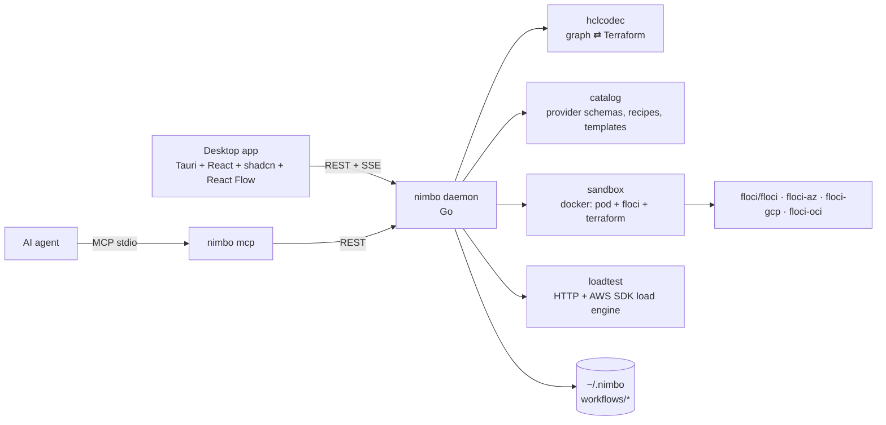

# Nimbo — Architecture

Nimbo is a local "ADE for infrastructure": design infrastructure as a node
graph, export/import it as Terraform, deploy it into a per-workflow Floci
sandbox and load-test it — all on the developer machine.



## Repository layout

| Path | Owner package | Purpose |
|---|---|---|
| `backend/cmd/nimbo` | main | `nimbo serve` (HTTP daemon), `nimbo mcp` (MCP stdio server), `nimbo doctor [--json]` (setup checks; exit 1 when not ready) |
| `backend/internal/model` | model | Shared domain types = wire contract |
| `backend/internal/hclcodec` | hclcodec | Workflow ⇄ HCL, value normalization, edge derivation |
| `backend/internal/catalog` | catalog | Embedded provider schemas, curated metadata, Floci support map, connection recipes, templates, schema validation |
| `backend/internal/sandbox` | sandbox | Per-workflow Docker sandbox, Terraform runs in containers, deployed state |
| `backend/internal/loadtest` | loadtest | Load engine, presets, target suggestions, results persistence |
| `backend/internal/endpoints` | endpoints | "How to use what you deployed": per-resource summaries, host URLs/identifiers, runnable snippets, "Try it" executor, Postman export |
| `backend/internal/store` | store | Workflow persistence on disk |
| `backend/internal/events` | events | SSE hub implementing `model.Publisher` |
| `backend/internal/api` | api | HTTP handlers, orchestration |
| `backend/internal/mcp` | mcp | MCP tools calling the daemon REST API |
| `backend/internal/settings` | settings | User preferences in `<home>/settings.json` (mode, docker, images, default AWS region) |
| `backend/internal/setup` | setup | Onboarding diagnostics (`GET /setup`, `nimbo doctor`), OS-tailored fixes, one-click actions (start Docker, pull images), PATH augmentation |
| `backend/internal/agents` | agents | Detects AI agent apps and installs/removes the `nimbo` MCP server in their configs |
| `apps/desktop` | — | Tauri 2 shell + React app; spawns `nimbo` as sidecar |

Go module: `github.com/ismaelosuna7824/nimbo/backend` (Go 1.26).

## Core decisions

1. **Single source of truth = Workflow JSON** (`model.Workflow`). Terraform is
   generated from it; imports produce it. Edges are *derived* from
   expressions (`aws_sqs_queue.q.arn` inside a node body ⇒ edge), never stored
   independently. Connecting two nodes in the UI = setting an attribute
   expression (or adding helper nodes through a curated recipe).
2. **Values carry both forms**: `expr` (canonical HCL source) and `literal`
   (JSON when constant). Beginners edit literals through typed forms; power
   users edit raw expressions. The backend fills the missing side on save.
   **`expr` is authoritative when both are present**: a client that edits a
   literal MUST send `{literal}` without `expr`; a client that edits an
   expression sends `{expr}` without `literal`.
3. **Sandbox = pod pattern.** Per workflow: docker network `nimbo-<wf>`, a
   `alpine` "pod" container `nimbo-<wf>-pod` that owns the network namespace
   and publishes emulator ports on fixed `127.0.0.1:<hostPort>` ports (see
   "Stable host ports" below); every emulator
   (`nimbo-<wf>-aws`, …) and every Terraform run (`hashicorp/terraform`)
   joins with `--network container:nimbo-<wf>-pod`. Inside the pod every
   emulator is `localhost:<native port>`, which matches the URLs Floci
   returns (`FLOCI_BASE_URL` default). Floci-spawned containers (Lambda,
   RDS…) join `nimbo-<wf>` via `FLOCI_SERVICES_DOCKER_NETWORK`. Verified
   manually: Lambda + API Gateway v2 deploy and invoke from host through
   `http://127.0.0.1:<hostPort>/execute-api/<apiId>/$default/<path>`.
4. **Terraform runs in a container** (`hashicorp/terraform`) with a shared
   plugin cache volume `nimbo-tf-plugins`. No host Terraform needed; identical
   on every OS; Azure's self-signed TLS cert is trusted through
   `SSL_CERT_DIR` inside the Linux container.
5. **Floci provider wiring is injected only at run time** (override files in
   the run workdir). Exported Terraform stays clean and cloud-ready.
6. **Catalog is embedded and generated at build time** from
   `terraform providers schema -json` (aws, azurerm, google, oci), trimmed and
   gzipped. Curated metadata (labels, categories, icons, basic fields,
   defaults, recipes, templates) is layered on top. Every provider resource is
   available; Floci support is computed from a resource-prefix → Floci service
   map and refined with the live `/_floci/health` service list.

## Floci facts (verified 2026-10-17, floci 2.3.0)

| Cloud | Image | Port | Health | Reset | Terraform wiring |
|---|---|---|---|---|---|
| AWS | `floci/floci:latest` | 4566 | `GET /_floci/health` → `{services:{key:"running"}, version}`; readiness `GET /_floci/init` → `completed.ready` | `POST /_floci/state/reset` | env `AWS_ENDPOINT_URL=http://localhost:4566`, `AWS_ACCESS_KEY_ID=test`, `AWS_SECRET_ACCESS_KEY=test`; provider override `s3_use_path_style=true`, `skip_credentials_validation`, `skip_metadata_api_check`, `skip_requesting_account_id` |
| Azure | `floci/floci-az:latest` | 4577 | `GET /health` → `{status:"UP"}`; `GET /ready` | `POST /_admin/reset` | needs `FLOCI_AZ_TLS_ENABLED=true`; cert `GET /_floci/tls-cert`; provider `environment="stack"`, `metadata_host="localhost:4577"`, fake subscription/tenant/client ids, `skip_provider_registration=true` (v3) / `resource_provider_registrations="none"` (v4), `use_cli=false` |
| GCP | `floci/floci-gcp:latest` | 4588 | `GET /_floci-gcp/health` | `POST /_floci-gcp/state/reset` | `GOOGLE_OAUTH_ACCESS_TOKEN=fake`; `*_custom_endpoint` per service (storage `/storage/v1/`, pubsub/kms/secret_manager/iam_beta/service_usage/resource_manager/cloud_scheduler `/v1/`, cloud_run(_v2)/cloudfunctions2 `/v2/`, sql `/sql/v1beta4/`, big_query `/bigquery/v2/`, container `/container/v1/`, compute `/compute/v1/`). Not deployable: Cloud Tasks (gRPC only), Cloud Functions v1 and Cloud Run v1 (`google_cloud_run_service`, knative API) return 404; Cloud Functions v2 has no update (re-applies with a diff fail) |
| OCI | `floci/floci-oci:latest` | 4599 | `GET /_floci-oci/health` | `POST /_floci-oci/state/reset` | env `TF_VAR_CLIENT_HOST_OVERRIDES="oci_identity.IdentityClient=http://localhost:4599;oci_object_storage.ObjectStorageClient=http://localhost:4599;…"` (floci-oci README; other clients follow the same pattern); fake tenancy/user/fingerprint + any generated RSA key (signatures not verified); `disable_auto_retries=true` |

Lambda Function URL path form: `/lambda-url/<urlId>/<path>`. API Gateway v1:
`/restapis/<id>/<stage>/_user_request_/<path>`; v2: `/execute-api/<id>/<stage>/<path>`
(or `Host: <id>.execute-api.localhost.floci.io:4566`).

Floci-spawned containers carry label `floci=true`; teardown removes every
container attached to `nimbo-<wf>`.

## Go package contracts

These signatures are the integration contract between packages. Types not
prefixed come from `internal/model`.

### hclcodec

```go
// Address returns "aws_s3_bucket.b", "data.aws_iam_policy_document.p" or "module.vpc".
func Address(n *model.Node) string

// Normalize fills Value.Expr/Literal pairs (also in Environments), assigns
// missing node IDs (from address), derives wf.Edges and wf.Clouds, and
// returns syntax/reference diagnostics (unknown reference, duplicate address,
// invalid expression). It does not validate against provider schemas.
func Normalize(wf *model.Workflow) []model.Diagnostic

// Export renders wf as Terraform files: "versions.tf" (terraform block),
// "providers.tf", "variables.tf", "main.tf" (locals, data, resources,
// modules, other), "outputs.tf". Files with no content are omitted.
// Comments (model.Comments) are written back where Import found them.
// With opts.Environments, also writes each environment's values to its
// Environment.File (the root variable file it was imported from, e.g.
// "terraform.tfvars") or "environments/<name>.tfvars", and
// "environments/<name>.env.example" (keys; secret values blank).
func Export(wf *model.Workflow, opts ExportOptions) (map[string][]byte, error)
type ExportOptions struct{ Environments bool }

// Import parses Terraform files (path -> content; only root-level *.tf and
// *.tfvars plus environments/*.tfvars and environments/*.env.example are
// interpreted) into a new workflow. Each *.tfvars file becomes an
// environment named after the file (terraform.tfvars -> "default",
// prod.auto.tfvars / environments/prod.tfvars -> "prod"; a taken name falls
// back to the file name); root files keep their name in Environment.File.
// environments/<name>.env.example fills that environment's EnvVars (created
// if needed; blank value => Secret). Override files and *.tf.json are not
// interpreted (warning "unsupported_file"; the folder import keeps them as
// assets). CRLF becomes LF. Comments are kept on the attribute/block they
// belong to (lead lines, same-line, block tail/end, end of file).
// Node positions are left with Positioned=false.
func Import(name string, files map[string][]byte) (*model.Workflow, []model.Diagnostic, error)

// ExprFromLiteral / LiteralFromExpr convert between value forms.
func ExprFromLiteral(lit json.RawMessage) (string, error)
func LiteralFromExpr(expr string) (json.RawMessage, bool)

// ValidateExpr reports a syntax error in a standalone expression.
func ValidateExpr(expr string) error

// MergeImported carries app-only data from prev into next (a fresh Import of
// edited code): node IDs, positions, labels, parents matched by address;
// environments, active environment, workflow ID/name/description/createdAt.
func MergeImported(prev, next *model.Workflow)

// RenameNode sets a node's name and rewrites every reference to its old
// address (bodies, depends_on, outputs, locals, providers, moved.to; not
// moved.from/removed.from). Errors on unknown node, invalid name or taken
// address. Node IDs are unchanged; call Normalize afterwards.
func RenameNode(wf *model.Workflow, nodeID, newName string) error

// Summarize parses one directory's *.tf files (cheap; used by folder scans):
// resource/data counts, module calls (constant source/version), providers,
// clouds, backend presence and parse diagnostics.
func Summarize(files map[string][]byte) Summary

// IsLocalModuleSource / ResolveLocalSource classify and resolve "./x", "../x".
func IsLocalModuleSource(source string) bool
func ResolveLocalSource(dir, source string) string

// RewriteModuleSources rewrites constant module `source` values in one .tf
// file through hclwrite; every other byte is preserved.
func RewriteModuleSources(filename string, src []byte, newSource func(string) (string, bool)) ([]byte, bool, error)
```

### catalog

```go
func Load() (*Catalog, error) // embedded data only; fast (lazy per-provider decompression ok)
func (c *Catalog) Providers() []model.ProviderInfo
func (c *Catalog) Search(q Query) []model.ResourceSummary
type Query struct {
    Text string; Cloud model.Cloud; Kind model.NodeKind; Category string
    SupportedOnly bool; PopularOnly bool; Limit int
}
func (c *Catalog) Categories(cloud model.Cloud) []string
func (c *Catalog) Schema(kind model.NodeKind, typ string) (*model.ResourceSchema, bool)
func (c *Catalog) CloudOf(typ string) (model.Cloud, bool) // by provider prefix
// AddNode appends a node of typ to wf (unique name derived from typ when name
// is ""), prefilled with curated defaults for required attributes. For
// curated starters it may also append helper nodes (e.g. Lambda adds an
// archive_file data source and an IAM role) laid out near pos. It ensures wf
// has a required_providers entry and a provider block for the node's cloud.
// Returns the ID of the primary node.
func (c *Catalog) AddNode(wf *model.Workflow, kind model.NodeKind, typ, name string, pos model.Position) (string, error)
func (c *Catalog) Connections(wf *model.Workflow, sourceID, targetID string) []model.ConnectionRecipe
func (c *Catalog) Connect(wf *model.Workflow, sourceID, targetID, recipeID string) error
func (c *Catalog) Validate(wf *model.Workflow) []model.Diagnostic
func (c *Catalog) SetLiveServices(cloud model.Cloud, services map[string]string)
func (c *Catalog) Templates() []model.Template
func (c *Catalog) TemplateFiles(id string) (map[string][]byte, bool) // Terraform files for hclcodec.Import
```

Catalog notes:

- Data: `backend/internal/catalog/data/<provider>.json.gz` (aws, azurerm,
  google, oci, plus utility providers archive and random) and `index.json.gz`
  are regenerated with `go generate ./internal/catalog/...` (host terraform,
  docker `hashicorp/terraform` fallback). Curated labels, icons (lucide
  kebab-case), categories, Floci service map, starter bodies and needs live
  in `catalog/curated/*.json`; templates in `catalog/templates/<id>/*.tf`.
- `Query.Limit` 0 means 200. Utility providers are not listed by
  `Providers`/`Search` but have schemas and validate.
- AddNode starters never contain Floci endpoints. Provider blocks: aws
  `region`, azurerm `features {}`, google `project = var.gcp_project`
  (default `floci-local`), oci `region`; OCI resources use
  `var.compartment_ocid` (default: local Floci tenancy).
- Recipe IDs: curated (`sqs-lambda`, `apigwv2-lambda`, `sns-sqs`,
  `lambda-uses-dynamodb_table`, `azure-resource-group`, …),
  generic `ref:<target|source>:<attr>:<sourceAttr>` (the node holding the
  attribute), and `depends_on` (target depends on source). Curated recipes
  are also offered when dragging in the reverse direction.
- Validate codes: `unknown_type`, `unknown_attribute`, `unknown_block`,
  `readonly_attribute`, `missing_attribute`, `missing_block`,
  `too_many_blocks` (errors); `deprecated_attribute`, `floci_unsupported`
  (warnings).

### sandbox

```go
func New(cfg Config) (*Manager, error)
type Config struct {
    Home string                     // ~/.nimbo
    Docker string                   // docker CLI binary, default "docker"
    Images map[model.Cloud]string   // emulator images, default floci/*:latest
    TerraformImage string           // default hashicorp/terraform:latest
    AWSRegion string                // AWS_REGION of Terraform runs, default us-east-1
    Events model.Publisher
}
// ApplySettings swaps docker binary, images, terraform image and AWS region
// for sandboxes started / runs launched afterwards (empty = default).
func (m *Manager) ApplySettings(s model.Settings)
func (m *Manager) Status(ctx context.Context, wfID string) (model.SandboxStatus, error)
func (m *Manager) Start(ctx context.Context, wfID string, clouds []model.Cloud) (model.SandboxStatus, error)
func (m *Manager) Stop(ctx context.Context, wfID string) error
func (m *Manager) Reset(ctx context.Context, wfID string) error  // emulator state + tfstate wiped
func (m *Manager) Remove(ctx context.Context, wfID string) error // containers, network, workdir
func (m *Manager) Run(ctx context.Context, req RunRequest) (*model.Run, error) // async
type RunRequest struct {
    Workflow *model.Workflow
    Action model.RunAction
    Files map[string][]byte       // hclcodec.Export output
    AssetsDir string              // copied into the workdir before the run ("" = none)
    Environment *model.Environment
}
func (m *Manager) Runs(wfID string) []model.Run   // newest first, without Log
func (m *Manager) GetRun(id string) (*model.Run, bool)
func (m *Manager) Cancel(id string) error
func (m *Manager) State(ctx context.Context, wf *model.Workflow) (*model.DeployedState, error)
func (m *Manager) HostURL(wfID, emulatorURL string) string // rewrite in-sandbox URL to host URL
func (m *Manager) EmulatorURL(wfID string, cloud model.Cloud) (string, bool) // host base URL (running pod)
func (m *Manager) StableEmulatorURL(wfID string, cloud model.Cloud) (string, bool) // live, else the saved port
func SandboxIdentities() Identities // fake Azure/GCP/OCI identities wired into providers
func (m *Manager) DockerAvailable(ctx context.Context) error // nil when the docker daemon answers
// Sandboxes keep running when the daemon exits; Status rediscovers them from container labels/names.
var ErrRunActive error // Run while another run of the workflow is active; Stop/Reset during a run
```

Sandbox behavior notes:

- Emulators run with persistent storage bind-mounted from
  `<home>/workflows/<wf>/emulators/<cloud>`, so `Stop` (docker stop of
  emulators, Floci-spawned containers and pod) keeps emulator state in step
  with `terraform.tfstate`. `Reset` calls the emulator reset endpoints (or
  wipes the data dir of stopped emulators), removes spawned containers and
  deletes the tfstate. `Remove` cancels an active run and deletes
  containers, network, emulator data and workdir; run history stays.
- Stable host ports: a new pod gets one block of 4 consecutive host ports
  (4566/4577/4588/4599 in that order) from 45000–49999. The preferred block
  is derived from an FNV hash of the workflow ID; blocks with a port that is
  saved by another workflow (`<home>/workflows/*/sandbox.json`) or cannot be
  bound on 127.0.0.1 are skipped. The allocation is saved to
  `<home>/workflows/<wf>/sandbox.json` (`{"ports": {"4566": 45120, …}}`) and
  published as `-p 127.0.0.1:<host>:<port>`, so URLs stay valid across
  stop/start (`docker start` keeps explicit ports) and pod re-creation (saved
  ports are reused). If a saved port is taken by another program, a stopped
  pod is re-created and only the lost ports move; `SandboxStatus.message`
  then names the change (`45120 → 45124`) while the sandbox runs. A port
  grabbed between the check and `docker run` is retried on other ports.
  `sandbox.json` survives Reset/Remove and goes with the workflow directory
  on delete. Pods created before this (random ports, no `sandbox.json`)
  keep working with Docker-assigned ports until they are re-created.
- `State` caches the `terraform show -json` output per workflow, keyed by the
  tfstate's modification time and size, so repeated reads skip the Terraform
  container (node mapping is redone per call).
- Each emulator gets `<PREFIX>_DOCKER_RESOURCE_NAMESPACE=nimbo-<wf>` so
  sandboxes sharing the Docker daemon never clean up each other's spawned
  containers; spawned volumes are found by the `floci_namespace` label, plus
  unlabeled ones the spawned containers mount whose name carries the
  namespace (`-nimbo-<wf>-`) and floci-oci's k3s volumes
  `floci-oci-nimbo-<wf>-oke-vol-ocid1.…` (Docker creates them on mount, without
  labels). Containers still using those volumes (fnserver's unlabeled function
  containers on the default bridge) are removed first; volumes that can't be
  attributed this way are never touched.
- Run workdir `<home>/workflows/<wf>/work`: files are overwritten in place;
  files from the previous run that are gone (tracked in
  `.nimbo/manifest.json`) and stale root `*.tf`/`*.auto.tfvars` are deleted;
  `.terraform/`, the lock file, tfstate and Terraform outputs (archive zips)
  stay. Wiring files: `zz_nimbo_floci_override.tf` (overrides existing
  provider blocks incl. aliases, `backend "local"`),
  `zz_nimbo_floci_providers.tf` (provider blocks for clouds without one),
  `zz_nimbo.auto.tfvars` (environment values).
- `HostURL` resolves API Gateway host-form URLs (`<id>.execute-api.<region>.amazonaws.com`,
  as reported in state, or `<id>.execute-api.localhost.floci.io:4566`) to the
  path form with AWS stage semantics, reading the API's stages from the
  emulator (a first path segment naming a stage selects it, otherwise `$default`).
  The path form requires an explicit stage (verified: `/execute-api/<id>/hello`
  is 404, `/execute-api/<id>/$default/hello` is 200; v1 REST APIs too).
- Azure storage data-plane hosts (`<account>.blob.core.windows.net`, …) do not
  resolve inside the sandbox. For azurerm >= 4.9 the override adds
  `features { storage { data_plane_available = false } }` (merged with the
  user's features block); without it every storage account waits ~2 minutes
  on data-plane polling. Resources that need the storage data plane
  (`azurerm_storage_container` by account name, blobs, queues) are not
  supported in the sandbox.

### loadtest

```go
func NewEngine(cfg EngineConfig) *Engine
type EngineConfig struct {
    Home string; Events model.Publisher; Resolver Resolver
    Connections ConnectionResolver // saved connections, secrets in clear
}
type Resolver interface {
    EmulatorURL(wfID string, cloud model.Cloud) (string, bool)
    HostURL(wfID, emulatorURL string) string
}
type ConnectionResolver interface { Connection(id string) (model.Connection, bool) }
func Presets() []model.LoadProfile
func Suggest(wf *model.Workflow, st *model.DeployedState, r Resolver) []model.LoadTarget
func (e *Engine) Start(ctx context.Context, wfID string, spec model.LoadTestSpec) (*model.LoadTestRun, error) // async; ErrTooManyRuns when 3 are running
func (e *Engine) StartConnection(ctx context.Context, connID string, spec model.LoadTestSpec) (*model.LoadTestRun, error) // run owned by the connection
func (e *Engine) Stop(id string) error // ErrNotFound for unknown ids; no-op for finished runs
func (e *Engine) Get(id string) (*model.LoadTestRun, bool) // runs of either owner
func (e *Engine) List(wfID string) []model.LoadTestRun // newest first, timeline empty
func (e *Engine) ListConnection(connID string) []model.LoadTestRun // newest first, timeline empty
func (e *Engine) DeleteConnectionRuns(connID string) error // ErrRunActive while one runs
func CheckConnection(ctx context.Context, c model.Connection) model.ConnectionCheck // ~10s, never fails
func SuggestConnection(ctx context.Context, c model.Connection) ([]model.LoadTarget, error)
func SandboxAWSConfig(endpoint, region string, httpc aws.HTTPClient) aws.Config // sandbox SDK config (test creds, no retries); also used by endpoints
func DynamoItem(s string) (map[string]ddbtypes.AttributeValue, error)              // plain JSON object → DynamoDB item
var ErrNotFound, ErrTooManyRuns, ErrConfirmationRequired, ErrConnectionNotFound, ErrRunActive error
```

Load test semantics: Start validates the spec synchronously (bad spec, AWS
sandbox not running → error, no run); the run then sends one preflight
request and ends with status `error` if the target is unreachable. Latency
stats cover successful requests; failures show up as error kinds
(`timeout`, `connection_refused`, `auth_failed`, `http_4xx`, `http_5xx`,
`aws:<ErrorCode>`, `sql:<SQLSTATE>`, `mysql:<errno>`, `redis:<prefix>`,
`mongo:<code name>`, `function_error`, `client_saturated`, …). `error_rate`
is a fraction. AWS resources may be a name, an SQS queue URL or an ARN (the
ARN region is used; default `us-east-1` in the sandbox, the connection's
region otherwise). DynamoDB items/keys are plain JSON objects.

Connections: a target with `connectionId` runs against that saved
connection. A spec is external when it has a connection, or is HTTP with a
host that is not loopback, `localhost`/`*.localhost`,
`*.localhost.floci.io` or the workflow's emulator host (checked after the
sandbox URL rewrite); external specs without `confirmExternal` fail with
`ErrConfirmationRequired` before anything is sent. HTTP connection URLs are
paths appended to `baseUrl` (absolute URLs allowed); connection headers and
auth apply under the target's headers. SQL args, Redis arguments (split
once, rendered per argument) and Mongo documents are templated per request
and always sent as parameters/values. Database pools are sized to the
workers, capped at 100. AWS connections load the shared config profile
(`AWS_ENDPOINT_URL` honored) with retries disabled. Workflow runs persist
under `<home>/workflows/<wf>/loadtests/`, connection runs under
`<home>/connections/<id>/loadtests/`; the 3-run cap is global. Errors and
check details have connection secrets redacted. Suggestions that write
data end their label with ` (writes data)` (Lambda: ` (invokes function)`).

### endpoints

```go
type Sandbox struct {
    Bases   map[model.Cloud]string // host base URLs: live, else saved stable ports
    Running map[model.Cloud]bool   // emulators up and answering
    Region  string                 // settings' default AWS region
    Sources []string               // workflow code assets, scanned for route hints
}
func Build(wf *model.Workflow, st *model.DeployedState, sb Sandbox) model.EndpointsInfo
func Try(ctx context.Context, wf *model.Workflow, st *model.DeployedState, sb Sandbox, req model.TryRequest) (model.TryResult, error) // ErrNotFound | *RequestError
func Postman(wf *model.Workflow, st *model.DeployedState, sb Sandbox) PostmanCollection
```

Every managed resource of the state becomes one `ResourceAccess` (data
sources and non-cloud providers such as `random`/`archive` are skipped).
AWS kinds: `http-api` (`aws_apigatewayv2_api` HTTP with its stages/routes/
integrations folded in, one `HTTPEndpoint` per stage × route at
`<aws>/execute-api/<id>/<stage><path>`; `aws_api_gateway_rest_api` with
stages/resources/methods at `<aws>/restapis/<id>/<stage>/_user_request_<path>`),
`function-url` (`<aws>/lambda-url/<urlId>/`), `function`, `queue` (host
queue URL = the reported URL's `/<account>/<name>` path on the sandbox
address), `topic`, `bucket`, `table`, `stream`, `event-bus` (custom buses,
plus the default bus when rules use it), `state-machine`, `secret`,
`parameter`, `user-pool` (app clients folded in), `database`/`cache`
(endpoints as reported plus a warning: only emulator API ports are published
on the host), and `generic` (identifiers only; common IAM/permission/mapping
types get a plain explanation). GCP: see below; Azure/OCI resources not covered
by their builders are generic. Without a known AWS address (legacy stopped
pod) AWS resources are generic with a "start the sandbox" warning.

GCP (`gcp.go`, verified against floci-gcp 0.11.0; one base URL for REST and
plaintext gRPC): `bucket` (JSON API list/upload/download), `topic` (REST
publish; warns without subscriptions), `queue` for `google_pubsub_subscription`
(pull + acknowledge: the emulator never redelivers pulled messages, so there
is no peek), `secret` (versions folded in; access latest / add version), `key`
for symmetric `google_kms_crypto_key` (encrypt/decrypt), `web-service` for
`google_cloud_run_v2_service` (URL = `<gcp>/run/v2/<service name>/`, the proxy
path that keeps sub-paths; the generated `*.run.localhost.floci.io` URL is
shown with the sandbox port), `function` for `google_cloudfunctions2_function`
(control plane only: settings + warning), `database` for
`google_sql_database_instance` (databases/users folded in; host is the Docker
network IP, so a `docker exec … psql` snippet into
`floci-gcp-nimbo-<wf>-cloudsql-<project>-<instance>`) and
`google_bigquery_dataset` (query/list tables), `table` for
`google_bigquery_table` (rows/insertAll), primary `generic` for
`google_cloud_scheduler_job` (run now), `kubernetes` for
`google_container_cluster` (k3s API published on the host, e.g.
`https://localhost:6550`; kubeconfig snippet and Try read the CA from the
GKE API, since Terraform stores it empty on create; any token works; Try lists
nodes/namespaces). Cloud Run containers and GKE clusters don't survive a
sandbox restart (503 / connection refused until redeployed). Service accounts, key rings, networks,
subnets, firewalls, node pools are supporting. Snippets: curl, gcloud
(`CLOUDSDK_API_ENDPOINT_OVERRIDES_<API>=<gcp>/` + a token file; not for Cloud
Run, BigQuery or GKE where gcloud can't be pointed at the sandbox), Node.js
client libraries (Storage/BigQuery `apiEndpoint`, Pub/Sub `apiEndpoint` +
`emulatorMode`, others gRPC `{apiEndpoint, port, sslCreds: createInsecure()}`)
and Python (Storage/BigQuery `client_options` + `AnonymousCredentials`,
Pub/Sub `PUBSUB_EMULATOR_HOST`, others `transport="rest"`). Postman: a
"Google Cloud services (sandbox)" folder plus a folder per Cloud Run service on
`{{gcpBaseUrl}}`.

Azure (`azure.go`/`azure_try.go`, verified against floci-az 0.15.0): one
emulator port serves HTTP and HTTPS (self-signed CA at `/_floci/tls-cert`,
SANs cover `127.0.0.1`/`localhost`); data planes are path-routed and Azure
host names (`<account>.blob.core.windows.net`, …) are never used. Builders:
`bucket` for `azurerm_storage_account` (connection string with
`BlobEndpoint=<az>/<acct>;QueueEndpoint=<az>/<acct>-queue;TableEndpoint=<az>/<acct>-table`,
the state's key — any key works; list containers) and
`azurerm_storage_container` (`<az>/<acct>/<container>`; list/upload/download),
`queue` for `azurerm_storage_queue` (send; peek with `peekonly=true`),
`table` for `azurerm_storage_table` (upsert `PUT <table>(PartitionKey='…',RowKey='…')`,
list `$top=25` with `odata=nometadata`) and `azurerm_cosmosdb_sql_container`
(`<az>/<acct>-cosmos/dbs/<db>/colls/<c>/docs`: SQL query, upsert with the
partition-key header), `secret` for `azurerm_key_vault` (list/get/set) and
`azurerm_key_vault_secret` (`<az>/<vault>-keyvault/secrets/<name>?api-version=7.4`;
any `Authorization: Bearer` token is required), `database` for
`azurerm_cosmosdb_account` (list databases; no auth) and PostgreSQL/MySQL
flexible servers / `azurerm_mssql_server`, `cache` for `azurerm_redis_cache`,
`parameter` for `azurerm_app_configuration` (`<az>/<store>-appconfig/kv`;
list/get/set), `web-service` for Function Apps (linux/windows/flex/legacy:
ARM `Microsoft.Web/sites` registers the app under account `devstoreaccount1`,
invoke `<az>/devstoreaccount1-functions/api/<app>/<function>`, Try lists
`/admin/apps/<app>/functions`) and `azurerm_container_app` (host-routed: the
ingress FQDN as `Host` header on `<az>/`, which Try adds; the sandbox runs
Container Apps mocked, so calls answer 503 `ContainerAppMocked` — the card
warns), `http-api` for `azurerm_api_management` (gateway
`<az>/devstoreaccount1-apim/<service>`, APIs/operations folded in as
endpoints), `topic` for `azurerm_eventgrid_topic` (publish to the reported
endpoint rewritten to the sandbox address, `aeg-sas-key` any value) and
`azurerm_servicebus_topic`, `queue` for the Service Bus namespace/queue and
`stream` for Event Hubs: their messaging is AMQP/Kafka on unpublished ports
(and mocked), so those cards carry a warning and only the management plane
(`<az>/<ns>-servicebus/$Resources/queues|topics`) is offered. floci-az runs
Redis/PostgreSQL/MySQL as sibling containers named like the reported host
(`floci-az-nimbo-<wf>-pg-<server>`) and publishes them on Docker-chosen host
ports (bound to 0.0.0.0): when the host has no dot the card says to use
`docker port <host> <port>` and the snippets do that. Resource groups, role
assignments, identities, networks, DNS zones, service plans, Container App
environments, sub-databases and other types in `azureSummaries` are supporting
(the container registry stays primary). Snippets: curl (plain HTTP), az CLI
only for storage (`--connection-string`), JavaScript/Python Azure SDKs
(storage via connection string — `allowInsecureConnection` for data-tables;
Cosmos with endpoint + key over HTTP; Key Vault/App Configuration over
`https://` with the certificate: `NODE_EXTRA_CA_CERTS`, `connection_verify`,
a fake token credential and `disableChallengeResourceVerification` /
`verify_challenge_resource=False`). Try uses plain HTTP; `https://` URLs in
HTTP actions trust the certificate fetched from the emulator per call. The
sandbox card's env snippet downloads the certificate and exports
`NODE_EXTRA_CA_CERTS`/`REQUESTS_CA_BUNDLE`/`SSL_CERT_FILE`, a storage
connection string and the `ARM_*` settings. Postman: "Azure services
(sandbox)" plus a folder per Function App/Container App (with `Host`)/APIM on
`{{azureBaseUrl}}`. With floci-az 0.15 + azurerm 5.10, Terraform itself
can't create storage containers/queues (the ARM GET answers 200 for any
name), storage tables/Key Vaults (azurerm dials `*.core.windows.net` /
`*.vault.azure.net` from the Terraform container), Service Bus, Event Hubs,
Cosmos DB, App Configuration, App Service plans or Event Grid topics (no ARM
handler or 200 instead of 201), and leaves API Management tainted; the cards
are ready for when those deploy.

OCI (`oci.go`/`oci_try.go`, verified against floci-oci 0.5.0): every service
is on the emulator address with OCI's REST paths; endpoint attributes in state
(`messages_endpoint`, `invoke_endpoint`, `crypto_endpoint`, …) report
`http://localhost:4599` and are replaced by that address. `bucket`
(`/n/<ns>/b/<bucket>/o[/<name>]` list/upload/download; pre-authenticated
requests of the bucket shown as `<oci>/p/<token>/…` URLs, anonymous),
`queue` (`/20210201/queues/<id>/messages`; send, peek with
`visibilityInSeconds=0`), `stream` (`/20180418/streams/<id>`; append, read:
a `TRIM_HORIZON` cursor per partition, paged with `AFTER_OFFSET`, latest 10
shown decoded), `key` for `oci_kms_key` (AES only: `/20180608/encrypt|decrypt`;
other algorithms get a warning — the emulator encrypts only with AES), `secret`
(`/20190301/secretbundles/<id>`, value decoded), `function` for
`oci_functions_function` (`/20181201/functions/<id>/actions/invoke`; the image
must be a current Fn FDK build, the first call starts fnserver), `kubernetes`
for `oci_containerengine_cluster` (k3s API as reported, published on the
host; kubeconfig via `POST /20180222/clusters/<id>/kubeconfig/content`, whose
exec plugin runs `oci ce cluster generate-token` that floci-oci's token webhook
accepts). `oci_kms_vault` and every `oci_identity_*`, functions application,
stream pool and pre-authenticated request are supporting. Try signs every
request (draft-cavage `rsa-sha256` over `date (request-target) host` plus
`content-length content-type x-content-sha256` for bodies; per-process RSA
key; keyId `<tenancy>/<user>/<fingerprint>` with the tenancy the resources'
`compartment_id` names). The emulator parses but never verifies signatures and
maps unsigned requests to its default tenancy, so curl snippets and the
Postman "OCI services (sandbox)" folder (`{{ociBaseUrl}}`) appear only when
the resources live there. Snippets: curl, OCI CLI (`--profile NIMBO
--endpoint <oci>`; the sandbox card's env snippet writes that profile with a
throwaway key and exports `OCI_CLI_PROFILE`/`OCI_CLI_ENDPOINT`), Node.js
(`oci-common` `SimpleAuthenticationDetailsProvider` over a key generated in
code, `client.endpoint`) and Python (`oci` config with `key_content`,
`service_endpoint`). floci-oci 0.5.0 serves Functions only on `/20181201`
while oracle/oci 9.10.0, OCI CLI 3.95 and current SDKs call `/20260325`
(404): function snippets sign the invoke with the SDK signer (`oci
raw-request`, `DefaultRequestSigner`, `oci.signer.Signer`) instead of the
Functions clients, and Terraform needs an older provider for functions
(9.0.0 works). Stream pools are not implemented (`oci_streaming_stream_pool`
→ 404).

`Supporting` marks plumbing so the UI can list it apart (a collapsed
"Supporting resources" section of compact rows, no canvas plug): only
`generic` entries qualify, when their type is IAM (`_iam_`), a sub-resource
of API Gateway/S3 buckets/CloudWatch logs, or ends in a wiring suffix
(`_policy`, `_attachment`, `_permission`, `_mapping`, `_subscription`,
`_route`, `_stage`, `_integration`, …); types naming something people use
(`_api`, `_function`, `_queue`, `_bucket`, `_table`, …) stay primary; any
other generic type is supporting unless it has an address (URL/endpoint/
host name value). See `supporting` in `endpoints.go`.

Route paths: `{param}` becomes `1`; greedy `{param+}` and the `$default`
route key become `Proxy` endpoints (method `ANY`) whose URL ends in one sample
segment: the most frequent quoted `/segment` literal in the workflow's
Lambda code (`archive_file`/`aws_lambda_function`/`local_file` node bodies
and code files under the assets dir), else `hello`.

Snippets run as-is against the sandbox: curl / `fetch` (Node 18+) / Python
`urllib` for HTTP; AWS CLI (credentials exported, `--endpoint-url` explicit
so CLI v1 works), JavaScript SDK v3 (`@aws-sdk/client-*`, `endpoint`,
static `test`/`test` credentials, `forcePathStyle` for S3, ES module with
top-level await) and Python boto3 (`endpoint_url`, path addressing for S3).
URLs containing `$default` are single-quoted in shell snippets.

Try: AWS actions use `loadtest.SandboxAWSConfig` (shared with load tests:
static test credentials, no retries); HTTP uses `net/http`. 15 s timeout;
HTTP targets must be loopback URLs on one of the sandbox's emulator ports
(relative paths resolve against the API's first stage or the function URL);
redirects are followed only to loopback hosts (max 5). Bodies are read up to
256 KB (then truncated with a note) and pretty-printed when JSON. SQS
`receive` peeks: up to 10 messages, then `ChangeMessageVisibility 0` so they
stay visible (the Go SDK drops a zero `VisibilityTimeout` on receive).
DynamoDB `scan` returns at most 25 items as plain JSON
(`attributevalue.UnmarshalListOfMaps`); `put` takes a plain JSON item.
Step Functions `start` describes the execution after 1 s. FIFO queues/topics
get message group `nimbo` (and a deduplication ID unless content-based).
The API builds Try's (and Postman's) `Sandbox` from the pod's cached host
ports, so a warm Try runs no docker command and no Terraform container (the
state comes from `State`'s cache); only `GET /endpoints` runs the full status
check. A stopped emulator then shows as a connection error in the result.

Postman: `info.schema` v2.1.0, collection variable `baseUrl` = AWS emulator
URL, a folder per HTTP API / function URL (ANY routes give a GET and a POST
with a JSON body), and "AWS services (sandbox)" with `awsv4`-auth requests
(accessKey/secretKey `test`, region, service): SQS SendMessage /
ReceiveMessage (JSON protocol, `X-Amz-Target: AmazonSQS.*`), SNS Publish
(query protocol, urlencoded), DynamoDB Scan / PutItem, S3 ListObjectsV2,
Lambda Invoke. Verified 2026-10-18 by replaying them with `curl --aws-sigv4`.

### store

```go
func Open(home string) (*Store, error)
func (s *Store) List() ([]model.WorkflowSummary, error)
func (s *Store) Get(id string) (*model.Workflow, error) // ErrNotFound
func (s *Store) Save(wf *model.Workflow) error          // atomic write, 0600
func (s *Store) Delete(id string) error
func (s *Store) AssignMissingIcons() (int, error) // daemon startup: random icon for pre-icon workflows, UpdatedAt kept
func (s *Store) AssetsDir(id string) string             // <home>/workflows/<id>/assets
func NewID(name string) string                          // slug-xxxxxx

func OpenConnections(home string) (*Connections, error) // <home>/connections.json
func (c *Connections) List() []model.Connection          // masked, by name
func (c *Connections) Get(id string) (model.Connection, error) // masked; ErrConnectionNotFound
func (c *Connections) Connection(id string) (model.Connection, bool) // secrets in clear (loadtest.ConnectionResolver)
func (c *Connections) Create(in model.Connection) (model.Connection, error)          // new ID; ErrInvalidConnection
func (c *Connections) Update(id string, in model.Connection) (model.Connection, error) // blank secret keeps, ClearSecrets removes
func (c *Connections) Delete(id string) error
func (c *Connections) Draft(in model.Connection) (model.Connection, error) // unsaved; with an ID, blank secrets come from the stored one
func Mask(c model.Connection) model.Connection
```

## Connections (already-deployed services)

The Connections library is global (not per workflow): saved services that
were **not** created by a workflow — any HTTP/HTTPS API (base URL, headers,
auth `none|bearer|basic|api_key`), PostgreSQL, MySQL, Redis, MongoDB (`uri`
or host/port/user/password/database/tls) and a real AWS account (shared
config/SSO `profile` + `region`). They can be tested ("Test connection"),
offer suggested targets, and be load-tested from the home screen (runs owned
by the connection) or used as targets inside any workflow's load test (runs
owned by the workflow, `LoadTarget.connectionId`).

- **Storage**: `<home>/connections.json`, one JSON array with secrets, mode
  0600, written atomically (temp file + rename). IDs are `slug-xxxxxx` like
  workflows. Connection-owned runs live under
  `<home>/connections/<id>/loadtests/`; deleting a connection deletes them
  (409 while one of its runs is active, nothing deleted).
- **Validation**: name required; `http` needs an absolute `http(s)://`
  `baseUrl` without credentials; database kinds need `uri` (scheme checked:
  `postgres(ql)://`, `mysql://` or a Go MySQL DSN, `redis(s)://`,
  `mongodb(+srv)://`) or `host`; `aws` needs nothing (region recommended).
  Fields that do not belong to the kind are dropped on save, so changing
  the kind never keeps another kind's secrets. Errors never quote secrets.
- **Masking**: secrets are `password`, `uri`, `auth.token`, `auth.password`.
  Every API response blanks them and lists the stored ones in `secretsSet`.
  On `PUT` a blank secret keeps the stored value; names in `clearSecrets`
  remove it. `POST /connections/test` accepts an unsaved draft; with an `id`
  the blank secrets are filled from the stored connection. MCP tools
  additionally redact credential-looking header values.
- **External rule**: a load test whose target has a `connectionId`, or an
  HTTP URL whose host is not loopback/an emulator, is outside the local
  sandbox. The engine refuses it unless `LoadTestSpec.confirmExternal` is
  true (`loadtest.ErrConfirmationRequired` → HTTP 428
  `{"error", "code": "confirmation_required"}`), before sending any
  request. Such runs have `external: true`. The UI asks for explicit
  confirmation; MCP tools tell agents to ask the user.
- **Events**: `connections.updated` (`{"id"}`, no workflowId) after
  create/update/delete; connection-run `loadtest.sample`/`loadtest.status`
  events carry no workflowId, so every SSE subscriber receives them.

## Setup diagnostics (onboarding, `nimbo doctor`)

`internal/setup` evaluates the machine for someone who may never have used
Docker; the desktop onboarding wizard (`GET /setup`) and `nimbo doctor`
(used by the setup script) show the same `model.SetupStatus`.

- **PATH augmentation**: an app launched from the macOS Finder gets
  `PATH=/usr/bin:/bin:/usr/sbin:/sbin`, so `docker` and its credential
  helpers are missing. `serve`, `mcp` and `doctor` call `setup.AugmentPath()`
  first: existing well-known dirs not yet on PATH are prepended (macOS:
  `/usr/local/bin`, `/opt/homebrew/bin`, `~/.orbstack/bin`,
  `/Applications/Docker.app/Contents/Resources/bin`, `~/.docker/bin`,
  `~/.rd/bin`, `~/.colima/bin`, `/usr/bin`; Linux: `/usr/local/bin`,
  `/usr/bin`, `/snap/bin`, `~/.docker/bin`, `~/.rd/bin`; Windows:
  `C:\Program Files\Docker\Docker\resources\bin`, Rancher Desktop's bin).
  The sandbox then resolves `Settings.Docker` with `exec.LookPath`
  (`sandbox.ResolveDocker`), so sandboxes, `/health` and setup checks run
  the same binary.
- **Platform**: `osName` (`sw_vers`, `/etc/os-release`, `ver`), Linux
  `distro` (os-release `ID`) and `packageManager` (brew/apt/dnf/pacman/
  zypper/winget/choco) tailor every fix: macOS gets OrbStack, Docker
  Desktop per chip (Apple silicon/Intel) and `brew install --cask` commands;
  Windows gets Docker Desktop (winget/choco) and WSL 2; Linux gets the
  official script (Ubuntu/Debian/Fedora/RHEL/CentOS), the distro package
  (`apt`/`dnf`/`pacman`/`zypper`), `sudo systemctl enable --now docker` and
  the docker-group step.
- **Checks** (order; required ones decide `ready`): `wsl` (Windows only,
  required: `wsl --status`), `docker-cli` (required; version and engine
  flavor from `docker --version`, the context endpoint and `docker info`:
  Docker Desktop/OrbStack/Rancher Desktop/Colima/Podman), `docker-daemon`
  (required; `docker info` within 3 s), `docker-permissions` (Linux only,
  required; "permission denied" on the socket → docker group fix),
  `images` (required; AWS Floci image from settings, Terraform image,
  `alpine:3`), `docker-socket` (required, evaluated once the daemon answers
  and `alpine:3` is present; `docker run --rm -v /var/run/docker.sock:…
  alpine:3 test -S …`, successes cached 5 min), `docker-memory` (warning
  < 4 GiB), `disk` (warning < 5 GiB free on the home volume), `internet`
  (warning; `HEAD https://registry.terraform.io` within 3 s). Checks that
  depend on an earlier failure report `missing` with a "Checked once …"
  summary and no fixes.
- **Actions** (`POST /setup/actions/{action}` → 202, one run per action at
  a time, else 409): `start-docker` (no-op when running; macOS opens the
  installed OrbStack/Docker Desktop/Rancher Desktop app, preferring the
  current context's, else `colima start`; Windows starts Docker Desktop;
  Linux answers with the `systemctl` command since it needs root; then waits
  up to 2 min for `docker info`), `pull-images` (pulls the missing required
  images, parsing `docker pull` layer lines). Progress: `setup.progress`
  events (no workflowId) with `SetupProgress`; the last has `done: true`
  and `error` on failure. Action fixes also carry `command`, the manual
  shell equivalent `nimbo doctor` prints.

## HTTP API (`/api/v1`, JSON, 127.0.0.1 only)

| Method & path | Body → Response |
|---|---|
| `GET /health` | → `{version, home, docker: bool, dockerError?}` (docker binary resolved like the sandbox's) |
| `GET /setup` | → `SetupStatus` (all checks, run concurrently with short timeouts) |
| `POST /setup/actions/{action}` | `start-docker` \| `pull-images` → 202 `{action}`; 409 while running; 404 unknown. Progress via `setup.progress` events |
| `GET /catalog/providers` | → `ProviderInfo[]` |
| `GET /catalog/categories?cloud=` | → `string[]` |
| `GET /catalog/resources?q=&cloud=&kind=&category=&supported=&popular=&limit=` | → `ResourceSummary[]` |
| `GET /catalog/resources/{kind}/{type}` | → `ResourceSchema` |
| `GET /catalog/templates` | → `Template[]` |
| `GET /catalog/load-presets` | → `LoadProfile[]` |
| `GET /workflows` | → `WorkflowSummary[]` (archived ones included with `archived: true`; the UI hides them from recents) |
| `POST /workflows` | `{name, description?, templateId?}` → `Workflow` (gets a random `icon` whose glyph differs from the most recently updated workflows; the template's own `icon` only decorates its card) |
| `GET /workflows/{id}` | → `Workflow` |
| `PUT /workflows/{id}` | `Workflow` → `Workflow` (normalized + validated; `archived` in the body is ignored; `icon` is `{glyph, color}` with IDs matching `^[a-z0-9-]{1,32}$`, else 400; glyph `nimbo` is the explicit Nimbo mascot; a body without `icon` keeps the current one) |
| `DELETE /workflows/{id}` | → 204. Removes the sandbox first (containers, Floci-spawned containers/volumes/networks, network, data); if that fails while Docker is up → 500 and the workflow is kept |
| `POST /workflows/{id}/duplicate` | `{name}` → `Workflow` (with a new random icon so the copy stands out) |
| `POST /workflows/{id}/archive` | → `Workflow` with `archived: true`. Stops the sandbox keeping all state (409 while a run is active; proceeds without Docker); runs, load tests and `sandbox/start` then answer 409 `workflow is archived` |
| `POST /workflows/{id}/unarchive` | → `Workflow` (restored; the sandbox starts again on the next deploy) |
| `POST /workflows/{id}/nodes` | `{kind, type, name?, position}` → `{workflow, nodeId}` (new nodes whose 248×84 card, plus 24px gap, overlaps another card move to the nearest free grid slot) |
| `PATCH /workflows/{id}/nodes/{nodeId}` | `{name?, label?, position?, positioned?, parent?, body?}` → `Workflow` |
| `DELETE /workflows/{id}/nodes/{nodeId}` | → `Workflow` (references to it become diagnostics) |
| `GET /workflows/{id}/connections?source=&target=` | → `ConnectionRecipe[]` |
| `POST /workflows/{id}/connections` | `{source, target, recipeId}` → `Workflow` (helper nodes are moved off other cards the same way) |
| `GET /workflows/{id}/terraform` | → `{files: {path: content}}` (no environments) |
| `PUT /workflows/{id}/terraform` | `{files}` → `Workflow` (code edit: re-import, keep positions/ids/envs by address; 400 + diagnostics and nothing saved on syntax errors) |
| `POST /workflows/{id}/export` | `{dir, environments: bool}` → `{dir, files: string[]}` (writes files + assets) |
| `GET /workflows/{id}/export.zip?environments=` | → zip |
| `POST /import/scan` | `{dir?, files?}` → `ImportScan{root, projects: ImportProject[], skipped}`. Walks the folder (skips `.terraform`, `.git`, `node_modules`, `vendor`, `.terragrunt-cache`, hidden dirs); every dir with `*.tf` is a project unless another scanned dir calls it as a local `module` (then it is listed in `skipped`). Per project: resource/data/module counts, providers, clouds, tfvars files (root + `environments/`), backend presence, parse diagnostics. `files` (relative paths; a shared top-level folder becomes the root and names it) are materialized in a temp dir. Over 5000 files or 200 Terraform dirs → 400 |
| `POST /import` | `{dir?, files?, projects?: string[], name?, names?: {path: name}}` → 201 `{workflows: Workflow[]}`, one per project, each with a random icon (`projects` omitted = the root `"."` only; `name` applies when exactly one project is imported). Per project: root `*.tf`/`*.tfvars` and `environments/*.tfvars`/`*.env.example` are parsed; other files of the project dir (minus nested Terraform dirs, `.terraform*`, `*.tfstate*`, skipped dirs) are copied into assets; every local module it reaches (recursively) is copied flat to `modules/<name>` (dir base name, `-2`… on clashes) and its `source` rewritten (`./modules/<name>` in the workflow, `../<name>` between modules, via hclwrite so the rest of each module file stays byte-identical). Registry/git sources are untouched. All-or-nothing; 400 + diagnostics on syntax errors |
| `GET /workflows/{id}/modules/{nodeId}?path=` | → `ModuleView{source, local, workflow?, message?}`. Local source inside the workflow files → the module parsed as a read-only `Workflow` (nodes unpositioned). Registry/remote → `message` ("Registry module terraform-aws-modules/vpc/aws 5.0.0 — contents are downloaded at deploy time"). `path=module.a.module.b` drills into nested calls |
| `GET /workflows/{id}/sandbox` | → `SandboxStatus` |
| `POST /workflows/{id}/sandbox/start` / `stop` / `reset` | → `SandboxStatus` |
| `POST /workflows/{id}/runs` | `{action, environment?}` → `Run` (starts sandbox if needed; environment defaults to the active one, 404 if unknown; plan/apply → 400 + diagnostics while error diagnostics exist; 409 while another run is active) |
| `GET /workflows/{id}/runs` | → `Run[]` |
| `GET /runs/{runId}` | → `Run` (with log) |
| `POST /runs/{runId}/cancel` | → 204 |
| `GET /workflows/{id}/state` | → `DeployedState` |
| `GET /workflows/{id}/endpoints` | → `EndpointsInfo` (empty `resources` when nothing is deployed; empty `sandbox` while the sandbox is not running — resource URLs then use the saved stable ports). Refetch when `state.updated` / `sandbox.status` arrive |
| `POST /workflows/{id}/endpoints/try` | `TryRequest` → `TryResult`; always 200 for operation failures (`ok: false`, `error`; stopped sandbox included); 400 bad request (missing `nodeId`/`action`, unknown action, invalid JSON input, URL outside the sandbox); 404 unknown resource |
| `GET /workflows/{id}/endpoints/postman.json` | → Postman Collection v2.1 download (`Content-Disposition: attachment`) |
| `GET /workflows/{id}/loadtests/targets` | → `LoadTarget[]` |
| `POST /workflows/{id}/loadtests` | `LoadTestSpec` → `LoadTestRun` (targets may use a saved connection; outside the sandbox without `confirmExternal` → 428 `confirmation_required`) |
| `GET /workflows/{id}/loadtests` | → `LoadTestRun[]` |
| `GET /loadtests/{runId}` | → `LoadTestRun` |
| `POST /loadtests/{runId}/stop` | → 204 |
| `GET /connections` | → `Connection[]` (masked) |
| `POST /connections` | `Connection` → 201 `Connection` (masked; 400 on validation errors) |
| `GET /connections/{id}` | → `Connection` (masked) |
| `PUT /connections/{id}` | `Connection` → `Connection` (blank secrets keep, `clearSecrets` removes) |
| `DELETE /connections/{id}` | → 204; also deletes its load test history (409 while one of its runs is active) |
| `POST /connections/test` | `Connection` draft → `ConnectionCheck` (with `id`: blank secrets from the stored one) |
| `POST /connections/{id}/test` | → `ConnectionCheck` |
| `GET /connections/{id}/targets` | → `LoadTarget[]` (502 if the service cannot be inspected) |
| `POST /connections/{id}/loadtests` | `LoadTestSpec` → 201 `LoadTestRun` (owned by the connection; 428 without `confirmExternal`) |
| `GET /connections/{id}/loadtests` | → `LoadTestRun[]` (newest first, no timeline) |
| `GET /session` | → `{openWorkflowId: string \| null}`: the workflow open in the desktop app (in memory; null after a daemon restart or once that workflow is deleted). MCP tools resolve `workflow: "current"` (or omitted) through it |
| `PUT /session` | `{openWorkflowId: string \| null}` → 204 (404 if the workflow does not exist); sent by the app on open/close |
| `GET /settings` | → `Settings` (defaults when `<home>/settings.json` is missing; invalid stored fields fall back to defaults) |
| `PUT /settings` | `Settings` → `Settings` (empty fields = defaults; 400 on invalid mode/image/region). Applied live: sandboxes started and Terraform runs launched afterwards use the new docker binary, images and `AWS_REGION`; new aws provider blocks get the region. A stopped emulator whose image changed is recreated on the next start (state is kept in its data dir) |
| `GET /settings/defaults` | → `Settings` with every default |
| `GET /agents` | → `AgentClient[]` (claude-code, claude-desktop, cursor, codex, vscode, windsurf, gemini-cli) |
| `POST /agents/{id}/install` | → `AgentClient`; writes `<exe> mcp` (exe = running daemon binary) into the client's user config, backup `<file>.<timestamp>.bak`; Claude Code uses `claude mcp add --scope user` when the CLI is found. 404 unknown id, 409 `unusable_executable` when the daemon runs from a temp/go-build dir, 422 when the config cannot be parsed |
| `DELETE /agents/{id}` | → `AgentClient`; removes only the `nimbo` entry |
| `GET /mcp/catalog` | → `{tools: ToolInfo[], prompts: PromptInfo[]}` (what the MCP server exposes) |
| `GET /mcp/command` | → `{command, args, problem?}`: how agents launch the MCP server; `problem` explains why one-click install is unavailable |
| `GET /events?workflow=` | SSE stream of `Event` (`event:` = type, `data:` = JSON Event) |

Errors: non-2xx with `{"error": string, "code"?: string, "diagnostics"?: Diagnostic[]}`
(`code` is `confirmation_required` on 428).
Node references in paths and connection bodies accept a node ID or address.
Requests with a non-loopback `Host` or an `Origin` outside the Tauri/Vite
dev origins (`tauri://localhost`, `http(s)://tauri.localhost`,
`http://localhost:1420`, `http://127.0.0.1:1420`, plus any listed in the
comma-separated env `NIMBO_DEV_ORIGINS`, e.g. for a second Vite port) are
rejected with 403.

Daemon discovery: `nimbo serve --addr 127.0.0.1:0` writes
`<home>/daemon.json` = `{"url": "http://127.0.0.1:PORT", "pid": N}` and prints
`NIMBO_LISTENING http://127.0.0.1:PORT` on stdout (Tauri reads it). `nimbo mcp`
reads `daemon.json`; if the daemon is not reachable it starts one in-process.
The desktop app spawns the sidecar with `--exit-with-parent`: the daemon shuts
down gracefully when its stdin (a pipe the app holds open) reaches EOF, so it
does not outlive a killed app (on Linux it also sets `PR_SET_PDEATHSIG`).
