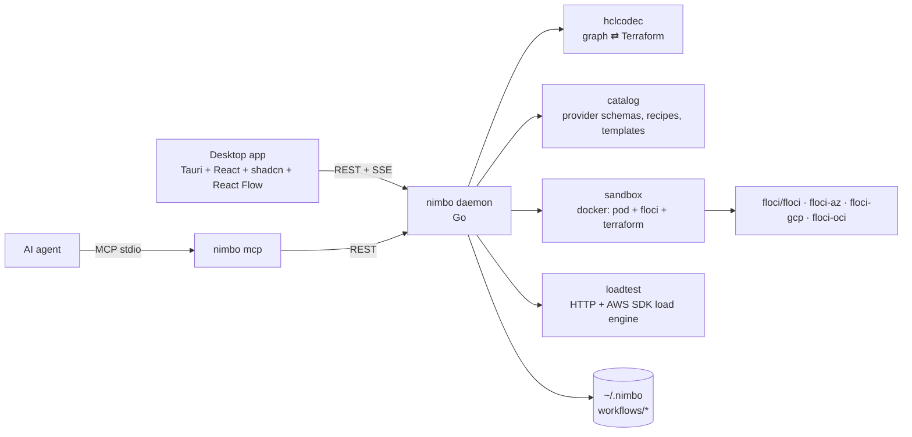

# Nimbo — Architecture

Nimbo is a local "ADE for infrastructure": design infrastructure as a node
graph, export/import it as Terraform, deploy it into a per-workflow Floci
sandbox and load-test it — all on the developer machine.



## Repository layout

| Path | Owner package | Purpose |
|---|---|---|
| `backend/cmd/nimbo` | main | `nimbo serve` (HTTP daemon), `nimbo mcp` (MCP stdio server), `nimbo doctor [--json]` (setup checks; exit 1 when not ready) |
| `backend/internal/model` | model | Shared domain types = wire contract |
| `backend/internal/hclcodec` | hclcodec | Workflow ⇄ HCL, value normalization, edge derivation |
| `backend/internal/catalog` | catalog | Embedded provider schemas, curated metadata, Floci support map, connection recipes, templates, schema validation |
| `backend/internal/lint` | lint | Best-practice checks (`bp_*` info/warning diagnostics with why + fix), run on every save after schema validation; see "Best-practice checks" below |
| `backend/internal/netcheck` | netcheck | Network model of a workflow (deployed state or statically evaluated design), `net_*` configuration checks, reachability analyzer and live probes; see "netcheck" below |
| `backend/internal/sandbox` | sandbox | Per-workflow Docker sandbox, Terraform runs in containers, deployed state |
| `backend/internal/loadtest` | loadtest | Load engine, presets, target suggestions, results persistence |
| `backend/internal/endpoints` | endpoints | "How to use what you deployed": per-resource summaries, host URLs/identifiers, runnable snippets, "Try it" executor, Postman export |
| `backend/internal/store` | store | Workflow persistence on disk |
| `backend/internal/events` | events | SSE hub implementing `model.Publisher` |
| `backend/internal/api` | api | HTTP handlers, orchestration |
| `backend/internal/mcp` | mcp | MCP tools calling the daemon REST API |
| `backend/internal/settings` | settings | User preferences in `<home>/settings.json` (mode, docker, images, default AWS region) |
| `backend/internal/setup` | setup | Onboarding diagnostics (`GET /setup`, `nimbo doctor`), OS-tailored fixes, one-click actions (start Docker, pull images), PATH augmentation |
| `backend/internal/agents` | agents | Detects AI agent apps and installs/removes the `nimbo` MCP server in their configs |
| `apps/desktop` | — | Tauri 2 shell + React app; spawns `nimbo` as sidecar |

Go module: `github.com/ismaelosuna7824/nimbo/backend` (Go 1.26).

## Core decisions

1. **Single source of truth = Workflow JSON** (`model.Workflow`). Terraform is
   generated from it; imports produce it. Edges are *derived* from
   expressions (`aws_sqs_queue.q.arn` inside a node body ⇒ edge), never stored
   independently. Connecting two nodes in the UI = setting an attribute
   expression (or adding helper nodes through a curated recipe).
2. **Values carry both forms**: `expr` (canonical HCL source) and `literal`
   (JSON when constant). Beginners edit literals through typed forms; power
   users edit raw expressions. The backend fills the missing side on save.
   **`expr` is authoritative when both are present**: a client that edits a
   literal MUST send `{literal}` without `expr`; a client that edits an
   expression sends `{expr}` without `literal`.
3. **Sandbox = pod pattern.** Per workflow: docker network `nimbo-<wf>`, a
   `alpine` "pod" container `nimbo-<wf>-pod` that owns the network namespace
   and publishes emulator ports on fixed `127.0.0.1:<hostPort>` ports (see
   "Stable host ports" below); every emulator
   (`nimbo-<wf>-aws`, …) and every Terraform run (`hashicorp/terraform`)
   joins with `--network container:nimbo-<wf>-pod`. Inside the pod every
   emulator is `localhost:<native port>`, which matches the URLs Floci
   returns (`FLOCI_BASE_URL` default). Floci-spawned containers (Lambda,
   RDS…) join `nimbo-<wf>` via `FLOCI_SERVICES_DOCKER_NETWORK`. Verified
   manually: Lambda + API Gateway v2 deploy and invoke from host through
   `http://127.0.0.1:<hostPort>/execute-api/<apiId>/$default/<path>`.
4. **Terraform runs in a container** (`hashicorp/terraform`) with a shared
   plugin cache volume `nimbo-tf-plugins`. No host Terraform needed; identical
   on every OS; Azure's self-signed TLS cert is trusted through
   `SSL_CERT_DIR` inside the Linux container.
5. **Floci provider wiring is injected only at run time** (override files in
   the run workdir). Exported Terraform stays clean and cloud-ready.
6. **Catalog is embedded and generated at build time** from
   `terraform providers schema -json` (aws, azurerm, google, oci), trimmed and
   gzipped. Curated metadata (labels, categories, icons, basic fields,
   defaults, recipes, templates) is layered on top. Every provider resource is
   available; Floci support is computed from a resource-prefix → Floci service
   map and refined with the live `/_floci/health` service list.

## Floci facts (verified 2026-10-17, floci 2.3.0)

| Cloud | Image | Port | Health | Reset | Terraform wiring |
|---|---|---|---|---|---|
| AWS | `floci/floci:latest` | 4566 | `GET /_floci/health` → `{services:{key:"running"}, version}`; readiness `GET /_floci/init` → `completed.ready` | `POST /_floci/state/reset` | env `AWS_ENDPOINT_URL=http://localhost:4566`, `AWS_ACCESS_KEY_ID=test`, `AWS_SECRET_ACCESS_KEY=test`; provider override `s3_use_path_style=true`, `skip_credentials_validation`, `skip_metadata_api_check`, `skip_requesting_account_id` |
| Azure | `floci/floci-az:latest` | 4577 | `GET /health` → `{status:"UP"}`; `GET /ready` | `POST /_admin/reset` | needs `FLOCI_AZ_TLS_ENABLED=true`; cert `GET /_floci/tls-cert`; provider `environment="stack"`, `metadata_host="localhost:4577"`, fake subscription/tenant/client ids, `skip_provider_registration=true` (v3) / `resource_provider_registrations="none"` (v4), `use_cli=false` |
| GCP | `floci/floci-gcp:latest` | 4588 | `GET /_floci-gcp/health` | `POST /_floci-gcp/state/reset` | `GOOGLE_OAUTH_ACCESS_TOKEN=fake`; `*_custom_endpoint` per service (storage `/storage/v1/`, pubsub/kms/secret_manager/iam_beta/service_usage/resource_manager/cloud_scheduler `/v1/`, cloud_run(_v2)/cloudfunctions2 `/v2/`, sql `/sql/v1beta4/`, big_query `/bigquery/v2/`, container `/container/v1/`, compute `/compute/v1/`). Not deployable: Cloud Tasks (gRPC only), Cloud Functions v1 and Cloud Run v1 (`google_cloud_run_service`, knative API) return 404; Cloud Functions v2 has no update (re-applies with a diff fail) |
| OCI | `floci/floci-oci:latest` | 4599 | `GET /_floci-oci/health` | `POST /_floci-oci/state/reset` | env `TF_VAR_CLIENT_HOST_OVERRIDES="oci_identity.IdentityClient=http://localhost:4599;oci_object_storage.ObjectStorageClient=http://localhost:4599;…"` (floci-oci README; other clients follow the same pattern); fake tenancy/user/fingerprint + any generated RSA key (signatures not verified); `disable_auto_retries=true` |

Lambda Function URL path form: `/lambda-url/<urlId>/<path>`. API Gateway v1:
`/restapis/<id>/<stage>/_user_request_/<path>`; v2: `/execute-api/<id>/<stage>/<path>`
(or `Host: <id>.execute-api.localhost.floci.io:4566`).

Floci-spawned containers carry label `floci=true`; teardown removes every
container attached to `nimbo-<wf>`.

## Go package contracts

These signatures are the integration contract between packages. Types not
prefixed come from `internal/model`.

### hclcodec

```go
// Address returns "aws_s3_bucket.b", "data.aws_iam_policy_document.p" or "module.vpc".
func Address(n *model.Node) string

// Normalize fills Value.Expr/Literal pairs (also in Environments), assigns
// missing node IDs (from address), derives wf.Edges and wf.Clouds, and
// returns syntax/reference diagnostics (unknown reference, duplicate address,
// invalid expression, invalid recorded file name). It does not validate
// against provider schemas.
func Normalize(wf *model.Workflow) []model.Diagnostic

// Export renders wf as Terraform files. Every top-level block carries an
// optional file (Node.File, NamedBlock.File, Block.File for Other) and
// source position (…Order). Every source `locals`/`terraform` block is a
// model.BlockPart (Workflow.LocalsBlocks/TerraformBlocks) and each of their
// items (Workflow.Locals, Workflow.Terraform attrs/blocks) names its part
// with File/Order, so several such blocks stay separate:
//   - recorded (import, or moved by the user): the block is written to that
//     file; blocks with a position come first in source order, so an
//     imported project keeps its own file split and block order; blocks
//     without one (new, or moved into the file) follow, data sources/
//     resources/modules in dependency order, then address; new locals and
//     terraform items join the last part of the file holding most parts;
//   - empty: Nimbo's recommended layout, recomputed on every export —
//     versions.tf (terraform), providers.tf, variables.tf, locals.tf,
//     outputs.tf, data.tf (data sources), one file per catalog category for
//     resources (opts.ResourceFile: network.tf, compute.tf, containers.tf,
//     storage.tf, database.tf, messaging.tf, api.tf, iam.tf, security.tf,
//     monitoring.tf, analytics.tf, ai.tf, devtools.tf, cost.tf) and main.tf
//     (module calls, other blocks, uncategorized resources). With at most 5
//     resources, data sources and resources all go to main.tf. Next to
//     recorded files a new block joins the file holding most recorded
//     blocks of its class (same category, variables, …). Unrecorded data
//     sources/resources are ordered by dependency (wf.Edges), then address.
// Files with no content are omitted. Comments (model.Comments) are written
// back where Import found them. With opts.Environments, also writes each
// environment's values to its Environment.File (the root variable file it
// was imported from, e.g. "terraform.tfvars") or
// "environments/<name>.tfvars", and "environments/<name>.env.example"
// (keys; secret values blank). Deterministic: same workflow, same bytes.
func Export(wf *model.Workflow, opts ExportOptions) (map[string][]byte, error)
type ExportOptions struct {
	Environments bool
	ResourceFile func(resourceType string) string // catalog.ResourceFile; nil: resources in main.tf
}

// Layout / NodeFiles report where Export writes every block (api finalize
// stores NodeFiles in the derived wf.NodeFiles). PinFiles records the
// current placement (what re-importing the export gives); UnpinFiles clears
// it (templates start from the recommended layout). ValidFileName accepts
// root *.tf names Terraform loads (no folders, hidden or override files).
func Layout(wf *model.Workflow, resourceFile func(string) string) Placement
func NodeFiles(wf *model.Workflow, resourceFile func(string) string) map[string]string
func PinFiles(wf *model.Workflow, resourceFile func(string) string)
func UnpinFiles(wf *model.Workflow, resourceFile func(string) string)
func ValidFileName(name string) error

// Format formats HCL like `terraform fmt` (hclwrite.Format, LF endings) once
// it parses; CheckSyntax returns the syntax errors as "parse_error"
// diagnostics located in name; IsHCLFile: *.tf, *.tfvars, *.hcl. NewModule
// renders a new local module's files (versions.tf with the workflow's
// required_version and providers as >= minimums, providers adding the
// catalog entry of a cloud the root does not require; variables.tf,
// outputs.tf, main.tf, README.md) and the block calling it with source.
func Format(name string, src []byte) ([]byte, []model.Diagnostic)
func CheckSyntax(name string, src []byte) []model.Diagnostic
func IsHCLFile(name string) bool
func NewModule(wf *model.Workflow, name, source string, providers []model.ProviderInfo) (files map[string][]byte, call string)

// ExportLayout renders wf in its export layout (ResolveLayout): Export for
// "single", ExportEnvironments for "environments". ResolveLayout is
// wf.EffectiveLayout() (auto: "environments" with >= 2 environments), with an
// automatic "environments" falling back to "single" when
// CheckEnvironmentsLayout fails (environment name unusable as a directory,
// provider config reading a resource); an explicit one fails instead.
// ExportEnvironments writes modules/<ServiceName(wf)>/ (the workflow's
// blocks; no provider blocks; required_providers as >= minimums with
// configuration_aliases; environment-specific variables without default;
// local module sources "../<name>"; path.root -> path.module) and per
// environment (EnvironmentNames: sorted; "default" without any)
// environments/<env>/{backend.tf (workflow backend or the cloud default,
// partial, key/prefix per env), versions.tf (~> pins, required_version
// raised for use_lockfile/oci), providers.tf, variables.tf, locals.tf
// (what providers read), main.tf (module call, providers map when aliased,
// import/removed blocks prefixed module.<service>.), outputs.tf (re-export)}
// plus, with opts.Environments, terraform.tfvars (non-secret values) and
// .env.example (env vars + TF_VAR_<sensitive>=). AssetPlacement maps a
// workflow asset to its export paths (env layout: modules/** stay, the lock
// file goes to every root, the rest into the service module).
func ExportLayout(wf *model.Workflow, opts ExportOptions) (map[string][]byte, error)
func ResolveLayout(wf *model.Workflow) (string, error)
func ExportEnvironments(wf *model.Workflow, opts ExportOptions) (map[string][]byte, error)
func CheckEnvironmentsLayout(wf *model.Workflow) error
func ServiceName(wf *model.Workflow) string // wf.Service, else snake_case(wf.Name)
func EnvironmentNames(wf *model.Workflow) []string
func AssetPlacement(wf *model.Workflow) func(rel string) []string

// ImportEnvironments parses an environments-layout tree (slash paths:
// modules/<svc>/*.tf, environments|envs/<env>/{*.tf, terraform.tfvars,
// *.auto.tfvars, .env.example}) into ONE workflow: Layout "environments",
// Service <svc>, the service module's blocks, the first root's providers
// and terraform settings (backend with the environment taken out of its key;
// dropped when it is the cloud default), root import/removed/moved blocks
// without the module prefix, one environment per root (tfvars + module
// call arguments + .env.example). IsEnvironmentsTree tells such a tree from
// root files. MergeEnvironmentsTree completes MergeImported for a code edit
// of that tree (environments stay the app's; removed defaults restored).
func ImportEnvironments(name string, files map[string][]byte) (*model.Workflow, []model.Diagnostic, error)
func IsEnvironmentsTree(files map[string][]byte) bool
func MergeEnvironmentsTree(prev, next *model.Workflow, fromTree []model.Environment)

// Scaffold renders the project files of wf's layout. Single: README.md
// (terraform-docs style: description, usage, "State & environments",
// requirements, providers, modules, resources with their file, inputs,
// outputs), .gitignore, terraform.tfvars.example (every variable; sensitive
// ones blank) and backend.tf.example (the cloud's partial remote backend;
// only without a backend). Environments: README.md (tree, usage, Make
// targets, state per environment), .gitignore (commits terraform.tfvars and
// the lock file), Makefile (init/plan/apply/validate ENV=, fmt),
// modules/<svc>/README.md and environments/<env>/backend.hcl.example. Each
// starts with a marker line: IsScaffold (by base name) recognizes them so a
// folder import of an export skips them. The API generates them only where
// the workflow has no file of that name (a README that came with an import
// wins). Readme also documents local modules (ReadmeOptions.ModuleSource).
func Scaffold(wf *model.Workflow, resourceFile func(string) string) map[string][]byte
func Readme(wf *model.Workflow, opts ReadmeOptions) []byte
func IsScaffold(name string, content []byte) bool

// Import parses Terraform files (path -> content; only root-level *.tf and
// *.tfvars plus environments/*.tfvars and environments/*.env.example are
// interpreted) into a new workflow. Every block records its file and
// position; each locals/terraform block becomes a BlockPart. Each
// *.tfvars file becomes an
// environment named after the file (terraform.tfvars -> "default",
// prod.auto.tfvars / environments/prod.tfvars -> "prod"; a taken name falls
// back to the file name); root files keep their name in Environment.File.
// environments/<name>.env.example fills that environment's EnvVars (created
// if needed; blank value => Secret). Override files and *.tf.json are not
// interpreted (warning "unsupported_file"; the folder import keeps them as
// assets). CRLF becomes LF. Comments are kept on the attribute/block they
// belong to (lead lines, same-line, block tail/end, end of file).
// Node positions are left with Positioned=false.
func Import(name string, files map[string][]byte) (*model.Workflow, []model.Diagnostic, error)

// ExprFromLiteral / LiteralFromExpr convert between value forms.
func ExprFromLiteral(lit json.RawMessage) (string, error)
func LiteralFromExpr(expr string) (json.RawMessage, bool)

// ValidateExpr reports a syntax error in a standalone expression.
func ValidateExpr(expr string) error

// MergeImported carries app-only data from prev into next (a fresh Import of
// edited code): node IDs, positions, labels, parents matched by address;
// environments, active environment, layout, service name, workflow
// ID/name/description/createdAt.
// Every block stays in the file it was written in. Blocks prev laid out
// automatically stay automatic while they remain in that file, and new
// blocks written where the layout would put them too, unless the layout
// of next would then move them or their file keeps recorded blocks.
func MergeImported(prev, next *model.Workflow, resourceFile func(string) string)

// RenameNode sets a node's name and rewrites every reference to its old
// address (bodies, depends_on, outputs, locals, providers, moved.to; not
// moved.from/removed.from). Errors on unknown node, invalid name or taken
// address. Node IDs are unchanged; call Normalize afterwards.
func RenameNode(wf *model.Workflow, nodeID, newName string) error

// Summarize parses one directory's *.tf files (cheap; used by folder scans):
// resource/data counts, module calls (constant source/version), providers,
// clouds, backend presence and parse diagnostics.
func Summarize(files map[string][]byte) Summary

// IsLocalModuleSource / ResolveLocalSource classify and resolve "./x", "../x".
func IsLocalModuleSource(source string) bool
func ResolveLocalSource(dir, source string) string

// RewriteModuleSources rewrites constant module `source` values in one .tf
// file through hclwrite; every other byte is preserved.
func RewriteModuleSources(filename string, src []byte, newSource func(string) (string, bool)) ([]byte, bool, error)
```

Module refactoring (`extract.go`, `inline.go`):

```go
// ExtractModule moves nodes (IDs or addresses) into a new local module
// modules/<name> called from the root in their place. Inbound references
// (moved blocks -> other root nodes, var.*, local.*) become input
// variables passed by the call, typed from the referenced attribute's
// provider schema, else from the attribute they feed, else from the root
// variable, else "string"/"number"/"bool" for a root local whose value is a
// string template or literal (local.name_prefix -> string), else `any`, and
// described. Outbound references (root -> moved
// blocks) become described outputs read as module.<name>.<output> (whole
// objects for indexed/splat/for_each use; sensitive when the schema says
// so). depends_on on a moved block becomes depends_on = [module.<name>];
// depends_on from a moved block to the root moves to the call. Non-default
// provider aliases are passed with providers = {} (listing every
// configuration) and declared as configuration_aliases. One root `moved`
// block per moved resource/module call (the whole resource, so
// count/for_each instances move too); an existing moved block in the
// opposite direction is dropped. path.module in moved blocks becomes
// path.root. Import `to` addresses are prefixed. The module renders with
// Export (recommended layout, File unset) plus Readme. The call node sits
// at the centroid of the moved nodes. Errors (wf unchanged): invalid or
// taken name, unknown node, lifecycle.replace_triggered_by crossing the
// boundary, a provider configured from moved blocks that they use, and
// depends_on rewrites that would form a cycle.
func ExtractModule(wf *model.Workflow, refs []string, name string, opts ExtractOptions) (*Extraction, error)
type ExtractOptions struct {
    Schema       SchemaLookup               // Attribute(kind, type, attr) (AttrInfo, bool); HasSensitive(kind, type)
    ResourceFile func(resourceType string) string
}
type Extraction struct {
    model.ModuleExtraction           // preview: inputs, outputs, moved, providers, dependsOn, files
    Contents map[string][]byte       // "modules/<name>/main.tf" -> bytes
    NodeID   string                  // the module call node
}
// InlineModule is the reverse for a local module called once without
// count/for_each: var.* become the call's arguments (or defaults;
// parenthesized when needed), module.<name>.<out> the output expressions,
// depends_on = [module.<name>] lists the inlined blocks, the call's
// depends_on goes to each inlined block, the providers map is applied,
// path.module becomes "${path.module}/<dir>", nested local sources are
// re-rooted, module locals join the root's, missing required_providers are
// added, and moved blocks go module.<name>.<addr> -> <addr>. Rejects
// provider blocks or moved/import/removed blocks inside the module,
// optional() variable types, address/local clashes and whole-module
// references. files: the module directory's files.
func InlineModule(wf *model.Workflow, nodeRef string, files map[string][]byte) (*Inlining, error)
func ValidModuleName(name string) error                 // snake_case
func LocalModuleDir(n *model.Node) (string, bool)       // "modules/x" for a constant local source inside the workflow
func TypeConstraint(raw json.RawMessage) string         // provider schema cty type JSON -> "list(string)"
```

### catalog

```go
func Load() (*Catalog, error) // embedded data only; fast (lazy per-provider decompression ok)
func (c *Catalog) Providers() []model.ProviderInfo
func (c *Catalog) Search(q Query) []model.ResourceSummary
type Query struct {
    Text string; Cloud model.Cloud; Kind model.NodeKind; Category string
    SupportedOnly bool; PopularOnly bool; Limit int
}
func (c *Catalog) Categories(cloud model.Cloud) []string
func (c *Catalog) Schema(kind model.NodeKind, typ string) (*model.ResourceSchema, bool)
func (c *Catalog) CloudOf(typ string) (model.Cloud, bool) // by provider prefix
// ResourceFile names the recommended file of a resource type from its
// category: "network.tf", "compute.tf", "containers.tf", "storage.tf",
// "database.tf", "messaging.tf", "iam.tf" (Identity), "security.tf",
// "monitoring.tf" (Observability), "analytics.tf", "ai.tf", "devtools.tf",
// "cost.tf"; API gateways/AppSync/API Management -> "api.tf"; "" (main.tf)
// for "Other" and non-cloud providers. Passed as hclcodec ExportOptions.ResourceFile.
func (c *Catalog) ResourceFile(typ string) string
// AddNode appends a node of typ to wf (unique name derived from typ when name
// is ""), prefilled with curated defaults for required attributes. For
// curated starters it may also append helper nodes (e.g. Lambda adds an
// archive_file data source and an IAM role) laid out near pos. It ensures wf
// has a required_providers entry and a provider block for the node's cloud.
// Returns the ID of the primary node.
func (c *Catalog) AddNode(wf *model.Workflow, kind model.NodeKind, typ, name string, pos model.Position) (string, error)
func (c *Catalog) Connections(wf *model.Workflow, sourceID, targetID string) []model.ConnectionRecipe
func (c *Catalog) Connect(wf *model.Workflow, sourceID, targetID, recipeID string) error
func (c *Catalog) Validate(wf *model.Workflow) []model.Diagnostic
func (c *Catalog) SetLiveServices(cloud model.Cloud, services map[string]string)
func (c *Catalog) Templates() []model.Template
func (c *Catalog) TemplateFiles(id string) (map[string][]byte, bool) // Terraform files for hclcodec.Import (the API then UnpinFiles: templates get the recommended layout)
// Code editor data: every resource/data type (utility providers included,
// Local = live Floci support), Schema extended to provider configuration
// blocks (kind KindProvider = "provider", name "aws"), the built-in
// functions, a cheap type check and ValidateProvider (Validate's rules on a
// provider block; alias/version are meta-arguments).
func (c *Catalog) Types() []model.TypeInfo
func (c *Catalog) SchemaOf(kind model.NodeKind, name string) (*model.ResourceSchema, bool)
func (c *Catalog) Functions() ([]model.FunctionSignature, error)
func (c *Catalog) HasType(kind model.NodeKind, typ string) bool
func (c *Catalog) ValidateProvider(name string, b *model.Body) []model.Diagnostic
```

Catalog notes:

- Data: `backend/internal/catalog/data/<provider>.json.gz` (aws, azurerm,
  google, oci, plus utility providers archive and random; each with the
  schema of its `provider` block), `index.json.gz` and `functions.json.gz`
  (`terraform metadata functions -json`, `core::` aliases dropped) are
  regenerated with `go generate ./internal/catalog/...` (host terraform,
  docker `hashicorp/terraform` fallback); `go run ./internal/catalog/gen
  -out internal/catalog/data -pin` regenerates at the versions of the
  existing index. Curated labels, icons (lucide
  kebab-case), categories, Floci service map, starter bodies and needs live
  in `catalog/curated/*.json`; templates in `catalog/templates/<id>/*.tf`.
- `Query.Limit` 0 means 200. Utility providers are not listed by
  `Providers`/`Search` but have schemas and validate.
- AddNode starters never contain Floci endpoints. Provider blocks: aws
  `region`, azurerm `features {}`, google `project = var.gcp_project`
  (default `floci-local`), oci `region`; OCI resources use
  `var.compartment_ocid` (default: local Floci tenancy).
- Recipe IDs: curated (`sqs-lambda`, `apigwv2-lambda`, `sns-sqs`,
  `lambda-uses-dynamodb_table`, `azure-resource-group`, …),
  generic `ref:<target|source>:<attr>:<sourceAttr>` (the node holding the
  attribute), and `depends_on` (target depends on source). Curated recipes
  are also offered when dragging in the reverse direction.
- Validate codes: `unknown_type`, `unknown_attribute`, `unknown_block`,
  `readonly_attribute`, `missing_attribute`, `missing_block`,
  `too_many_blocks` (errors); `deprecated_attribute`, `floci_unsupported`
  (warnings).

### codeintel (code editor checks)

```go
// Check reports the problems of one file while it is edited. files: every
// .tf file of the workflow by workflow path, unsaved edits applied.
// Syntax errors (hclsyntax) are errors and end the check; otherwise
// warnings: catalog.Validate/ValidateProvider on the file's blocks located
// at the attribute name (missing ones at the block header), and references
// to undeclared var./local./module./data./resources of the file's
// directory, unknown outputs of local modules and unknown resource
// attributes. Reference checks are skipped while another file of the
// directory does not parse.
func Check(cat *catalog.Catalog, files map[string][]byte, file string) []model.CodeProblem
```

### lint (best-practice checks)

```go
func Rules() []model.BestPracticeRule // GET /best-practices/rules
func Check(wf *model.Workflow, cat *catalog.Catalog, cfg model.BestPracticeSettings, mods *model.ModuleTree) []model.Diagnostic // normalized wf; info/warning only
func LocalModules(wf *model.Workflow, dir string, read func(dir string) (map[string][]byte, error)) (*model.ModuleTree, error)
func Structure(wf *model.Workflow, mods *model.ModuleTree) model.StructureSummary // GET /workflows/{id}/structure
func Strip(diags []model.Diagnostic) []model.Diagnostic // without bp_* findings
func IsFinding(d model.Diagnostic) bool
```

The API's `save` runs `Check` after `Normalize` + `Validate` (and `GET
/workflows/{id}` re-runs it, so Settings toggles apply without an edit);
module views are not checked. `mods` are the local modules the workflow
calls, nested calls included, read from its files by `LocalModules` (each
directory parsed and normalized once; only when the workflow calls a local
module; registry/remote module code is never read). Findings carry `detail` (why) and `fix`, never
severity `error`, so plan/apply are never refused for them. Settings:
`bestPractices: {disabled, disabledRules}` (codes `bp_[a-z0-9_]+`, sorted,
deduplicated). The desktop Problems tab groups Errors / Warnings / Best
practices / Network (`net_*`, see netcheck); node badges and tab counts
ignore `info`.

Rules (warnings: `bp_sensitive_not_marked`, `bp_provider_version`,
`bp_open_ingress`, `bp_public_bucket` — public intent = website configuration
or a `Public = "true"` tag/label —, `bp_unencrypted_storage` — S3/DynamoDB
findings are info —, `bp_iam_wildcard`; info: `bp_variable_type`,
`bp_variable_description`, `bp_output_description`, `bp_required_version`,
`bp_hardcoded_region`, `bp_hardcoded_az`, `bp_hardcoded_account_id`,
`bp_missing_tags` (AWS/GCP: one finding per provider configuration without
`default_tags`/`default_labels`; Azure: per resource), `bp_name_prefix`
(only when `local.name_prefix` exists, for types with a curated `naming`
attribute), `bp_log_retention`, `bp_large_file` (> 15 resources in one file),
`bp_module_candidate` (≥ 5 resources of one logical group — network
foundation, data tier, API, container service, Kubernetes cluster — in a
workflow of ≥ 12; fix suggests `extract_module`), `bp_duplicate_literal`
(same configuration-like literal in ≥ 3 resources).

Structure rules (docs/MCP.md "Structure" has the target layout and the
sources). Module rules report on the root module call the module is reached
through:

| Rule | Severity | Trigger |
|---|---|---|
| `bp_module_version_unpinned` | warning | Registry module without `version`; git source (`git::`, `github.com/`, `.git`) without `?ref=` or with a branch ref (`main`, `master`, `HEAD`, …); in the root and in local modules |
| `bp_provider_in_module` | warning | A `provider` block with settings in a local module (an empty or alias-only proxy block, or `configuration_aliases`, is fine) |
| `bp_module_thin_wrapper` | info | A local module called from the root with exactly one managed resource and no module calls (single-resource submodules a module composes internally are its design) |
| `bp_module_nesting_depth` | info | A local module call deeper than 2 levels below the root as exported (one level less in the environments layout, whose service module is the first level); one finding per root call |
| `bp_module_output_missing` | info | A local module resource that exports more than `id` (ARN, URL, name) and that no output reaches: neither referenced by an output (directly or through locals) nor connected by references to a resource that is (attachments, policies and associations count through their parent; data sources only connect when they read a managed resource) |
| `bp_inline_sg_rules` | info (warning when both styles target the same group) | `aws_security_group` with inline `ingress`/`egress` where the same root or local module also uses standalone rules (`aws_security_group_rule`, `aws_vpc_security_group_ingress_rule`/`_egress_rule`). Inline-only code is not flagged: it is consistent, used by the `aws-vpc-basics` template and `add_test_instance`, and the "always" variant only adds noise |
| `bp_no_remote_backend` | info | ≥ 2 environments exported in the single layout (`hclcodec.ResolveLayout`: `layout: "single"`, or auto falling back because the workflow can't be split, the reason then in the fix) and no `backend`/`cloud` block: every environment would share one local state. The environments layout writes a `backend.tf` per environment, so a workflow in it needs no backend block and is not flagged |
| `bp_state_too_large` | info ≥ 50, warning ≥ 100 | Managed resource instances in one state: the root plus local modules, constant `count`/`for_each` expanded, conditionals with an empty branch (`var.create ? 1 : 0`) counted as absent, other unknown sizes once; registry modules not counted |
| `bp_workspace_branching` | info | `terraform.workspace` in any expression of the root or a local module (one finding listing the places) |

Noise, measured with `go test -tags corpus ./internal/tfqa/ -run
TestCorpusBestPractices` on the 48 public corpus roots (2026-10-18; the
structure rules re-measured 2026-10-20 with the local modules each root calls,
read from its repository): 190 findings, all reviewed as true positives after
tuning (secret-name heuristic: key metadata and PGP-encrypted outputs are not
secrets, −15; MIME types are not duplicate candidates, −1; module call depth
counted by path segments, not by "module." substrings such as
`disabled_submodule`, −1; feature-flagged blocks counted as absent in state
size, −9; module outputs reach attachments through their parent, and locals
are followed, −17; thin wrappers only when called from the root, −8):
`bp_variable_type` 59 (11 roots),
`bp_variable_description` 46 (3), `bp_missing_tags` 23 (17),
`bp_output_description` 20 (6), `bp_provider_version` 17 (14),
`bp_required_version` 10 (10), `bp_module_thin_wrapper` 4 (4: the
`aws-instance` module of two HashiCorp tutorials, terraform-aws-s3-bucket's
`modules/object` and terraform-aws-rds's automated-backups-replication
submodule, each wrapping one resource), `bp_sensitive_not_marked` 3 (2),
`bp_module_output_missing` 3 (3: terraform-aws-vpc has no output for
`aws_vpc_block_public_access_options`), `bp_unencrypted_storage` 2 (2),
`bp_hardcoded_region` 1, `bp_open_ingress` 1, `bp_state_too_large` 1
(terraform-aws-lambda's complete example calls the module ~15 times: about
59 instances), every other rule 0. The 10 templates and a fresh workflow with every popular
starter of each cloud have 0 findings (`lint` tests).

### netcheck (network checks)

```go
func Analyze(wf *model.Workflow, st *model.DeployedState) *Analysis // normalized wf; st nil/empty: design basis
func Check(wf *model.Workflow) []model.Diagnostic                    // design-basis net_* findings (every save)
func Strip(diags []model.Diagnostic) []model.Diagnostic              // without net_* findings
func IsFinding(d model.Diagnostic) bool
func (a *Analysis) Summary() model.NetworkSummary                    // GET /network
func (a *Analysis) Findings() []model.Diagnostic
func (a *Analysis) Reachability(req model.ReachabilityRequest) (model.ReachabilityResult, error) // ErrBadRequest
func (a *Analysis) Live(ctx context.Context, sb LiveSandbox, req model.ReachabilityRequest, res *model.ReachabilityResult)
type LiveSandbox interface { Instances(...); ExecInstance(...) } // *sandbox.Manager
```

A VPC on its own receives no traffic, so a load test can't tell whether a
network design works. Network checks answer that instead: a configuration
review and a reachability analyzer modeled on AWS Reachability Analyzer.

**Values.** The *deployed* basis reads the sandbox's `terraform show -json`
(exact CIDRs, IDs, count/for_each instances; root module only); it is used
when every network resource of the design has instances in the state,
otherwise the *design* basis evaluates the expressions statically: an
`hcl.EvalContext` with variable values (active environment, else
`default`, converted to the declared type), locals and resources in
dependency order, count/for_each expanded into instance addresses
(`aws_subnet.public["a"]`), dynamic blocks expanded, and a curated function
set (go-cty stdlib collection/string/number functions, `try`/`can`, type
conversions, `cidrsubnet`/`cidrsubnets`/`cidrhost`/`cidrnetmask` with
Terraform semantics). Provider-computed attributes become placeholders
(`nimbo-ref:<address>` for `id`/`arn`, `nimbo-ref:<address>#<attr>` for
`*_id`/`name`/`self_link`, so `aws_vpc.main.default_route_table_id` resolves
to the VPC's main route table) or unknown values. References resolve to
model entities by placeholder (design), real ID/ARN (deployed) or `name`.
Unknown inputs (data sources, module outputs, unset variables, unsupported
functions, unknown count/for_each) skip the checks that need them; the
summary's `notes` say what was skipped and `basisReason` which basis was
used. Module calls are not analyzed.

**AWS model**: VPCs (+ secondary CIDR associations), subnets, route tables
(inline routes, `aws_route`, explicit/main associations, `aws_default_route_table`,
the implicit main table), internet/egress-only/VPN gateways, NAT gateways,
VPC endpoints (gateway route tables, interface subnets/SGs/private DNS),
peering, transit gateway attachments (opaque), NACLs (inline rules,
`aws_network_acl_rule`, associations, default NACL), security groups
(inline rules, `aws_security_group_rule`, `aws_vpc_security_group_*_rule`,
SG references, the VPC default SG for resources without one; an
`aws_security_group` without egress has none, as Terraform removes AWS's
allow-all rule), and placements: instances (+ENIs, EIPs, public IP from
`associate_public_ip_address`/subnet `map_public_ip_on_launch`), Lambda
`vpc_config`, RDS/Aurora/ElastiCache/Redshift via subnet groups (engine
ports, `publicly_accessible`), ALB/NLB (subnets, SGs, listeners → target
groups → attachments/ASGs/ECS services), ECS `network_configuration`, EKS
clusters/node groups, autoscaling groups + launch templates. Azure (VNets,
subnets, NSGs, peerings) and GCP (networks, subnetworks with secondary
ranges, firewalls) get the address-range and rule checks only.

**Findings** (`net_*`, NodeID + Attribute, message, detail = why, fix):
errors `net_subnet_outside_network`, `net_subnet_overlap`,
`net_peering_overlap`, `net_route_cross_vpc`, `net_sg_cross_vpc` (not
between peered VPCs), `net_single_az` (ALB, EKS, DB subnet group; warning
for Multi-AZ ElastiCache), `net_rule_priority_duplicate` (Azure NSG);
warnings `net_public_subnet_no_igw`, `net_no_egress` (Lambda/ECS/EKS in
subnets without NAT and no VPC endpoints), `net_nat_no_igw`,
`net_route_table_unassociated`, `net_nacl_ephemeral` (subnet hosting
internet-facing resources whose NACL drops 1024-65535 replies); info
`net_private_subnet_igw`. Open admin ports are not repeated: security group
summaries point to `bp_open_ingress`. The API's `review` adds the design
findings on every save/GET (Problems tab "Network" group, MCP diagnostics);
they never block plan/apply (the run gate skips `net_*` errors: Terraform
and the cloud have the final say).

**Reachability** (internet | node → node | internet | AWS service node,
tcp/udp/icmp + port): stateful security groups (outbound on the source,
inbound on the destination; CIDR, SG reference, self, prefix list),
stateless NACLs in both directions with the 1024-65535 return range (no
NACL hop inside one subnet), longest-prefix route lookup (an internet
address stands for "the internet"; the local route for the VPC; peering
routes both ways between VPCs; transit gateways unknown), IGW needs a public
IP/EIP, private egress through a NAT gateway in a public subnet, S3/DynamoDB
gateway endpoints on the route table and interface endpoints with private
DNS for AWS services (else the internet path on 443), Lambda outside a VPC
as an internet client and never a destination, `publicly_accessible`
databases, engine ports, and load balancer listeners forwarding to their
first target (NLB without SGs: targets see client addresses). Every hop has
a component, layer, node, verdict (allow/deny/unknown) and reason; denials
become blockers with fixes. The verdict is `unreachable` on any deny,
`unknown` on any unknown hop. With several subnets the first one is
analyzed (the path says so).

**Live mode** (`live: true`, deployed basis only, EC2 instances): what the
local emulator really enforces decides what a probe can verify. Verified
2026-10-19 with floci 2.3.0 on OrbStack (hashicorp/aws 6.69):

- Floci runs every instance as `floci-aws-nimbo-<wf>-ec2-<iid>` (labels
  `io.floci.resource-id`, `floci_namespace=nimbo-<wf>`) on one Docker
  network per VPC (`floci-aws-nimbo-<wf>-vpc-…`), plus `bridge` (its default
  route) and `nimbo-<wf>`. AMIs map to images (`ami-amazonlinux2023`,
  `ami-alpine`, `ami-ubuntu2204/2404`, `ami-debian12`; unknown → Amazon
  Linux 2023); `t3.micro` works; user_data runs after sshd, 30-60 s after
  the apply returns.
- Security groups, NACLs, route tables and internet gateways are **not
  enforced between containers**: an instance whose SG allows only 22 still
  answers on 80 to another instance, a private subnet without an IGW/NAT
  route reaches the internet, a NACL deny is ignored, empty egress changes
  nothing. (`FLOCI_NETWORK_SECURITY_GROUP_ENFORCEMENT_ENABLED=true` enforces
  SGs with nftables but takes instances off the VPC network, breaks the
  metadata service and disables port publishing, so Nimbo doesn't use it.)
- The one network effect: a TCP SG ingress rule with a CIDR source (any
  CIDR; never port 22) makes Floci publish that port on the host through a
  socat sidecar `…-ec2-fwd-<iid>-<port>` (`0.0.0.0:30000+`); revoking the rule
  removes it. SSH is always published (`0.0.0.0:22xx`). State
  `public_ip`/`private_ip` are VPC addresses, not reachable from the host.
- `associate_public_ip_address = true` makes Floci drop the instance's SGs
  (the next plan wants to replace it): rely on `map_public_ip_on_launch`.
- Every instance has a metadata proxy on `169.254.169.254:80`, so a server
  binding `0.0.0.0:80` fails; bind the instance's own IP.
- Destroying a VPC can leave its Docker network (the pod stays attached);
  re-creating the same CIDR then gets `10.240.0.0/16` addresses until the
  workflow's sandbox is removed.

So: *your computer → instance* GETs `127.0.0.1:<published port>` (TCP
connect for non-HTTP ports); it verifies the SG inbound port rule and the
listening service, while IGW/public IP, route tables, NACLs and the SG's
source CIDR stay "checked by analysis". *instance → instance / internet*
runs `curl` (or `nc`/bash `/dev/tcp`) with `docker exec` in the source
instance; it verifies only that the destination answers. Each probe lists
its command, result, latency, `predicted` (what the emulator should do given
the layers it enforces) and `matches`; hops get `enforcement: live |
analysis` and the result explains differences ("the connection worked in the
sandbox because the emulator doesn't enforce security groups between
instances; on AWS the blockers apply"). Other endpoints → `unavailable`.

**Test instance** (`POST /network/test-instance {subnet}`): adds
`aws_security_group.test_web` (port 80 from 0.0.0.0/0, commented; close it
with `ingress = []`, since deleting the block keeps the deployed rule) and
`aws_instance.test_web` (`ami-amazonlinux2023`, `t3.micro`, user_data
serving a page with `python3 -m http.server 80 --bind <instance IP>`), named
`test_web_2`… when taken, labelled "Test web server". Verified end to end:
aws-vpc-basics + test instance → deploy → Endpoints card URL and Try it
answer the page; live internet → instance:80 connects (HTTP 200, matches);
`ingress = []` + deploy → not published, unreachable, matches; a second
instance → first:80 with that rule closed connects (labelled analysis-only
for SGs); destroy.

Tests: table tests per check (broken variants, unknown inputs, Azure/GCP),
the aws-vpc-basics template (0 findings; internet → instance:80 ✓, :22 ✗
by the SG), a 3-tier fixture (`testdata/three-tier`: internet → ALB:443 ✓
through listener and target, internet → app ✗ with reasons, app → db:5432
✓, db → internet ✗ isolated), NACL ephemeral/rule-order cases, CIDR
functions, the deployed basis from a recorded Floci `terraform show -json`
(`testdata/deployed`), and live probes against a fake sandbox. Corpus
(`go test -tags corpus ./internal/tfqa/ -run TestCorpusNetworkChecks`,
2026-10-19): the 48 public roots, 5 network modules as roots and
terraform-aws-vpc fed with 9 of its examples' inputs (e.g. complete: 18
subnets = 3 public, 12 private, 3 isolated) — 0 findings, 0 errors.

### sandbox

```go
func New(cfg Config) (*Manager, error)
type Config struct {
    Home string                     // ~/.nimbo
    Docker string                   // docker CLI binary, default "docker"
    Images map[model.Cloud]string   // emulator images, default floci/*:latest
    TerraformImage string           // default hashicorp/terraform:latest
    AWSRegion string                // AWS_REGION of Terraform runs, default us-east-1
    Events model.Publisher
}
// ApplySettings swaps docker binary, images, terraform image and AWS region
// for sandboxes started / runs launched afterwards (empty = default).
func (m *Manager) ApplySettings(s model.Settings)
func (m *Manager) Status(ctx context.Context, wfID string) (model.SandboxStatus, error)
func (m *Manager) Start(ctx context.Context, wfID string, clouds []model.Cloud) (model.SandboxStatus, error)
func (m *Manager) Stop(ctx context.Context, wfID string) error
func (m *Manager) Reset(ctx context.Context, wfID string) error  // emulator state + tfstate wiped
func (m *Manager) Remove(ctx context.Context, wfID string) error // containers, network, workdir
func (m *Manager) Run(ctx context.Context, req RunRequest) (*model.Run, error) // async
type RunRequest struct {
    Workflow *model.Workflow
    Action model.RunAction
    Files map[string][]byte       // hclcodec.Export output
    AssetsDir string              // copied into the workdir before the run ("" = none)
    Environment *model.Environment
}
func (m *Manager) Runs(wfID string) []model.Run   // newest first, without Log
func (m *Manager) GetRun(id string) (*model.Run, bool)
func (m *Manager) Cancel(id string) error
func (m *Manager) State(ctx context.Context, wf *model.Workflow) (*model.DeployedState, error)
func (m *Manager) HostURL(wfID, emulatorURL string) string // rewrite in-sandbox URL to host URL
func (m *Manager) EmulatorURL(wfID string, cloud model.Cloud) (string, bool) // host base URL (running pod)
func (m *Manager) StableEmulatorURL(wfID string, cloud model.Cloud) (string, bool) // live, else the saved port
func SandboxIdentities() Identities // fake Azure/GCP/OCI identities wired into providers
func (m *Manager) DockerAvailable(ctx context.Context) error // nil when the docker daemon answers
type InstanceAccess struct { InstanceID, Container string; Running bool; Ports map[int]int } // Ports: instance TCP port -> 127.0.0.1 host port (app sidecars + 22)
func (a InstanceAccess) AppPorts() []int    // published app ports (no 22), sorted; none unless Running
func (a InstanceAccess) URL(port int) string // http(s)://127.0.0.1:<host port>/ ("" unpublished); shared by endpoints and loadtest.Suggest
var HTTPAppPorts = []int{80, 8080, 8000, 3000, 5000} // offered as HTTP GET endpoints/targets
func (m *Manager) Instances(ctx context.Context, wfID string) (map[string]InstanceAccess, error) // one docker ps; docker errors returned
func (m *Manager) ExecInstance(ctx context.Context, wfID, instanceID, script string, timeout time.Duration) (output string, exitCode int, err error) // docker exec sh -c; output trimmed, ≤ 8 KB; err only for docker failures/timeout
// Sandboxes keep running when the daemon exits; Status rediscovers them from container labels/names.
var ErrRunActive error // Run while another run of the workflow is active; Stop/Reset during a run
```

Sandbox behavior notes:

- Emulators run with persistent storage bind-mounted from
  `<home>/workflows/<wf>/emulators/<cloud>`, so `Stop` (docker stop of
  emulators, Floci-spawned containers and pod) keeps emulator state in step
  with `terraform.tfstate`. `Reset` calls the emulator reset endpoints (or
  wipes the data dir of stopped emulators), removes spawned containers and
  deletes the tfstate. `Remove` cancels an active run and deletes
  containers, network, emulator data and workdir; run history stays.
- Stable host ports: a new pod gets one block of 4 consecutive host ports
  (4566/4577/4588/4599 in that order) from 45000–49999. The preferred block
  is derived from an FNV hash of the workflow ID; blocks with a port that is
  saved by another workflow (`<home>/workflows/*/sandbox.json`) or cannot be
  bound on 127.0.0.1 are skipped. The allocation is saved to
  `<home>/workflows/<wf>/sandbox.json` (`{"ports": {"4566": 45120, …}}`) and
  published as `-p 127.0.0.1:<host>:<port>`, so URLs stay valid across
  stop/start (`docker start` keeps explicit ports) and pod re-creation (saved
  ports are reused). If a saved port is taken by another program, a stopped
  pod is re-created and only the lost ports move; `SandboxStatus.message`
  then names the change (`45120 → 45124`) while the sandbox runs. A port
  grabbed between the check and `docker run` is retried on other ports.
  `sandbox.json` survives Reset/Remove and goes with the workflow directory
  on delete. Pods created before this (random ports, no `sandbox.json`)
  keep working with Docker-assigned ports until they are re-created.
- `State` caches the `terraform show -json` output per workflow, keyed by the
  tfstate's modification time and size, so repeated reads skip the Terraform
  container (node mapping is redone per call).
- Each emulator gets `<PREFIX>_DOCKER_RESOURCE_NAMESPACE=nimbo-<wf>` so
  sandboxes sharing the Docker daemon never clean up each other's spawned
  containers; spawned volumes are found by the `floci_namespace` label, plus
  unlabeled ones the spawned containers mount whose name carries the
  namespace (`-nimbo-<wf>-`) and floci-oci's k3s volumes
  `floci-oci-nimbo-<wf>-oke-vol-ocid1.…` (Docker creates them on mount, without
  labels). Containers still using those volumes (fnserver's unlabeled function
  containers on the default bridge) are removed first; volumes that can't be
  attributed this way are never touched.
- Run workdir `<home>/workflows/<wf>/work`: files are overwritten in place;
  files from the previous run that are gone (tracked in
  `.nimbo/manifest.json`) and stale root `*.tf`/`*.auto.tfvars` are deleted;
  `.terraform/`, the lock file, tfstate and Terraform outputs (archive zips)
  stay. Wiring files: `zz_nimbo_floci_override.tf` (overrides existing
  provider blocks incl. aliases, `backend "local"`),
  `zz_nimbo_floci_providers.tf` (provider blocks for clouds without one),
  `zz_nimbo.auto.tfvars` (environment values).
- Settle step: VM-backed Docker file sharing (OrbStack, Docker Desktop on
  macOS) can show containers a file rewritten in place with its old size
  for a moment, so Terraform read `compute.tf` cut short ("Unclosed
  configuration block"; reproduced on OrbStack 8/15 rewrites, fsync and
  rename do not help; same-size, new and deleted files are seen at once).
  `syncWorkdir` returns the rewritten files whose size changed; before
  `terraform init`, `settleWorkdir` runs `alpine:3` (`--network none`, the
  workdir mounted) until every one of them shows its new size (≤ 10 s; on
  timeout the run logs a warning and continues).
- `HostURL` resolves API Gateway host-form URLs (`<id>.execute-api.<region>.amazonaws.com`,
  as reported in state, or `<id>.execute-api.localhost.floci.io:4566`) to the
  path form with AWS stage semantics, reading the API's stages from the
  emulator (a first path segment naming a stage selects it, otherwise `$default`).
  The path form requires an explicit stage (verified: `/execute-api/<id>/hello`
  is 404, `/execute-api/<id>/$default/hello` is 200; v1 REST APIs too).
- Azure storage data-plane hosts (`<account>.blob.core.windows.net`, …) do not
  resolve inside the sandbox. For azurerm >= 4.9 the override adds
  `features { storage { data_plane_available = false } }` (merged with the
  user's features block); without it every storage account waits ~2 minutes
  on data-plane polling. Resources that need the storage data plane
  (`azurerm_storage_container` by account name, blobs, queues) are not
  supported in the sandbox.

### loadtest

```go
func NewEngine(cfg EngineConfig) *Engine
type EngineConfig struct {
    Home string; Events model.Publisher; Resolver Resolver
    Connections ConnectionResolver // saved connections, secrets in clear
}
type Resolver interface {
    EmulatorURL(wfID string, cloud model.Cloud) (string, bool)
    HostURL(wfID, emulatorURL string) string
}
type ConnectionResolver interface { Connection(id string) (model.Connection, bool) }
func Presets() []model.LoadProfile
func Suggest(wf *model.Workflow, st *model.DeployedState, r Resolver, instances map[string]sandbox.InstanceAccess) []model.LoadTarget // instances: sandbox.Manager.Instances (nil: none); EC2 instances get "GET / · <name>:<port>" on each published HTTP port (sandbox.HTTPAppPorts, InstanceAccess.URL — the Endpoints card's Host URL)
func (e *Engine) Start(ctx context.Context, wfID string, spec model.LoadTestSpec) (*model.LoadTestRun, error) // async; ErrTooManyRuns when 3 are running
func (e *Engine) StartConnection(ctx context.Context, connID string, spec model.LoadTestSpec) (*model.LoadTestRun, error) // run owned by the connection
func (e *Engine) Stop(id string) error // ErrNotFound for unknown ids; no-op for finished runs
func (e *Engine) Get(id string) (*model.LoadTestRun, bool) // runs of either owner
func (e *Engine) List(wfID string) []model.LoadTestRun // newest first, timeline empty
func (e *Engine) ListConnection(connID string) []model.LoadTestRun // newest first, timeline empty
func (e *Engine) DeleteConnectionRuns(connID string) error // ErrRunActive while one runs
func CheckConnection(ctx context.Context, c model.Connection) model.ConnectionCheck // ~10s, never fails
func SuggestConnection(ctx context.Context, c model.Connection) ([]model.LoadTarget, error)
func SandboxAWSConfig(endpoint, region string, httpc aws.HTTPClient) aws.Config // sandbox SDK config (test creds, no retries); also used by endpoints
func DynamoItem(s string) (map[string]ddbtypes.AttributeValue, error)              // plain JSON object → DynamoDB item
var ErrNotFound, ErrTooManyRuns, ErrConfirmationRequired, ErrConnectionNotFound, ErrRunActive error
```

Load test semantics: Start validates the spec synchronously (bad spec, AWS
sandbox not running → error, no run); the run then sends one preflight
request and ends with status `error` if the target is unreachable. For
sandbox HTTP targets, preflight keeps retrying (until its 30 s deadline)
while connections are accepted and then dropped: the case of a Docker-published
EC2 port whose web server is still starting. Refused connections fail at once.
Latency
stats cover successful requests; failures show up as error kinds
(`timeout`, `connection_refused`, `auth_failed`, `http_4xx`, `http_5xx`,
`aws:<ErrorCode>`, `sql:<SQLSTATE>`, `mysql:<errno>`, `redis:<prefix>`,
`mongo:<code name>`, `function_error`, `client_saturated`, …). `error_rate`
is a fraction. AWS resources may be a name, an SQS queue URL or an ARN (the
ARN region is used; default `us-east-1` in the sandbox, the connection's
region otherwise). DynamoDB items/keys are plain JSON objects.

Connections: a target with `connectionId` runs against that saved
connection. A spec is external when it has a connection, or is HTTP with a
host that is not loopback, `localhost`/`*.localhost`,
`*.localhost.floci.io` or the workflow's emulator host (checked after the
sandbox URL rewrite); external specs without `confirmExternal` fail with
`ErrConfirmationRequired` before anything is sent. HTTP connection URLs are
paths appended to `baseUrl` (absolute URLs allowed); connection headers and
auth apply under the target's headers. SQL args, Redis arguments (split
once, rendered per argument) and Mongo documents are templated per request
and always sent as parameters/values. Database pools are sized to the
workers, capped at 100. AWS connections load the shared config profile
(`AWS_ENDPOINT_URL` honored) with retries disabled. Workflow runs persist
under `<home>/workflows/<wf>/loadtests/`, connection runs under
`<home>/connections/<id>/loadtests/`; the 3-run cap is global. Errors and
check details have connection secrets redacted. Suggestions that write
data end their label with ` (writes data)` (Lambda: ` (invokes function)`).

### endpoints

```go
type Sandbox struct {
    Bases   map[model.Cloud]string // host base URLs: live, else saved stable ports
    Running map[model.Cloud]bool   // emulators up and answering
    Region  string                 // settings' default AWS region
    Sources []string               // workflow code assets, scanned for route hints
    Instances map[string]sandbox.InstanceAccess // EC2 containers by instance ID (sandbox.Instances)
}
func Build(wf *model.Workflow, st *model.DeployedState, sb Sandbox) model.EndpointsInfo
func Try(ctx context.Context, wf *model.Workflow, st *model.DeployedState, sb Sandbox, req model.TryRequest) (model.TryResult, error) // ErrNotFound | *RequestError
func Postman(wf *model.Workflow, st *model.DeployedState, sb Sandbox) PostmanCollection
```

Every managed resource of the state becomes one `ResourceAccess` (data
sources and non-cloud providers such as `random`/`archive` are skipped).
AWS kinds: `http-api` (`aws_apigatewayv2_api` HTTP with its stages/routes/
integrations folded in, one `HTTPEndpoint` per stage × route at
`<aws>/execute-api/<id>/<stage><path>`; `aws_api_gateway_rest_api` with
stages/resources/methods at `<aws>/restapis/<id>/<stage>/_user_request_<path>`),
`function-url` (`<aws>/lambda-url/<urlId>/`), `function`, `queue` (host
queue URL = the reported URL's `/<account>/<name>` path on the sandbox
address), `topic`, `bucket`, `table`, `stream`, `event-bus` (custom buses,
plus the default bus when rules use it), `state-machine`, `secret`,
`parameter`, `user-pool` (app clients folded in), `database`/`cache`
(endpoints as reported plus a warning: only emulator API ports are published
on the host), and `generic` (identifiers only; common IAM/permission/mapping
types get a plain explanation). GCP: see below; Azure/OCI resources not covered
by their builders are generic. Without a known AWS address (legacy stopped
pod) AWS resources are generic with a "start the sandbox" warning.

EC2 (`ec2.go`): Floci runs each `aws_instance` as the container
`floci-aws-nimbo-<wf>-ec2-<iid>`; its private/public IPs are VPC addresses
not reachable from the host. Kind `instance` shows instance ID, IPs (public
= VPC address too), zone and subnet, plus what the API reads with one
`docker ps` (only when the state has instances): `Host URL (port N)` per app
port Floci publishes through `…-ec2-fwd-<iid>-<port>` socat sidecars (one per
TCP security-group ingress rule with a CIDR source, never 22) and `SSH` =
`127.0.0.1:<port>`. Ports 80/8080/8000/3000/5000 become GET endpoints;
snippets are curl and `docker exec -it <container> sh`; Try sends HTTP to
the published ports (allowed for any of the workflow's instances' app
ports). Without published app ports the card explains the security-group
rule needed; without a container it says to start the sandbox. Postman:
"EC2 instances (sandbox)" with a GET per host URL.

GCP (`gcp.go`, verified against floci-gcp 0.11.0; one base URL for REST and
plaintext gRPC): `bucket` (JSON API list/upload/download), `topic` (REST
publish; warns without subscriptions), `queue` for `google_pubsub_subscription`
(pull + acknowledge: the emulator never redelivers pulled messages, so there
is no peek), `secret` (versions folded in; access latest / add version), `key`
for symmetric `google_kms_crypto_key` (encrypt/decrypt), `web-service` for
`google_cloud_run_v2_service` (URL = `<gcp>/run/v2/<service name>/`, the proxy
path that keeps sub-paths; the generated `*.run.localhost.floci.io` URL is
shown with the sandbox port), `function` for `google_cloudfunctions2_function`
(control plane only: settings + warning), `database` for
`google_sql_database_instance` (databases/users folded in; host is the Docker
network IP, so a `docker exec … psql` snippet into
`floci-gcp-nimbo-<wf>-cloudsql-<project>-<instance>`) and
`google_bigquery_dataset` (query/list tables), `table` for
`google_bigquery_table` (rows/insertAll), primary `generic` for
`google_cloud_scheduler_job` (run now), `kubernetes` for
`google_container_cluster` (k3s API published on the host, e.g.
`https://localhost:6550`; kubeconfig snippet and Try read the CA from the
GKE API, since Terraform stores it empty on create; any token works; Try lists
nodes/namespaces). Cloud Run containers and GKE clusters don't survive a
sandbox restart (503 / connection refused until redeployed). Service accounts, key rings, networks,
subnets, firewalls, node pools are supporting. Snippets: curl, gcloud
(`CLOUDSDK_API_ENDPOINT_OVERRIDES_<API>=<gcp>/` + a token file; not for Cloud
Run, BigQuery or GKE where gcloud can't be pointed at the sandbox), Node.js
client libraries (Storage/BigQuery `apiEndpoint`, Pub/Sub `apiEndpoint` +
`emulatorMode`, others gRPC `{apiEndpoint, port, sslCreds: createInsecure()}`)
and Python (Storage/BigQuery `client_options` + `AnonymousCredentials`,
Pub/Sub `PUBSUB_EMULATOR_HOST`, others `transport="rest"`). Postman: a
"Google Cloud services (sandbox)" folder plus a folder per Cloud Run service on
`{{gcpBaseUrl}}`.

Azure (`azure.go`/`azure_try.go`, verified against floci-az 0.15.0): one
emulator port serves HTTP and HTTPS (self-signed CA at `/_floci/tls-cert`,
SANs cover `127.0.0.1`/`localhost`); data planes are path-routed and Azure
host names (`<account>.blob.core.windows.net`, …) are never used. Builders:
`bucket` for `azurerm_storage_account` (connection string with
`BlobEndpoint=<az>/<acct>;QueueEndpoint=<az>/<acct>-queue;TableEndpoint=<az>/<acct>-table`,
the state's key — any key works; list containers) and
`azurerm_storage_container` (`<az>/<acct>/<container>`; list/upload/download),
`queue` for `azurerm_storage_queue` (send; peek with `peekonly=true`),
`table` for `azurerm_storage_table` (upsert `PUT <table>(PartitionKey='…',RowKey='…')`,
list `$top=25` with `odata=nometadata`) and `azurerm_cosmosdb_sql_container`
(`<az>/<acct>-cosmos/dbs/<db>/colls/<c>/docs`: SQL query, upsert with the
partition-key header), `secret` for `azurerm_key_vault` (list/get/set) and
`azurerm_key_vault_secret` (`<az>/<vault>-keyvault/secrets/<name>?api-version=7.4`;
any `Authorization: Bearer` token is required), `database` for
`azurerm_cosmosdb_account` (list databases; no auth) and PostgreSQL/MySQL
flexible servers / `azurerm_mssql_server`, `cache` for `azurerm_redis_cache`,
`parameter` for `azurerm_app_configuration` (`<az>/<store>-appconfig/kv`;
list/get/set), `web-service` for Function Apps (linux/windows/flex/legacy:
ARM `Microsoft.Web/sites` registers the app under account `devstoreaccount1`,
invoke `<az>/devstoreaccount1-functions/api/<app>/<function>`, Try lists
`/admin/apps/<app>/functions`) and `azurerm_container_app` (host-routed: the
ingress FQDN as `Host` header on `<az>/`, which Try adds; the sandbox runs
Container Apps mocked, so calls answer 503 `ContainerAppMocked` — the card
warns), `http-api` for `azurerm_api_management` (gateway
`<az>/devstoreaccount1-apim/<service>`, APIs/operations folded in as
endpoints), `topic` for `azurerm_eventgrid_topic` (publish to the reported
endpoint rewritten to the sandbox address, `aeg-sas-key` any value) and
`azurerm_servicebus_topic`, `queue` for the Service Bus namespace/queue and
`stream` for Event Hubs: their messaging is AMQP/Kafka on unpublished ports
(and mocked), so those cards carry a warning and only the management plane
(`<az>/<ns>-servicebus/$Resources/queues|topics`) is offered. floci-az runs
Redis/PostgreSQL/MySQL as sibling containers named like the reported host
(`floci-az-nimbo-<wf>-pg-<server>`) and publishes them on Docker-chosen host
ports (bound to 0.0.0.0): when the host has no dot the card says to use
`docker port <host> <port>` and the snippets do that. Resource groups, role
assignments, identities, networks, DNS zones, service plans, Container App
environments, sub-databases and other types in `azureSummaries` are supporting
(the container registry stays primary). Snippets: curl (plain HTTP), az CLI
only for storage (`--connection-string`), JavaScript/Python Azure SDKs
(storage via connection string — `allowInsecureConnection` for data-tables;
Cosmos with endpoint + key over HTTP; Key Vault/App Configuration over
`https://` with the certificate: `NODE_EXTRA_CA_CERTS`, `connection_verify`,
a fake token credential and `disableChallengeResourceVerification` /
`verify_challenge_resource=False`). Try uses plain HTTP; `https://` URLs in
HTTP actions trust the certificate fetched from the emulator per call. The
sandbox card's env snippet downloads the certificate and exports
`NODE_EXTRA_CA_CERTS`/`REQUESTS_CA_BUNDLE`/`SSL_CERT_FILE`, a storage
connection string and the `ARM_*` settings. Postman: "Azure services
(sandbox)" plus a folder per Function App/Container App (with `Host`)/APIM on
`{{azureBaseUrl}}`. With floci-az 0.15 + azurerm 5.10, Terraform itself
can't create storage containers/queues (the ARM GET answers 200 for any
name), storage tables/Key Vaults (azurerm dials `*.core.windows.net` /
`*.vault.azure.net` from the Terraform container), Service Bus, Event Hubs,
Cosmos DB, App Configuration, App Service plans or Event Grid topics (no ARM
handler or 200 instead of 201), and leaves API Management tainted; the cards
are ready for when those deploy.

OCI (`oci.go`/`oci_try.go`, verified against floci-oci 0.5.0): every service
is on the emulator address with OCI's REST paths; endpoint attributes in state
(`messages_endpoint`, `invoke_endpoint`, `crypto_endpoint`, …) report
`http://localhost:4599` and are replaced by that address. `bucket`
(`/n/<ns>/b/<bucket>/o[/<name>]` list/upload/download; pre-authenticated
requests of the bucket shown as `<oci>/p/<token>/…` URLs, anonymous),
`queue` (`/20210201/queues/<id>/messages`; send, peek with
`visibilityInSeconds=0`), `stream` (`/20180418/streams/<id>`; append, read:
a `TRIM_HORIZON` cursor per partition, paged with `AFTER_OFFSET`, latest 10
shown decoded), `key` for `oci_kms_key` (AES only: `/20180608/encrypt|decrypt`;
other algorithms get a warning — the emulator encrypts only with AES), `secret`
(`/20190301/secretbundles/<id>`, value decoded), `function` for
`oci_functions_function` (`/20181201/functions/<id>/actions/invoke`; the image
must be a current Fn FDK build, the first call starts fnserver), `kubernetes`
for `oci_containerengine_cluster` (k3s API as reported, published on the
host; kubeconfig via `POST /20180222/clusters/<id>/kubeconfig/content`, whose
exec plugin runs `oci ce cluster generate-token` that floci-oci's token webhook
accepts). `oci_kms_vault` and every `oci_identity_*`, functions application,
stream pool and pre-authenticated request are supporting. Try signs every
request (draft-cavage `rsa-sha256` over `date (request-target) host` plus
`content-length content-type x-content-sha256` for bodies; per-process RSA
key; keyId `<tenancy>/<user>/<fingerprint>` with the tenancy the resources'
`compartment_id` names). The emulator parses but never verifies signatures and
maps unsigned requests to its default tenancy, so curl snippets and the
Postman "OCI services (sandbox)" folder (`{{ociBaseUrl}}`) appear only when
the resources live there. Snippets: curl, OCI CLI (`--profile NIMBO
--endpoint <oci>`; the sandbox card's env snippet writes that profile with a
throwaway key and exports `OCI_CLI_PROFILE`/`OCI_CLI_ENDPOINT`), Node.js
(`oci-common` `SimpleAuthenticationDetailsProvider` over a key generated in
code, `client.endpoint`) and Python (`oci` config with `key_content`,
`service_endpoint`). floci-oci 0.5.0 serves Functions only on `/20181201`
while oracle/oci 9.10.0, OCI CLI 3.95 and current SDKs call `/20260325`
(404): function snippets sign the invoke with the SDK signer (`oci
raw-request`, `DefaultRequestSigner`, `oci.signer.Signer`) instead of the
Functions clients, and Terraform needs an older provider for functions
(9.0.0 works). Stream pools are not implemented (`oci_streaming_stream_pool`
→ 404).

`Supporting` marks plumbing so the UI can list it apart (a collapsed
"Supporting resources" section of compact rows, no canvas plug): only
`generic` entries qualify, when their type is IAM (`_iam_`), a sub-resource
of API Gateway/S3 buckets/CloudWatch logs, or ends in a wiring suffix
(`_policy`, `_attachment`, `_permission`, `_mapping`, `_subscription`,
`_route`, `_stage`, `_integration`, …); types naming something people use
(`_api`, `_function`, `_queue`, `_bucket`, `_table`, …) stay primary; any
other generic type is supporting unless it has an address (URL/endpoint/
host name value). See `supporting` in `endpoints.go`.

Route paths: `{param}` becomes `1`; greedy `{param+}` and the `$default`
route key become `Proxy` endpoints (method `ANY`) whose URL ends in one sample
segment: the most frequent quoted `/segment` literal in the workflow's
Lambda code (`archive_file`/`aws_lambda_function`/`local_file` node bodies
and code files under the assets dir), else `hello`.

Snippets run as-is against the sandbox: curl / `fetch` (Node 18+) / Python
`urllib` for HTTP; AWS CLI (credentials exported, `--endpoint-url` explicit
so CLI v1 works), JavaScript SDK v3 (`@aws-sdk/client-*`, `endpoint`,
static `test`/`test` credentials, `forcePathStyle` for S3, ES module with
top-level await) and Python boto3 (`endpoint_url`, path addressing for S3).
URLs containing `$default` are single-quoted in shell snippets.

Try: AWS actions use `loadtest.SandboxAWSConfig` (shared with load tests:
static test credentials, no retries); HTTP uses `net/http`. 15 s timeout;
HTTP targets must be loopback URLs on one of the sandbox's emulator ports or
a published app port of the workflow's EC2 instances
(relative paths resolve against the API's first stage or the function URL);
redirects are followed only to loopback hosts (max 5). Bodies are read up to
256 KB (then truncated with a note) and pretty-printed when JSON. SQS
`receive` peeks: up to 10 messages, then `ChangeMessageVisibility 0` so they
stay visible (the Go SDK drops a zero `VisibilityTimeout` on receive).
DynamoDB `scan` returns at most 25 items as plain JSON
(`attributevalue.UnmarshalListOfMaps`); `put` takes a plain JSON item.
Step Functions `start` describes the execution after 1 s. FIFO queues/topics
get message group `nimbo` (and a deduplication ID unless content-based).
The API builds Try's (and Postman's) `Sandbox` from the pod's cached host
ports, so a warm Try runs no docker command (one `docker ps` when the state
has EC2 instances) and no Terraform container (the
state comes from `State`'s cache); only `GET /endpoints` runs the full status
check. A stopped emulator then shows as a connection error in the result.

Postman: `info.schema` v2.1.0, collection variable `baseUrl` = AWS emulator
URL, a folder per HTTP API / function URL (ANY routes give a GET and a POST
with a JSON body), and "AWS services (sandbox)" with `awsv4`-auth requests
(accessKey/secretKey `test`, region, service): SQS SendMessage /
ReceiveMessage (JSON protocol, `X-Amz-Target: AmazonSQS.*`), SNS Publish
(query protocol, urlencoded), DynamoDB Scan / PutItem, S3 ListObjectsV2,
Lambda Invoke. Verified 2026-10-18 by replaying them with `curl --aws-sigv4`.

### store

```go
func Open(home string) (*Store, error)
func (s *Store) List() ([]model.WorkflowSummary, error)
func (s *Store) Get(id string) (*model.Workflow, error) // ErrNotFound
func (s *Store) Save(wf *model.Workflow) error          // atomic write, 0600
func (s *Store) Delete(id string) error
func (s *Store) AssignMissingIcons() (int, error) // daemon startup: random icon for pre-icon workflows, UpdatedAt kept
func (s *Store) AssetsDir(id string) string             // <home>/workflows/<id>/assets
func NewID(name string) string                          // slug-xxxxxx

func OpenConnections(home string) (*Connections, error) // <home>/connections.json
func (c *Connections) List() []model.Connection          // masked, by name
func (c *Connections) Get(id string) (model.Connection, error) // masked; ErrConnectionNotFound
func (c *Connections) Connection(id string) (model.Connection, bool) // secrets in clear (loadtest.ConnectionResolver)
func (c *Connections) Create(in model.Connection) (model.Connection, error)          // new ID; ErrInvalidConnection
func (c *Connections) Update(id string, in model.Connection) (model.Connection, error) // blank secret keeps, ClearSecrets removes
func (c *Connections) Delete(id string) error
func (c *Connections) Draft(in model.Connection) (model.Connection, error) // unsaved; with an ID, blank secrets come from the stored one
func Mask(c model.Connection) model.Connection
```

## Architecture diagram view

The canvas has two views, switched with the *Build | Architecture* control
at its top-left, ⌘K ("Show architecture diagram") or ⌘⇧A, remembered per
workflow in `localStorage` (`nimbo.view.<workflowId>`). *Build* is the
editing canvas, unchanged. *Architecture* (`apps/desktop/src/features/architecture`)
is a read-only, shareable cloud diagram drawn on a white surface whatever
the app theme; official service icons appear only there
(`architecture/icons`: `archIconFor`, `archCategoryOf`, `isPlumbing`,
`providerLogo`, `groupIcon`, `actorIcon`). It is a view only: nothing in it
is dragged, resized, renamed, annotated or hidden, and it stores nothing —
the layout is always the automatic one and only Build edits. Pan, zoom, fit
and "Export image…" work; selecting a card (or a VPC/subnet) opens its
resource — for a card drawn from a module, the module call — in the
inspector.

- **Derivation** (`derive.ts`, pure, unit-tested in `derive.test.ts` and,
  per provider, `providers.test.ts`): containers per provider —
  AWS region → VPC → AZ → subnet; Azure resource group → region (the
  resource's `location`, else its parent's or resource group's; Front Door,
  DNS and Traffic Manager stay in the resource group) → VNet → subnet; GCP
  project → region → VPC network (drawn in its subnets' region, or the
  region of what it holds) → subnet, with global load balancing, DNS, Cloud
  Armor, certificates and IAM in a *Global* group listed first; OCI
  compartment (a `oci_identity_compartment`, else "Compartment"/"Tenancy"
  from `compartment_id`) → region → VCN → availability domain (subnets with
  a literal AD) → subnet. AWS IAM/CloudFront/Route 53/WAF classic/… are
  global. Resources land in their
  subnet through `subnet_id`/`subnet_ids`/`vpc_config`/… references, directly
  or through a helper (DB subnet group); subnets referenced together by one
  resource form one tier group. Tiers come from routes (route table with a
  route to an internet gateway = public, to a NAT gateway = private),
  `map_public_ip_on_launch`, then the name. Other services go to logical
  groups by category: Edge & DNS, Edge security, Compute, Messaging &
  integration, Data, Identity & security, Observability, AI & ML,
  Networking, Platform services, Modules. Helpers (`isPlumbing`: policies,
  attachments, permissions, routes, integrations, …) fold into the card
  they belong to (named by attributes such as `function_name`, `role`,
  `bucket`, `api_id`) as "+ 2 IAM role policies". Values resolve through a
  small Terraform evaluator (`expr.ts`, `resolve.ts`): literals, `var.*`
  (active environment, then default, with the defaults of `optional()`
  attributes of object types), `local.*`, templates, operators,
  conditionals, `for` expressions and common functions (`length`, `merge`,
  `lookup`, `try`, `coalesce`, `toset`, `format`, …); resource attributes and
  anything else are unknown, so a count that cannot be resolved prints
  nothing and unresolved expressions never become placeholders. Blocks whose
  count is 0 (or that sit in a module call with none) are not drawn — with
  environments but none active, a block is drawn when any environment
  creates it — and a reference only in the branch of a conditional Terraform
  does not take (`var.private ? rt.nat.id : rt.igw.id`) is not one. A
  reference through locals counts like a direct one (`image = local.image`
  whose local names an Artifact Registry repository; `localEdges` in
  `resolve.ts`, since the workflow's edges stop at locals).
  `azapi_resource`s take the azurerm type of their ARM `type` (`azapi.ts`:
  `Microsoft.Web/sites` → web or function app, child types fold into their
  parent, AVM telemetry and update/action resources are not drawn). Tags,
  enabled APIs, locks, telemetry, SSH keys and provider lookups (images,
  ADs, OCI services) are never drawn, nor are data sources that only look a
  value up for what uses them (`LOOKUP`: the ELB service account, managed
  prefix lists, IP ranges, caller identity, AMIs, …); utility-provider
  helpers (random, time, template, http, …) that belong to nothing are
  dropped.
- **Modules** (`modules.ts`, pure, unit-tested in `modules.test.ts`):
  `GET /workflows/{id}/modules` returns every module call's content, nested
  calls included — local modules from the workflow files and registry/remote
  ones `terraform init` downloaded into the sandbox working directory
  (`.terraform/modules/modules.json`). `expandModules` replaces each readable
  call with its resources, one copy per call (`module.<call>.<address>`):
  inputs are bound to the call's arguments (each instance's `var.*`/`local.*`
  are renamed so one resolver serves them all), a call's `count`/`for_each`
  multiplies its resources' ×N, and references are re-derived across module
  boundaries; module outputs become locals of their instance, so
  `for_each = module.interfaces.private_endpoints` or a count read through
  another module resolves, and an argument reading `each.value` of the
  call's for_each is known when every instance gets the same value — a call argument `module.lb.target_group_arns["x"]` follows
  the output into the target group inside module.lb, a resource's
  `var.subnet_ids` follows the argument back out. Each call is then drawn as
  the services it creates: its heaviest resource by `serviceWeight`
  (running services, then data/messaging/front doors; identity, keys and
  telemetry only support them; ties go to the most connected) is its card,
  the heaviest resource of each other main service family keeps a card
  (static site → CloudFront + S3), and everything else folds into the card
  of its family or the call's card; network fabric (gateways, endpoints)
  keeps its VPC placement, and a machine or node pool in a subnet of its own
  (a bastion, OKE workers) keeps its own card there. Module cards are titled
  from the call name without the words it shares with the module and
  without source noise ("ecs_service_billing" → "Billing", "oci-arch-tomcat"
  → "Tomcat", "avm_res_web_site" → "Web site") and select the call; a VPC
  of a module named generically (`this`, `vcn`, `main`) is titled after its
  call, with ×N for a call with for_each. A call whose content is
  unavailable is one card typed from its source (`moduleServiceType`,
  per provider: …/vpc/aws → VPC, Azure Verified Modules' `avm-res-*` names,
  terraform-google-modules `cloud-nat`/`vm//modules/mig`/`memorystore`,
  oracle-terraform-modules `vcn`/`drg`/`oke`, …) described "module ·
  <source>"; naming, region, interface and project-services helpers are not
  drawn.
- **Sub-groups**: three or more cards of one kind in a container form a
  labelled, packed sub-group ("ECS services (6)") laid out as a grid of at
  most three rows; two or more of its cards with the same flow to (or from)
  one item share one arrow from (or to) the sub-group. More than three
  dashed (control) lines into one card become "used by N" on it, and a role
  shared by more than two cards adds no IAM-derived flows.
- **Folding that keeps large designs readable**:
  - *Security groups* are never cards (`network.ts`): each is a line with
    its allowed inbound ports and sources on what it protects, e.g. "SG alb:
    in 443 from anywhere". AWS security groups (`ingress` blocks and rule
    resources) go on every card using them; Azure NSGs (`security_rule`
    blocks and `azurerm_network_security_rule`) on the subnets of their
    subnet associations and on the VMs of their NIC associations ("NSG web:
    in 443 from anywhere"); GCP firewall rules on the cards whose network
    tags (`tags`, an instance template's) or service accounts they target,
    else on their VPC ("firewall allow-hc: in 80 from health checks", with
    IAP and health-check ranges named); OCI security lists on the subnets
    listing them ("SL web: …", the VCN's default list on the subnets using
    it) and NSGs on the cards naming them (`nsg_ids`,
    `network_security_group_ids`; "NSG app: in 8080 from NSG lb"). Groups
    nothing uses are listed on their VPC ("unused security groups: …"), and
    the VPC's `aws_default_security_group` is a line on it ("default SG:
    deny all" without rules).
  - *Route tables* (with their routes and associations) fold into the
    subnets associated with them as a "routes: 0.0.0.0/0 → IGW" (or "→ NAT",
    "→ TGW", …) sublabel line; one associated with no subnet goes to its VPC.
    A subnet whose only route tables have no route at all is an "Isolated
    subnet". Azure route tables read next hops ("→ NVA 10.0.0.4", "→ VNet", "→ VPN
    gateway") and a subnet's NAT gateway association adds "0.0.0.0/0 → NAT";
    OCI route tables (subnets' `route_table_id`, attachments, the VCN's
    default table) read `network_entity_id` ("→ IGW", "→ NAT", "Oracle
    services → Service gateway", "→ DRG"); GCP routes go on their VPC
    ("0.0.0.0/0 → internet gateway"). Single subnets with the same title
    side by side are told apart by their names, without the words all their
    names share ("Private subnet · App", "Private subnet · Data").
  - *Absorbed resources*: an Elastic IP folds into the NAT gateway or
    instance using it ("Elastic IP"), a target group into the load balancer
    whose listener forwards to it, a task definition into its ECS service
    (its CPU/memory join the service's facts). Their references count as the
    absorbing card's, so the load balancer → ECS service and service →
    database/queue flows remain. Likewise (`ABSORB`): Azure public IPs into
    the VM (through its NIC), load balancer, gateway or NAT gateway using
    them; NICs into their VM; private endpoints (and the private DNS zones
    of their zone groups) into the service they expose ("private endpoint ·
    private DNS"); an App Service plan or Container Apps environment hosting
    one app into it (sizing it: "Linux · P1v3"); queues, topics, event hubs,
    containers, Cosmos and SQL databases into their namespace, account or
    server; Front Door endpoints, origins and routes into the profile. GCP:
    node pools into their cluster, subscriptions into their topic ("push
    subscription"), instance templates and autoscalers into their managed
    instance group, NAT into its Cloud Router ("Cloud NAT"), the reserved
    range into private service access ("/16 reserved range"), and a load
    balancer's proxies, URL maps, backend services, NEGs, health checks,
    managed certificates and address into its forwarding rule — one card,
    forwarding rules sharing parts (HTTP and HTTPS) merged and named after
    the rule serving traffic (HTTPS), not the HTTP redirect. OCI: keys and
    secrets into their vault, instance configurations into their pool, a
    functions application hosting one function into it, DRG attachments
    into the (opaque) DRG; node pools with a subnet of their own stay
    cards.
  - *Parts* (`PART_OF`) fold into the resource they belong to, and a
    reference to one is a reference to it: a certificate's validation (and
    its DNS validation records: "DNS validated"), a secret's version, a Key
    Vault's secrets, keys and certificates, a KMS alias — CloudFront using a
    validation uses the certificate, a web app reading
    `azurerm_key_vault_secret.x.versionless_id` reads the vault, a GCP
    secret version storing Redis' auth string stays in its secret. Azure
    sub-resources without a location naming their parent through
    `<parent type>_id` (a Redis access policy assignment, a storage
    account's static website) are parts the same way. A helper made with
    `for_each` over several cards (one ECR lifecycle policy per repository)
    folds into each of them. A certificate a helper uses is its owner's
    (an HTTPS listener's → its load balancer → the certificate).
  - *Private endpoints*: a service reached through private endpoints (and
    in no subnet of its own) is drawn in their subnet, so every
    private-endpoint service sits in the endpoints subnet, never outside.
  - *Internet gateways* are small cards on their VPC's top border, past the
    VPC and region labels, above the public subnet they feed; the Internet
    actor sits above the outermost container, straight over the gateway.
    Both are placed after the automatic layout (`onBorder`, `above`). OCI
    internet gateways sit the same way; NAT and service gateways, Cloud
    Routers, private service access and Serverless VPC Access connectors
    are cards inside their VPC.
- **Card text**: icon, title (service name, or the resource type's label
  when several types share one service: "Pub/Sub Topic", "Pub/Sub
  Subscription"), then the description — name · facts · security groups ·
  folded helpers — wrapped over two lines, breaking between parts first
  (`wrapParts`); an ellipsis only when two lines are not enough, with the
  full text in the card's tooltip. Cards are 260 × 80.
- **Edges** are data flow, de-duplicated, never containment: helper links
  (event source mapping SQS → Lambda, API integration API → Lambda, SNS
  subscription, S3 notification, EventBridge target, listener → target
  group, Route 53 record) win over direct references (referrer → referenced;
  inbound attributes such as `topic`/`target_group_arn` reversed; monitoring
  receives), which win over IAM (a role's users → what its policies grant).
  A DNS record another card reaches its target by (a CloudFront origin at
  `aws_route53_record.origin.fqdn`) is that card's arrow to what the record
  points at (CloudFront → ALB), not the zone's. Identity, keys and telemetry
  are *control* (dashed). Internet gateways
  reach the public subnets routing to them; private subnets show their way
  out as their routes line, not as an arrow. Other clouds' links: Front Door
  origin → its app, App Gateway/LB backend pools → their VMs, diagnostic
  settings, VPN gateway connections, OCI load balancer backends → their
  instances, API Gateway deployments → their functions, notification
  subscriptions → their endpoints. Access grants (`GRANTS`: role
  assignments, Key Vault and Redis access policies) are drawn like AWS IAM:
  the principal's workloads → the scope (a managed identity stands for the
  apps using it, which keep their dashed line to it). Between containers:
  VNet and VPC peerings (VNet → VNet), a DRG → the VCNs it attaches,
  serverless services reaching into a subnet (App Service VNet
  integration, Cloud Run Direct VPC egress: an arrow to the subnet, not a
  placement there), private service access → the databases on its VPC,
  and Azure NAT gateways or GCP Cloud NAT → Internet.
- **Actors**: *Users* when there is a public entry (API Gateway, CloudFront,
  internet-facing load balancer, Function URL, S3/GCS/Azure static website,
  App Gateway/Front Door/web apps and function apps (unless public network
  access is off), Container Apps with external ingress, public Azure/OCI
  load balancers, Cloud Run without internal ingress, OCI public API
  gateways, …; through Route 53 when a record points
  at it), *Internet* for internet gateways, and the saved Connections the
  workflow's load tests use as third-party services. Users get one arrow per
  way in: an entry point fed by another one (Route 53 → CloudFront → load
  balancer) is reached through it, not directly.
- **Layout** (`layout.ts`, container links unit-tested in `layout.test.ts`, routing in `geometry.test.ts`): bottom-up with elkjs layered, left → right:
  every container is laid out on its own (children placed, unconnected
  ones packed in rows by component, groups as the boxes their own layout
  made), so each group reads as a compact block. An edge reaching inside a
  child group stands in as an edge to that group while its container is
  laid out (`containerLinks`); a pair of groups joined by data one way and
  only by dashed lines the other is laid out along the data, and the
  child holding what Users enter through comes first (GCP's Global group
  between Users and the region). ELK's route is kept for edges between
  direct children, and every other edge (and one crossed by a border card)
  is routed by `routeOrthogonal` (`geometry.ts`): a shortest path with bend
  costs over the grid of card/actor sides and group labels (12 px
  clearance), leaving each end through the side facing the other, its
  middle segments centered in their corridors — lines stay orthogonal and
  never cross a card or a group label. Routes are drawn beside each other
  (`Lanes`): twice, each time beside every other route, they take another
  lane of a shared corridor (10 px apart, 5 px in a narrow one) and another
  point of a shared box side, so two arrows never merge into one line.
  Re-run only when the structure changes. Group IDs are
  `group:<kind>:…`, actors `actor:users`/`actor:internet`/
  `conn:<connectionId>`, edges `flow:<source>-><target>`. A provider's
  global logical group with the same title as a regional one says what it
  holds ("IAM") or that it is global.
- **Export** ("Export image…" in the view, ⌘K "Export architecture
  diagram…"): the whole diagram is serialized from the same SVG shapes the
  canvas draws (`svg.tsx`, `scene-svg.tsx`) into a standalone SVG with the
  Geist font (Latin + Latin Extended) and every icon embedded as data URLs;
  PNG rasterizes that SVG on a canvas at 1×–4× (default 2×; lowered when the
  image would exceed 16384 px per side or 140 MP), white or transparent,
  with or without title and legend. The Build canvas exports as PNG through
  the same dialog (html-to-image of the React Flow viewport). Files are
  saved with the native save dialog in the desktop app, as downloads in a
  browser. Since the desktop app is a WKWebView on macOS, the architecture
  e2e spec also runs in Playwright's `webkit` project (part of
  `bun run test:e2e`), switching views, checking the diagram stays
  read-only and exporting the 2× PNG.
- **MCP**: there is no export tool. Rendering needs the browser (elkjs
  layout, text measurement, icon assets); the daemon cannot draw the
  diagram without duplicating the view in Go.

## Connections (already-deployed services)

The Connections library is global (not per workflow): saved services that
were **not** created by a workflow — any HTTP/HTTPS API (base URL, headers,
auth `none|bearer|basic|api_key`), PostgreSQL, MySQL, Redis, MongoDB (`uri`
or host/port/user/password/database/tls) and a real AWS account (shared
config/SSO `profile` + `region`). They can be tested ("Test connection"),
offer suggested targets, and be load-tested from the home screen (runs owned
by the connection) or used as targets inside any workflow's load test (runs
owned by the workflow, `LoadTarget.connectionId`).

- **Storage**: `<home>/connections.json`, one JSON array with secrets, mode
  0600, written atomically (temp file + rename). IDs are `slug-xxxxxx` like
  workflows. Connection-owned runs live under
  `<home>/connections/<id>/loadtests/`; deleting a connection deletes them
  (409 while one of its runs is active, nothing deleted).
- **Validation**: name required; `http` needs an absolute `http(s)://`
  `baseUrl` without credentials; database kinds need `uri` (scheme checked:
  `postgres(ql)://`, `mysql://` or a Go MySQL DSN, `redis(s)://`,
  `mongodb(+srv)://`) or `host`; `aws` needs nothing (region recommended).
  Fields that do not belong to the kind are dropped on save, so changing
  the kind never keeps another kind's secrets. Errors never quote secrets.
- **Masking**: secrets are `password`, `uri`, `auth.token`, `auth.password`.
  Every API response blanks them and lists the stored ones in `secretsSet`.
  On `PUT` a blank secret keeps the stored value; names in `clearSecrets`
  remove it. `POST /connections/test` accepts an unsaved draft; with an `id`
  the blank secrets are filled from the stored connection. MCP tools
  additionally redact credential-looking header values.
- **External rule**: a load test whose target has a `connectionId`, or an
  HTTP URL whose host is not loopback/an emulator, is outside the local
  sandbox. The engine refuses it unless `LoadTestSpec.confirmExternal` is
  true (`loadtest.ErrConfirmationRequired` → HTTP 428
  `{"error", "code": "confirmation_required"}`), before sending any
  request. Such runs have `external: true`. The UI asks for explicit
  confirmation; MCP tools tell agents to ask the user.
- **Events**: `connections.updated` (`{"id"}`, no workflowId) after
  create/update/delete; connection-run `loadtest.sample`/`loadtest.status`
  events carry no workflowId, so every SSE subscriber receives them.

## Setup diagnostics (onboarding, `nimbo doctor`)

`internal/setup` evaluates the machine for someone who may never have used
Docker; the desktop onboarding wizard (`GET /setup`) and `nimbo doctor`
(used by the setup script) show the same `model.SetupStatus`.

- **PATH augmentation**: an app launched from the macOS Finder gets
  `PATH=/usr/bin:/bin:/usr/sbin:/sbin`, so `docker` and its credential
  helpers are missing. `serve`, `mcp` and `doctor` call `setup.AugmentPath()`
  first: existing well-known dirs not yet on PATH are prepended (macOS:
  `/usr/local/bin`, `/opt/homebrew/bin`, `~/.orbstack/bin`,
  `/Applications/Docker.app/Contents/Resources/bin`, `~/.docker/bin`,
  `~/.rd/bin`, `~/.colima/bin`, `/usr/bin`; Linux: `/usr/local/bin`,
  `/usr/bin`, `/snap/bin`, `~/.docker/bin`, `~/.rd/bin`; Windows:
  `C:\Program Files\Docker\Docker\resources\bin`, Rancher Desktop's bin).
  The sandbox then resolves `Settings.Docker` with `exec.LookPath`
  (`sandbox.ResolveDocker`), so sandboxes, `/health` and setup checks run
  the same binary.
- **Platform**: `osName` (`sw_vers`, `/etc/os-release`, `ver`), Linux
  `distro` (os-release `ID`) and `packageManager` (brew/apt/dnf/pacman/
  zypper/winget/choco) tailor every fix: macOS gets OrbStack, Docker
  Desktop per chip (Apple silicon/Intel) and `brew install --cask` commands;
  Windows gets Docker Desktop (winget/choco) and WSL 2; Linux gets the
  official script (Ubuntu/Debian/Fedora/RHEL/CentOS), the distro package
  (`apt`/`dnf`/`pacman`/`zypper`), `sudo systemctl enable --now docker` and
  the docker-group step.
- **Checks** (order; required ones decide `ready`): `wsl` (Windows only,
  required: `wsl --status`), `docker-cli` (required; version and engine
  flavor from `docker --version`, the context endpoint and `docker info`:
  Docker Desktop/OrbStack/Rancher Desktop/Colima/Podman), `docker-daemon`
  (required; `docker info` within 3 s), `docker-permissions` (Linux only,
  required; "permission denied" on the socket → docker group fix),
  `images` (required; AWS Floci image from settings, Terraform image,
  `alpine:3`), `docker-socket` (required, evaluated once the daemon answers
  and `alpine:3` is present; `docker run --rm -v /var/run/docker.sock:…
  alpine:3 test -S …`, successes cached 5 min), `docker-memory` (warning
  < 4 GiB), `disk` (warning < 5 GiB free on the home volume), `internet`
  (warning; `HEAD https://registry.terraform.io` within 3 s). Checks that
  depend on an earlier failure report `missing` with a "Checked once …"
  summary and no fixes.
- **Actions** (`POST /setup/actions/{action}` → 202, one run per action at
  a time, else 409): `start-docker` (no-op when running; macOS opens the
  installed OrbStack/Docker Desktop/Rancher Desktop app, preferring the
  current context's, else `colima start`; Windows starts Docker Desktop;
  Linux answers with the `systemctl` command since it needs root; then waits
  up to 2 min for `docker info`), `pull-images` (pulls the missing required
  images, parsing `docker pull` layer lines). Progress: `setup.progress`
  events (no workflowId) with `SetupProgress`; the last has `done: true`
  and `error` on failure. Action fixes also carry `command`, the manual
  shell equivalent `nimbo doctor` prints.

## HTTP API (`/api/v1`, JSON, 127.0.0.1 only)

| Method & path | Body → Response |
|---|---|
| `GET /health` | → `{version, home, docker: bool, dockerError?}` (docker binary resolved like the sandbox's) |
| `GET /setup` | → `SetupStatus` (all checks, run concurrently with short timeouts) |
| `POST /setup/actions/{action}` | `start-docker` \| `pull-images` → 202 `{action}`; 409 while running; 404 unknown. Progress via `setup.progress` events |
| `GET /catalog/providers` | → `ProviderInfo[]` |
| `GET /catalog/categories?cloud=` | → `string[]` |
| `GET /catalog/resources?q=&cloud=&kind=&category=&supported=&popular=&limit=` | → `ResourceSummary[]` |
| `GET /catalog/resources/{kind}/{type}` | → `ResourceSchema` |
| `GET /catalog/templates` | → `Template[]` |
| `GET /catalog/load-presets` | → `LoadProfile[]` |
| `GET /catalog/types` | → `TypeInfo[]` `{kind, type, cloud?, label, local?}`: every resource and data type of every provider (utility ones without `cloud`), for code completion; `local` = runs in the emulator |
| `GET /catalog/schemas?types=` | `types` = comma-separated `resource/<type>`, `data/<type>`, `provider/<name>` (≤ 200) → `{key: ResourceSchema}` (unknown keys left out; provider schemas have `kind: "provider"` and the provider's Registry docs URL); 400 for other kinds |
| `GET /catalog/functions` | → `FunctionSignature[]` `{name, description?, returnType, parameters: {name, type, description?, nullable?}[], variadicParameter?}`: Terraform's built-in functions |
| `GET /workflows` | → `WorkflowSummary[]` (archived ones included with `archived: true`; the UI hides them from recents) |
| `POST /workflows` | `{name, description?, templateId?}` → `Workflow` (gets a random `icon` whose glyph differs from the most recently updated workflows; the template's own `icon` only decorates its card) |
| `GET /workflows/{id}` | → `Workflow` |
| `PUT /workflows/{id}` | `Workflow` → `Workflow` (normalized + validated; `archived` in the body is ignored; `icon` is `{glyph, color}` with IDs matching `^[a-z0-9-]{1,32}$`, else 400; glyph `nimbo` is the explicit Nimbo mascot; a body without `icon` keeps the current one; `layout` is `""` (auto), `single` or `environments`, else 400, and `service` a module name (`^[A-Za-z][A-Za-z0-9_-]*$`), else 400; a body without them keeps the current ones) |
| `DELETE /workflows/{id}` | → 204. Removes the sandbox first (containers, Floci-spawned containers/volumes/networks, network, data); if that fails while Docker is up → 500 and the workflow is kept |
| `POST /workflows/{id}/duplicate` | `{name}` → `Workflow` (with a new random icon so the copy stands out) |
| `POST /workflows/{id}/archive` | → `Workflow` with `archived: true`. Stops the sandbox keeping all state (409 while a run is active; proceeds without Docker); runs, load tests and `sandbox/start` then answer 409 `workflow is archived` |
| `POST /workflows/{id}/unarchive` | → `Workflow` (restored; the sandbox starts again on the next deploy) |
| `POST /workflows/{id}/nodes` | `{kind, type, name?, position}` → `{workflow, nodeId}` (new nodes whose 248×84 card, plus 24px gap, overlaps another card move to the nearest free grid slot) |
| `PATCH /workflows/{id}/nodes/{nodeId}` | `{name?, label?, position?, positioned?, parent?, body?, file?}` → `Workflow` (`file`: root `.tf` file to write the node to, `""` = recommended layout; invalid names → 400) |
| `DELETE /workflows/{id}/nodes/{nodeId}` | → `Workflow` (references to it become diagnostics) |
| `GET /workflows/{id}/connections?source=&target=` | → `ConnectionRecipe[]` |
| `POST /workflows/{id}/connections` | `{source, target, recipeId}` → `Workflow` (helper nodes are moved off other cards the same way) |
| `GET /workflows/{id}/terraform` | → `{files: {path: content}}`: the `.tf` files of the workflow's export layout (no variable files): root files, or `modules/<service>/*.tf` + `environments/<env>/*.tf` |
| `PUT /workflows/{id}/terraform` | `{files}` or `{changes?, moves?, format?}` → `Workflow`. `files`: the complete code (GET's keys; a file left out is deleted): re-import, keep positions/ids/envs by address; an environments-layout tree is read back with `ImportEnvironments` + `MergeEnvironmentsTree`. `changes: {path: content|null}` / `moves: [{from, to}]` (moves first, in order) edit any files of the Code tab in one request, at their export paths: Terraform code of the layout (root `*.tf` Terraform loads in the single layout; `modules/<service>/*.tf` and `environments/<env>/*.tf` in the environments layout) is re-imported when it changed (a renamed file keeps its nodes; code without blocks is stored as a file, an emptied one dropped); every other path is stored as a workflow asset (`AssetPlacement` inverted: in the environments layout `modules/<service>/x` → asset `x`, `modules/<name>/…` as is, anything else 400); moves go through a staging folder (swaps work), emptied folders are removed. New/moved-to paths: clean relative, no hidden segments or state files (400); clash with a file or folder (409); generated non-code files (scaffold, tfvars, env), environment-root files that are read-only (`readOnlyReason`), creating/moving/deleting under `environments/` and lock-file copies → 409; unknown path → 404. `format: true` formats the HCL written (`hclcodec.Format`, terraform fmt). Syntax errors in any HCL written (module files too) → 400 + diagnostics located at the full path; nothing is written or saved on any error |
| `GET /workflows/{id}/terraform/workspace` | → `CodeWorkspace{files: {path: content}, modules: DownloadedModule{key, source, version?, files}[]}`: every `.tf` file the Code tab lists (generated and assets such as local modules) and the registry/remote modules `terraform init` downloaded into the sandbox working directory (manifest keys; local ones come from `files`). The editor resolves names, module inputs and outputs from it |
| `POST /workflows/{id}/terraform/check` | `{path, files: {path: content}}` (the edited file and any other unsaved ones; saved files fill in the rest) → `{problems: CodeProblem{severity, code, message, detail?, line, column, endLine, endColumn}[]}` (`codeintel.Check`: syntax errors, then schema and reference warnings). 400 for paths that are not clean relative `.tf` paths or missing from `files` |
| `POST /workflows/{id}/export` | `{dir, environments: bool}` → `{dir, files: string[]}` (writes the workflow's layout + assets placed by `AssetPlacement`; 400 when an explicit environments layout is impossible) |
| `GET /workflows/{id}/export.zip?environments=` | → zip |
| `GET /workflows/{id}/files` | → `{files: WorkflowFile[]}`: everything an export with environments writes in the workflow's layout, sorted by path. `WorkflowFile{path, size, kind: terraform\|tfvars\|env\|module\|scaffold\|asset, generated, editable, readOnlyReason?, movable, binary, language: hcl\|json\|javascript\|typescript\|python\|go\|yaml\|markdown\|shell\|text}`. Generated `*.tf` are editable through `PUT /terraform` (root files; in the environments layout the service module, every root's `main.tf` and the first root's `providers.tf`/`versions.tf`/`backend.tf` — the rest of a root is read-only, see TERRAFORM_FIDELITY.md); `readOnlyReason` says why a file is not editable; `movable` files can be renamed, moved or deleted (not generated non-code files, environment-root files or lock-file copies); generated tfvars/env files are not (edited in the app). `scaffold` files (`README.md`, `.gitignore`, `terraform.tfvars.example`, `backend.tf.example`, `Makefile`, `backend.hcl.example`, `modules/<service>/README.md`) are generated read-only from the workflow, only where the workflow has no file of that name (e.g. an imported README); a folder import skips generated ones (marker line). Assets (`modules/**`, Lambda sources, templates…) are listed at their export path (environments layout: inside `modules/<service>/`, the lock file in every root) and are editable when they are UTF-8 text ≤ 2 MiB, except `.terraform.lock.hcl`. Symlinks are never listed |
| `GET /workflows/{id}/files/content?path=` | → `WorkflowFileContent{…WorkflowFile, content}`. Binary → 415 `{error, code: "binary", size, download}`; text > 2 MiB → 413 `{…, code: "too_large"}`; `download` is the raw URL path. `path` must be clean, relative, slash-separated, without `.`/`..` (400); unknown or reached through a symlink → 404 |
| `PUT /workflows/{id}/files/content?path=` | `{content}` → `{file: WorkflowFile, workflow: Workflow}`: overwrites an existing editable text asset (UTF-8, no NUL, ≤ 2 MiB, else 400/413) and bumps the workflow's `updatedAt`. Generated or read-only files → 409 |
| `GET /workflows/{id}/files/raw?path=` | → the file's bytes as an attachment (`text/plain` or `application/octet-stream`) |
| `POST /import/scan` | `{dir?, files?}` → `ImportScan{root, projects: ImportProject[], skipped}`. Walks the folder (skips `.terraform`, `.git`, `node_modules`, `vendor`, `.terragrunt-cache`, hidden dirs); every dir with `*.tf` is a project unless another scanned dir calls it as a local `module` (then it is listed in `skipped`) or it is a root of an environments-layout tree: `<base>/environments/<env>` (or `envs/<env>`) dirs that only call one `<base>/modules/<service>` (no resources/data, every Terraform dir of that folder alike, `<base>` without `*.tf`) are ONE project at `<base>` with `layout: "environments"` and `environments: [env…]`; other projects have `layout: "single"`. Per project: resource/data/module counts (the service module's for a tree), providers, clouds, tfvars files (root + `environments/`; for a tree each root's `terraform.tfvars`/`*.auto.tfvars`), backend presence, parse diagnostics. `files` (relative paths; a shared top-level folder becomes the root and names it) are materialized in a temp dir. Over 5000 files or 200 Terraform dirs → 400 |
| `POST /import` | `{dir?, files?, projects?: string[], name?, names?: {path: name}}` → 201 `{workflows: Workflow[]}`, one per project, each with a random icon (`projects` omitted = the root `"."` only, a single root or an environments-layout tree; `name` applies when exactly one project is imported). Per project: root `*.tf`/`*.tfvars` and `environments/*.tfvars`/`*.env.example` are parsed (the workflow gets `layout: "single"`: an imported project keeps its layout); other files of the project dir (minus nested Terraform dirs, `.terraform*`, `*.tfstate*`, skipped dirs) are copied into assets; every local module it reaches (recursively) is copied flat to `modules/<name>` (dir base name, `-2`… on clashes) and its `source` rewritten (`./modules/<name>` in the workflow, `../<name>` between modules, via hclwrite so the rest of each module file stays byte-identical). An environments-layout tree is parsed with `hclcodec.ImportEnvironments` into one workflow (`layout: "environments"`, `service`, one environment per root); the service module's other files become the workflow's assets, the modules it calls are copied as above and the first root's `.terraform.lock.hcl` is kept. Registry/git sources are untouched. All-or-nothing; 400 + diagnostics on syntax errors |
| `GET /workflows/{id}/modules` | → `ModuleTree{calls: {"module.a[.module.b]": ModuleCallSource{source, version?, local, dir?}}, modules: {dir: Workflow}}`: every module call, nested ones included, with the content of local modules (inside the workflow files) and of registry/remote modules found in the sandbox working directory's `.terraform/modules/modules.json`; each directory parsed once. Used by the Architecture view |
| `GET /workflows/{id}/structure` | → `StructureSummary{layout, layoutSetting, layoutNote?, environments, service?, states, resourcesPerState, rootResources, modules: StructureModule{call, source, version?, kind: local\|registry\|remote, dir?, resources, depth}[], maxNesting, backend?, state}` (`lint.Structure` over the local modules the workflow calls): the layout export writes (`hclcodec.ResolveLayout`; `layoutNote` says why auto fell back to single or why an explicit environments layout can't be exported), the service module name, how many states the export has, managed resource instances per state (root + local modules, constant count/for_each expanded, feature-flagged blocks absent; registry/remote modules listed but not counted), module tree depth, backend type and where state lives. MCP `get_workflow`/`review_terraform` show it |
| `GET /workflows/{id}/modules/{nodeId}?path=` | → `ModuleView{source, local, dir?, workflow?, message?}`. Local source inside the workflow files → the module parsed as a read-only `Workflow` (nodes unpositioned) and `dir`, its folder relative to the workflow files (`modules/network`; the UI's "Open files" filters the Code tab to it). Registry/remote → `message` ("Registry module terraform-aws-modules/vpc/aws 5.0.0 — contents are downloaded at deploy time"). `path=module.a.module.b` drills into nested calls |
| `POST /workflows/{id}/modules/extract/preview` | `{nodeIds, name}` → `ModuleExtraction{name, source, inputs: ModuleIO[], outputs: ModuleIO[], moved: {from,to}[], providers, dependsOn, files}`; nothing is saved. 400 with the reason when the selection cannot be extracted, 409 when `modules/<name>` exists |
| `POST /workflows/{id}/modules/extract` | `{nodeIds, name}` → `Workflow` (`hclcodec.ExtractModule`; the module files are written to the workflow's assets at `modules/<name>/`; same errors as the preview) |
| `POST /workflows/{id}/modules/{nodeId}/inline` | → `Workflow` (`hclcodec.InlineModule`; then the module's `*.tf` and `README.md` are deleted, other files stay). 400 for non-local modules, count/for_each, clashes, whole-module references; 409 when another local module also calls the directory |
| `POST /workflows/{id}/modules/scaffold` | `{name}` (snake_case) → `ModuleScaffold{name, dir, files: {path: content}, call: {path, block}}`: a new local module `modules/<name>/` (versions.tf with the workflow's `required_version` and required providers — plus the catalog provider of every cloud the root does not require yet — as `>=` minimums; variables.tf, outputs.tf, main.tf, README.md) and the module block calling it from `main.tf` (environments layout: from `modules/<service>/main.tf` with `source = "../<name>"`); nothing is saved (the Code tab adds them as pending changes). 400 invalid name, 409 when `modules/<name>` exists |
| `POST /terraform/format` | `{content, path?}` → `{content, changed}`: HCL formatted like `terraform fmt` (`hclcodec.Format`); 400 + diagnostics located in `path` (default `main.tf`) on syntax errors |
| `GET /workflows/{id}/sandbox` | → `SandboxStatus` |
| `POST /workflows/{id}/sandbox/start` / `stop` / `reset` | → `SandboxStatus` |
| `POST /workflows/{id}/runs` | `{action, environment?}` → `Run` (starts sandbox if needed; environment defaults to the active one, 404 if unknown; plan/apply → 400 + diagnostics while error diagnostics other than `net_*` exist; 409 while another run is active) |
| `GET /workflows/{id}/runs` | → `Run[]` |
| `GET /runs/{runId}` | → `Run` (with log) |
| `POST /runs/{runId}/cancel` | → 204 |
| `GET /workflows/{id}/state` | → `DeployedState` |
| `GET /workflows/{id}/endpoints` | → `EndpointsInfo` (empty `resources` when nothing is deployed; empty `sandbox` while the sandbox is not running — resource URLs then use the saved stable ports). Refetch when `state.updated` / `sandbox.status` arrive |
| `POST /workflows/{id}/endpoints/try` | `TryRequest` → `TryResult`; always 200 for operation failures (`ok: false`, `error`; stopped sandbox included); 400 bad request (missing `nodeId`/`action`, unknown action, invalid JSON input, URL outside the sandbox); 404 unknown resource |
| `GET /workflows/{id}/endpoints/postman.json` | → Postman Collection v2.1 download (`Content-Disposition: attachment`) |
| `GET /workflows/{id}/network` | → `NetworkSummary` (`basis` deployed/design + `basisReason`, networks, subnets with `classification` public/private/isolated/unknown and `why`, route tables, gateways, security groups with `summary`, placements, `findings`, `counts`, `notes`). Reads the cached deployed state; nothing deployed → design |
| `POST /workflows/{id}/network/reachability` | `ReachabilityRequest {source, destination: {kind: internet\|node, nodeId?}, protocol: tcp\|udp\|icmp, port, live?}` → `ReachabilityResult {reachable, verdict, basis, summary, path: ReachabilityHop[], blockers, suggestions, live?: LiveCheck}`; 400 for unknown nodes, non-network nodes, internet → internet, bad protocol/port. `live` adds real probes (`LiveCheck.unavailable` explains when they can't run) |
| `POST /workflows/{id}/network/test-instance` | `{subnet}` (aws_subnet ID/address; count/for_each subnets need an instance address) → 201 `{workflow, nodeId}` |
| `GET /workflows/{id}/loadtests/targets` | → `LoadTarget[]` |
| `POST /workflows/{id}/loadtests` | `LoadTestSpec` → `LoadTestRun` (targets may use a saved connection; outside the sandbox without `confirmExternal` → 428 `confirmation_required`) |
| `GET /workflows/{id}/loadtests` | → `LoadTestRun[]` |
| `GET /loadtests/{runId}` | → `LoadTestRun` |
| `POST /loadtests/{runId}/stop` | → 204 |
| `GET /connections` | → `Connection[]` (masked) |
| `POST /connections` | `Connection` → 201 `Connection` (masked; 400 on validation errors) |
| `GET /connections/{id}` | → `Connection` (masked) |
| `PUT /connections/{id}` | `Connection` → `Connection` (blank secrets keep, `clearSecrets` removes) |
| `DELETE /connections/{id}` | → 204; also deletes its load test history (409 while one of its runs is active) |
| `POST /connections/test` | `Connection` draft → `ConnectionCheck` (with `id`: blank secrets from the stored one) |
| `POST /connections/{id}/test` | → `ConnectionCheck` |
| `GET /connections/{id}/targets` | → `LoadTarget[]` (502 if the service cannot be inspected) |
| `POST /connections/{id}/loadtests` | `LoadTestSpec` → 201 `LoadTestRun` (owned by the connection; 428 without `confirmExternal`) |
| `GET /connections/{id}/loadtests` | → `LoadTestRun[]` (newest first, no timeline) |
| `GET /session` | → `{openWorkflowId: string \| null}`: the workflow open in the desktop app (in memory; null after a daemon restart or once that workflow is deleted). MCP tools resolve `workflow: "current"` (or omitted) through it |
| `PUT /session` | `{openWorkflowId: string \| null}` → 204 (404 if the workflow does not exist); sent by the app on open/close |
| `GET /settings` | → `Settings` (defaults when `<home>/settings.json` is missing; invalid stored fields fall back to defaults) |
| `PUT /settings` | `Settings` → `Settings` (empty fields = defaults; 400 on invalid mode/image/region). Applied live: sandboxes started and Terraform runs launched afterwards use the new docker binary, images and `AWS_REGION`; new aws provider blocks get the region. A stopped emulator whose image changed is recreated on the next start (state is kept in its data dir) |
| `GET /settings/defaults` | → `Settings` with every default |
| `GET /agents` | → `AgentClient[]` (claude-code, claude-desktop, cursor, codex, vscode, windsurf, gemini-cli) |
| `POST /agents/{id}/install` | → `AgentClient`; writes `<exe> mcp` (exe = running daemon binary) into the client's user config, backup `<file>.<timestamp>.bak`; Claude Code uses `claude mcp add --scope user` when the CLI is found. 404 unknown id, 409 `unusable_executable` when the daemon runs from a temp/go-build dir, 422 when the config cannot be parsed |
| `DELETE /agents/{id}` | → `AgentClient`; removes only the `nimbo` entry |
| `GET /mcp/catalog` | → `{tools: ToolInfo[], prompts: PromptInfo[]}` (what the MCP server exposes) |
| `GET /mcp/command` | → `{command, args, problem?}`: how agents launch the MCP server; `problem` explains why one-click install is unavailable |
| `GET /events?workflow=` | SSE stream of `Event` (`event:` = type, `data:` = JSON Event) |

Errors: non-2xx with `{"error": string, "code"?: string, "diagnostics"?: Diagnostic[]}`
(`code` is `confirmation_required` on 428).
Node references in paths and connection bodies accept a node ID or address.
Requests with a non-loopback `Host` or an `Origin` outside the Tauri/Vite
dev origins (`tauri://localhost`, `http(s)://tauri.localhost`,
`http://localhost:1420`, `http://127.0.0.1:1420`, plus any listed in the
comma-separated env `NIMBO_DEV_ORIGINS`, e.g. for a second Vite port) are
rejected with 403.

Daemon discovery: `nimbo serve --addr 127.0.0.1:0` writes
`<home>/daemon.json` = `{"url": "http://127.0.0.1:PORT", "pid": N}` and prints
`NIMBO_LISTENING http://127.0.0.1:PORT` on stdout (Tauri reads it). `nimbo mcp`
reads `daemon.json`; if the daemon is not reachable it starts one in-process.
The desktop app spawns the sidecar with `--exit-with-parent`: the daemon shuts
down gracefully when its stdin (a pipe the app holds open) reaches EOF, so it
does not outlive a killed app (on Linux it also sets `PR_SET_PDEATHSIG`).
